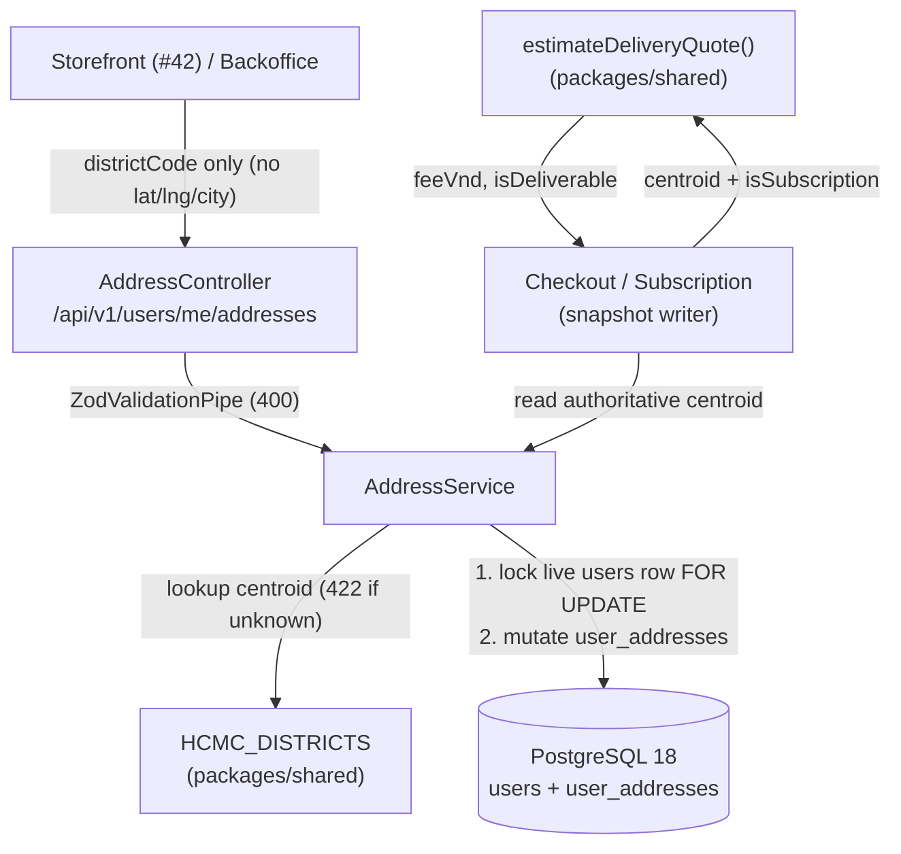
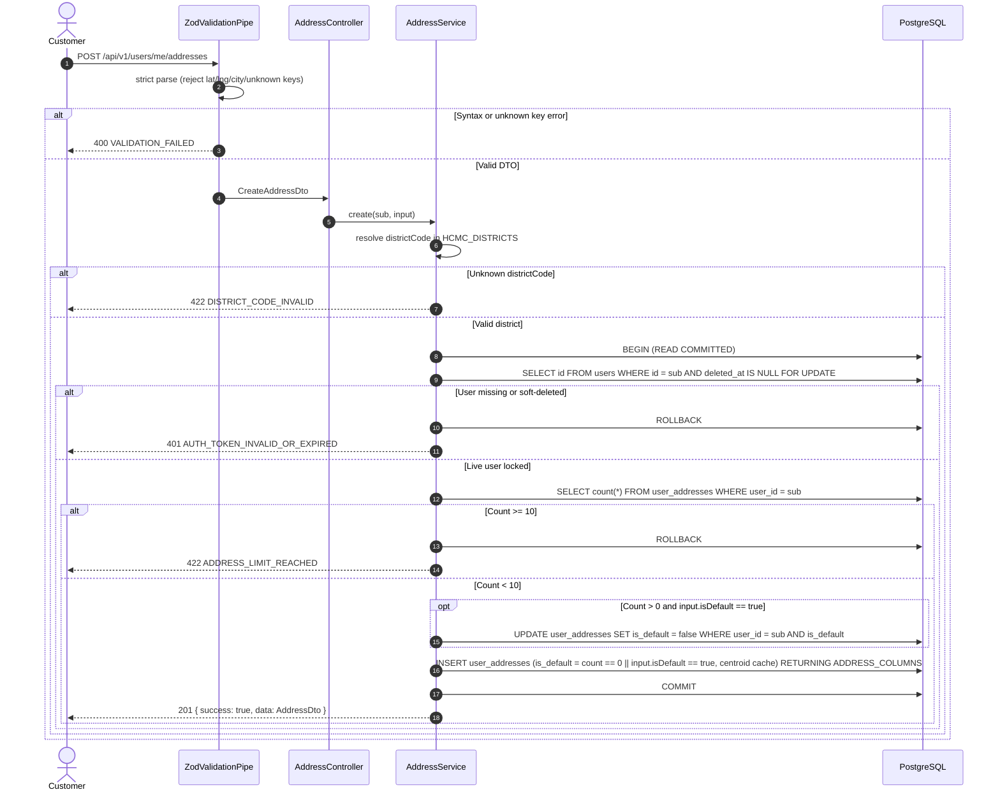
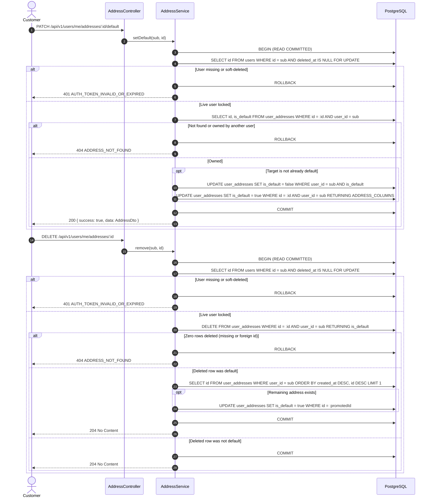
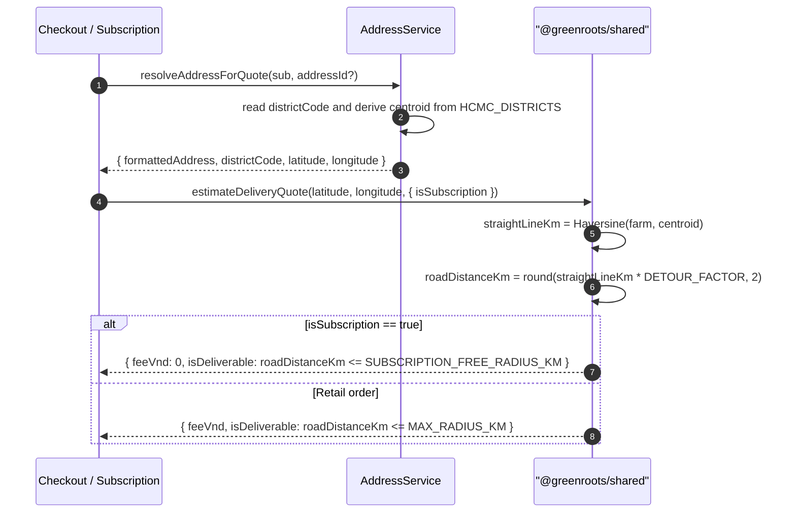

# Address Book & Delivery Fee Formal Specification

## Overview & Context

This document specifies the customer address book and the delivery-fee trust boundary introduced by #76 (split from #18, epic #7, storefront consumer #42) and recorded in ADR-0018.

The core problem is coordinate provenance and write concurrency. `user_addresses` currently carries a free-text `district` alongside nullable `latitude` and `longitude`, plus a non-unique `(user_id, is_default)` index. Accepting coordinates from a client would allow fabricating proximity to appear inside `MAX_RADIUS_KM = 25` or to reduce `estimateDeliveryQuote()` fees. Without serialization and a partial unique index, concurrent requests can also breach the 10-address cap or commit multiple default addresses.

Version `1.1.0` corrects five defects identified during design review against the codebase:

1. **Serialization under `READ COMMITTED`**: Replaces unguarded `SELECT count(*)` and unserialized `setDefault` updates with a parent-row lock (`SELECT id FROM users WHERE id = :sub AND deleted_at IS NULL FOR UPDATE`) so concurrent creates, deletes, and default switches cannot exceed 10 rows or trigger `23505` collisions.
2. **Validation status boundary**: Because `ZodValidationPipe` always throws `400`, request DTOs validate `districtCode` syntax only and `AddressService` validates membership in `HCMC_DISTRICTS` to return `422 DISTRICT_CODE_INVALID`.
3. **REST & DTO closure**: Aligns `DELETE` to `204 No Content` per `docs/standards/api-design-and-error-handling.md` §5, removes `isDefault` from `PATCH /:id`, omits internal cached `latitude`/`longitude` from `AddressDto`, and enforces `:id` UUIDv7 validation.
4. **Live-subject parity**: Matches `ProfileService` (`401 AUTH_TOKEN_INVALID_OR_EXPIRED` when the `users` row is missing or soft-deleted).
5. **Migration & seed accuracy**: Attributes expand/contract to `docs/standards/database-and-migrations.md` §5 (instead of ADR-0003) and aligns `tier3-operational.seeder.ts` (`latitude: "10.72960000"`) with the `quan-7` centroid (`10.73400000`).

### Goals

- Make `districtCode` the single geographic input, validated against `HCMC_DISTRICTS` (`422 DISTRICT_CODE_INVALID`).
- Derive `district`, `city = "TP. Hồ Chí Minh"`, and centroid coordinates on the server; reject `latitude`, `longitude`, `city`, and unknown keys on input (`400 UNRECOGNIZED_KEYS`); omit cached coordinates from customer `AddressDto` responses.
- Guarantee exactly one default address per user with saved addresses via a `users` `FOR UPDATE` lock root + unique partial index on `(user_id) WHERE is_default`.
- Cap each user at 10 addresses (`422 ADDRESS_LIMIT_REACHED`), enforce `404 ADDRESS_NOT_FOUND` on foreign/missing UUIDs, and verify live subject (`401`).
- Preserve historical order and subscription addresses through immutable snapshots after hard delete.

### Non-Goals

- Street-level geocoding, map pickers, or third-party address validation.
- Client-editable coordinates or delivery-fee overrides.
- Admin address management or cross-user address access.
- Soft delete for `user_addresses` (per ADR-0003, only five tables use `deleted_at`).
- Multi-city or multi-province delivery outside Ho Chi Minh City.
- Subscription-specific address snapshot mutations (owned by the subscription issue).

## Architecture



Symbols and their locations:

- `USERS_ROUTES` in `apps/api/src/modules/users/users.routes.ts` defines frozen address route constants alongside `ME`.
- `AddressController` in `apps/api/src/modules/users/address.controller.ts` exposes `GET/POST /api/v1/users/me/addresses`, `PATCH/DELETE /api/v1/users/me/addresses/:id`, and `PATCH /api/v1/users/me/addresses/:id/default` behind `@ApiAuth()`.
- `AddressService` in `apps/api/src/modules/users/address.service.ts` owns `ADDRESS_COLUMNS`, `HCMC_DISTRICTS` resolution, `users` `FOR UPDATE` transaction serialization, the 10-row cap, default promotion, and ownership isolation.
- `CreateAddressDto`, `UpdateAddressDto`, and `AddressDto` in `apps/api/src/modules/users/dto/` are Zod-backed DTOs per ADR-0011.
- `UsersModule` in `apps/api/src/modules/users/users.module.ts` registers `AddressController` and exports `AddressService` for future Checkout and Subscription modules.
- `userAddresses` in `apps/api/src/database/schemas/user.schema.ts` adds `districtCode` (`varchar(50)` not null) and replaces `user_addresses_default_idx` with unique partial index `user_addresses_default_uidx`.
- `HCMC_DISTRICTS` and `estimateDeliveryQuote()` in `packages/shared/src/haversine.ts` serve as the geographic and pricing Single Source of Truth.
- `API_ERROR_CODES` and `API_ERROR_DICTIONARY` in `packages/shared/src/error-dictionary.ts` register `ADDRESS_NOT_FOUND`, `ADDRESS_LIMIT_REACHED`, and `DISTRICT_CODE_INVALID`.

## Operational Flow

### 1. Create Address



### 2. List & Update Address

```mermaid
sequenceDiagram
    autonumber
    actor Customer
    participant Ctrl as AddressController
    participant Svc as AddressService
    participant DB as PostgreSQL

    Customer->>Ctrl: GET /api/v1/users/me/addresses
    Ctrl->>Svc: list(sub)
    Svc->>DB: SELECT id FROM users WHERE id = sub AND deleted_at IS NULL
    alt User missing or soft-deleted
        Svc-->>Customer: 401 AUTH_TOKEN_INVALID_OR_EXPIRED
    else Live user
        Svc->>DB: SELECT ADDRESS_COLUMNS FROM user_addresses WHERE user_id = sub ORDER BY is_default DESC, created_at DESC
        Svc-->>Customer: 200 { success: true, data: AddressDto[] }
    end

    Customer->>Ctrl: PATCH /api/v1/users/me/addresses/:id
    Note over Ctrl: :id validated via zUuidV7() -> 400 INVALID_UUID; body forbids isDefault/city/lat/lng
    Ctrl->>Svc: update(sub, id, patch)
    opt patch.districtCode provided
        Svc->>Svc: resolve districtCode in HCMC_DISTRICTS (422 DISTRICT_CODE_INVALID if unknown)
    end
    Svc->>DB: BEGIN (READ COMMITTED)
    Svc->>DB: SELECT id FROM users WHERE id = sub AND deleted_at IS NULL FOR UPDATE
    alt User missing or soft-deleted
        Svc->>DB: ROLLBACK
        Svc-->>Customer: 401 AUTH_TOKEN_INVALID_OR_EXPIRED
    else Live user locked
        Svc->>DB: UPDATE user_addresses SET provided fields (+ recomputed district/lat/lng) WHERE id = :id AND user_id = sub RETURNING ADDRESS_COLUMNS
        alt Zero rows updated (missing or foreign id)
            Svc->>DB: ROLLBACK
            Svc-->>Customer: 404 ADDRESS_NOT_FOUND
        else Updated
            Svc->>DB: COMMIT
            Svc-->>Customer: 200 { success: true, data: AddressDto }
        end
    end
```

### 3. Set Default & Delete Address



### 4. Delivery Quote (Downstream Consumer Flow)



The fee formula is owned by `estimateDeliveryQuote()` and `BUSINESS_RULES.SHIPPING` in `@greenroots/shared`; this spec does not duplicate numeric constants beyond referencing those symbols.

## API Contract

### Endpoints

All endpoints require `@ApiAuth(UserRole.CUSTOMER)` (strictly `UserRole.CUSTOMER`, acting on JWT `sub`; non-customer roles `guest`, `farm_staff`, `sales`, `admin`, and `super_admin` receive `403 FORBIDDEN`, with `@ApiUnauthorizedResponseRfc9457()` and `@ApiForbiddenResponseRfc9457()` provided by `@ApiAuth`) and inherit class-level `@ApiBadRequestResponseRfc9457()` and `@ApiInternalServerErrorResponseRfc9457()`:

| Method & Path                                  | Success                              | Additional RFC 9457 Errors                                          | Notes                                                                        |
| :--------------------------------------------- | :----------------------------------- | :------------------------------------------------------------------ | :--------------------------------------------------------------------------- |
| `GET /api/v1/users/me/addresses`               | `200` `ApiResponseDto<AddressDto[]>` | `401`                                                               | Ordered `isDefault DESC, createdAt DESC`; max 10 items, no `meta` pagination |
| `POST /api/v1/users/me/addresses`              | `201` `ApiResponseDto<AddressDto>`   | `401`, `422` (`DISTRICT_CODE_INVALID`, `ADDRESS_LIMIT_REACHED`)     | First address forces `isDefault = true`                                      |
| `PATCH /api/v1/users/me/addresses/:id`         | `200` `ApiResponseDto<AddressDto>`   | `401`, `404` (`ADDRESS_NOT_FOUND`), `422` (`DISTRICT_CODE_INVALID`) | Updates content fields only; requires `>= 1` field                           |
| `PATCH /api/v1/users/me/addresses/:id/default` | `200` `ApiResponseDto<AddressDto>`   | `401`, `404` (`ADDRESS_NOT_FOUND`)                                  | Sets target as sole default in one transaction                               |
| `DELETE /api/v1/users/me/addresses/:id`        | `204` empty body                     | `401`, `404` (`ADDRESS_NOT_FOUND`)                                  | Hard delete; promotes newest remaining row if default                        |

### DTOs & Projections

`AddressDto` closed projection (`ADDRESS_COLUMNS`, omitting `userId`, `latitude`, and `longitude`):

| Field           | Type                         | Source                               | Writable                          |
| :-------------- | :--------------------------- | :----------------------------------- | :-------------------------------- |
| `id`            | UUIDv7 string                | `userAddresses.id`                   | No                                |
| `receiverName`  | string, 1–100                | `userAddresses.receiverName`         | Create / Update                   |
| `phoneNumber`   | 10-digit VN phone            | `userAddresses.phoneNumber`          | Create / Update                   |
| `streetAddress` | string, 1–500                | `userAddresses.streetAddress`        | Create / Update                   |
| `districtCode`  | string                       | `userAddresses.districtCode`         | Create / Update                   |
| `district`      | string                       | Server-derived from `HCMC_DISTRICTS` | Derived                           |
| `city`          | string (`"TP. Hồ Chí Minh"`) | Fixed server-side                    | Derived                           |
| `isDefault`     | boolean                      | `userAddresses.isDefault`            | Create / `PATCH .../default` only |
| `createdAt`     | ISO-8601 string              | `userAddresses.createdAt`            | No                                |
| `updatedAt`     | ISO-8601 string              | `userAddresses.updatedAt`            | No                                |

Input validation rules:

- `CreateAddressDto`: `.strict()` object with `receiverName` (`zSanitizedString({ min: 1, max: 100 })`), `phoneNumber` (`zPhoneNumber()`), `streetAddress` (`zSanitizedString({ min: 1, max: 500 })`), `districtCode` (`z.string().trim().min(1).max(50)`), and optional `isDefault` (`z.boolean().optional()`).
- `UpdateAddressDto`: `.strict()` partial object of `{ receiverName, phoneNumber, streetAddress, districtCode }` with refinement requiring at least one defined field (`MESSAGES.VALIDATION.AT_LEAST_ONE_ADDRESS_FIELD`). Forbids `isDefault`, `city`, `latitude`, `longitude`, and any unknown field (`400 UNRECOGNIZED_KEYS`).
- `:id` route parameter: validated via `ZodValidationPipe(zUuidV7())` so malformed IDs return `400 VALIDATION_FAILED` (`INVALID_UUID`) instead of reaching PostgreSQL (`22P02`).

### Shared Error Codes (`@greenroots/shared`)

Register in `API_ERROR_CODES` and `API_ERROR_DICTIONARY`:

- `ADDRESS_NOT_FOUND` (`404`): customer-facing Vietnamese copy in `API_ERROR_DICTIONARY`, English developer detail in `MESSAGES.ADDRESS.NOT_FOUND`.
- `ADDRESS_LIMIT_REACHED` (`422`): customer-facing Vietnamese copy referencing the 10-address maximum, English developer detail in `MESSAGES.ADDRESS.LIMIT_REACHED`.
- `DISTRICT_CODE_INVALID` (`422`): customer-facing Vietnamese copy stating the district is outside the Ho Chi Minh City delivery table, English developer detail in `MESSAGES.ADDRESS.DISTRICT_CODE_INVALID`.

### Schema & Migration (`database-and-migrations.md` §5)

Because no production traffic or `AddressController` exists yet, one forward-only Drizzle migration executes the expand-backfill-constrain sequence cleanly (correcting Issue #76's citation of ADR-0003, which governs soft-delete scope rather than expand/contract):

1. **Expand**: `ALTER TABLE "user_addresses" ADD COLUMN "district_code" varchar(50);` (nullable).
2. **Backfill**: `UPDATE "user_addresses" SET "district_code" = 'quan-7', "latitude" = '10.73400000', "longitude" = '106.72180000' WHERE "district" = 'Quận 7';` (matching `HCMC_DISTRICTS` `quan-7` centroid).
3. **Constrain**: `ALTER TABLE "user_addresses" ALTER COLUMN "district_code" SET NOT NULL;` (fails safely if any unmapped row exists).
4. **Index Swap**: `DROP INDEX "user_addresses_default_idx";` and `CREATE UNIQUE INDEX "user_addresses_default_uidx" ON "user_addresses" ("user_id") WHERE "is_default" = true;`

Update `tier3-operational.seeder.ts` to seed `districtCode: "quan-7"` and `latitude: "10.73400000"`, `longitude: "106.72180000"` so fresh seeds match `HCMC_DISTRICTS`.

## Security & Reliability

- **Trust boundary & input sanitization**: `receiverName` and `streetAddress` pass through `zSanitizedString`, stripping HTML and collapsing whitespace; `phoneNumber` enforces `VN_PHONE_REGEX`. Unknown fields (`latitude`, `longitude`, `city`, `userId`, `id`, and `isDefault` on `PATCH /:id`) fail at `ZodValidationPipe` with `400 UNRECOGNIZED_KEYS`.
- **Ownership & anti-enumeration**: Every address query scopes by `userId = sub` from the verified JWT. A missing or foreign UUIDv7 returns `404 ADDRESS_NOT_FOUND` (never `403`) so address IDs cannot be enumerated across accounts.
- **Live subject check**: Every read and write checks `users.id = sub AND users.deleted_at IS NULL`; missing or soft-deleted subjects receive `401 AUTH_TOKEN_INVALID_OR_EXPIRED`. Account suspension follows ADR-0016 (enforced at login/refresh and via Redis revocation on suspension).
- **Concurrency & lock ordering**: Every mutation begins by locking the parent row (`SELECT id FROM users WHERE id = sub AND deleted_at IS NULL FOR UPDATE`) under `READ COMMITTED`, establishing strict lock order `users -> user_addresses` per `docs/standards/concurrency-and-locking.md` §2. This serializes concurrent creates (eliminating the 11-row phantom-insert race and first-address `23505`), concurrent `setDefault` calls, and concurrent `delete` promotions. The unique partial index `user_addresses_default_uidx` remains the final database authority.
- **Fail-closed semantics**: An unknown `districtCode` or invalid centroid lookup fails closed with `422 DISTRICT_CODE_INVALID` before any lock or write; `AddressService` never falls back to client coordinates or old `district` strings.
- **PII & logging**: `receiverName`, `phoneNumber`, and `streetAddress` are PII per `docs/standards/security-and-cryptography.md` §7 and are never logged by `AddressService`.
- **Rate limiting & abuse**: Routes inherit `CustomThrottlerGuard` (`default` tier: `100 req / 60s`), and storage per user is hard-bounded to 10 rows.
- **Deletion & snapshot safety**: Hard delete with `ON DELETE CASCADE` from `users`. `subscriptions.user_address_id` uses `ON DELETE SET NULL` while `orders.shippingAddress` and `subscriptions.shippingAddress` preserve immutable text snapshots.
- **Contract propagation**: `bun run types:sync` updates `apps/api/openapi.json`, client type schemas, and `apps/api/test/generated/api-schema.d.ts`.

## Domain Invariant Taxonomy

| Invariant    | Name                | Formal Statement                                                                                   | Enforcement Seam                                                              | Verification Test                                                                                   |
| :----------- | :------------------ | :------------------------------------------------------------------------------------------------- | :---------------------------------------------------------------------------- | :-------------------------------------------------------------------------------------------------- |
| `INV-ADDR-1` | Distance Provenance | For every quote $q$, destination equals centroid of $d$ where $d \in \text{HCMC\_DISTRICTS}$       | `AddressService` derives centroid; DTOs reject `latitude`/`longitude`/`city`  | Rejects coordinate fields with `400`; quote uses centroid                                           |
| `INV-ADDR-2` | Single Default      | User $u$ has exactly $1$ default address iff $\lvert\text{Addresses}(u)\rvert > 0$                 | `users` `FOR UPDATE` lock + unique partial index `(user_id) WHERE is_default` | Concurrent default requests converge with zero `23505` errors                                       |
| `INV-ADDR-3` | Address Cap         | For every user $u$, $\lvert\text{Addresses}(u)\rvert \le 10$                                       | `users` `FOR UPDATE` lock + `count(*)` check in `AddressService.create`       | 11th create and concurrent creates at 9 never exceed 10                                             |
| `INV-ADDR-4` | Ownership Isolation | Every read or mutation on address $a$ by user $u$ requires $a.\text{userId} = u$                   | All queries scoped by `userId = sub`; foreign `:id` returns `404`             | Cross-user `PATCH`, `PATCH .../default`, `DELETE` return `404`                                      |
| `INV-ADDR-5` | Default Continuity  | Deleting a default address when others remain promotes newest remaining at commit                  | Single tx under `users` lock: `DELETE ... RETURNING` then promote newest      | Deleting default promotes newest remaining row                                                      |
| `INV-ADDR-6` | District Cache Sync | Changing `districtCode` to $d'$ updates `district`, `latitude`, and `longitude` to $d'$            | `AddressService.update` resolves `HCMC_DISTRICTS` and rewrites all 3 columns  | Updating `districtCode` updates `district` and cached centroid                                      |
| `INV-ADDR-7` | Live Subject        | Missing or soft-deleted `users` rows are rejected with `401` on every endpoint                     | `users.deletedAt IS NULL` check (plus `FOR UPDATE` on mutations)              | Soft-deleted user with valid JWT receives `401`                                                     |
| `INV-ADDR-8` | Projection Closure  | `AddressDto` exposes only `ADDRESS_COLUMNS` and never exposes `userId`, `latitude`, or `longitude` | Closed `ADDRESS_COLUMNS` projection in `AddressService`                       | Response keys match contract list exactly                                                           |
| `INV-ADDR-9` | Role Isolation      | Only `UserRole.CUSTOMER` can access `/api/v1/users/me/addresses`                                   | `@ApiAuth(UserRole.CUSTOMER)` + `RolesGuard`                                  | Non-customer roles (`guest`, `farm_staff`, `sales`, `admin`, `super_admin`) receive `403 FORBIDDEN` |

### Edge Cases (`EDGE-1..15`)

| ID        | Case                                                                                                  | Expected Behaviour                                                              |
| :-------- | :---------------------------------------------------------------------------------------------------- | :------------------------------------------------------------------------------ |
| `EDGE-1`  | Create payload includes `latitude`, `longitude`, or `city`                                            | `400 VALIDATION_FAILED` with `UNRECOGNIZED_KEYS`                                |
| `EDGE-2`  | Create/Update with unknown `districtCode` (e.g. `"quan-99"`)                                          | `422 DISTRICT_CODE_INVALID`                                                     |
| `EDGE-3`  | Create/Update with empty or whitespace-only `districtCode`                                            | `400 VALIDATION_FAILED` (`REQUIRED`)                                            |
| `EDGE-4`  | `PATCH /:id` with `{}` (no fields)                                                                    | `400 VALIDATION_FAILED` (`CUSTOM_VALIDATION_ERROR`)                             |
| `EDGE-5`  | `PATCH /:id` includes `isDefault: false` or `isDefault: true`                                         | `400 VALIDATION_FAILED` (`UNRECOGNIZED_KEYS`)                                   |
| `EDGE-6`  | Malformed `:id` (non-UUIDv7 string or UUIDv4)                                                         | `400 VALIDATION_FAILED` (`INVALID_UUID`)                                        |
| `EDGE-7`  | Valid UUIDv7 `:id` owned by another user or non-existent                                              | `404 ADDRESS_NOT_FOUND`                                                         |
| `EDGE-8`  | First address created with `isDefault: false` or omitted                                              | Created with `isDefault = true` (`INV-ADDR-2`)                                  |
| `EDGE-9`  | 10th address created, then 11th address attempted                                                     | 10th succeeds (`201`); 11th returns `422 ADDRESS_LIMIT_REACHED`, count stays 10 |
| `EDGE-10` | `PATCH /:id/default` on address that is already default                                               | Idempotent `200` returning the address unchanged                                |
| `EDGE-11` | Delete the sole remaining address (which is default)                                                  | `204 No Content`; 0 rows remain (`INV-ADDR-2` satisfied vacuously)              |
| `EDGE-12` | Delete the default address when 2+ addresses remain                                                   | `204 No Content`; newest remaining (`created_at DESC, id DESC`) becomes default |
| `EDGE-13` | HTML tags in `receiverName` or `streetAddress` (e.g. `<b>Home</b>`)                                   | Sanitized and trimmed before persistence (`Home`)                               |
| `EDGE-14` | Soft-deleted `users` row calling any address endpoint with valid JWT                                  | `401 AUTH_TOKEN_INVALID_OR_EXPIRED`                                             |
| `EDGE-15` | Non-customer role (`farm_staff`, `sales`, `admin`, `super_admin`, `guest`) calls any address endpoint | `403 FORBIDDEN` from `RolesGuard`                                               |

### Concurrency & Adversarial Matrix (`ADV-1..5`)

| ID      | Scenario                                                                                | Expected Behaviour                                                                                                                                                    |
| :------ | :-------------------------------------------------------------------------------------- | :-------------------------------------------------------------------------------------------------------------------------------------------------------------------- |
| `ADV-1` | Two concurrent `POST` requests when user has 0 addresses                                | Serialized via `users FOR UPDATE`; first gets `isDefault = true`, second gets `isDefault = false` (or replaces default if requested), both `201`, zero `23505` errors |
| `ADV-2` | Two concurrent `POST` requests when user has 9 addresses                                | Serialized via `users FOR UPDATE`; one succeeds (`201`, total 10), one fails (`422 ADDRESS_LIMIT_REACHED`), total never exceeds 10                                    |
| `ADV-3` | Two concurrent `PATCH .../default` requests for addresses A and B                       | Serialized via `users FOR UPDATE`; both return `200`, final DB state has exactly 1 default (later commit)                                                             |
| `ADV-4` | Concurrent `DELETE` of default address + `PATCH .../default` on another address         | Serialized via `users FOR UPDATE`; `INV-ADDR-2` holds regardless of commit order                                                                                      |
| `ADV-5` | Client attempts `latitude`/`longitude` injection or `userId` override on `POST`/`PATCH` | Rejected at `ZodValidationPipe` (`400 UNRECOGNIZED_KEYS`) before service execution                                                                                    |

## Test Matrix

Integration tests in `apps/api/test/integration/users.spec.ts` (or `addresses.spec.ts`) using `createAuthenticatedUser()` and typed contracts from `apps/api/test/generated/api-schema.d.ts`:

- `GET /api/v1/users/me/addresses`: returns `[]` for new user, returns ordered list (`isDefault DESC, createdAt DESC`) with exact `AddressDto` keys (no `latitude`, `longitude`, `userId`), returns `401` unauthenticated or soft-deleted.
- `POST /api/v1/users/me/addresses`: first address auto-defaults (`isDefault: true`), subsequent address with `isDefault: true` flips previous default, rejects `latitude`/`longitude`/`city` (`400`), rejects unknown `districtCode` (`422 DISTRICT_CODE_INVALID`), rejects 11th address (`422 ADDRESS_LIMIT_REACHED`), sanitizes HTML fields, verifies DB `latitude`/`longitude` match `HCMC_DISTRICTS` centroid.
- `PATCH /api/v1/users/me/addresses/:id`: updates partial fields, recomputes `district` and cached centroid when `districtCode` changes, rejects empty body and `isDefault` (`400`), rejects invalid `:id` (`400`), returns `404` on foreign/missing UUIDv7.
- `PATCH /api/v1/users/me/addresses/:id/default`: switches default atomically, idempotent when already default, returns `404` on foreign/missing UUIDv7.
- `DELETE /api/v1/users/me/addresses/:id`: returns `204`, hard-deletes row, promotes newest remaining address when deleting default, leaves `orders.shippingAddress` / `subscriptions.shippingAddress` snapshots intact, returns `404` on foreign/missing UUIDv7.
- Concurrency (`Promise.all`): concurrent first creates, concurrent 10th/11th creates at count=9, and concurrent `PATCH .../default` requests preserve `INV-ADDR-2` and `INV-ADDR-3` with zero `500` or `409` errors.
- Contract sync: `bun run types:sync` executed and generated OpenAPI/schema diffs verified.

## Risks & Rollback

- **Per-user lock contention**: `SELECT ... FOR UPDATE` on `users` serializes concurrent address mutations for the same account. Acceptable because an account holds at most 10 addresses and mutations are infrequent user actions. Future features locking both `users` and `user_addresses` must lock `users` first.
- **Unmapped existing rows during migration**: If a local developer database contains manual non-seed `user_addresses` rows whose `district` is not `"Quận 7"`, `SET NOT NULL` will abort the migration safely before corrupting data; resetting or seeding fixes local state.
- **Rollback**: Revert the application PR, re-run `bun run types:sync`, and if needed execute a compensating forward migration dropping `district_code` and `user_addresses_default_uidx` and restoring `user_addresses_default_idx`.
