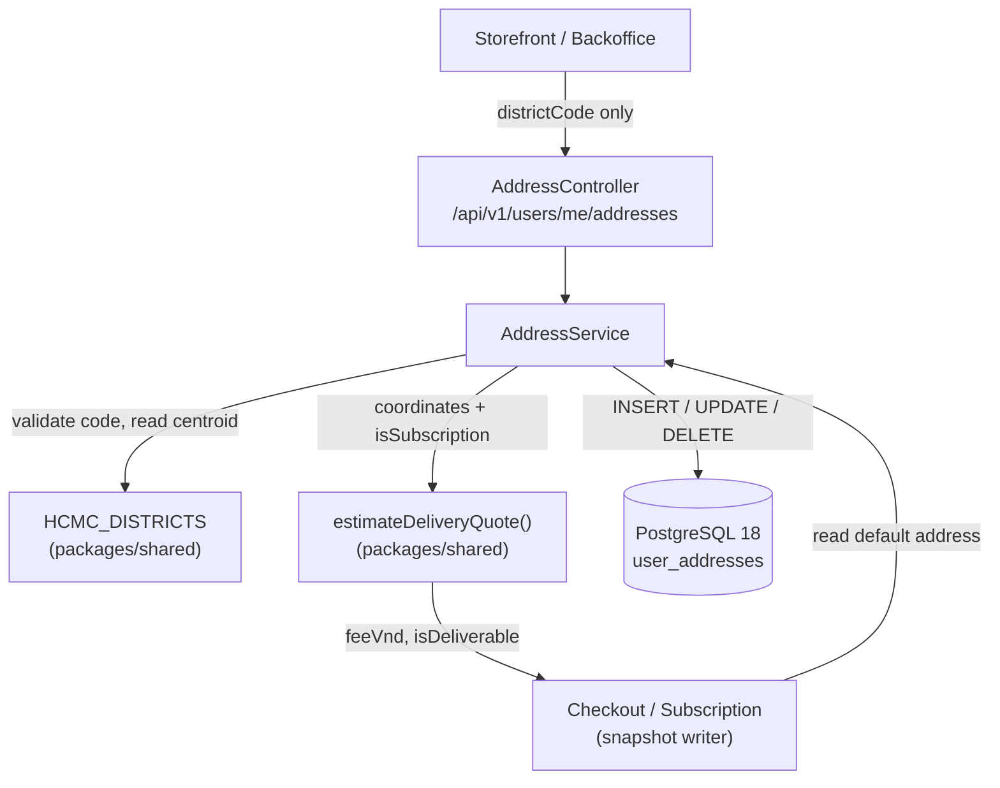
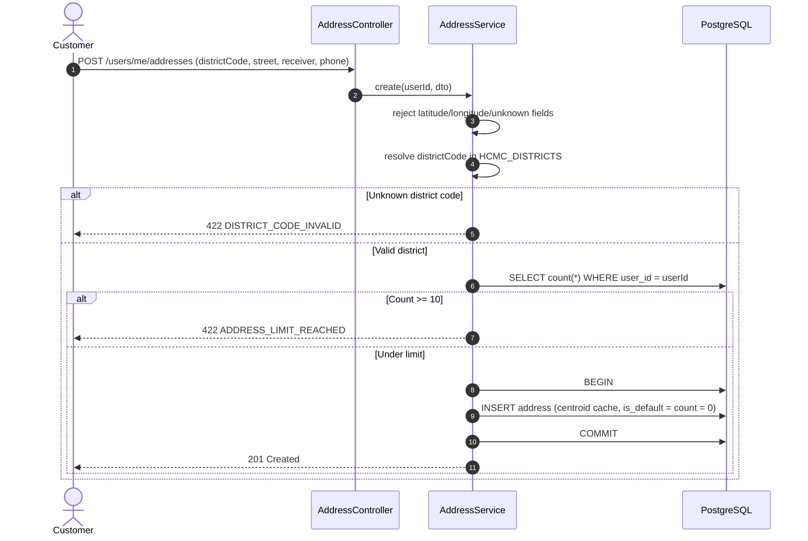
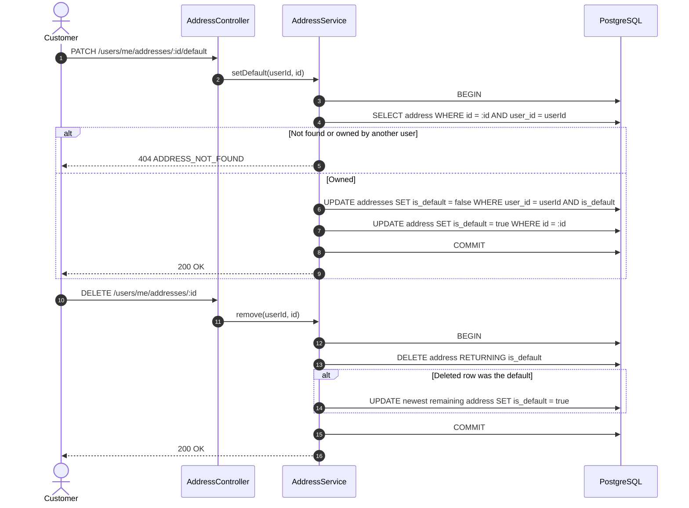

# Address Book & Delivery Fee Formal Specification

## Overview & Context

This document specifies the customer address book and the delivery-fee trust boundary introduced by #76 (split from #18) and recorded in ADR-0018.

The core problem is provenance. Before this spec, `user_addresses` accepted `latitude` and `longitude` from the client, and `estimateDeliveryQuote()` priced delivery from those values. A client could therefore fabricate a coordinate to appear inside the delivery radius or to lower the fee. The address book also had no per-user cap and no database guarantee of a single default address.

### Goals

- Make `district_code` the single geographic input, validated against `HCMC_DISTRICTS`.
- Derive and cache coordinates on the server; never accept them from a request.
- Guarantee exactly one default address per user through a database constraint.
- Bound the address book at 10 rows per user and prevent id enumeration.
- Preserve historical order and subscription addresses through immutable snapshots after hard delete.

### Non-Goals

- Street-level geocoding, map pickers, or third-party address validation.
- Client-editable coordinates or fee overrides.
- Admin access to customer addresses.
- Soft delete for addresses.
- Multi-city or multi-country delivery.

## Architecture



- `AddressController` in `apps/api/src/modules/users` exposes `GET/POST /api/v1/users/me/addresses`, `PATCH/DELETE /api/v1/users/me/addresses/:id`, and `PATCH /api/v1/users/me/addresses/:id/default`.
- `AddressService` owns validation, coordinate derivation, the 10-row cap, default promotion, and ownership checks.
- `HCMC_DISTRICTS` in `packages/shared/src/haversine.ts` is the geographic source of truth: 24 districts, each with `code`, display name, latitude, and longitude.
- `user_addresses` gains `district_code`; `latitude` and `longitude` become a server-derived cache.

## Operational Flow

### 1. Create Address



### 2. Set Default and Delete Default



### 3. Delivery Quote

```mermaid
sequenceDiagram
    autonumber
    participant Order as Checkout / Subscription
    participant Svc as AddressService
    participant Shared as packages/shared

    Order->>Svc: resolve default address for userId
    Svc-->>Order: { districtCode, latitude, longitude }
    Order->>Shared: estimateDeliveryQuote(latitude, longitude, { isSubscription })
    Shared->>Shared: straightKm = Haversine(farm, centroid)
    Shared->>Shared: roadKm = round(straightKm * 1.3, 2)
    alt Subscription
        Shared-->>Order: feeVnd = 0, deliverable = roadKm <= 20
    else Retail
        Shared-->>Order: extraKm = max(0, ceil(roadKm - 3)); feeVnd = 15000 + extraKm * 5000; deliverable = roadKm <= 25
    end
```

The fee formula is owned by `estimateDeliveryQuote()`; this spec does not duplicate constants beyond naming them. `BUSINESS_RULES.SHIPPING` remains the numeric source of truth.

## Security & Reliability

- **Input surface**: request DTOs accept `receiverName`, `phoneNumber`, `streetAddress`, `districtCode`, and `isDefault`. `latitude`, `longitude`, `city`, and unknown fields are rejected with `400`.
- **Ownership**: every read and mutation scopes by `user_id` from the JWT `sub`. A foreign id returns `404`, never `403`, so ids cannot be enumerated.
- **Concurrency**: setting a default runs inside one transaction; `INV-ADDR-2` is additionally enforced by a unique partial index on `(user_id) WHERE is_default`. Two concurrent default requests cannot both commit a default.
- **Cap enforcement**: the 10-row check and the insert share a transaction; the count is re-read before insert. A concurrent create that loses the race rolls back with `422`.
- **Failure behaviour**: an unknown district or a missing centroid row fails closed with `422`; the service never falls back to client coordinates.
- **Rate limiting**: address mutations use the authenticated bucket; bulk creation is naturally bounded by the 10-row cap.
- **Deletion**: hard delete with `ON DELETE CASCADE` from `users`. Order and subscription rows keep their own `shippingAddress` text snapshot, so history does not depend on the address row.

## Domain Invariant Taxonomy

| Invariant    | Name                  | Formal Statement                                                                                                             | Enforcement Seam                                                         | Verification Test                                               |
| :----------- | :-------------------- | :--------------------------------------------------------------------------------------------------------------------------- | :----------------------------------------------------------------------- | :-------------------------------------------------------------- |
| `INV-ADDR-1` | Distance Provenance   | $\forall q \in \text{Quotes}: \text{dest}(q) = \text{centroid}(d) \land d \in \text{HCMC\_DISTRICTS}$                        | `AddressService` derives coordinates; DTOs reject `latitude`/`longitude` | Address spec -> coordinate fields rejected; quote uses centroid |
| `INV-ADDR-2` | Single Default        | $\forall u: \lvert\{a \in \text{Addresses}(u) : a.\text{isDefault}\}\rvert = 1 \iff \lvert\text{Addresses}(u)\rvert > 0$     | Unique partial index `(user_id) WHERE is_default` + transaction          | Two concurrent default requests -> one default                  |
| `INV-ADDR-3` | Address Cap           | $\forall u: \lvert\text{Addresses}(u)\rvert \le 10$                                                                          | `AddressService.create` count check                                      | Eleventh create -> `422 ADDRESS_LIMIT_REACHED`                  |
| `INV-ADDR-4` | Ownership Isolation   | $\text{Read}(u, a) \lor \text{Mutate}(u, a) \implies a.\text{userId} = u$                                                    | Every query scoped by `user_id`; foreign id -> `404`                     | Cross-user read/update/delete -> `404`                          |
| `INV-ADDR-5` | Default Continuity    | $\text{Delete}(a) \land a.\text{isDefault} \implies \exists a' \in \text{Addresses}(u): a'.\text{isDefault}$ at commit       | Transaction: delete then promote newest remaining                        | Delete default -> newest remaining becomes default              |
| `INV-ADDR-6` | District Immutability | $\text{Update}(a) \land a.\text{districtCode} \ne d' \implies (a.\text{latitude}, a.\text{longitude}) = \text{centroid}(d')$ | `AddressService.update` recomputes cache                                 | Update district -> coordinates change to new centroid           |
