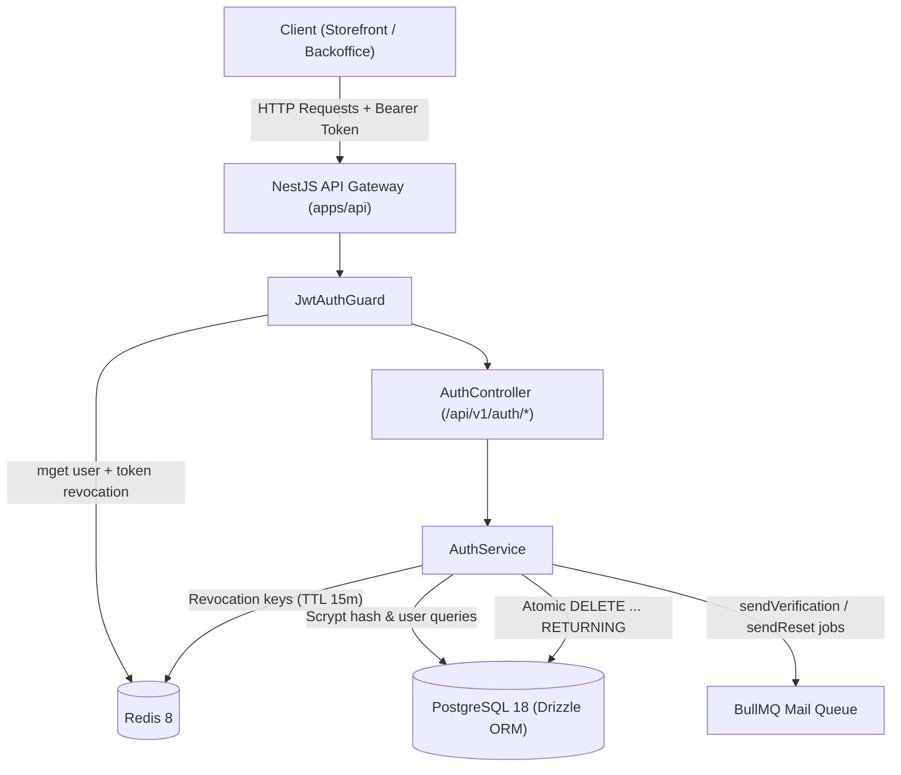
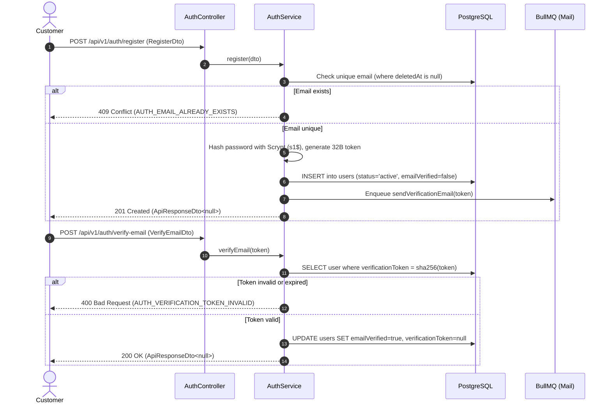
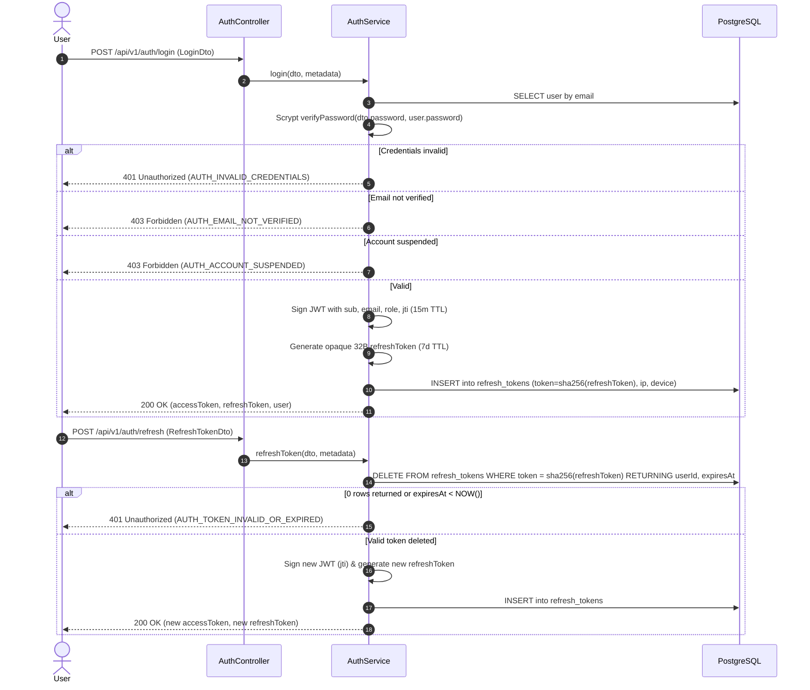
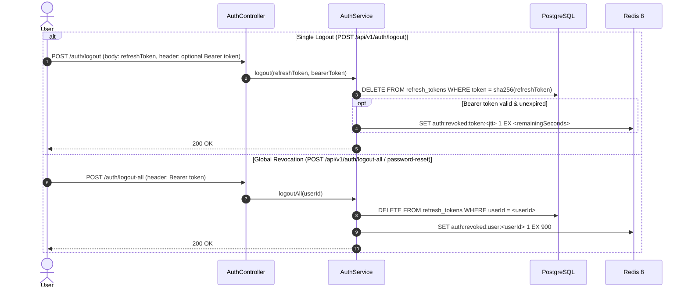

# Authentication & Session Management System Design

## Overview & Context

This document specifies the technical design, lifecycle invariants, and failure boundaries for the GreenRoots Farm authentication and session management subsystem (covering UC-01 through UC-04, Issue #17).

### Goals

- Secure authentication using OWASP-compliant `scrypt` (`s1$`) password hashing and constant-time equality comparisons.
- Single-use Refresh Token rotation via atomic `DELETE ... RETURNING` in PostgreSQL, mitigating token leakage and dangling active sessions.
- Hybrid Two-Level Access Token revocation in Redis: token-level blacklist for single-device logout (`auth:revoked:token:<jti>`), and account-level revocation for global security events (`auth:revoked:user:<userId>`).
- Asynchronous verification and password recovery emails dispatched through BullMQ (`mail` queue) without blocking HTTP threads.
- Comprehensive anti-enumeration defenses across public auth endpoints with strict rate limiting.

### Non-Goals

- Social OAuth logins (Google, Apple, Zalo) — deferred to customer identity expansion.
- Client-side cookie setting in NestJS — client runtimes (Next.js Storefront and React Backoffice) manage cookie storage and SSR forwarding independently.

## Architecture

## Operational Flow

### 1. User Registration & Email Verification (UC-01)

### 2. Login & Single-Use Refresh Token Rotation (UC-02 & UC-03)

### 3. Two-Level Revocation: Single Logout vs Global Revocation

## Security & Reliability

1. **Password Storage & Comparison**:
   - Parameters: `N=16384, r=8, p=5, keyLen=64, salt=16`.
   - Constant-time verification: `crypto.timingSafeEqual` with length guard.
2. **Two-Level Redis Guard Enforcement**:
   - `JwtAuthGuard` executes `redis.mget("auth:revoked:user:" + sub, "auth:revoked:token:" + jti)` in a single round-trip.
   - Fail-open circuit breaker: When Redis is unreachable or degraded, the guard logs a warning and authorizes the token rather than bringing the entire API down.
3. **Anti-Enumeration Protection**:
   - `POST /auth/forgot-password` always returns `200 OK` regardless of whether the email exists.
   - `POST /auth/resend-verification` returns generic `200 OK` without leaking account status, enforcing a 60-second cooldown per email.
4. **Rate Limiting**:
   - Throttled under named bucket `auth`: `POST /auth/login` (5/min), `POST /auth/refresh` (10/min), `POST /auth/forgot-password` (3/min), `POST /auth/resend-verification` (3/min).

## Domain Invariant Taxonomy

| Invariant    | Name                            | Formal Statement                                                                                                                        | Enforcement Seam                                             | Verification Test                                     |
| :----------- | :------------------------------ | :-------------------------------------------------------------------------------------------------------------------------------------- | :----------------------------------------------------------- | :---------------------------------------------------- |
| `INV-AUTH-1` | Unique Active Email             | $\forall u_1, u_2 \in \text{Users}: u_1.\text{email} = u_2.\text{email} \implies (u_1.\text{deletedAt} \ne \text{null} \lor u_1 = u_2)$ | DB partial index `users_email_uidx` & `AuthService.register` | `auth.spec.ts` -> duplicate register returns 409      |
| `INV-AUTH-2` | Unverified Login Barrier        | $\text{Login}(u) \implies u.\text{emailVerified} = \text{true} \land u.\text{status} \ne \text{suspended}$                              | `AuthService.login`                                          | `auth.spec.ts` -> unverified user login returns 403   |
| `INV-AUTH-3` | Single-Use Refresh Rotation     | $\text{Rotate}(R_1) \implies \text{Deleted}(R_1) \land \text{Issued}(R_2)$ atomically                                                   | `DELETE FROM refresh_tokens RETURNING`                       | `auth.spec.ts` -> replaying rotated token returns 401 |
| `INV-AUTH-4` | Single-Device Session Isolation | $\text{Logout}(d_1) \implies \neg\text{Revoked}(d_2)$ where $d_1 \ne d_2$ belong to user $u$                                            | Token-level Redis key `auth:revoked:token:<jti>`             | `auth.spec.ts` -> device 2 access token remains valid |
| `INV-AUTH-5` | Global Account Revocation       | $\text{LogoutAll}(u) \lor \text{ResetPassword}(u) \implies \forall d \in \text{Sessions}(u): \text{Revoked}(d)$                         | User-level Redis key `auth:revoked:user:<userId>` (15m)      | `auth.spec.ts` -> all device tokens rejected          |
| `INV-AUTH-6` | Anti-Enumeration Silence        | $\text{Status}(\text{ForgotPassword}(e)) = 200 \iff \text{Status}(\text{ForgotPassword}(e')) = 200$                                     | `AuthService.forgotPassword`                                 | `auth.spec.ts` -> non-existent email returns 200      |
