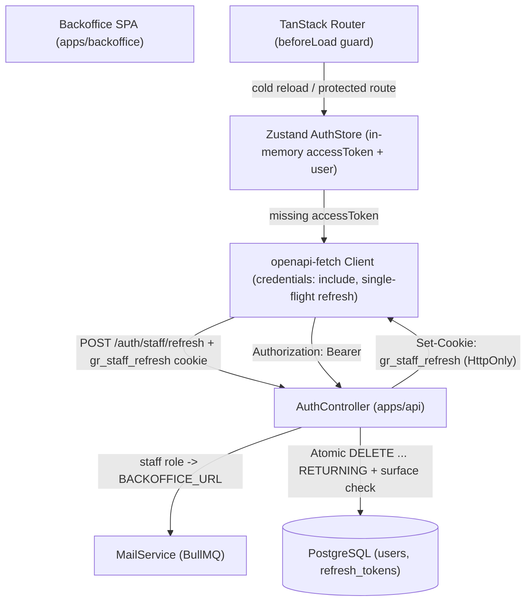
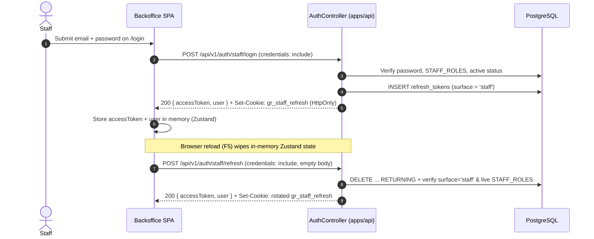
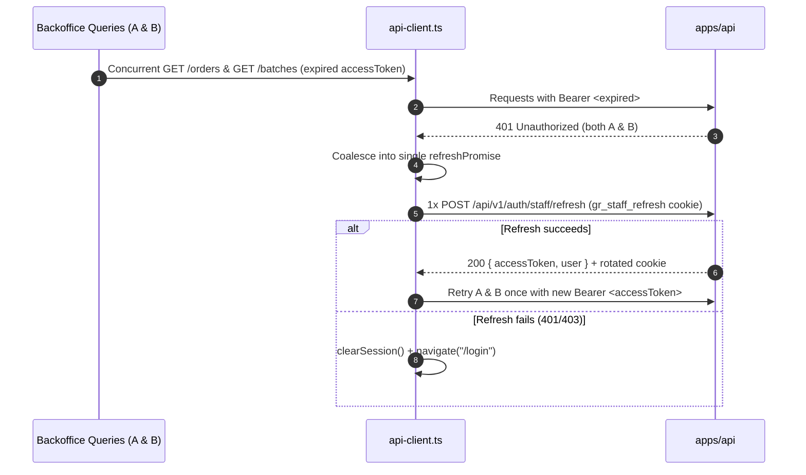

# Backoffice Staff Authentication, Password Recovery & Session Lifecycle Formal Specification

## Overview & Context

This specification defines the end-to-end authentication, password recovery, and session lifecycle contract for GreenRoots Backoffice (`apps/backoffice`) and its supporting API changes (`apps/api`) under Issue `#120` (Epic `#7`), governed by `ADR-0039` and `ADR-0051` (amending `docs/design/auth-and-session-management.md` for the staff surface).

### Goals

- Authenticate Backoffice staff solely via `POST /api/v1/auth/staff/login` and `POST /api/v1/auth/staff/refresh` (`ADR-0039`), with `refreshToken` transported exclusively in an `httpOnly` cookie (`gr_staff_refresh`) and `accessToken` + `user` held strictly in-memory in Zustand (`ADR-0051`).
- Rehydrate staff sessions transparently on browser reload (`F5`) via single-flight `staff/refresh` returning `{ accessToken, user }`, guarded by TanStack Router `beforeLoad` auth checks.
- Wire `/forgot-password` and `/reset-password` in Backoffice and route staff `forgot-password` emails to `env.BACKOFFICE_URL/reset-password?token=...` (`MailService.sendPasswordResetEmail`).
- Handle `401` and `403` responses cleanly: single-flight refresh on `401`, session clear + `/login` redirect only on unrecoverable `401` or auth/surface `403` (`AUTH_SURFACE_FORBIDDEN`, `AUTH_ACCOUNT_SUSPENDED`), preserving sessions on RBAC `403`.
- Remove all demo login/role-switching bypasses (`DEMO_USERS`, `loginDemoRole`, `import.meta.env.DEV` switcher) from `apps/backoffice`.

### Non-Goals

- Changing `/api/v1/auth/customer/*` JSON transport or Storefront BFF (`ADR-0036`).
- `BO-10` staff RBAC management UI (sibling issue).
- Self-service staff registration, phone login, OTP, or Google OAuth (explicitly prohibited by `ADR-0019` and `ADR-0039`).
- Native mobile app transport for `/auth/staff/*` (`ADR-0051`).

## Architecture



### Symbols & Ownership Boundaries

- **`apps/api/src/main.ts`**:
  - Register `cookie-parser` middleware so `req.cookies` is populated for `AuthController`.
- **`apps/api/src/modules/auth/auth.controller.ts` & `auth.service.ts` & `dto/`**:
  - `STAFF_REFRESH_COOKIE = "gr_staff_refresh"` (`HttpOnly`, `SameSite=Lax`, `Path=/api/v1/auth`, `Max-Age=7d`, `Secure` in production).
  - `staffLogin`: sets `gr_staff_refresh` cookie and returns `StaffAuthResponseDto` (`{ accessToken, user }`, omitting `refreshToken` from JSON).
  - `staffRefresh`: validates `Origin` against `CORS_ORIGINS` (when `Origin` header is present), reads `req.cookies.gr_staff_refresh` (empty body), rotates token via `AuthService.refreshToken(token, AuthSurface.STAFF, metadata)`, sets rotated `gr_staff_refresh` cookie, and returns `StaffAuthResponseDto` (`{ accessToken, user }`).
  - `logout`: accepts optional `refreshToken` in body (`LogoutDto`) or falls back to `req.cookies.gr_staff_refresh` (with `Origin` check when using cookie), revokes session if token is present, and always clears `gr_staff_refresh`.
  - `forgotPassword`: queries `user.role` and passes `isStaff: STAFF_ROLES.includes(user.role)` to `MailService.sendPasswordResetEmail`.
- **`apps/api/src/modules/mail/mail.service.ts`**:
  - `sendPasswordResetEmail(to, fullName, token, isStaff = false)`: builds `resetUrl` using `env.BACKOFFICE_URL` when `isStaff` is `true`, else `env.STOREFRONT_URL`.
- **`apps/backoffice/src/stores/auth.store.ts`**:
  - Remove `DEMO_USERS` and `loginDemoRole`. Keep `accessToken`, `user`, `setSession`, `clearSession` (plus `logout()` action calling `POST /api/v1/auth/logout`).
- **`apps/backoffice/src/lib/api-client.ts`**:
  - Configure `createClient<paths>({ baseUrl, credentials: "include" })`.
  - Attach `Authorization: Bearer <accessToken>` on outgoing requests.
  - Implement `refreshStaffSession()` with a shared in-flight promise (`refreshPromise`) so concurrent `401` responses or cold-reload hydration coalesce into a single `POST /api/v1/auth/staff/refresh` call (`ADR-0015`).
  - On `401` (excluding `/auth/staff/login`, `/auth/staff/refresh`, `/auth/logout`): attempt one `refreshStaffSession()` and retry the original request once; if refresh fails, clear session and navigate to `/login` without loops.
  - On `403`: inspect RFC 9457 `code`; if `AUTH_SURFACE_FORBIDDEN` or `AUTH_ACCOUNT_SUSPENDED`, clear session and redirect to `/login`; otherwise (RBAC `403`), preserve session and surface localized error.
- **`apps/backoffice/src/routes/`**:
  - Public auth routes: `/login`, `/forgot-password`, `/reset-password` (adapted from `/home/ngxc/Downloads/ng_nh_p_n_i_b.html`: centered `bg-surface-warm` card, brand mark, email input, password reveal toggle, no phone/OTP/OAuth/register/demo buttons).
  - Protected routes: guarded via TanStack Router `beforeLoad` (or `_authenticated` layout route) that attempts `refreshStaffSession()` once when `accessToken` is null, redirecting to `/login` on failure.

## Operational Flow

### 1. Staff Login & Cold-Reload Hydration



### 2. Concurrent 401 Single-Flight Refresh & 403 Branching



### 3. Staff Password Recovery (`/forgot-password` → `/reset-password`)

```mermaid
sequenceDiagram
    autonumber
    actor Staff
    participant SPA as Backoffice SPA
    participant API as AuthController / AuthService
    participant Mail as MailService (BullMQ)

    Staff->>SPA: Submit email on /forgot-password
    SPA->>API: POST /api/v1/auth/forgot-password { email }
    API->>API: Lookup user.role; isStaff = STAFF_ROLES.includes(role)
    API->>Mail: sendPasswordResetEmail(..., isStaff=true -> BACKOFFICE_URL)
    API-->>SPA: 200 OK (anti-enumeration)
    Staff->>SPA: Open BACKOFFICE_URL/reset-password?token=...
    SPA->>API: POST /api/v1/auth/reset-password { token, newPassword }
    API-->>SPA: 200 OK -> redirect /login
```

## Security & Reliability

- **XSS & CSRF**: `refreshToken` never enters JavaScript memory or Web Storage on Backoffice. `accessToken` stays in-memory and uses `Authorization: Bearer`, so domain mutations are immune to CSRF. Cookie-authenticated `staff/refresh` and `logout` enforce `SameSite=Lax` + `Origin` allowlist validation (`CORS_ORIGINS`).
- **Single-Use Rotation Coalescing**: `refreshStaffSession()` guarantees at most one in-flight `/auth/staff/refresh` request per tab, preventing `ADR-0015` token-replay false positives under parallel React Query fetches.
- **Loop Prevention**: `401` handling explicitly bypasses retry/refresh on `/auth/staff/login`, `/auth/staff/refresh`, and `/auth/logout`, and retries a failed request at most once.
- **No Production/Dev Demo Bypasses**: `DEMO_USERS` and `loginDemoRole` are deleted from the codebase, ensuring all environments exercise real JWT/RBAC boundaries.

## Domain Invariant Taxonomy

| Invariant ID | Rule                                                                                                                                                                                  | Enforcement Layer                              | Verification Test                                                        |
| :----------- | :------------------------------------------------------------------------------------------------------------------------------------------------------------------------------------ | :--------------------------------------------- | :----------------------------------------------------------------------- |
| `INV-1`      | `staff/login` and `staff/refresh` set `gr_staff_refresh` (`HttpOnly`) and never expose `refreshToken` in JSON responses.                                                              | `AuthController` (`apps/api`)                  | `apps/api/test/integration/auth.spec.ts`                                 |
| `INV-2`      | Cookie-authenticated `staff/refresh` and `logout` reject mismatched `Origin` headers outside `CORS_ORIGINS`.                                                                          | `AuthController` (`apps/api`)                  | `apps/api/test/integration/auth.spec.ts`                                 |
| `INV-3`      | `forgotPassword` routes reset URLs to `BACKOFFICE_URL` for `STAFF_ROLES` and `STOREFRONT_URL` for customers.                                                                          | `AuthService` + `MailService` (`apps/api`)     | `apps/api/src/modules/auth/auth.service.spec.ts`, `mail.service.spec.ts` |
| `INV-4`      | Concurrent `401` responses in Backoffice coalesce into a single `staff/refresh` call; RBAC `403` preserves session while auth/surface `403` clears session and redirects to `/login`. | `api-client.ts` (`apps/backoffice`)            | `apps/backoffice/src/lib/api-client.spec.ts`                             |
| `INV-5`      | Backoffice contains zero demo login/role-switch bypasses and blocks unauthenticated access to protected routes via `beforeLoad`.                                                      | `auth.store.ts`, `routes/` (`apps/backoffice`) | `apps/backoffice/src/stores/auth.store.spec.ts`                          |
