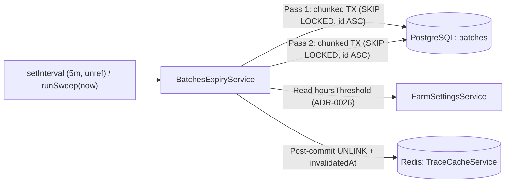
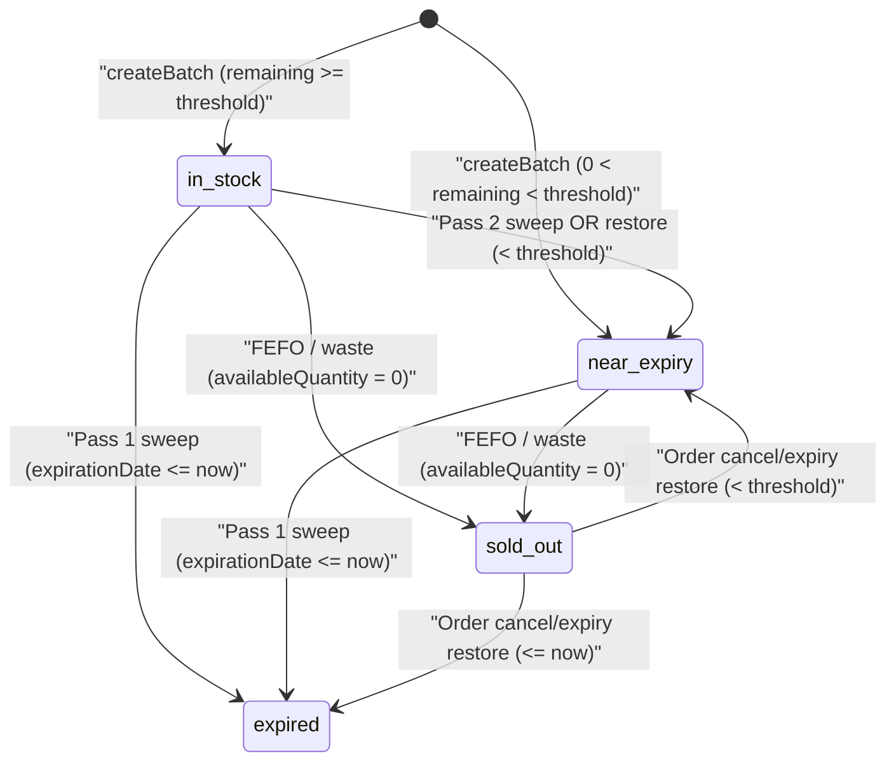

# Batch Expiry and Near-Expiry Transition Worker

## Overview & Context

Issue `#248` (split from `#34`, parent epic `#14`) automates the time-driven lifecycle transitions of harvested inventory batches in `apps/api/src/modules/inventory`:

1. **Expired transition**: `IN_STOCK` and `NEAR_EXPIRY` batches whose `expirationDate <= now` transition to `BatchStatus.EXPIRED`.
2. **Near-expiry transition**: `IN_STOCK` batches whose remaining shelf life enters the farm's configured flash-sale window (`now < expirationDate < now + hoursThreshold * 1h`) transition monotonically to `BatchStatus.NEAR_EXPIRY`.

During design review of `#248` against `ADR-0026` (`timestamptz` batch timestamps) and the live codebase, three adjustments from `#34`'s original wording were resolved:

- **Periodic interval sweep over `@Cron("0 0 * * *")`**: `@nestjs/schedule` is not installed in `apps/api/package.json`, and `batches.expirationDate` is a second-precision `timestamptz` (`ADR-0026`), not a calendar `date`. A once-daily `00:00` cron would leave daytime-expiring batches in `IN_STOCK`/`NEAR_EXPIRY` for up to 24 hours (missing nearly half of the 48-hour Rescue Flash Sale window) and miss runs on midnight restarts. The worker instead follows `OrdersExpiryService` (`apps/api/src/modules/orders/orders-expiry.service.ts`) using `setInterval` (`5m` cadence, `.unref()`, skipped in `NODE_ENV === "test"`, `isRunning` guard) and exposes `runSweep(now)` for deterministic testing.
- **Include `IN_STOCK -> NEAR_EXPIRY` in `#248`**: Without this pass, batches created with shelf life `>= hoursThreshold` would never automatically enter `BatchStatus.NEAR_EXPIRY` for `#249` (near-expiry query/flash-sale toggle) or `ProductsService.toRescueProgress`.
- **Two-pass ordering & failure isolation**: Pass 1 (`-> EXPIRED`) runs before Pass 2 (`IN_STOCK -> NEAR_EXPIRY`) so already-expired `IN_STOCK` batches transition directly to `EXPIRED` in one update, and Pass 1 never depends on `FarmSettingsService`.

### Goals

- Transition `IN_STOCK` and `NEAR_EXPIRY` batches with `expirationDate <= now` to `BatchStatus.EXPIRED` idempotently.
- Transition `IN_STOCK` batches with `now < expirationDate < now + hoursThreshold * 1h` to `BatchStatus.NEAR_EXPIRY` monotonically and idempotently.
- Prevent cross-module lock deadlocks (`INV-ORD-19`) via chunked `ORDER BY batches.id ASC FOR UPDATE SKIP LOCKED` transactions.
- Invalidate public QR trace projections via `TraceCacheService.invalidateByBatchCodes` strictly after each chunk transaction commits.

### Non-Goals

- Implementing `GET /api/v1/inventory/near-expiry` or `PATCH /api/v1/batches/:id/flash-sale` (`#249`).
- Modifying `WasteLogsService` write-off workflows (`ADR-0029`) or `OrdersService` FEFO allocation (`ADR-0033`, `ADR-0038`).
- Demoting `NEAR_EXPIRY` batches back to `IN_STOCK` when `farms.flash_sale_config.hoursThreshold` is lowered at runtime.

---

## Architecture

The worker lives inside `InventoryModule` (`apps/api/src/modules/inventory/inventory.module.ts`), reusing `FarmSettingsService` and `TraceCacheService` exported by `FarmsModule` (`apps/api/src/modules/farms/farms.module.ts`) and the existing `batches_fefo_outbound_idx` (`expirationDate`, `status`) index on `batches` (`apps/api/src/database/schemas/catalog.schema.ts`).



### Module & Symbol Mapping

- **Worker service**: `BatchesExpiryService` in `apps/api/src/modules/inventory/batches-expiry.service.ts` (registered in `InventoryModule` providers/exports, implementing `OnModuleInit` and `OnModuleDestroy`).
- **Constants**: `BATCH_EXPIRY_SWEEP_INTERVAL_MS` (`5 * TIME_IN_MS.MINUTE`) and `BATCH_EXPIRY_SWEEP_BATCH_SIZE` (`500`) in `apps/api/src/modules/inventory/inventory.constant.ts`.
- **Threshold resolution**: `FarmSettingsService.getSettings()` (`apps/api/src/modules/farms/farm-settings.service.ts`), mirroring `BatchesService.resolveHoursThreshold()` (`ADR-0026` production fail-closed vs. non-production fallback to `BUSINESS_RULES.FLASH_SALE_HOURS_THRESHOLD`).
- **Cache invalidation**: `TraceCacheService.invalidateByBatchCodes()` (`apps/api/src/modules/farms/trace-cache.service.ts`).

---

## Operational Flow

### Batch Lifecycle State Transitions



### Sweep Execution Sequence

```mermaid
sequenceDiagram
  autonumber
  participant Trigger as Timer / runSweep(now)
  participant Worker as BatchesExpiryService
  participant Settings as FarmSettingsService
  participant DB as PostgreSQL (batches)
  participant Cache as TraceCacheService

  Trigger->>Worker: runSweep(now)
  alt isRunning is true
    Worker-->>Trigger: return { expired: 0, nearExpiry: 0 }
  end

  rect rgb(245, 245, 245)
    Note over Worker,Cache: Pass 1 — Expired Transition (isolated)
    loop While chunk size == BATCH_EXPIRY_SWEEP_BATCH_SIZE
      Worker->>DB: BEGIN; SELECT id, batch_code FROM batches WHERE status IN ('in_stock','near_expiry') AND expiration_date <= now ORDER BY id ASC LIMIT 500 FOR UPDATE SKIP LOCKED
      Worker->>DB: UPDATE batches SET status = 'expired', updated_at = now WHERE id IN (...)
      Worker->>DB: COMMIT
      opt Updated rows > 0
        Worker->>Cache: invalidateByBatchCodes(chunkCodes)
      end
    end
  end

  rect rgb(245, 245, 245)
    Note over Worker,Cache: Pass 2 — Near-Expiry Transition (isolated)
    Worker->>Settings: getSettings() -> hoursThreshold
    alt FarmSettings missing/invalid in production
      Worker-->>Worker: Log error & skip Pass 2 (Pass 1 unaffected)
    else Valid hoursThreshold
      Note over Worker: cutoff = now + hoursThreshold * 1h
      loop While chunk size == BATCH_EXPIRY_SWEEP_BATCH_SIZE
        Worker->>DB: BEGIN; SELECT id, batch_code FROM batches WHERE status = 'in_stock' AND expiration_date > now AND expiration_date < cutoff ORDER BY id ASC LIMIT 500 FOR UPDATE SKIP LOCKED
        Worker->>DB: UPDATE batches SET status = 'near_expiry', updated_at = now WHERE id IN (...)
        Worker->>DB: COMMIT
        opt Updated rows > 0
          Worker->>Cache: invalidateByBatchCodes(chunkCodes)
        end
      end
    end
  end
```

---

## Security & Reliability

- **Concurrency & Deadlock Prevention (`INV-ORD-19`)**: Both passes lock candidate rows in ascending `batches.id` order using `FOR UPDATE SKIP LOCKED` (`LIMIT 500`). If `OrdersService` (checkout, confirm, cancel, reservation expiry) or `WasteLogsService` (approve) currently holds a row lock on a batch, the worker skips it cleanly without blocking or deadlocking and picks it up on the next sweep if still eligible.
- **Multi-Replica Safety**: `FOR UPDATE SKIP LOCKED` prevents two API replicas running `setInterval` simultaneously from double-updating the same batch rows or issuing duplicate `UPDATE`s.
- **Pass Isolation & Fail-Closed Threshold**: Pass 1 (`-> EXPIRED`) has zero external dependencies and runs inside its own `try/catch`. Pass 2 (`IN_STOCK -> NEAR_EXPIRY`) runs in a separate `try/catch` and honors `ADR-0026`: in `NODE_ENV === "production"`, missing `FarmSettings` or non-positive `hoursThreshold` logs an error and skips Pass 2 rather than guessing `48h`; in `development`/`test`, `NotFoundException` falls back to `BUSINESS_RULES.FLASH_SALE_HOURS_THRESHOLD` with a warning.
- **Post-Commit Fail-Open Cache Invalidation (`ADR-0024`)**: `TraceCacheService.invalidateByBatchCodes` is invoked only after each chunk transaction commits so concurrent `GET /api/v1/trace/:batchCode` requests cannot read pre-commit DB state and backfill stale Redis entries. Redis failures inside `TraceCacheService` are caught and logged without rolling back or failing the sweep.
- **Overlap & Test Safety**: `isRunning` prevents overlapping in-process sweeps if a pass takes longer than `BATCH_EXPIRY_SWEEP_INTERVAL_MS`. `onModuleInit` skips `setInterval` registration when `env.NODE_ENV === "test"`, and `timer.unref()` ensures the interval never blocks graceful shutdown.

---

## Domain Invariant Taxonomy

| ID           | Invariant                                                                                                                                                                                                | Enforcement Mechanism                                                                                        | Verification                                                             |
| :----------- | :------------------------------------------------------------------------------------------------------------------------------------------------------------------------------------------------------- | :----------------------------------------------------------------------------------------------------------- | :----------------------------------------------------------------------- |
| `INV-BEXP-1` | Any `IN_STOCK` or `NEAR_EXPIRY` batch with `expirationDate <= now` transitions to `BatchStatus.EXPIRED` (including direct `IN_STOCK -> EXPIRED`).                                                        | Pass 1 predicate `status IN ('in_stock', 'near_expiry') AND expiration_date <= now`, executed before Pass 2. | Unit & integration tests (`batches-expiry.service.spec.ts`, e2e/DB test) |
| `INV-BEXP-2` | Only `IN_STOCK` batches with `now < expirationDate < now + hoursThreshold * 1h` transition to `BatchStatus.NEAR_EXPIRY`; `NEAR_EXPIRY` is never demoted back to `IN_STOCK`, and `SOLD_OUT` is untouched. | Pass 2 predicate `status = 'in_stock' AND expiration_date > now AND expiration_date < cutoff`.               | Unit & integration tests                                                 |
| `INV-BEXP-3` | Re-running `runSweep(now)` at the same or later timestamp is idempotent (zero duplicate mutations or cache invalidations for already-transitioned rows).                                                 | Status predicates exclude `EXPIRED` (Pass 1) and `NEAR_EXPIRY`/`EXPIRED`/`SOLD_OUT` (Pass 2).                | Unit & integration idempotency tests                                     |
| `INV-BEXP-4` | Row locks on `batches` are acquired in `batches.id ASC` order with `FOR UPDATE SKIP LOCKED` in bounded chunks (`<= 500`), preventing deadlocks with `OrdersService` and `WasteLogsService`.              | Chunked `SELECT ... ORDER BY id ASC LIMIT 500 FOR UPDATE SKIP LOCKED` inside per-chunk transaction.          | Unit test verifying SQL/order + integration test                         |
| `INV-BEXP-5` | `TraceCacheService.invalidateByBatchCodes` is called strictly after chunk commit with only the transitioned batch codes, and Pass 1 (`-> EXPIRED`) is isolated from Pass 2 / `FarmSettings` errors.      | Post-commit call outside `db.transaction` + independent `try/catch` blocks per pass.                         | Unit tests (mocked TX order & Pass 2 failure isolation)                  |
