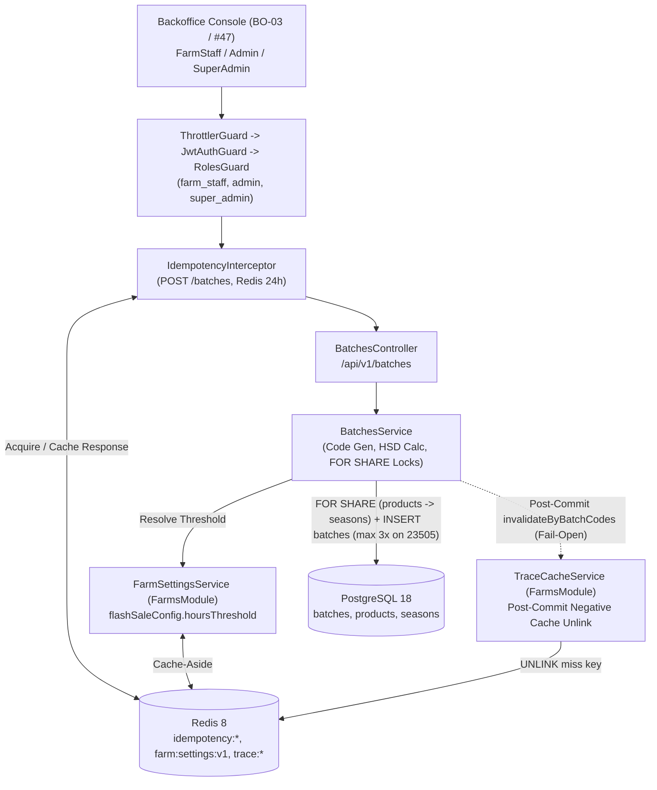
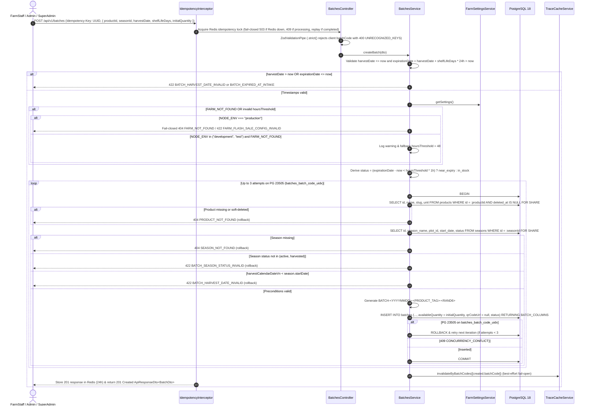
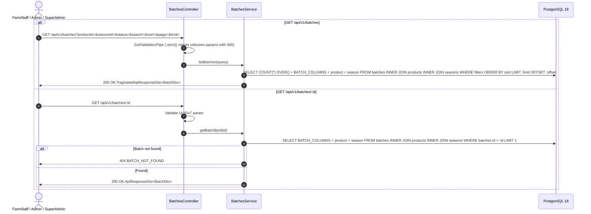

# Batch Intake and HSD Tracking Formal Specification

## Overview & Context

This specification defines the batch intake and inventory listing API (`POST /api/v1/batches`, `GET /api/v1/batches`, `GET /api/v1/batches/:id`), `batches` timestamp migration, server-side `batchCode` generation, and HSD status classification introduced by #82 (split from #23; parent epic #9; Backoffice consumer #47 `BO-03`; downstream dependents #81, #83, #34, #84) in `apps/api/src/modules/inventory`.

Architectural commitments are recorded in ADR-0026 (partially superseding ADR-0024 on `batches.harvestDate` and `batches.expirationDate` column types); database invariants follow ADR-0005; idempotency follows ADR-0008; DTO co-location, envelopes, and RFC 9457 contracts follow ADR-0011, ADR-0012, and ADR-0013; season/product lifecycle foundations follow ADR-0021, ADR-0022, ADR-0023, and ADR-0025.

`apps/api/src/database/schemas/catalog.schema.ts` currently defines `batches` with `harvestDate` and `expirationDate` as `date` (`YYYY-MM-DD`) and lacks upper-bound/positive `CHECK` constraints, `apps/api/src/modules/inventory/inventory.module.ts` is an empty skeleton, `TraceRecordDto` (`apps/api/src/modules/farms/dto/trace-record.dto.ts`) still expects `YYYY-MM-DD` batch dates, and `@greenroots/shared` lacks batch intake RFC 9457 error codes.

### Goals

- Migrate `batches.harvestDate` and `batches.expirationDate` from `date` to `timestamptz` in `apps/api/src/database/schemas/catalog.schema.ts` via one forward-only migration (`Asia/Ho_Chi_Minh` conversion for existing data), add DB `CHECK` constraints (`initial_quantity > 0`, `available_quantity <= initial_quantity`, `expiration_date > harvest_date`), and synchronize `TraceService`, `TraceRecordDto`, unit specs, and `tier2-catalog.seeder.ts`.
- Expose `POST /api/v1/batches` (`@Idempotent()`, `farm_staff` | `admin` | `super_admin`) accepting `productId`, `seasonId`, `harvestDate` (ISO-8601 datetime with offset), `shelfLifeDays` (`1..3650`), and `initialQuantity` (`0.01..99_999_999.99`, max 2 decimals).
- Generate `batchCode` exclusively server-side (`BATCH-<YYYYMMDD>-<PRODUCT_TAG>-<RAND6>`) with up to 3 transaction-level retries on PG `23505` (`batches_batch_code_uidx`), set `availableQuantity = initialQuantity` and `qrCodeUrl = null`, and reject client-supplied `batchCode` with `400`.
- Derive `expirationDate = harvestDate + shelfLifeDays * 24h`, reject expired intake (`expirationDate <= now`) with `422`, and classify initial `status` as `near_expiry` vs `in_stock` using `farms.flashSaleConfig.hoursThreshold` (fail-closed in `production`, fallback to `BUSINESS_RULES.FLASH_SALE_HOURS_THRESHOLD` in `development`/`test` only on `FARM_NOT_FOUND`).
- Expose `GET /api/v1/batches` (filters: `productId`, `seasonId`, `status`, `search`; pagination & `.strict()` query validation) and `GET /api/v1/batches/:id` with closed `product` and `season` summaries, restricted to `farm_staff`, `admin`, and `super_admin`.
- Invalidate `TraceCacheService.invalidateByBatchCodes([created.batchCode])` post-commit, register RFC 9457 error codes in `@greenroots/shared` and `apps/api`, and run `bun run types:sync`.

### Non-Goals

- QR label payload or thermal print rendering (`#83`) and public traceability route changes beyond aligning `harvestDate`/`expirationDate` to ISO datetime (`#21`).
- Midnight expiry cron transitions or 48-hour flash-sale toggles (`#34`).
- Waste write-off proposals/approvals (`#24`), FEFO stock reservation/checkout deduction (`#84`), or live product stock aggregation (`#81`).
- Batch updates (`PATCH`) or deletion (`DELETE`); batch records are immutable after intake outside stock/status transitions owned by `#34`, `#24`, and `#84`.

## Architecture

Symbols and module layout:

- `INVENTORY_ROUTES` in `apps/api/src/modules/inventory/inventory.routes.ts` defines frozen constants (`TAG: "inventory"`, `BATCHES_BASE: "batches"`, `BATCH_BY_ID: ":id"`).
- `BatchesController` in `apps/api/src/modules/inventory/batches.controller.ts` exposes `POST /api/v1/batches`, `GET /api/v1/batches`, and `GET /api/v1/batches/:id` decorated with `@ApiAuth(UserRole.FARM_STAFF, UserRole.ADMIN, UserRole.SUPER_ADMIN)` plus class-level `@ApiBadRequestResponseRfc9457()` and `@ApiInternalServerErrorResponseRfc9457()`. `POST /api/v1/batches` also carries `@Idempotent()`.
- `BatchesService` in `apps/api/src/modules/inventory/batches.service.ts` owns closed `BATCH_COLUMNS`, `BATCH_PRODUCT_SUMMARY_COLUMNS`, and `BATCH_SEASON_SUMMARY_COLUMNS` projections, `products -> seasons` `FOR SHARE` lock ordering, `Asia/Ho_Chi_Minh` harvest-vs-season calendar validation, Crockford Base32 `batchCode` generation with bounded 3-attempt `23505` retry, environment-scoped `FarmSettingsService` threshold resolution, `TraceCacheService.invalidateByBatchCodes` post-commit cleanup, and `numeric(10, 2)` string-to-number serialization.
- `InventoryModule` in `apps/api/src/modules/inventory/inventory.module.ts` imports `FarmsModule` (consuming exported `FarmSettingsService` and `TraceCacheService` without circular dependencies) and registers `BatchesController` and `BatchesService`.
- `inventory.interface.ts` in `apps/api/src/modules/inventory/inventory.interface.ts` holds compile-time constants (`BATCH_SORT_OPTIONS`, `BATCH_CODE_MAX_GENERATION_ATTEMPTS = 3`, `BATCH_MAX_SHELF_LIFE_DAYS = 3650`, `BATCH_MAX_QUANTITY = 99_999_999.99`, `BATCH_MIN_QUANTITY = 0.01`, `BATCH_CODE_RANDOM_LENGTH = 6`, `CROCKFORD_BASE32_ALPHABET`, `ALLOWED_BATCH_INTAKE_SEASON_STATUSES`) with zero runtime Zod schemas per ADR-0011.
- `apps/api/src/modules/inventory/dto/` holds co-located Zod schemas and `createZodDto()` classes (`batch.dto.ts`, `create-batch.dto.ts`, `list-batches-query.dto.ts`, `index.ts`).
- `apps/api/src/database/schemas/catalog.schema.ts` updates `batches.harvestDate` and `batches.expirationDate` to `timestamp({ withTimezone: true, mode: "date" })` and adds `batches_initial_quantity_positive`, `batches_available_lte_initial`, and `batches_expiration_after_harvest` `check()` constraints.
- `apps/api/src/modules/farms/trace.service.ts`, `apps/api/src/modules/farms/dto/trace-record.dto.ts`, `apps/api/src/database/seeds/constants/seed-dates.constant.ts`, and `apps/api/src/database/seeds/tiers/tier2-catalog.seeder.ts` align `harvestDate` and `expirationDate` serialization to ISO-8601 `timestamptz` instants.
- `@greenroots/shared` (`packages/shared/src/error-dictionary.ts` and `packages/shared/GLOSSARY.md`) registers batch intake RFC 9457 error codes and sharpens `Batch`, `Batch Code`, and `Shelf Life (HSD)` vocabulary.

## Operational Flow

### 1. Batch Intake, Threshold Classification & Collision Retry (`POST /api/v1/batches`)

### 2. Batch Inventory Listing & Detail Retrieval (`GET /api/v1/batches` & `GET /api/v1/batches/:id`)

## API Contract

### Endpoints

| Method & Path             | Access                               | Rate Limit Tier             | Idempotency     | Success                                   | RFC 9457 Errors                                                                                                                                                                                           |
| :------------------------ | :----------------------------------- | :-------------------------- | :-------------- | :---------------------------------------- | :-------------------------------------------------------------------------------------------------------------------------------------------------------------------------------------------------------- |
| `POST /api/v1/batches`    | `farm_staff`, `admin`, `super_admin` | `default` (`100 req / 60s`) | `@Idempotent()` | `201` `ApiResponseDto<BatchDto>`          | `400` (`VALIDATION_FAILED`), `401`, `403`, `404` (`PRODUCT_NOT_FOUND`, `SEASON_NOT_FOUND`, `FARM_NOT_FOUND`), `409` (`CONCURRENCY_CONFLICT`), `422` (domain rules), `503` (Redis idempotency unavailable) |
| `GET /api/v1/batches`     | `farm_staff`, `admin`, `super_admin` | `default` (`100 req / 60s`) | —               | `200` `PaginatedApiResponseDto<BatchDto>` | `400` (`VALIDATION_FAILED`), `401`, `403`                                                                                                                                                                 |
| `GET /api/v1/batches/:id` | `farm_staff`, `admin`, `super_admin` | `default` (`100 req / 60s`) | —               | `200` `ApiResponseDto<BatchDto>`          | `400` (`VALIDATION_FAILED`), `401`, `403`, `404` (`BATCH_NOT_FOUND`)                                                                                                                                      |

### DTOs, Projections & Validation Rules

1. **`CreateBatchDto` (`POST /api/v1/batches`, `.strict()`)**:
   - `productId`: `zUuidV7()` (must reference a non-deleted product; `products.isActive = false` is allowed).
   - `seasonId`: `zUuidV7()` (must reference a season in `SeasonStatus.ACTIVE` or `SeasonStatus.HARVESTED`).
   - `harvestDate`: `z.iso.datetime({ offset: true })` (parsed to `Date` inside `BatchesService`; must satisfy `harvestDate <= now` and `harvestCalendarDateVn >= season.startDate` in `Asia/Ho_Chi_Minh`).
   - `shelfLifeDays`: `z.number().int().min(1).max(3650)` (whole shelf-life days added as `shelfLifeDays * TIME_IN_MS.DAY` to `harvestDate`).
   - `initialQuantity`: `z.number().finite().positive().max(99_999_999.99)` refined to at most 2 decimal places (`Math.round(val * 100) === val * 100` within float tolerance, serialized to fixed 2-decimal string for Drizzle `numeric(10, 2)`).
   - Supplying `batchCode`, `availableQuantity`, `expirationDate`, `status`, or `qrCodeUrl` is rejected with `400 VALIDATION_FAILED` (`UNRECOGNIZED_KEYS`).
2. **`BatchDto` (closed projection returned by `POST`, `GET` list, and `GET /:id`)**:
   - `{ id (UUID), batchCode (string), productId (UUID), seasonId (UUID), product: { id (UUID), name (string), slug (string), unit (string) }, season: { id (UUID), seasonName (string), plotId (UUID) }, harvestDate (ISO datetime), expirationDate (ISO datetime), initialQuantity (number), availableQuantity (number), qrCodeUrl (string | null), status (BatchStatus), createdAt (ISO datetime), updatedAt (ISO datetime) }`.
   - `product` and `season` summaries use `INNER JOIN` without `products.deletedAt IS NULL` filter on read so historical batches of subsequently soft-deleted products remain inspectable in backoffice inventory screens.
3. **`ListBatchesQueryDto` (`GET /api/v1/batches`, `.strict()`)**:
   - `productId?`: `zUuidV7()`.
   - `seasonId?`: `zUuidV7()`.
   - `status?`: `z.enum(BatchStatus)`.
   - `search?`: `zSanitizedString({ min: 1, max: 100 })` matching `batches.batchCode` via escaped case-insensitive `ILIKE` (`escapeLikePattern`).
   - `page`: `zNumericString({ integer: true, min: 1 }).default(1)`.
   - `limit`: `zNumericString({ integer: true, min: 1, max: 100 }).default(20)`.
   - `sort`: `z.enum(BATCH_SORT_OPTIONS).default("createdAt:desc")` where `BATCH_SORT_OPTIONS = ["createdAt:desc", "createdAt:asc", "expirationDate:asc", "expirationDate:desc", "harvestDate:desc", "harvestDate:asc"]` (all tied by `desc(batches.id)` for deterministic pagination).
4. **Traceability DTO Alignment (`TraceRecordDto` in `apps/api/src/modules/farms/dto/trace-record.dto.ts`)**:
   - Update `traceBatchSummarySchema.harvestDate` and `traceBatchSummarySchema.expirationDate` from `zIsoDate()` to `z.iso.datetime()` and project `.toISOString()` in `TraceService.loadAndBackfill`.

### Shared Contracts, Error Codes & Migration

- `@greenroots/shared` (`packages/shared/src/error-dictionary.ts`):
  - Register `BATCH_SEASON_STATUS_INVALID`, `BATCH_HARVEST_DATE_INVALID`, `BATCH_EXPIRED_AT_INTAKE`, and `FARM_FLASH_SALE_CONFIG_INVALID` in `API_ERROR_CODES` with Vietnamese copy in `API_ERROR_DICTIONARY` (`BATCH_NOT_FOUND` already exists).
- `apps/api/src/common/constants/messages.constant.ts`:
  - Expand `MESSAGES.BATCHES` with English developer-facing descriptions for `SEASON_STATUS_INVALID`, `HARVEST_BEFORE_SEASON_START`, `HARVEST_IN_FUTURE`, `EXPIRED_AT_INTAKE`, and `CODE_GENERATION_EXHAUSTED`, plus `MESSAGES.FARMS.FLASH_SALE_CONFIG_INVALID` and `MESSAGES.VALIDATION.INVALID_QUANTITY_PRECISION`.
- Database schema & migration (`apps/api/src/database/schemas/catalog.schema.ts`):
  - Alter `batches.harvestDate` and `batches.expirationDate` from `date()` to `timestamp({ withTimezone: true, mode: "date" }).notNull()`.
  - Add `check("batches_initial_quantity_positive", sql\`${table.initialQuantity} > 0\`)`, `check("batches_available_lte_initial", sql\`${table.availableQuantity} <= ${table.initialQuantity}\`)`, and `check("batches_expiration_after_harvest", sql\`${table.expirationDate} > ${table.harvestDate}\`)`.
  - Generate one forward-only migration converting existing `date` rows via `USING (...::timestamp AT TIME ZONE 'Asia/Ho_Chi_Minh')` (preserving `expiration_date > harvest_date`) and update `seed-dates.constant.ts` / `tier2-catalog.seeder.ts` to produce `Date` instances relative to runtime.

## Security & Reliability

### Access & Exposure Matrix

| Route / Operation         | `@Public()` / `customer` / `sales` | `farm_staff` / `admin` / `super_admin` |
| :------------------------ | :--------------------------------: | :------------------------------------: |
| `POST /api/v1/batches`    |           `401` / `403`            |         Yes (`@Idempotent()`)          |
| `GET /api/v1/batches`     |           `401` / `403`            |                  Yes                   |
| `GET /api/v1/batches/:id` |           `401` / `403`            |                  Yes                   |

### Controls

- **RBAC & Principle of Least Privilege**: All batch intake and inventory read endpoints require `@ApiAuth(UserRole.FARM_STAFF, UserRole.ADMIN, UserRole.SUPER_ADMIN)` enforced by `JwtAuthGuard` and `RolesGuard`. `sales` and `customer` accounts are denied with `403`.
- **Idempotency (`@Idempotent()`)**: `POST /api/v1/batches` enforces `Idempotency-Key: <UUID>` via `IdempotencyInterceptor` (ADR-0008), failing closed with `503` if Redis is unavailable, returning `409` on concurrent in-flight duplicates, `422` on payload mismatch, and deleting the key if a validation or transaction exception aborts the request.
- **Fail-Closed Threshold Configuration in Production**: `BatchesService` reads `flashSaleConfig.hoursThreshold` via `FarmSettingsService.getSettings()`. When `env.NODE_ENV === "production"`, missing `farms` (`404 FARM_NOT_FOUND`) or invalid `hoursThreshold <= 0` (`422 FARM_FLASH_SALE_CONFIG_INVALID`) aborts intake rather than silently assuming `48`. Only `development` and `test` fall back to `BUSINESS_RULES.FLASH_SALE_HOURS_THRESHOLD` on `FARM_NOT_FOUND` (with a logged warning).
- **Concurrency & Lock Ordering**: Intake transactions always lock `products` (`FOR SHARE`) before `seasons` (`FOR SHARE`) in fixed order, preventing lock-order deadlocks with `ProductsService` (`DELETE /products/:id`) and `SeasonsService` (`PATCH /seasons/:id`). Each `batchCode` generation attempt runs in a clean transaction block so PG `23505` aborts roll back cleanly before retrying (max 3 attempts -> `409 CONCURRENCY_CONFLICT`).
- **Input Strictness & Injection Defense**: `.strict()` on both `CreateBatchDto` and `ListBatchesQueryDto` rejects client-supplied `batchCode`, `status`, `availableQuantity`, or unknown query keys with `400`. `search` uses `zSanitizedString` + `escapeLikePattern` inside parameterized Drizzle `ILIKE`.
- **Trace Cache Coherency**: Post-commit `TraceCacheService.invalidateByBatchCodes([created.batchCode])` removes any 30-second negative-cache marker (`trace:batch:miss:v1:<CODE>`) fail-open without blocking or rolling back committed batch creation.

## Domain Invariant Taxonomy

| Invariant     | Name                                    | Formal Statement                                                                                                                                                                           | Enforcement Seam                                                                                    | Verification Test                                                                                                       |
| :------------ | :-------------------------------------- | :----------------------------------------------------------------------------------------------------------------------------------------------------------------------------------------- | :-------------------------------------------------------------------------------------------------- | :---------------------------------------------------------------------------------------------------------------------- |
| `INV-BATCH-1` | Server-Generated Unique Batch Code      | `batchCode` is generated exclusively server-side matching `BATCH_CODE_REGEX`, is immutable after creation, and retries up to 3 times across clean transaction boundaries on `23505`        | `.strict()` DTO + `BatchesService` code generator retry loop + `batches_batch_code_uidx`            | Client-supplied `batchCode` returns `400`; mocked `23505` collision retries and succeeds; 3 collisions return `409`     |
| `INV-BATCH-2` | Instant-Based HSD & Past-Expiry Guard   | `harvestDate` and `expirationDate` are `timestamptz` instants with `harvestDate <= now`, `expirationDate = harvestDate + shelfLifeDays * 24h`, and `expirationDate > now` on intake        | `CreateBatchDto` + `BatchesService.createBatch` + `batches_expiration_after_harvest` DB check       | Future `harvestDate` returns `422`; `expirationDate <= now` returns `422`; DB rejects `expiration_date <= harvest_date` |
| `INV-BATCH-3` | Environment-Scoped Near-Expiry Boundary | Initial status is `near_expiry` iff `0 < expirationDate - now < hoursThreshold * 3600s`, else `in_stock`; `production` fails closed when `FarmSettings` is missing/invalid                 | `BatchesService.resolveHoursThreshold` + `FarmSettingsService.getSettings`                          | Boundary tests at `48h - 1ms` (`near_expiry`), `48h` (`in_stock`), custom farm setting, and prod fail-closed unit spec  |
| `INV-BATCH-4` | Intake Stock Equality & Precision       | On creation `availableQuantity === initialQuantity > 0` with at most 2 decimal places (`<= 99_999_999.99`), and `0 <= available_quantity <= initial_quantity` holds in DB                  | `CreateBatchDto` + `BatchesService` + `batches_initial_quantity_positive` & `available_lte_initial` | Zero, negative, or 3-decimal `initialQuantity` returns `400`; created row has `availableQuantity === initialQuantity`   |
| `INV-BATCH-5` | Active/Harvested Season & Lock Order    | Intake requires a non-deleted `productId` and a `seasonId` in `active` or `harvested` status with `harvestCalendarDateVn >= season.startDate`, locking `products -> seasons` (`FOR SHARE`) | `BatchesService.createBatch` `FOR SHARE` lock sequence + `Asia/Ho_Chi_Minh` date formatter          | `planning`/`completed` season returns `422`; soft-deleted product returns `404`; `04:00+07:00` on `startDate` succeeds  |
| `INV-BATCH-6` | Idempotent Creation & Cache Cleanup     | `POST /api/v1/batches` enforces `Idempotency-Key` (replaying within 24h without creating duplicate batches) and clears any trace negative cache post-commit                                | `@Idempotent()` (`IdempotencyInterceptor`) + post-commit `TraceCacheService.invalidateByBatchCodes` | Replaying `POST /batches` with same `Idempotency-Key` returns `201` with identical `batchCode` and 1 DB row             |

### Edge Cases (`EDGE-1..12`)

| ID        | Case                                                                                                      | Expected Behaviour                                                                            |
| :-------- | :-------------------------------------------------------------------------------------------------------- | :-------------------------------------------------------------------------------------------- |
| `EDGE-1`  | Client includes `batchCode`, `availableQuantity`, or unknown query key on `POST` or `GET`                 | `.strict()` rejects with `400 VALIDATION_FAILED` (`UNRECOGNIZED_KEYS`)                        |
| `EDGE-2`  | `harvestDate` is `2026-11-20T04:00:00+07:00` when `season.startDate` is `2026-11-20`                      | Accepted because `Asia/Ho_Chi_Minh` calendar date matches `2026-11-20` (despite `21:00Z` UTC) |
| `EDGE-3`  | `harvestDate` is `2026-11-19T23:59:59+07:00` when `season.startDate` is `2026-11-20`                      | Rejected with `422 BATCH_HARVEST_DATE_INVALID`                                                |
| `EDGE-4`  | `harvestDate` is 1 second in the future (`> now`)                                                         | Rejected with `422 BATCH_HARVEST_DATE_INVALID`                                                |
| `EDGE-5`  | `harvestDate = now - 3 days`, `shelfLifeDays = 3` (`expirationDate <= now`)                               | Rejected with `422 BATCH_EXPIRED_AT_INTAKE`                                                   |
| `EDGE-6`  | Remaining shelf life equals `hoursThreshold * 3600s` exactly (e.g., `48h00m00s` when `hoursThreshold=48`) | Classified as `in_stock` (strictly `< hoursThreshold` triggers `near_expiry`)                 |
| `EDGE-7`  | Remaining shelf life is `47h59m59s` (`< hoursThreshold`)                                                  | Classified as `near_expiry`                                                                   |
| `EDGE-8`  | `initialQuantity = 12.345` (3 decimal places) or `0` or `-5`                                              | Rejected at HTTP boundary with `400 VALIDATION_FAILED`                                        |
| `EDGE-9`  | `productId` refers to a non-deleted product with `isActive = false`                                       | Intake succeeds (`201 Created`) so stock can be labeled prior to storefront activation        |
| `EDGE-10` | `productId` was soft-deleted after batch creation; staff calls `GET /batches` or `GET /batches/:id`       | Batch remains readable with its nested `product` summary (`INNER JOIN` omits `deletedAt`)     |
| `EDGE-11` | `GET /batches?search=2026%25` (`%` or `_` wildcard in search)                                             | `escapeLikePattern` escapes wildcards for literal `batchCode` matching                        |
| `EDGE-12` | `POST /batches` missing `Idempotency-Key` header                                                          | Rejected with `400` per ADR-0008                                                              |

### Concurrency & Adversarial Matrix (`ADV-1..6`)

| ID      | Scenario                                                                                                          | Expected Behaviour                                                                                                                                               |
| :------ | :---------------------------------------------------------------------------------------------------------------- | :--------------------------------------------------------------------------------------------------------------------------------------------------------------- |
| `ADV-1` | Concurrent `POST /batches` (`Idempotency-Key: K1`) double-clicked at the exact same millisecond                   | `IdempotencyInterceptor` processes first request, rejects concurrent in-flight duplicate with `409`, and replays `201` once completed without creating 2 batches |
| `ADV-2` | Code generator collides on `batches_batch_code_uidx` (`23505`) on attempt 1 during `POST /batches`                | First transaction rolls back cleanly; attempt 2 generates a fresh Crockford suffix and commits `201 Created`                                                     |
| `ADV-3` | Concurrent `POST /batches` (`FOR SHARE` on `season`) and `PATCH /seasons/:id` transitioning season to `completed` | Serialized by row lock: either batch commits while season is `active`/`harvested`, or season commits `completed` first and intake fails `422`                    |
| `ADV-4` | Concurrent `POST /batches` (`FOR SHARE` on `product`) and `DELETE /products/:id` (soft delete)                    | Serialized by `products` row lock (`products -> seasons`): if soft delete commits first, intake returns `404 PRODUCT_NOT_FOUND`                                  |
| `ADV-5` | `NODE_ENV=production` with missing `farms` row or `hoursThreshold <= 0`                                           | Fails closed (`404 FARM_NOT_FOUND` / `422 FARM_FLASH_SALE_CONFIG_INVALID`), never silently defaulting to `48`                                                    |
| `ADV-6` | `customer` or `sales` JWT calls `POST /batches`, `GET /batches`, or `GET /batches/:id`                            | `RolesGuard` rejects with `403 FORBIDDEN` before entering `BatchesService`                                                                                       |

## Test Matrix

- **Factories & Mothers (`apps/api/test/factories/`)**:
  - Update `createBatch(db, overrides)` and `BatchMother` presets (`inStock()`, `nearExpiry()`, `expired()`) to emit `Date` instances for `harvestDate` and `expirationDate` matching the `timestamptz` schema.
- **Unit specs (`apps/api/src/modules/inventory/batches.service.spec.ts`)**:
  - `batchCode` format (`BATCH_CODE_REGEX`), Crockford alphabet, and 3-attempt `23505` collision retry + exhaustion (`409`).
  - `shelfLifeDays` calculation, `< hoursThreshold` vs `>= hoursThreshold` boundary, past-expiry rejection (`422`), `Asia/Ho_Chi_Minh` `harvestDate >= season.startDate` edge case (`04:00+07:00`).
  - `NODE_ENV === "production"` fail-closed vs `test`/`development` fallback on `FARM_NOT_FOUND`.
  - Updated `trace.service.spec.ts` and `trace-cache.service.spec.ts` for ISO datetime `harvestDate` / `expirationDate`.
- **E2E Integration suite (`apps/api/test/integration/batches.spec.ts`)**:
  - `POST /api/v1/batches`: happy path (`in_stock` and `near_expiry` against dynamic `FarmSettings`), `Idempotency-Key` replay (`201` identical `batchCode`) & payload mismatch (`422`), client-supplied `batchCode` rejection (`400`), season status gates (`planning`/`completed` -> `422`), soft-deleted product (`404`), inactive product (`201`), negative/zero/3-decimal quantities (`400`), past expiry (`422`), RBAC matrix (`farm_staff`/`admin`/`super_admin` pass; `sales`/`customer`/unauthenticated fail), and post-commit negative trace cache clearing.
  - `GET /api/v1/batches` & `GET /api/v1/batches/:id`: `productId`, `seasonId`, `status`, `search` (including wildcard escaping), `sort`, pagination, unknown query key (`400`), `404` on missing `:id`, and historical read after `product` soft-delete.
  - DB `CHECK` constraint integration assertions verifying raw invalid inserts (`initial_quantity <= 0`, `available_quantity > initial_quantity`, `expiration_date <= harvest_date`) fail with `23514`.
- **Verification commands**:
  - Run `bun run types:sync`, `bun run check`, `bun run test`, and `bun run test:e2e`.

## Risks & Rollback

- **Downstream contract & sibling synchronization (`#81`, `#34`, `#45`, `#47`)**:
  - `#81` (`GET /products` live stock) and `#34` (`@Cron("0 0 * * *")` expiry scanner & near-expiry listing) can now compare `batches.expiration_date > NOW()` directly against `timestamptz` without calendar-timezone conversion hacks.
  - `#45` (`SF-03` TraceView) must format ISO datetime strings returned by `TraceRecordDto.batch.harvestDate` and `expirationDate`, and `#47` (`BO-03`) must send ISO-8601 `harvestDate` with offset + `Idempotency-Key` UUID header.
- **Rollback**:
  - Revert `InventoryModule` routes/services, `@greenroots/shared` additions, `TraceService`/`TraceRecordDto` date-string restoration, and re-run `bun run types:sync`. Because column type alteration (`date -> timestamptz`) is forward-only under `docs/standards/database-and-migrations.md` §5, rolling back the schema requires a compensating forward migration casting `timestamptz` back via `AT TIME ZONE 'Asia/Ho_Chi_Minh'`.
