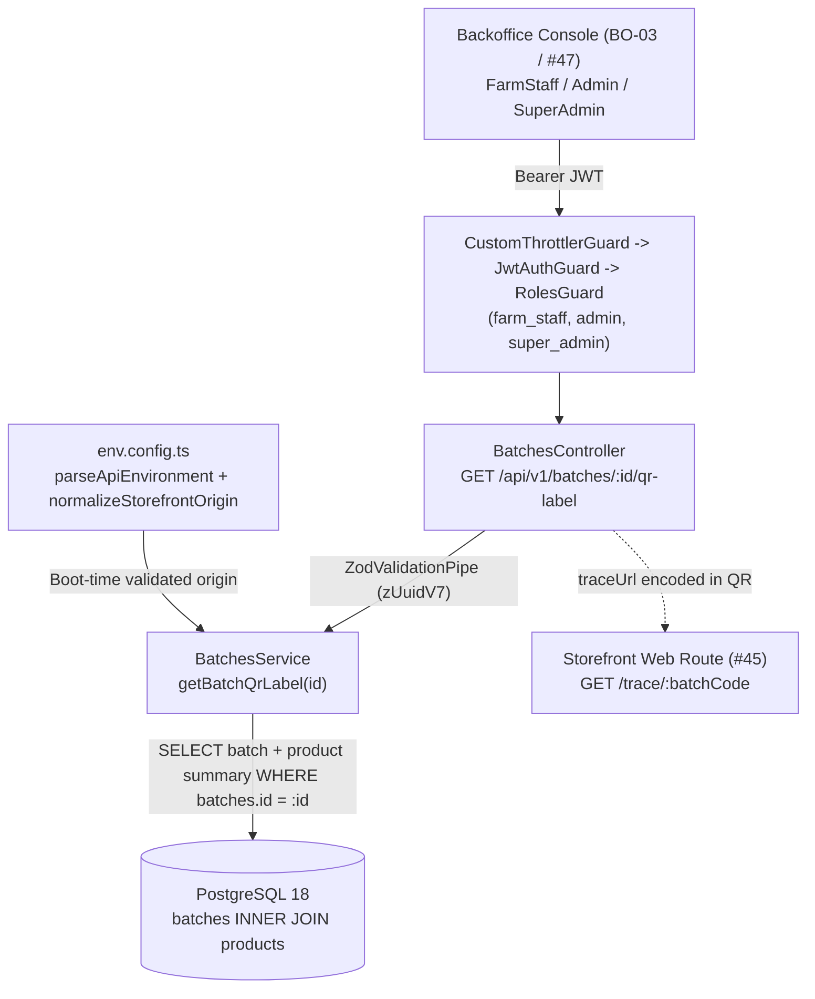
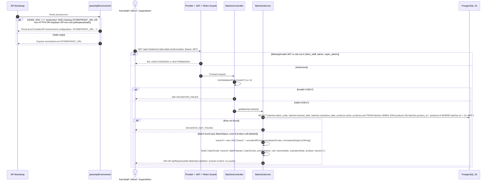

# Batch QR Label Generation Formal Specification

## Overview & Context

This specification defines the batch QR label payload endpoint (`GET /api/v1/batches/:id/qr-label`) and production public-origin validation introduced by #83 (split from #23; parent epic #9; Backoffice consumer #47 `BO-03`; deferred schema cleanup #102) in `apps/api/src/modules/inventory` and `apps/api/src/common/config`.

Architectural commitments are recorded in ADR-0028; batch intake and `timestamptz` schema invariants follow ADR-0026; public QR traceability routes follow ADR-0024; DTO co-location, response envelopes, OpenAPI type sync, and RFC 9457 error handling follow ADR-0007, ADR-0011, ADR-0012, and ADR-0013.

`apps/api/src/modules/inventory/batches.controller.ts` currently exposes `POST /api/v1/batches`, `GET /api/v1/batches`, and `GET /api/v1/batches/:id` (with `batches.qrCodeUrl = null` on intake per ADR-0026), `apps/api/src/common/config/env.config.ts` defaults `STOREFRONT_URL` to `http://localhost:3001` without a production fail-fast check, and `apps/backoffice/src/routes/farming/batches.tsx` (`BO-03`) has no server endpoint yet to fetch the deterministic thermal sticker payload and storefront QR target URL.

### Goals

- Expose `GET /api/v1/batches/:id/qr-label` restricted to `farm_staff`, `admin`, and `super_admin`, returning `{ batchCode, traceUrl, labelPayload }` inside `ApiResponseDto<BatchQrLabelDto>`.
- Enforce `STOREFRONT_URL` as the canonical public origin SSOT across `apps/api` (aligning with `MailService` and `apps/storefront/app/trace/[batchCode]/page.tsx`), normalizing the origin and failing fast in `parseApiEnvironment()` when `NODE_ENV === "production"` and `STOREFRONT_URL` is missing, non-HTTPS, or resolves to a loopback/unspecified host.
- Construct `traceUrl` deterministically as `<normalizedOrigin>/trace/<encodeURIComponent(batchCode)>` without reading or mutating the deprecated `batches.qrCodeUrl` column (cleanup tracked in #102).
- Provide a self-contained, stock-independent `labelPayload` (`batchCode`, `productName`, `unit`, `harvestDate`, `expirationDate`, `qrValue`) via a single primary-key `batches INNER JOIN products` query, returning `404 BATCH_NOT_FOUND` for missing `:id` and allowing reprints across all `BatchStatus` values and soft-deleted products.
- Regenerate and commit OpenAPI contracts via `bun run types:sync`.

### Non-Goals

- Server-side SVG, PNG, ESC/POS, ZPL, or PDF thermal label rendering, or printer hardware integration.
- Public traceability JSON projection (`GET /api/v1/trace/:batchCode`, #21) or storefront `SF-03` UI rendering (#45).
- Backoffice `BO-03` thermal modal UI (#47).
- Dropping `batches.qr_code_url` and `BatchDto.qrCodeUrl` (deferred to #102).

## Architecture

Symbols and module layout:

- `env.config.ts` (`apps/api/src/common/config/env.config.ts`) introduces `normalizeStorefrontOrigin(rawUrl: string): string` and `resolvePublicStorefrontOrigin(rawUrl: string, nodeEnv: string): string` and strengthens `parseApiEnvironment()` so `NODE_ENV === "production"` requires an explicit `https:` `STOREFRONT_URL` without path/query/hash or loopback hosts (`localhost`, `127.0.0.1`, `::1`, `[::1]`, `0.0.0.0`, `*.localhost`).
- `INVENTORY_ROUTES` in `apps/api/src/modules/inventory/inventory.routes.ts` adds `BATCH_QR_LABEL: ":id/qr-label"`.
- `apps/api/src/modules/inventory/dto/batch-qr-label.dto.ts` (re-exported via `dto/index.ts`) co-locates `batchQrLabelPayloadSchema`, `batchQrLabelSchema`, `BatchQrLabelPayload`, `BatchQrLabelProjection`, and `BatchQrLabelDto` per ADR-0011.
- `BatchesController` in `apps/api/src/modules/inventory/batches.controller.ts` adds `getQrLabel(@Param("id", new ZodValidationPipe(zUuidV7())) id: string)` decorated with `@Get(INVENTORY_ROUTES.BATCH_QR_LABEL)`, `@ApiAuth(UserRole.FARM_STAFF, UserRole.ADMIN, UserRole.SUPER_ADMIN)`, `@Header("Cache-Control", "no-cache")`, `@ApiOperation`, `@ApiParam`, `@ApiOkResponseGeneric(BatchQrLabelDto)`, and `@ApiNotFoundResponseRfc9457()`.
- `BatchesService` in `apps/api/src/modules/inventory/batches.service.ts` adds `getBatchQrLabel(id: string): Promise<BatchQrLabelProjection>` reading only `batches` (`id`, `batchCode`, `harvestDate`, `expirationDate`) joined to `products` (`name`, `unit`) without filtering `products.deletedAt`, and formatting `traceUrl` via `new URL(\`/trace/\${encodeURIComponent(row.batchCode)}\`, normalizeStorefrontOrigin(env.STOREFRONT_URL)).toString()`.

## Operational Flow

### 1. Boot-Time Origin Validation & On-Demand QR Label Projection

## API Contract

### Endpoints

| Method & Path                      | Access                               | Rate Limit Tier             | Idempotency | Success                                 | RFC 9457 Errors                                                                                                                         |
| :--------------------------------- | :----------------------------------- | :-------------------------- | :---------- | :-------------------------------------- | :-------------------------------------------------------------------------------------------------------------------------------------- |
| `GET /api/v1/batches/:id/qr-label` | `farm_staff`, `admin`, `super_admin` | `default` (`100 req / 60s`) | Safe `GET`  | `200` `ApiResponseDto<BatchQrLabelDto>` | `400` (`VALIDATION_FAILED`), `401` (`UNAUTHORIZED`), `403` (`FORBIDDEN`), `404` (`BATCH_NOT_FOUND`), `429` (`TOO_MANY_REQUESTS`), `500` |

### DTOs, Projections & Validation Rules

1. **Path Parameter `:id`**:
   - Validated with `new ZodValidationPipe(zUuidV7())`; non-UUID or non-v7 strings return `400 VALIDATION_FAILED`.
2. **`labelPayload` (`batchQrLabelPayloadSchema` inside `BatchQrLabelDto`)**:
   - `batchCode`: `z.string()` — uppercase immutable server-generated batch identifier (`batches.batchCode`).
   - `productName`: `z.string()` — SKU display name (`products.name`).
   - `unit`: `z.string()` — selling/packaging unit (`products.unit`, e.g., `"500g"`, `"1kg"`).
   - `harvestDate`: `z.iso.datetime()` — ISO-8601 UTC instant (`batches.harvestDate.toISOString()`).
   - `expirationDate`: `z.iso.datetime()` — ISO-8601 UTC instant (`batches.expirationDate.toISOString()`).
   - `qrValue`: `z.url()` — exact string encoded into the QR matrix by `BO-03`, strictly equal to top-level `traceUrl`.
3. **`BatchQrLabelDto` (`batchQrLabelSchema`)**:
   - `batchCode`: `z.string()`.
   - `traceUrl`: `z.url()` — `<normalizedStorefrontOrigin>/trace/<encodeURIComponent(batchCode)>`.
   - `labelPayload`: `batchQrLabelPayloadSchema`.
4. **URL & Environment Normalization (`env.config.ts`)**:
   - `STOREFRONT_URL` must parse via `new URL(...)` with protocol `http:` or `https:`, `pathname === "/"`, `search === ""`, and `hash === ""` (preventing open-path/query injection or `//trace/...` double-slash joins).
   - In `NODE_ENV === "production"`, `STOREFRONT_URL` must be explicitly present in `rawEnv` (not inherited from the dev default), must use `https:`, and its normalized `hostname` must not be `localhost`, `*.localhost`, `127.0.0.1`, `::1`, `[::1]`, or `0.0.0.0`.
   - As an in-depth safeguard against runtime mutation of `env` in tests or dynamic overrides, `BatchesService.getBatchQrLabel` also normalizes via `normalizeStorefrontOrigin(env.STOREFRONT_URL)` and rejects `localhost`/loopback hosts when `env.NODE_ENV === "production"`.
5. **Response Headers & OpenAPI**:
   - Emit `Cache-Control: no-cache` so intermediaries do not serve stale URLs after domain changes or product metadata corrections.
   - No new `API_ERROR_CODES` are needed (`BATCH_NOT_FOUND` and `VALIDATION_FAILED` already exist in `@greenroots/shared`).
   - Run `bun run types:sync` after adding `BatchQrLabelDto` so `apps/api/test/generated/api-schema.d.ts`, `apps/backoffice/src/types/api-schema.d.ts`, and `apps/storefront/src/types/api-schema.d.ts` receive the typed contract.

## Security & Reliability

### Access & Exposure Matrix

| Route / Operation                  | Unauthenticated / `customer` / `sales` | `farm_staff` / `admin` / `super_admin` |
| :--------------------------------- | :------------------------------------: | :------------------------------------: |
| `GET /api/v1/batches/:id/qr-label` |             `401` / `403`              |                  Yes                   |

### Controls Across Baseline Domains

- **Security & Trust Boundary**: Enforces `@ApiAuth(UserRole.FARM_STAFF, UserRole.ADMIN, UserRole.SUPER_ADMIN)` at `CustomThrottlerGuard -> JwtAuthGuard -> RolesGuard`. `customer` and `sales` receive `403 FORBIDDEN`. `:id` is validated as UUIDv7 before any SQL execution, and `encodeURIComponent(batchCode)` prevents path/query injection in `traceUrl`. No PII, `users` IDs, `initialQuantity`, or `availableQuantity` appear in the response.
- **Configuration Safety (Fail-Closed Production Origin)**: `parseApiEnvironment()` rejects missing, non-HTTPS, path-suffixed, or loopback `STOREFRONT_URL` values at startup in `production`, preventing misconfigured deployments from printing dead `localhost` QR stickers onto physical produce packaging.
- **Reliability & Determinism**: Pure read-only `GET` with zero side effects and zero Redis dependency (never fails closed on cache outage). Executing one primary-key lookup (`batches.id = :id`) joined to `products` guarantees deterministic output across repeated calls regardless of `batches.status` transitions (`in_stock` -> `near_expiry` -> `sold_out` / `expired`) or stock deductions.
- **Performance & Rate Limiting**: Single primary-key index scan (`batches_pkey` + `products_pkey`), sub-2ms DB latency, zero Redis round-trips, protected by `CustomThrottlerGuard` `default` tier (`100 req / 60s`).
- **Maintainability & Compliance**: Reuses `env.STOREFRONT_URL` (same SSOT as `MailService`), leaves `batches.qrCodeUrl` untouched for #102 cleanup, and includes `harvestDate` + `expirationDate` + `unit` in `labelPayload` so `BO-03` thermal labels carry complete consumer shelf-life metadata without N+1 calls.
- **Observability**: Standard NestJS HTTP structured logs + `GlobalExceptionFilter` RFC 9457 error telemetry; boot failure logs exact `STOREFRONT_URL` validation issue without leaking secrets.

## Domain Invariant Taxonomy

| Invariant        | Name                                    | Formal Statement                                                                                                                                                                     | Enforcement Seam                                                                    | Verification Test                                                                                                                              |
| :--------------- | :-------------------------------------- | :----------------------------------------------------------------------------------------------------------------------------------------------------------------------------------- | :---------------------------------------------------------------------------------- | :--------------------------------------------------------------------------------------------------------------------------------------------- |
| `INV-QR-LABEL-1` | Production Public Origin Fail-Closed    | When `NODE_ENV === "production"`, `parseApiEnvironment()` requires an explicit `https:` `STOREFRONT_URL` with root path and non-loopback host, never emitting `localhost` URLs       | `parseApiEnvironment` & `normalizeStorefrontOrigin` (`env.config.ts`)               | Unit tests in `env.config.spec.ts` rejecting missing, `http://`, `localhost`, `127.0.0.1`, `[::1]`, and path-suffixed `STOREFRONT_URL` in prod |
| `INV-QR-LABEL-2` | Deterministic Origin-Derived Trace URL  | `traceUrl` equals `labelPayload.qrValue` and is computed deterministically as `<normalizedOrigin>/trace/<encodeURIComponent(batchCode)>` without reading/writing `batches.qrCodeUrl` | `BatchesService.getBatchQrLabel`                                                    | Repeated `GET /batches/:id/qr-label` calls return identical payloads; batch with legacy/null `qrCodeUrl` still uses `env.STOREFRONT_URL`       |
| `INV-QR-LABEL-3` | Lifecycle- & Soft-Delete-Invariant Read | Any existing batch row returns `200` regardless of `batches.status` (`in_stock`, `near_expiry`, `sold_out`, `expired`) or `products.deletedAt`; missing `:id` returns `404`          | `BatchesService.getBatchQrLabel` (`INNER JOIN products` without `deletedAt` filter) | Integration tests for `expired`, `sold_out`, soft-deleted product (`200`), and nonexistent UUID (`404 BATCH_NOT_FOUND`)                        |
| `INV-QR-LABEL-4` | Staff-Only Label Projection Boundary    | Only `farm_staff`, `admin`, and `super_admin` may request QR labels, and `labelPayload` omits mutable stock counts (`availableQuantity`), `status`, and internal staff PII           | `@ApiAuth(...)` on `BatchesController.getQrLabel` + `batchQrLabelSchema`            | Integration RBAC tests (`401` unauthenticated, `403` `customer` & `sales`, `200` allowed roles) and closed-key shape assertions                |

### Edge Cases (`EDGE-1..8`)

| ID       | Case                                                                                                                                                                              | Expected Behaviour                                                                                       |
| :------- | :-------------------------------------------------------------------------------------------------------------------------------------------------------------------------------- | :------------------------------------------------------------------------------------------------------- |
| `EDGE-1` | `:id` is malformed or non-v7 UUID (e.g., `not-a-uuid`, UUIDv4)                                                                                                                    | `ZodValidationPipe(zUuidV7())` rejects with `400 VALIDATION_FAILED` before hitting DB                    |
| `EDGE-2` | `:id` is a valid UUIDv7 that does not exist in `batches`                                                                                                                          | Returns `404 BATCH_NOT_FOUND`                                                                            |
| `EDGE-3` | `STOREFRONT_URL` has trailing slash (e.g., `https://greenroots.farm/`)                                                                                                            | Normalized to `https://greenroots.farm`, producing `https://greenroots.farm/trace/<CODE>` (no `//trace`) |
| `EDGE-4` | `STOREFRONT_URL` includes a path or query (e.g., `https://greenroots.farm/shop`)                                                                                                  | Rejected by `env.config.ts` schema validation at boot                                                    |
| `EDGE-5` | `NODE_ENV=production` with `STOREFRONT_URL=http://greenroots.farm` or `https://localhost:3001` or omitted                                                                         | Rejected by `parseApiEnvironment()` at boot                                                              |
| `EDGE-6` | Batch has `status = "expired"` or `status = "sold_out"`                                                                                                                           | Still returns `200 OK` deterministically so warehouse staff can reprint recall/waste labels              |
| `EDGE-7` | Linked `product` was soft-deleted (`deletedAt IS NOT NULL`) after batch creation                                                                                                  | Still returns `200 OK` with the historical product `name` and `unit`                                     |
| `EDGE-8` | Seeded batch has legacy non-null `batches.qrCodeUrl` (`https://greenroots.farm/...`) while `STOREFRONT_URL` is `http://localhost:3001` (dev) or `https://staging.greenroots.farm` | `traceUrl` uses `env.STOREFRONT_URL`, ignoring legacy `batches.qrCodeUrl`                                |

### Concurrency & Adversarial Matrix (`ADV-1..4`)

| ID      | Scenario                                                                                       | Expected Behaviour                                                                                              |
| :------ | :--------------------------------------------------------------------------------------------- | :-------------------------------------------------------------------------------------------------------------- |
| `ADV-1` | `customer` or `sales` token calls `GET /api/v1/batches/:id/qr-label`                           | `RolesGuard` rejects with `403 FORBIDDEN` before `BatchesService` runs                                          |
| `ADV-2` | Unauthenticated client calls `GET /api/v1/batches/:id/qr-label`                                | `JwtAuthGuard` rejects with `401 UNAUTHORIZED`                                                                  |
| `ADV-3` | Concurrent `GET /batches/:id/qr-label` alongside `PATCH /products/:id` or FEFO stock deduction | Stock deductions do not alter `labelPayload`; product rename transactions serialize cleanly at `READ COMMITTED` |
| `ADV-4` | Misconfigured Doppler secret omits `STOREFRONT_URL` in production deploy                       | Process crashes fast on startup inside `parseApiEnvironment()`, preventing `localhost` QR issuance              |

## Test Matrix

- **Unit specs (`apps/api/src/common/config/env.config.spec.ts`)**:
  - Update `PROD_BASE_ENV` to include a valid production `STOREFRONT_URL` (`https://greenroots.farm`).
  - Add specs verifying `parseApiEnvironment` fails fast in `production` when `STOREFRONT_URL` is omitted, `http://`, `localhost`, `127.0.0.1`, `[::1]`, `0.0.0.0`, or has a non-root path/query, while accepting `https://greenroots.farm/` (normalized to `https://greenroots.farm`) and keeping `http://localhost:3001` default in `development`/`test`.
- **Unit specs (`apps/api/src/modules/inventory/batches.service.spec.ts`)**:
  - `getBatchQrLabel` constructs `traceUrl` from normalized `env.STOREFRONT_URL`, populates `labelPayload` (`batchCode`, `productName`, `unit`, `harvestDate`, `expirationDate`, `qrValue === traceUrl`), ignores `batches.qrCodeUrl`, returns `404 BATCH_NOT_FOUND` on missing ID, and fails closed if `env.NODE_ENV === "production"` encounters a localhost `STOREFRONT_URL` override.
- **E2E Integration suite (`apps/api/test/integration/batches.spec.ts`)**:
  - `GET /api/v1/batches/:id/qr-label`:
    - Returns `{ batchCode, traceUrl, labelPayload }` in standard `ApiResponseDto` envelope with `Cache-Control: no-cache`, matching `components["schemas"]["BatchQrLabelDto"]` from `test/generated/api-schema.d.ts`.
    - Deterministic across repeated calls, including for `expired`, `sold_out`, and soft-deleted-product batches.
    - Returns `400` for invalid UUIDv7 `:id` and `404 BATCH_NOT_FOUND` for unknown UUIDv7 `:id`.
    - Enforces RBAC (`farm_staff`, `admin`, `super_admin` -> `200`; `sales`, `customer` -> `403`; unauthenticated -> `401`).
- **Verification commands**:
  - `bun run types:sync`
  - `bun run check`
  - `bun run test`
  - `bun run test:e2e`

## Risks & Rollback

- **Downstream / Sibling Coordination**:
  - `#47` (`BO-03`) consumes `BatchQrLabelDto` via generated OpenAPI types (`apps/backoffice/src/types/api-schema.d.ts`), formats `harvestDate`/`expirationDate` to `Asia/Ho_Chi_Minh` for thermal sticker layout, and warns operators before printing labels for `expired`/`sold_out` batches.
  - `#102` removes the deprecated `batches.qr_code_url` column and `BatchDto.qrCodeUrl` field once #83 and #47 are complete.
  - Production Doppler configs must define `STOREFRONT_URL=https://<domain>` before deploying this change.
- **Rollback**:
  - Revert `GET /api/v1/batches/:id/qr-label` route, `BatchQrLabelDto`, `BatchesService.getBatchQrLabel`, and the `STOREFRONT_URL` production guard in `env.config.ts`, then re-run `bun run types:sync`. Zero database migrations are included in #83, so rollback is code-only and non-destructive.
