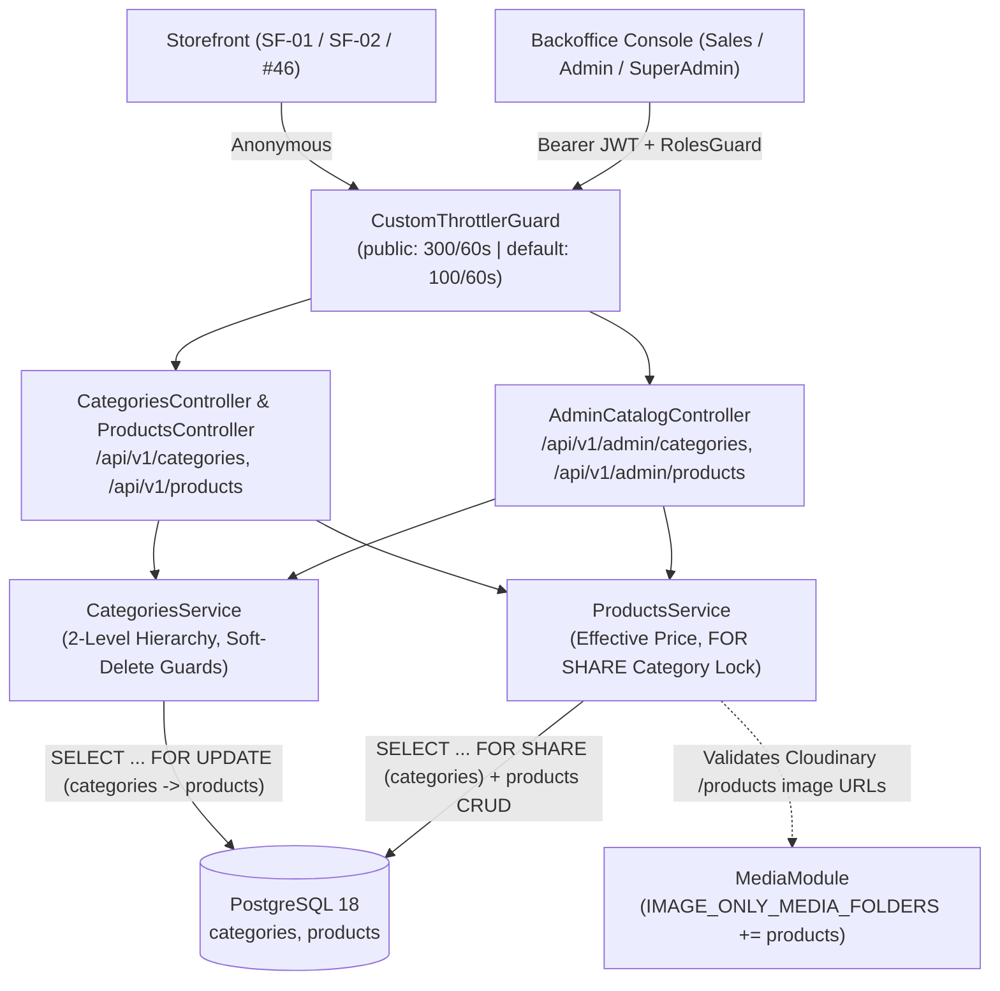
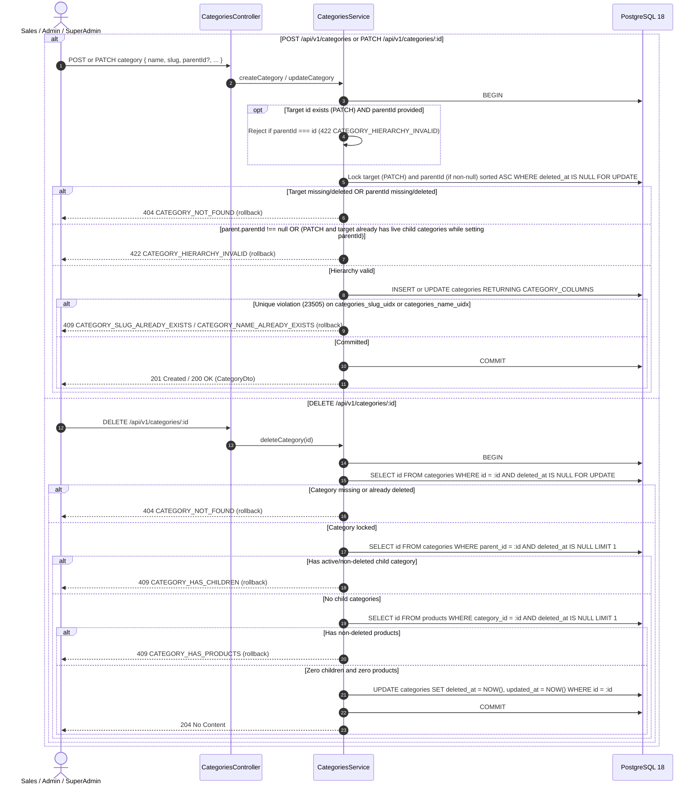

# Catalog Categories and Products CRUD Formal Specification

## Overview & Context

This specification defines the catalog category and product management endpoints, database schema extensions, hierarchy/soft-delete integrity guards, and public/admin visibility boundaries introduced by #80 (split from #22; parent epic #9; Storefront consumer #46 `SF-01`/`SF-02`; live-stock sibling #81) in `apps/api/src/modules/catalog`. Architectural decisions are recorded in ADR-0025; soft-delete partial unique indexes follow ADR-0003; integer VND currency rules follow ADR-0004; DB-enforced `CHECK` invariants follow ADR-0005; Cloudinary media boundaries follow ADR-0009; DTO co-location, envelopes, and RFC 9457 error contracts follow ADR-0011, ADR-0012, and ADR-0013.

`apps/api/src/database/schemas/catalog.schema.ts` currently defines `categories` and `products`, while `apps/api/src/modules/catalog/catalog.module.ts` is an empty skeleton. However, `products` currently lacks `salePrice`, `isVietGap`, and `isUsda` columns plus sale-price `CHECK` constraints, `IMAGE_ONLY_MEDIA_FOLDERS` in `apps/api/src/modules/media/media.interface.ts` does not yet restrict `"products"` to images, `tier2-catalog.seeder.ts` seeds malformed product image URLs, and `@greenroots/shared` lacks catalog RFC 9457 error codes.

### Goals

- Extend `products` in `apps/api/src/database/schemas/catalog.schema.ts` with `salePrice` (nullable integer VND), `isVietGap` (boolean), `isUsda` (boolean), `CHECK (sale_price IS NULL OR sale_price >= 0)`, `CHECK (sale_price IS NULL OR sale_price <= base_price)`, and query indexes for active public reads and effective price (`COALESCE(sale_price, base_price)`).
- Expose uncached `@Public()` (`public` throttle `300 req / 60s`) read endpoints `GET /api/v1/categories`, `GET /api/v1/products`, and `GET /api/v1/products/:slug` excluding soft-deleted and inactive records (including inactive parent/assigned categories), supporting strict `.strict()` query validation (`400` on unknown parameters), pagination, sorting, VietGAP/USDA filters, effective-price range filtering, and 2-level `categoryId` / `categorySlug` descendant filtering.
- Expose `@ApiAuth(UserRole.SALES, UserRole.ADMIN, UserRole.SUPER_ADMIN)` backoffice read endpoints (`GET /api/v1/admin/categories`, `GET /api/v1/admin/categories/:id`, `GET /api/v1/admin/products`, `GET /api/v1/admin/products/:id`) with `isActive` visibility and mutation endpoints (`POST/PATCH/DELETE /api/v1/categories` and `/api/v1/products`).
- Enforce 2-level `categories` hierarchy (`422 CATEGORY_HIERARCHY_INVALID`), `FOR UPDATE` / `FOR SHARE` lock ordering (`categories -> products`), soft-delete dependency guards (`409 CATEGORY_HAS_CHILDREN` / `CATEGORY_HAS_PRODUCTS`), partial-update price invariants (`422 PRODUCT_PRICE_INVALID`), strict kebab-case slug uniqueness (`deleted_at IS NULL`), and image-only `"products"` media validation.
- Register catalog RFC 9457 error codes in `@greenroots/shared` and `apps/api/src/common/constants/messages.constant.ts`, align `tier2-catalog.seeder.ts` image URLs, and sync OpenAPI/TypeScript contracts via `bun run types:sync`.

### Non-Goals

- Live batch stock aggregation (`availableQuantity`) on product read endpoints (implemented in sibling #81).
- Batch intake (#82), expiry cron transitions, or 50% near-expiry Flash Sale batch toggles (#34).
- Writing batch Flash Sale discounts into `products.sale_price` (explicitly prohibited by ADR-0025).
- Category hierarchies deeper than two levels (parent -> child) or recursive tree serialization inside paginated `GET /api/v1/categories`.
- Image upload binary proxying (clients upload via `POST /api/v1/media/upload-signature`).

## Architecture



Symbols and module layout:

- `CATALOG_ROUTES` in `apps/api/src/modules/catalog/catalog.routes.ts` defines frozen route and tag constants (`TAG: "catalog"`, `CATEGORIES_BASE: "categories"`, `CATEGORY_BY_ID: ":id"`, `PRODUCTS_BASE: "products"`, `PRODUCT_BY_SLUG: ":slug"`, `PRODUCT_BY_ID: ":id"`, `ADMIN_CATEGORIES_BASE: "admin/categories"`, `ADMIN_PRODUCTS_BASE: "admin/products"`).
- `CategoriesController` (`apps/api/src/modules/catalog/categories.controller.ts`) and `ProductsController` (`apps/api/src/modules/catalog/products.controller.ts`) expose `@Public()` uncached `GET` list/detail endpoints (`@Throttle({ public: { limit: 300, ttl: 60000 } })`) and `@ApiAuth(UserRole.SALES, UserRole.ADMIN, UserRole.SUPER_ADMIN)` `POST`/`PATCH`/`DELETE` handlers, declaring class-level `@ApiBadRequestResponseRfc9457()` and `@ApiInternalServerErrorResponseRfc9457()`.
- `AdminCategoriesController` (`apps/api/src/modules/catalog/admin-categories.controller.ts`) and `AdminProductsController` (`apps/api/src/modules/catalog/admin-products.controller.ts`) (or unified `AdminCatalogController`) expose `@ApiAuth(UserRole.SALES, UserRole.ADMIN, UserRole.SUPER_ADMIN)` `GET` list and `:id` detail routes returning both active and inactive (`isActive = false`) non-deleted rows.
- `CategoriesService` (`apps/api/src/modules/catalog/categories.service.ts`) owns closed `CATEGORY_COLUMNS` projections, escaped `ILIKE` search (`escapeLikePattern`), 2-level hierarchy validation under `FOR UPDATE`, `23505` constraint-name mapping (`categories_slug_uidx` vs `categories_name_uidx`), and transactional soft-delete dependency guards.
- `ProductsService` (`apps/api/src/modules/catalog/products.service.ts`) owns closed `PRODUCT_COLUMNS` and `PRODUCT_CATEGORY_SUMMARY_COLUMNS` projections, `INNER JOIN categories` active-visibility filtering, 2-level `categoryId` / `categorySlug` descendant filtering, `COALESCE(sale_price, base_price)` price filtering/sorting, `FOR SHARE` parent-category locking, partial-update `salePrice <= basePrice` verification under `FOR UPDATE`, and `23505` / `23514` PostgreSQL error mapping.
- `CatalogModule` (`apps/api/src/modules/catalog/catalog.module.ts`) registers controllers and exports `CategoriesService` and `ProductsService` for downstream `#81`, `#82`, and `#84`.
- `catalog.interface.ts` (`apps/api/src/modules/catalog/catalog.interface.ts`) defines compile-time constants (`CATEGORY_SORT_OPTIONS`, `PRODUCT_SORT_OPTIONS`, `SLUG_REGEX`, `MAX_PRODUCT_IMAGES = 5`, `CatalogSortOption`, etc.) without runtime Zod schemas (per ADR-0011).
- `apps/api/src/modules/catalog/dto/` holds co-located Zod schemas and `createZodDto()` classes (`category.dto.ts`, `create-category.dto.ts`, `update-category.dto.ts`, `list-categories-query.dto.ts`, `product.dto.ts`, `create-product.dto.ts`, `update-product.dto.ts`, `list-products-query.dto.ts`).
- `apps/api/src/modules/media/media.interface.ts` adds `"products"` to `IMAGE_ONLY_MEDIA_FOLDERS`.
- `apps/api/src/database/schemas/catalog.schema.ts` updates `products` columns, `CHECK` constraints, and catalog indexes via one forward-only migration, and `apps/api/src/database/seeds/tiers/tier2-catalog.seeder.ts` aligns seeded product `imageUrls` with `zCloudinaryMediaUrl`.
- `@greenroots/shared` (`packages/shared/src/error-dictionary.ts` and `packages/shared/GLOSSARY.md`) registers catalog RFC 9457 error codes and sharpens `Category`, `Product`, `Catalog Markdown Price`, and `Flash Sale` definitions.

## Operational Flow

### 1. Category Hierarchy Write & Soft-Delete Guard (`POST` / `PATCH` / `DELETE /api/v1/categories`)



### 2. Product Create / Partial Update & Category Lock (`POST` / `PATCH /api/v1/products`)

```mermaid
sequenceDiagram
    autonumber
    actor Staff as Sales / Admin / SuperAdmin
    participant Ctrl as ProductsController
    participant Svc as ProductsService
    participant DB as PostgreSQL 18

    Staff->>Ctrl: POST /api/v1/products or PATCH /api/v1/products/:id
    Ctrl->>Svc: createProduct / updateProduct
    Svc->>DB: BEGIN
    opt categoryId provided
        Svc->>DB: SELECT id, name, slug FROM categories WHERE id = :categoryId AND deleted_at IS NULL FOR SHARE
        alt Category missing or soft-deleted
            Svc-->>Staff: 404 CATEGORY_NOT_FOUND (rollback)
        end
    end
    alt PATCH /api/v1/products/:id
        Svc->>DB: SELECT PRODUCT_COLUMNS FROM products WHERE id = :id AND deleted_at IS NULL FOR UPDATE
        alt Product missing or soft-deleted
            Svc-->>Staff: 404 PRODUCT_NOT_FOUND (rollback)
        else Row locked
            Svc->>Svc: Compute effectiveBase = dto.basePrice ?? row.basePrice; effectiveSale = dto.salePrice !== undefined ? dto.salePrice : row.salePrice
            alt effectiveSale !== null AND effectiveSale > effectiveBase
                Svc-->>Staff: 422 PRODUCT_PRICE_INVALID (rollback)
            else Price invariant satisfied
                Svc->>DB: UPDATE products SET ..., updated_at = NOW() WHERE id = :id RETURNING PRODUCT_COLUMNS
            end
        end
    else POST /api/v1/products
        Svc->>DB: INSERT INTO products (...) RETURNING PRODUCT_COLUMNS
    end
    alt Unique violation (23505 on products_slug_uidx)
        Svc-->>Staff: 409 PRODUCT_SLUG_ALREADY_EXISTS (rollback)
    else Committed
        Svc->>DB: COMMIT (with category summary)
        Svc-->>Staff: 201 Created / 200 OK (ProductDto)
    end
```

Note on lock ordering across both workflows: every transaction touching both `categories` and `products` acquires locks on `categories` **first** (`FOR UPDATE` in `CategoriesService`, `FOR SHARE` in `ProductsService`) **before** reading/locking/mutating `products`, preventing `categories <-> products` lock-order deadlocks.

### 3. Public Catalog Read & Two-Level Category Filter (`GET /api/v1/products` & `GET /api/v1/products/:slug`)

```mermaid
sequenceDiagram
    autonumber
    actor Customer as Storefront / Public Client
    participant Ctrl as ProductsController
    participant Svc as ProductsService
    participant DB as PostgreSQL 18

    alt GET /api/v1/products
        Customer->>Ctrl: GET /api/v1/products?categorySlug=...&isVietGap=true&minPriceVnd=...&sort=price:asc
        Ctrl->>Ctrl: ZodValidationPipe (.strict() rejects unknown params; rejects categoryId + categorySlug together; rejects minPriceVnd > maxPriceVnd)
        Ctrl->>Svc: listPublicProducts(query)
        opt categoryId or categorySlug provided
            Svc->>DB: SELECT id FROM categories WHERE (id = :categoryId OR slug = :categorySlug) AND deleted_at IS NULL AND is_active = true
            alt Category not found or inactive
                Svc-->>Customer: 200 OK (items: [], meta: { total: 0, ... })
            end
        end
        Svc->>DB: SELECT COUNT(*) + paginated rows FROM products INNER JOIN categories ON products.category_id = categories.id WHERE products.deleted_at IS NULL AND products.is_active = true AND categories.deleted_at IS NULL AND categories.is_active = true AND (category filter matches id OR parent_id) AND effective price filters
        Svc-->>Customer: 200 OK PaginatedApiResponseDto<ProductDto>
    else GET /api/v1/products/:slug
        Customer->>Ctrl: GET /api/v1/products/:slug
        Ctrl->>Ctrl: Validate slug format (^[a-z0-9]+(?:-[a-z0-9]+)*$)
        Ctrl->>Svc: getPublicProductBySlug(slug)
        Svc->>DB: SELECT PRODUCT_COLUMNS + category summary INNER JOIN categories WHERE products.slug = :slug AND products.deleted_at IS NULL AND products.is_active = true AND categories.deleted_at IS NULL AND categories.is_active = true LIMIT 1
        alt Not found or product/category inactive or deleted
            Svc-->>Customer: 404 PRODUCT_NOT_FOUND
        else Found and active
            Svc-->>Customer: 200 OK ApiResponseDto<ProductDto>
        end
    end
```

## API Contract

### Endpoints

| Method & Path                      | Access                          | Rate Limit Tier             | Success                                      | RFC 9457 Errors                                                                                                                                                                  |
| :--------------------------------- | :------------------------------ | :-------------------------- | :------------------------------------------- | :------------------------------------------------------------------------------------------------------------------------------------------------------------------------------- |
| `GET /api/v1/categories`           | `@Public()`                     | `public` (`300 req / 60s`)  | `200` `PaginatedApiResponseDto<CategoryDto>` | `400` (`VALIDATION_FAILED`), `429`                                                                                                                                               |
| `GET /api/v1/products`             | `@Public()`                     | `public` (`300 req / 60s`)  | `200` `PaginatedApiResponseDto<ProductDto>`  | `400` (`VALIDATION_FAILED`), `429`                                                                                                                                               |
| `GET /api/v1/products/:slug`       | `@Public()`                     | `public` (`300 req / 60s`)  | `200` `ApiResponseDto<ProductDto>`           | `400` (`VALIDATION_FAILED`), `404` (`PRODUCT_NOT_FOUND`), `429`                                                                                                                  |
| `GET /api/v1/admin/categories`     | `sales`, `admin`, `super_admin` | `default` (`100 req / 60s`) | `200` `PaginatedApiResponseDto<CategoryDto>` | `400`, `401`, `403`                                                                                                                                                              |
| `GET /api/v1/admin/categories/:id` | `sales`, `admin`, `super_admin` | `default` (`100 req / 60s`) | `200` `ApiResponseDto<CategoryDto>`          | `400`, `401`, `403`, `404` (`CATEGORY_NOT_FOUND`)                                                                                                                                |
| `POST /api/v1/categories`          | `sales`, `admin`, `super_admin` | `default` (`100 req / 60s`) | `201` `ApiResponseDto<CategoryDto>`          | `400`, `401`, `403`, `404` (`CATEGORY_NOT_FOUND` for `parentId`), `409` (`CATEGORY_SLUG_ALREADY_EXISTS` \| `CATEGORY_NAME_ALREADY_EXISTS`), `422` (`CATEGORY_HIERARCHY_INVALID`) |
| `PATCH /api/v1/categories/:id`     | `sales`, `admin`, `super_admin` | `default` (`100 req / 60s`) | `200` `ApiResponseDto<CategoryDto>`          | `400`, `401`, `403`, `404` (`CATEGORY_NOT_FOUND`), `409` (`CATEGORY_SLUG_ALREADY_EXISTS` \| `CATEGORY_NAME_ALREADY_EXISTS`), `422` (`CATEGORY_HIERARCHY_INVALID`)                |
| `DELETE /api/v1/categories/:id`    | `sales`, `admin`, `super_admin` | `default` (`100 req / 60s`) | `204 No Content`                             | `400`, `401`, `403`, `404` (`CATEGORY_NOT_FOUND`), `409` (`CATEGORY_HAS_CHILDREN` \| `CATEGORY_HAS_PRODUCTS`)                                                                    |
| `GET /api/v1/admin/products`       | `sales`, `admin`, `super_admin` | `default` (`100 req / 60s`) | `200` `PaginatedApiResponseDto<ProductDto>`  | `400`, `401`, `403`                                                                                                                                                              |
| `GET /api/v1/admin/products/:id`   | `sales`, `admin`, `super_admin` | `default` (`100 req / 60s`) | `200` `ApiResponseDto<ProductDto>`           | `400`, `401`, `403`, `404` (`PRODUCT_NOT_FOUND`)                                                                                                                                 |
| `POST /api/v1/products`            | `sales`, `admin`, `super_admin` | `default` (`100 req / 60s`) | `201` `ApiResponseDto<ProductDto>`           | `400`, `401`, `403`, `404` (`CATEGORY_NOT_FOUND`), `409` (`PRODUCT_SLUG_ALREADY_EXISTS`)                                                                                         |
| `PATCH /api/v1/products/:id`       | `sales`, `admin`, `super_admin` | `default` (`100 req / 60s`) | `200` `ApiResponseDto<ProductDto>`           | `400`, `401`, `403`, `404` (`PRODUCT_NOT_FOUND` \| `CATEGORY_NOT_FOUND`), `409` (`PRODUCT_SLUG_ALREADY_EXISTS`), `422` (`PRODUCT_PRICE_INVALID`)                                 |
| `DELETE /api/v1/products/:id`      | `sales`, `admin`, `super_admin` | `default` (`100 req / 60s`) | `204 No Content`                             | `400`, `401`, `403`, `404` (`PRODUCT_NOT_FOUND`)                                                                                                                                 |

### DTOs, Projections & Validation Rules

1. **Slug & Sanitization (`slug`, `name`, `description`)**:
   - `slug`: normalized with `.trim().toLowerCase()`? No — reject non-kebab-case directly (`trim()` optional or strict `^[a-z0-9]+(?:-[a-z0-9]+)*$`, length `1..255`), so uppercase or spaces fail cleanly with `400 VALIDATION_FAILED`. On `PATCH`, omitting `slug` leaves the persisted `slug` unchanged even when `name` changes.
   - `name` (`1..255`), `description` (nullable `text`, max `5000`), `unit` (`1..50`, default `"kg"`): validated via `zSanitizedString` (HTML/script stripping + whitespace collapse per `docs/standards/security-and-cryptography.md` §5).
2. **Categories DTOs (`CategoryDto`, `CreateCategoryDto`, `UpdateCategoryDto`, `ListCategoriesQueryDto`)**:
   - `CategoryDto`: `{ id (UUID), name, slug, description (string | null), parentId (UUID | null), sortOrder (int), isActive (boolean), createdAt (ISO), updatedAt (ISO) }`. Never exposes `deletedAt`.
   - `CreateCategoryDto`: `{ name, slug, description? (nullable), parentId? (UUIDv7 | null), sortOrder? (int >= 0, default 0), isActive? (boolean, default true) }`.
   - `UpdateCategoryDto`: partial of the above (`at least one field required`, `.strict()`), allowing `parentId: null` to promote a child to root and `description: null` to clear description.
   - `ListCategoriesQueryDto`: `.strict()` with `q?`, `parentId?` (`zUuidV7()`), `rootOnly?` (`zBooleanString()`), `page` (`>= 1`, default `1`), `limit` (`1..100`, default `20`), `sort` (`sortOrder:asc` default | `sortOrder:desc` | `name:asc` | `name:desc` | `createdAt:desc`). Rejects `parentId` + `rootOnly=true` together (`400 VALIDATION_FAILED`). Admin query DTO adds `isActive?` (`zBooleanString()`).
3. **Products DTOs (`ProductDto`, `CreateProductDto`, `UpdateProductDto`, `ListProductsQueryDto`)**:
   - `ProductDto`: `{ id (UUID), categoryId (UUID), category: { id (UUID), name, slug, parentId (UUID | null) }, name, slug, description (string | null), basePriceVnd (int), salePriceVnd (int | null), unit, imageUrls (string[]), isVietGap (boolean), isUsda (boolean), isSubscriptionEligible (boolean), isActive (boolean), createdAt (ISO), updatedAt (ISO) }`. Money fields strictly carry the `Vnd` suffix per ADR-0004 (`basePriceVnd`, `salePriceVnd`); `imageUrls` normalizes `null` to `[]`; `deletedAt` is never exposed.
   - `CreateProductDto`: `{ categoryId (UUIDv7), name, slug, description? (nullable), basePriceVnd (int >= 0), salePriceVnd? (int >= 0 | null), unit? (default "kg"), imageUrls? (array of <= 5 unique `zCloudinaryMediaUrl({ resourceTypes: ["image"], folder: "products" })`, default `[]`), isVietGap? (boolean, default false), isUsda? (boolean, default false), isSubscriptionEligible? (boolean, default true), isActive? (boolean, default true) }`. Boundary refine checks `salePriceVnd <= basePriceVnd` when `salePriceVnd != null`.
   - `UpdateProductDto`: partial of `CreateProductDto` (`at least one field required`, `.strict()`), allowing `salePriceVnd: null` to clear catalog promotion and `imageUrls: []` (or `null` normalized to `[]`) to clear images.
   - `ListProductsQueryDto`: `.strict()` with `q?`, `categoryId?` (`zUuidV7()`), `categorySlug?` (kebab-case slug), `isVietGap?` (`zBooleanString()`), `isUsda?` (`zBooleanString()`), `isSubscriptionEligible?` (`zBooleanString()`), `minPriceVnd?` (`zNumericString({ integer: true, min: 0 })`), `maxPriceVnd?` (`zNumericString({ integer: true, min: 0 })`), `page` (`1+`, default `1`), `limit` (`1..100`, default `20`), `sort` (`createdAt:desc` default | `createdAt:asc` | `price:asc` | `price:desc` | `name:asc` | `name:desc`). Refines reject `categoryId && categorySlug` and `minPriceVnd > maxPriceVnd` (`400 VALIDATION_FAILED`). Admin query DTO adds `isActive?` (`zBooleanString()`).

### Shared Contracts, Error Codes & Migration

- `@greenroots/shared` (`packages/shared/src/error-dictionary.ts`):
  - Register `CATEGORY_NOT_FOUND`, `CATEGORY_SLUG_ALREADY_EXISTS`, `CATEGORY_NAME_ALREADY_EXISTS`, `CATEGORY_HAS_CHILDREN`, `CATEGORY_HAS_PRODUCTS`, `CATEGORY_HIERARCHY_INVALID`, `PRODUCT_NOT_FOUND`, `PRODUCT_SLUG_ALREADY_EXISTS`, `PRODUCT_PRICE_INVALID` in `API_ERROR_CODES` with Vietnamese user-facing copy in `API_ERROR_DICTIONARY`.
- `apps/api/src/common/constants/messages.constant.ts`:
  - Add `MESSAGES.CATEGORIES` and `MESSAGES.PRODUCTS` developer-facing English messages plus `MESSAGES.VALIDATION` helpers (`INVALID_SLUG`, `AT_LEAST_ONE_CATEGORY_FIELD`, `AT_LEAST_ONE_PRODUCT_FIELD`, `PRICE_RANGE_INVALID`, `CONFLICTING_CATEGORY_FILTER`).
- Database schema & migration (`apps/api/src/database/schemas/catalog.schema.ts`):
  - Add `salePrice: integer()`, `isVietGap: boolean().default(false).notNull()`, `isUsda: boolean().default(false).notNull()` to `products`.
  - Add `CHECK` constraints `products_sale_price_non_negative` (`sale_price IS NULL OR sale_price >= 0`) and `products_sale_price_lte_base_price` (`sale_price IS NULL OR sale_price <= base_price`).
  - Add partial/expression indexes on `products` (`products_public_active_idx` on `(category_id, created_at)` `WHERE deleted_at IS NULL AND is_active = true`, `products_effective_price_idx` on `(COALESCE(sale_price, base_price))` `WHERE deleted_at IS NULL AND is_active = true`) and verify query plans via `EXPLAIN (ANALYZE, BUFFERS)`.
  - Generate one forward-only migration via Drizzle per `docs/standards/database-and-migrations.md`.

## Security & Reliability

### Access & Exposure Matrix

| Resource / Action                                                                                      | Public (`@Public()`)  | `customer` / `farm_staff` |     `sales` / `admin` / `super_admin`      |
| :----------------------------------------------------------------------------------------------------- | :-------------------: | :-----------------------: | :----------------------------------------: |
| `GET /categories`, `GET /products`, `GET /products/:slug` (`isActive = true`)                          |          Yes          |            Yes            |                    Yes                     |
| `GET /categories`, `GET /products` seeing `isActive = false` or `deletedAt != null`                    | Hidden (`[]` / `404`) |   Hidden (`[]` / `404`)   |          Hidden on public routes           |
| `GET /admin/categories`, `GET /admin/categories/:id`, `GET /admin/products`, `GET /admin/products/:id` |         `401`         |           `403`           | Yes (non-deleted incl. `isActive = false`) |
| `POST/PATCH/DELETE /categories` and `/products`                                                        |         `401`         |           `403`           |                    Yes                     |

### Controls

- **RBAC & Trust Boundary**: Public routes are decorated with `@Public()`, `@SkipThrottle({ default: true, auth: true })`, and `@Throttle({ public: { limit: 300, ttl: 60000 } })`. All admin read routes and write mutations require `@ApiAuth(UserRole.SALES, UserRole.ADMIN, UserRole.SUPER_ADMIN)` (verified JWT + `RolesGuard`).
- **Unknown Query Parameter & Field Rejection**: Every Query, Create, and Update Zod schema applies `.strict()` alongside global `whitelist: true` and `forbidNonWhitelisted: true` so unrecognized query parameters (e.g. `?foo=bar`) or body fields fail at the HTTP boundary with `400`.
- **XSS & SQL Injection Defense**: All text fields (`name`, `description`, `unit`, `q`) pass through `zSanitizedString` (`sanitizeString` stripping HTML/scripts) and parameterized Drizzle queries (`escapeLikePattern` for `ILIKE` search).
- **Concurrency & Lock Ordering**: All cross-table writes lock `categories` before `products` (`FOR UPDATE` in `CategoriesService`, `FOR SHARE` in `ProductsService`). PostgreSQL partial unique indexes (`categories_name_uidx`, `categories_slug_uidx`, `products_slug_uidx`) and `CHECK` constraints remain the authoritative concurrency backstop (`23505` / `23514` mapped cleanly to `409` / `422`).
- **Cloudinary Media Integrity**: `products.imageUrls` accepts only `https://res.cloudinary.com/${CLOUDINARY_CLOUD_NAME}/image/upload/.../products/...` without query strings, hashes, or path traversal segments (`isCloudinaryMediaUrl`), and `POST /media/upload-signature` rejects video requests for folder `"products"`.

## Domain Invariant Taxonomy

| Invariant    | Name                                           | Formal Statement                                                                                                                                                                                                        | Enforcement Seam                                                                               | Verification Test                                                                                                                                         |
| :----------- | :--------------------------------------------- | :---------------------------------------------------------------------------------------------------------------------------------------------------------------------------------------------------------------------- | :--------------------------------------------------------------------------------------------- | :-------------------------------------------------------------------------------------------------------------------------------------------------------- |
| `INV-CAT-1`  | Active & Non-Deleted Public Visibility         | Public `/categories`, `/products`, and `/products/:slug` MUST return only rows where `deletedAt IS NULL` and `isActive = true` (including `categories.deletedAt IS NULL` and `categories.isActive = true` for products) | `CategoriesService` / `ProductsService` public query builders (`INNER JOIN categories`)        | Inactive product, soft-deleted product, or product inside an inactive category is omitted from `GET /products` and returns `404` on `GET /products/:slug` |
| `INV-CAT-2`  | Two-Level Category Hierarchy                   | `categories.parentId` is either `null` (root) or points to a non-deleted root category (`parent.parentId IS NULL` and `parent.id !== self.id`); a category owning non-deleted children cannot acquire a `parentId`      | `CategoriesService.createCategory` / `updateCategory` under sorted `FOR UPDATE` locks          | Reject self-parent, deleted parent, grandchild assignment, or demoting a parent with children with `422` (`404` if missing/deleted)                       |
| `INV-CAT-3`  | Soft-Delete Dependency Guard                   | Soft-deleting a category MUST fail (`409`) if any non-deleted child category or non-deleted product references it                                                                                                       | `CategoriesService.deleteCategory` (`FOR UPDATE` on category + child/product existence checks) | `DELETE /categories/:id` returns `409 CATEGORY_HAS_CHILDREN` or `CATEGORY_HAS_PRODUCTS`, succeeds (`204`) once dependencies are deleted/reassigned        |
| `INV-CAT-4`  | Active-Scoped Kebab-Case Slug Uniqueness       | Category and product slugs match `^[a-z0-9]+(?:-[a-z0-9]+)*$`, remain immutable on `PATCH` unless explicitly supplied, and are unique only among `deleted_at IS NULL` rows                                              | Zod schema + PostgreSQL partial unique indexes `categories_slug_uidx` / `products_slug_uidx`   | Duplicate active slug returns `409`; soft-deleting row frees its slug for immediate reuse on `POST`                                                       |
| `INV-PROD-1` | Integer VND Non-Negative & Sale Markdown Bound | `basePriceVnd >= 0` integer VND; when non-null, `0 <= salePriceVnd <= basePriceVnd` holds against persisted values across partial `PATCH` updates; `products.sale_price` is never mutated by `#34` Flash Sales          | Zod refine + DB `CHECK` constraints + `ProductsService.updateProduct` `FOR UPDATE` check       | `POST` or partial `PATCH` with `salePriceVnd > basePriceVnd` or `basePriceVnd < persisted salePrice` rejects with `400`/`422`                             |
| `INV-PROD-2` | Image-Only Products Media Boundary             | `products.imageUrls` contains at most 5 unique HTTPS Cloudinary `image` URLs under folder `products` (`null` normalized to `[]` on read)                                                                                | `IMAGE_ONLY_MEDIA_FOLDERS` + `zCloudinaryMediaUrl` + `ProductsService` mapper                  | Video upload signature for `products` returns `400`; >5 URLs, duplicate URLs, or cross-folder URLs return `400`                                           |

### Edge Cases (`EDGE-1..14`)

| ID        | Case                                                                                                           | Expected Behaviour                                                                                                    |
| :-------- | :------------------------------------------------------------------------------------------------------------- | :-------------------------------------------------------------------------------------------------------------------- |
| `EDGE-1`  | Unknown query param on `GET /categories` or `GET /products` (e.g. `?unknown=1`)                                | `.strict()` rejects with `400 VALIDATION_FAILED` (`UNRECOGNIZED_KEYS`)                                                |
| `EDGE-2`  | `GET /products?minPriceVnd=50000&maxPriceVnd=30000`                                                            | Rejected with `400 VALIDATION_FAILED`                                                                                 |
| `EDGE-3`  | `GET /products?categoryId=<uuid>&categorySlug=rau-cu-qua`                                                      | Rejected with `400 VALIDATION_FAILED`                                                                                 |
| `EDGE-4`  | Product with `basePrice=45000, salePrice=28000` queried with `maxPriceVnd=30000`                               | Included because effective price `COALESCE(sale_price, base_price) = 28000 <= 30000`                                  |
| `EDGE-5`  | `GET /products?categoryId=<rootId>` or `categorySlug=<rootSlug>` when products belong to child category        | Returns active products in both root and direct child categories (`INV-CAT-1` preserved)                              |
| `EDGE-6`  | Product is `isActive=true` inside a category updated to `isActive=false`                                       | Disappears from `GET /products` and returns `404` on `GET /products/:slug`, remains readable on `GET /admin/products` |
| `EDGE-7`  | `PATCH /products/:id` updates `{ name: "New Name" }` without `slug`                                            | `name` updates; existing `slug` remains unchanged                                                                     |
| `EDGE-8`  | `PATCH /products/:id` sets `{ salePriceVnd: 50000 }` on product with `basePrice=40000`                         | Rejected with `422 PRODUCT_PRICE_INVALID`                                                                             |
| `EDGE-9`  | `PATCH /products/:id` sets `{ salePriceVnd: null }`                                                            | Clears `sale_price` to `null` (`salePriceVnd: null` in DTO)                                                           |
| `EDGE-10` | `POST` creates category/product with slug `"ca-chua-bi"`, `DELETE`, then `POST` new record with `"ca-chua-bi"` | Succeeds with `201 Created`; old record stays `deleted_at IS NOT NULL`                                                |
| `EDGE-11` | `POST /categories` with `parentId` pointing to a child category (depth 3)                                      | Rejected with `422 CATEGORY_HIERARCHY_INVALID`                                                                        |
| `EDGE-12` | `PATCH /categories/:id` sets `parentId: <otherRootId>` when category `:id` already has a live child            | Rejected with `422 CATEGORY_HIERARCHY_INVALID`                                                                        |
| `EDGE-13` | `POST /products` with `imageUrls: null` or omitted                                                             | Persists cleanly and returns `imageUrls: []` in `ProductDto`                                                          |
| `EDGE-14` | `GET /categories?q=50%25` (`%` or `_` wildcard characters in `q`)                                              | `escapeLikePattern` escapes `%` and `_` so `ILIKE` matches literally                                                  |

### Concurrency & Adversarial Matrix (`ADV-1..6`)

| ID      | Scenario                                                                                                                         | Expected Behaviour                                                                                                                                                                                   |
| :------ | :------------------------------------------------------------------------------------------------------------------------------- | :--------------------------------------------------------------------------------------------------------------------------------------------------------------------------------------------------- |
| `ADV-1` | Concurrent `POST /products` (`FOR SHARE` on `categoryId`) and `DELETE /categories/:id` (`FOR UPDATE` on `categoryId`)            | Serialized on `categories` row lock: either `DELETE` completes first (`POST` sees `404 CATEGORY_NOT_FOUND`), or `POST` commits first (`DELETE` sees product and returns `409 CATEGORY_HAS_PRODUCTS`) |
| `ADV-2` | Two concurrent `POST /products` requests submit identical active `slug`                                                          | Partial unique index `products_slug_uidx` rejects the second with `23505`, mapped to `409 PRODUCT_SLUG_ALREADY_EXISTS`                                                                               |
| `ADV-3` | Concurrent `PATCH /categories/:a` (`parentId = :b`) and `PATCH /categories/:b` (`parentId = :a`)                                 | Sorted ascending UUID `FOR UPDATE` locking prevents deadlock; second writer observes updated `parentId` on `:b` and rejects with `422 CATEGORY_HIERARCHY_INVALID`                                    |
| `ADV-4` | Concurrent `PATCH /products/:id` one raising `salePriceVnd` while another lowers `basePriceVnd`                                  | `FOR UPDATE` serializes updates; second transaction reads committed prices and rejects if `effectiveSale > effectiveBase` (`422 PRODUCT_PRICE_INVALID`)                                              |
| `ADV-5` | Anonymous or `customer` / `farm_staff` user calls `GET /admin/products`, `POST /categories`, or `DELETE /products/:id`           | `JwtAuthGuard` / `RolesGuard` rejects with `401` / `403` before service execution                                                                                                                    |
| `ADV-6` | Attacker passes XSS `<script>alert(1)</script>` in `name`/`description` or path traversal `../farming_logs/a.png` in `imageUrls` | `zSanitizedString` strips tags; `zCloudinaryMediaUrl` rejects traversal with `400 VALIDATION_FAILED`                                                                                                 |

## Test Matrix

- **Factories & Mothers (`apps/api/test/factories/`)**:
  - Add/verify `createCategory(db, overrides)` and `createProduct(db, overrides)` resolving FK dependencies and `CategoryMother` / `ProductMother` presets (`leafy`, `rootWithChild`, `vietGapMarkdown`, `inactive`, `softDeleted`).
- **Unit specs (`apps/api/src/modules/catalog/categories.service.spec.ts` & `products.service.spec.ts`)**:
  - `CategoriesService`: 2-level hierarchy guards, sorted lock ordering, `23505` slug vs name conflict mapping, soft-delete `409` guards.
  - `ProductsService`: partial-update `salePrice <= basePrice` validation, `COALESCE(sale_price, base_price)` filter/sort expressions, `imageUrls` null-to-array normalization, `23505`/`23514` error mapping.
- **Media validation spec (`apps/api/test/integration/media.spec.ts`)**:
  - Assert `POST /media/upload-signature` rejects `resourceType: "video"` for folder `"products"` with `400` (`IMAGE_ONLY_MEDIA_FOLDERS` via `SignedUploadDto`).
- **E2E Integration suite (`apps/api/test/integration/catalog.spec.ts`)**:
  - Public `GET /categories` and `GET /products` pagination, sorting, VietGAP/USDA filters, effective-price range filters (`EDGE-4`), 2-level `categoryId` & `categorySlug` filters (`EDGE-5`), inactive category/product hiding (`INV-CAT-1`), unknown query param `400` (`EDGE-1`).
  - `GET /products/:slug` (`200` active, `404` inactive/soft-deleted/missing).
  - Admin read endpoints (`GET /admin/categories`, `GET /admin/categories/:id`, `GET /admin/products`, `GET /admin/products/:id`) returning `isActive = false` rows for `sales`/`admin`/`super_admin` and `401`/`403` for `customer`/`farm_staff`.
  - RBAC matrix across `POST/PATCH/DELETE`, slug kebab-case validation, slug reuse after soft delete (`EDGE-10`), `salePrice > basePrice` rejection on `POST` and partial `PATCH` (`INV-PROD-1`), 2-level hierarchy violations (`INV-CAT-2`), soft-delete `409` guards (`INV-CAT-3`), and concurrency race tests (`ADV-1`..`ADV-4`).
- **Query plan & contract propagation**:
  - Verify `GET /api/v1/products` query plan with `EXPLAIN (ANALYZE, BUFFERS)` on seeded data.
  - Run `bun run types:sync`, `bun run check`, `bun run test`, and `bun run test:e2e`.

## Risks & Rollback

- **Storefront & Backoffice consumer wiring (`#46`)**: Storefront `SHOWCASE_PRODUCTS` mock (`apps/storefront/src/services/storefront.service.ts`) includes live-stock and rescue-deal fields (`availableQuantity`, `isRescueDeal`, `hoursRemaining`) that land in `#81` and `#34`; `#46` should wait for `#81` or bind non-stock catalog fields first using the OpenAPI types from `bun run types:sync`.
- **Downstream checkout precedence (`#84` & `#34`)**: When a product has both a `products.sale_price` markdown and a batch-level 50% near-expiry Flash Sale, `#34`/`#84` must specify whether batch Flash Sale calculates 50% off `basePrice` or `min(flashSalePrice, salePrice)`.
- **Rollback**: Revert `CatalogModule` routes/services, `MEDIA_INTERFACE` `"products"` entry, and `error-dictionary.ts` additions, then re-run `bun run types:sync`. The additive `sale_price`, `is_viet_gap`, and `is_usda` columns on `products` are nullable/defaulted and backward-compatible, or can be contracted via a forward-only migration per `docs/standards/database-and-migrations.md` §5.
