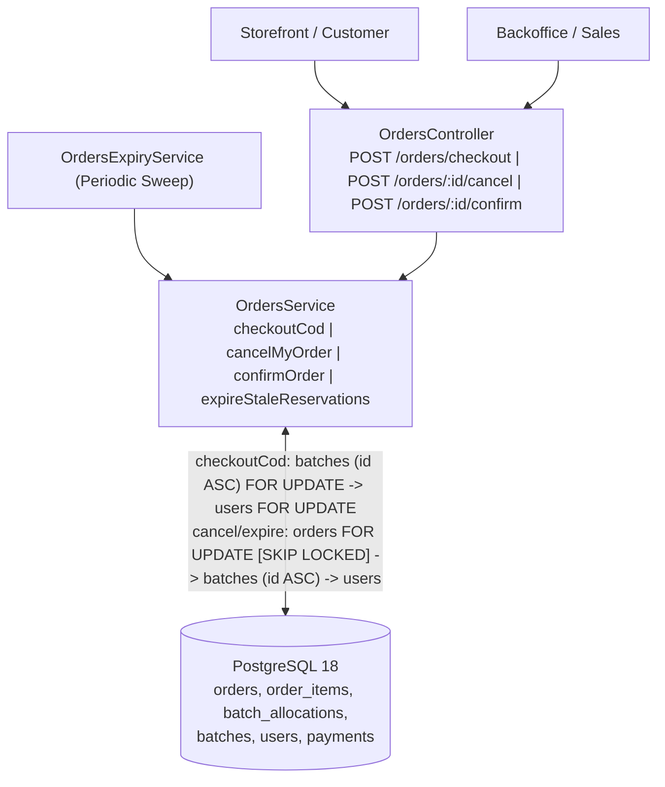
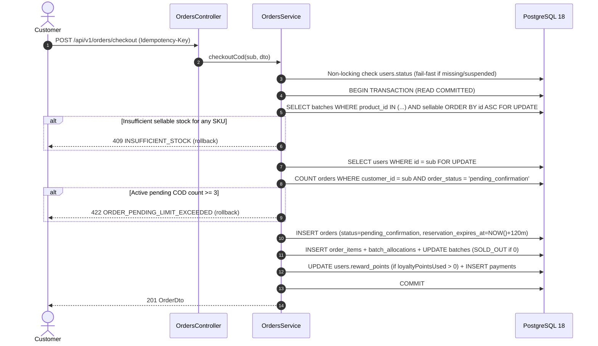

# Checkout-Time FEFO Reservation, COD Anti-Hoarding, and Customer Self-Cancel Formal Specification

## Overview & Context

This specification amends `ADR-0031` and `ADR-0033` (recorded in `ADR-0038`) to move retail FEFO batch allocation from `POST /api/v1/orders/:id/confirm` to `POST /api/v1/orders/checkout` (`checkoutCod`), introduce PostgreSQL-backed COD reservation expiry (`reservation_expires_at` + `FOR UPDATE SKIP LOCKED` sweep) and per-customer pending-order limits (`MAX_PENDING_COD_ORDERS_PER_CUSTOMER`), and add customer self-cancellation (`POST /api/v1/orders/:id/cancel`) prior to staff confirmation.

### Goals

- Add `MAX_PENDING_COD_ORDERS_PER_CUSTOMER: 3`, `COD_CONFIRMATION_TIMEOUT_MINUTES: 120`, and `API_ERROR_CODES.ORDER_PENDING_LIMIT_EXCEEDED` (with Vietnamese `API_ERROR_DICTIONARY` copy) in `@greenroots/shared`.
- Evolve `orders` in `apps/api/src/database/schemas/order.schema.ts` with nullable `reservationExpiresAt` (`timestamptz`) and partial index `orders_reservation_expires_at_idx` via one forward-only Drizzle migration.
- Update `OrdersService.checkoutCod()` to allocate FEFO batches atomically using deadlock-free lock order **`batches (id ASC) -> users`**, enforce the per-customer pending COD cap (`3`), and stamp `reservationExpiresAt`.
- Simplify `OrdersService.confirmOrder()` to verify active `batch_allocations` exist, clear `reservationExpiresAt = null`, and transition `PENDING_CONFIRMATION -> CONFIRMED`.
- Expand `ALLOCATED_CANCELLABLE_STATUSES` to `[PENDING_CONFIRMATION, CONFIRMED, PACKING]` so cancelling any allocated order soft-releases `batch_allocations` and restores `batches`.
- Expose `POST /api/v1/orders/:id/cancel` (`UserRole.CUSTOMER`, `200 OK`, closed `OrderDto`) for pre-confirmation customer cancellations.
- Add `OrdersExpiryService` periodic sweep (`FOR UPDATE SKIP LOCKED`) to auto-cancel expired `PENDING_CONFIRMATION` / `PENDING_PAYMENT` reservations.
- Run `bun run types:sync` and update `orders-checkout.spec.ts`, `orders-fulfillment.spec.ts`, and `orders-concurrency.spec.ts`.

### Non-Goals

- Moving `MAX_PENDING_COD_ORDERS_PER_CUSTOMER` or `COD_CONFIRMATION_TIMEOUT_MINUTES` into `FarmSettings` dynamic admin UI.
- Implementing PayOS payment gateway adapter or webhooks (`#28`).
- Allowing customer self-cancellation once an order reaches `CONFIRMED` or later.

## Architecture



## Operational Flow

### 1. Checkout-Time FEFO Allocation (`POST /api/v1/orders/checkout`)



### 2. Customer Self-Cancel (`POST /api/v1/orders/:id/cancel`)

1. Validate `:id` as UUIDv7 (`ZodValidationPipe`).
2. Inside `READ COMMITTED` transaction: `SELECT ... FROM orders WHERE id = :orderId FOR UPDATE`.
3. If missing or `order.customerId !== sub`: throw `404 ORDER_NOT_FOUND` (`ADR-0032` anti-enumeration).
4. If `order.paymentStatus === PAID || order.paymentMethod === SUBSCRIPTION`: throw `422 ORDER_PAID_CANCELLATION_FORBIDDEN`.
5. If `order.orderStatus` not in `[PENDING_PAYMENT, PENDING_CONFIRMATION]`: throw `422 ORDER_INVALID_STATUS_TRANSITION`.
6. If `order.orderStatus === PENDING_CONFIRMATION` (or active allocations exist): call `releaseOrderAllocations(tx, order.id, hoursThreshold, now)` locking `batches` in `id ASC` order.
7. If `order.loyaltyPointsUsed > 0`: call `refundLoyaltyPoints(tx, order.customerId, order.loyaltyPointsUsed)` locking `users FOR UPDATE`.
8. Update `orders` (`orderStatus = CANCELLED`, `paymentStatus = CANCELLED`, `reservationExpiresAt = null`) and pending `payments` rows (`CANCELLED`).
9. Return `200 OK` with closed `OrderDto`.

### 3. Expiry Sweep (`OrdersExpiryService`)

1. Periodic interval / cron (suppressed in standard integration test runs per `testing-and-fixtures.md` §3, invoked directly in expiry tests).
2. Inside transaction (`READ COMMITTED`), select up to batch size (e.g. `50`) expired order IDs:
   ```sql
   SELECT id FROM orders
   WHERE order_status IN ('pending_payment', 'pending_confirmation')
     AND reservation_expires_at IS NOT NULL
     AND reservation_expires_at <= NOW()
   ORDER BY reservation_expires_at ASC, id ASC
   LIMIT 50
   FOR UPDATE SKIP LOCKED;
   ```
3. For each locked expired order, execute the same `releaseOrderAllocations` -> `refundLoyaltyPoints` -> `CANCELLED` transition atomically.

## Domain Invariants

- **`INV-ORD-18` (Checkout-Time FEFO Invariant)**: Every retail order in `pending_confirmation`, `confirmed`, `packing`, or `shipping` MUST hold active `batch_allocations` (`released_at IS NULL`) whose sum per `order_item_id` equals `order_items.quantity`.
- **`INV-ORD-19` (Global Lock Ordering)**: `checkoutCod` MUST acquire `batches (id ASC) FOR UPDATE` before `users FOR UPDATE`; `updateOrderStatus`, `cancelMyOrder`, and `expireStaleReservations` MUST acquire `orders FOR UPDATE [SKIP LOCKED]` -> `batches (id ASC) FOR UPDATE` -> `users FOR UPDATE`. No code path may lock `users` before `batches`.
- **`INV-ORD-20` (Per-Customer Pending COD Cap)**: A customer may hold at most `BUSINESS_RULES.MAX_PENDING_COD_ORDERS_PER_CUSTOMER` (`3`) concurrent `pending_confirmation` COD orders; excess attempts fail with `422 ORDER_PENDING_LIMIT_EXCEEDED`.
- **`INV-ORD-21` (Customer Pre-Confirm Self-Cancel Isolation)**: `POST /api/v1/orders/:id/cancel` permits cancellation only for the owning customer (`404 ORDER_NOT_FOUND` otherwise) and only from `pending_payment` or `pending_confirmation` (`422 ORDER_INVALID_STATUS_TRANSITION` from `confirmed` or later), returning closed `OrderDto` without `batchCode`.
- **`INV-ORD-22` (Reservation Expiry Soft-Release)**: Expired `pending_confirmation` / `pending_payment` orders (`reservation_expires_at <= NOW()`) are atomically cancelled via `FOR UPDATE SKIP LOCKED`, soft-releasing `batch_allocations`, restoring `batches.available_quantity` and `batches.status`, and refunding `loyaltyPointsUsed`.

## Phased Implementation Plan (Atomic Slices)

1. **Slice 1 — Shared Contracts & Schema Migration (`packages/shared`, `apps/api/src/database`)**:
   - Add `MAX_PENDING_COD_ORDERS_PER_CUSTOMER`, `COD_CONFIRMATION_TIMEOUT_MINUTES`, and `ORDER_PENDING_LIMIT_EXCEEDED` in `packages/shared`.
   - Add `orders.reservationExpiresAt` + `orders_reservation_expires_at_idx` partial index and generate forward-only Drizzle migration.
2. **Slice 2 — Checkout FEFO Allocation & Lock Ordering (`apps/api/src/modules/orders`)**:
   - Refactor `executeCheckoutTransaction()` to lock `batches (id ASC)` before `users`, enforce pending cap, run `allocateFefoForOrder()`, and set `reservationExpiresAt`.
   - Simplify `confirmOrder()` to assert active allocations and clear `reservationExpiresAt = null`.
   - Expand `ALLOCATED_CANCELLABLE_STATUSES` to include `PENDING_CONFIRMATION`.
3. **Slice 3 — Customer Self-Cancel Endpoint (`POST /api/v1/orders/:id/cancel`)**:
   - Add `ORDERS_ROUTES.CANCEL` (`:id/cancel`), `OrdersController.cancelMyOrder()`, `OrdersService.cancelMyOrder()`, and run `bun run types:sync`.
4. **Slice 4 — Expiry Sweep Worker (`OrdersExpiryService`)**:
   - Implement `FOR UPDATE SKIP LOCKED` sweep service + unit/integration tests.
5. **Slice 5 — Concurrency & Regression Test Alignment**:
   - Update `orders-checkout.spec.ts`, `orders-fulfillment.spec.ts`, and `orders-concurrency.spec.ts` to assert checkout-time FEFO allocation, `batches -> users` deadlock immunity under concurrent checkout + cancel, cap enforcement, customer self-cancel, and expiry sweep.
