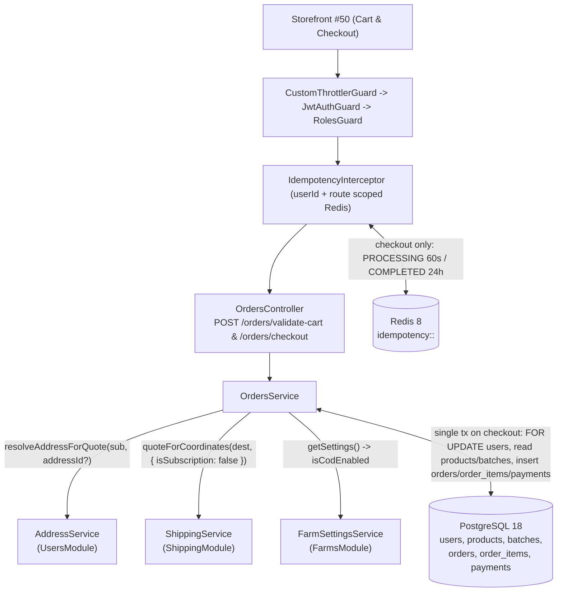
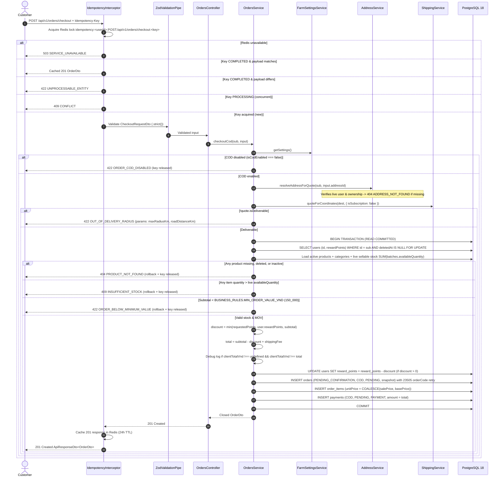

# COD Checkout and Cart Validation Formal Specification

## Overview & Context

This specification defines `POST /api/v1/orders/validate-cart`, `POST /api/v1/orders/checkout` (Cash on Delivery), loyalty-point redemption, server-authoritative order pricing, minimum order value (`MIN_ORDER_VALUE_VND = 150_000`) enforcement, and scoped idempotency for `#84` (split from `#26`, parent epic `#10`, storefront consumer `#50`).

Architectural decisions are recorded in `ADR-0031` (reconciling `#84` with `OrderStatus`, `#86`, `#34`, `#29`, `ADR-0008`, `ADR-0020`, `ADR-0025`, and `ADR-0030`). Money handling follows `ADR-0004`, DB constraints follow `ADR-0005`, OpenAPI sync follows `ADR-0007`, DTO co-location and response envelopes follow `ADR-0011` and `ADR-0012`, RFC 9457 error formatting follows `ADR-0013`, address provenance follows `ADR-0018`, live stock aggregation follows `ADR-0027`, and shipping quotes follow `ADR-0030`.

### Goals

- Add `BUSINESS_RULES.MIN_ORDER_VALUE_VND = 150_000` to `packages/shared/src/business.constants.ts` and add `ORDER_BELOW_MINIMUM_VALUE` and `ORDER_COD_DISABLED` to `API_ERROR_CODES` / `API_ERROR_DICTIONARY` in `packages/shared/src/error-dictionary.ts`.
- Extend `orders` in `apps/api/src/database/schemas/order.schema.ts` with `receiverName` (`varchar(255) NOT NULL`), `receiverPhone` (`varchar(20) NOT NULL`), `loyaltyPointsUsed` (`integer`, default `0`, non-negative `CHECK`), and `orders_discount_lte_subtotal` (`discountAmount <= subtotal`), and add `users_reward_points_non_negative` (`rewardPoints >= 0`) on `users` via forward-only Drizzle migrations.
- Extend `ResolvedQuoteAddress` (`AddressService.resolveAddressForQuote`) with `receiverName` and `phoneNumber` so checkout snapshots `orders.receiverName`, `orders.receiverPhone`, and `orders.shippingAddress` (`"${streetAddress}, ${district}, ${city}"`) independently.
- Namespace `IdempotencyService` / `IdempotencyInterceptor` Redis keys by caller scope (`userId` + `method` + `path`) so idempotency cache entries and conflict locks cannot leak or collide across different customer accounts or endpoints.
- Implement `OrdersModule` (`apps/api/src/modules/orders/*`) exposing `POST /api/v1/orders/validate-cart` (`200 OK` diagnostic validation) and `POST /api/v1/orders/checkout` (`201 Created`, `@Idempotent({ required: true })`, atomic COD order + items + payment + loyalty deduction).
- Run `bun run types:sync` and commit generated OpenAPI and TypeScript client contracts.

### Non-Goals

- FEFO batch allocation (`batch_allocations`), decrementing `batches.availableQuantity`, order confirmation (`POST /api/v1/orders/:id/confirm`), or order status transitions (`#86`).
- Batch-level 50% near-expiry Flash Sale discounting during checkout (`#34`).
- PayOS payment initiation, webhook verification (`#28`), or the 15-minute unpaid order expiry worker (`#29`).
- Customer order history endpoints (`GET /api/v1/orders/me`, `GET /api/v1/orders/:id`, `#85`) or subscription checkout (`#30`).
- Server-side persistent shopping cart storage; the cart remains client-side.

## Architecture

Symbols and module layout:

- `BUSINESS_RULES.MIN_ORDER_VALUE_VND` (`150_000`) in `packages/shared/src/business.constants.ts`.
- `API_ERROR_CODES.ORDER_BELOW_MINIMUM_VALUE` and `API_ERROR_CODES.ORDER_COD_DISABLED` (with Vietnamese copy) in `packages/shared/src/error-dictionary.ts`.
- `orders.loyaltyPointsUsed` + `orders_discount_lte_subtotal` check in `apps/api/src/database/schemas/order.schema.ts`, and `users_reward_points_non_negative` check in `apps/api/src/database/schemas/user.schema.ts`.
- `ResolvedQuoteAddress` (with `receiverName`, `phoneNumber`) in `apps/api/src/modules/users/users.interface.ts` and `AddressService.resolveAddressForQuote()` in `apps/api/src/modules/users/address.service.ts`.
- `IdempotencyService` (`apps/api/src/common/services/idempotency.service.ts`) and `IdempotencyInterceptor` (`apps/api/src/common/interceptors/idempotency.interceptor.ts`) updated to accept an explicit caller/route scope (`scopeKey`) when building Redis keys.
- `MESSAGES.ORDERS` in `apps/api/src/common/constants/messages.constant.ts`.
- `ORDERS_ROUTES` (`TAG`, `BASE: "orders"`, `VALIDATE_CART: "validate-cart"`, `CHECKOUT: "checkout"`) in `apps/api/src/modules/orders/orders.routes.ts`.
- `ORDER_CODE_PREFIX`, `ORDER_CODE_RANDOM_LENGTH`, `ORDER_CODE_MAX_GENERATION_ATTEMPTS`, `MAX_CART_LINE_ITEMS` in `apps/api/src/modules/orders/orders.interface.ts` (pure types/constants only per `ADR-0011`).
- `ValidateCartRequestDto`, `ValidateCartResponseDto`, `CheckoutRequestDto`, and `OrderDto` in `apps/api/src/modules/orders/dto/` (re-exported via `dto/index.ts`).
- `OrdersService` (`apps/api/src/modules/orders/orders.service.ts`), `OrdersController` (`apps/api/src/modules/orders/orders.controller.ts`), and `OrdersModule` (`apps/api/src/modules/orders/orders.module.ts`), imported by `AppModule` (`apps/api/src/app.module.ts`).

## Operational Flow

### 1. COD Checkout Transaction (`POST /api/v1/orders/checkout`)

### 2. Cart Normalization & Monetary Rules

1. **Line-item normalization**: Duplicate `productId` entries in `items` are merged by summing `quantity` (`numeric(10, 2)` precision, max 2 decimal places, strictly `> 0`) and sorted deterministically by `productId` ascending.
2. **Authoritative unit price**: `unitPriceVnd = product.salePrice ?? product.basePrice` (`COALESCE(products.sale_price, products.base_price)`), evaluated only for non-deleted active products in non-deleted active categories.
3. **Line total and subtotal**: `lineTotalVnd = Math.round(quantity * unitPriceVnd)` using exact integer arithmetic on 2-decimal quantities (`Math.round(Number(quantity) * 100) * unitPriceVnd / 100`, rejecting fractional-VND ambiguity by rounding to nearest integer VND or validating integer result); `subtotalVnd = sum(lineTotalVnd)`.
   - _Note_: Because produce quantities may be fractional (`0.25`, `0.50`, `1.25` kg) and prices are integer VND, multiplying `Math.round(qty * 100) * unitPriceVnd` in integer cents-of-kg and `Math.round(... / 100)` prevents IEEE-754 floating-point drift while yielding integer VND.
4. **Minimum order value**: Checked strictly against `subtotalVnd >= BUSINESS_RULES.MIN_ORDER_VALUE_VND` (`150_000`).
5. **Loyalty redemption (`1 point = 1 VND`)**:
   - `loyaltyPointsUsed = discountAmountVnd = Math.min(requestedLoyaltyPoints ?? 0, user.rewardPoints, subtotalVnd)`.
   - Loyalty discount never deducts from `shippingFeeVnd` (3PL delivery cost pass-through).
6. **Grand total**: `totalAmountVnd = subtotalVnd - discountAmountVnd + shippingFeeVnd`.
7. **Client total mismatch logging**: If optional `clientTotalVnd` is supplied and differs from `totalAmountVnd`, `OrdersService` ignores `clientTotalVnd` and logs `{ serverTotalVnd, clientTotalVnd }` via `Logger.debug()` (never logging address or phone PII).

### 3. `validate-cart` Behavior (`POST /api/v1/orders/validate-cart`)

1. Accepts normalized `items[]`, optional `loyaltyPoints` (`>= 0`, default `0`), optional `clientTotalVnd`, and optional `addressId` XOR `districtCode`.
2. Resolves shipping quote when `addressId` or `districtCode` is supplied, or falls back to the customer's default saved address (`AddressService.resolveAddressForQuote(sub)` without failing when the customer has zero addresses — returning `shipping: null` in that case).
3. Loads each requested product (with category visibility check) and live sellable stock (`LIVE_AVAILABLE_QUANTITY_EXPR` from `ADR-0027`), plus the live customer's `rewardPoints`.
4. Returns `200 OK` with `ValidateCartResponseDto`:
   - `isValid`: `true` iff every item is active/available with `availableQuantity >= requestedQuantity`, `meetsMinOrderValue === true`, and `shipping !== null && shipping.isDeliverable === true` (surfacing `meetsMinOrderValue` alongside `shipping: ShippingQuoteDto | null` so `#50` can distinguish "no address selected yet" from "out of delivery radius").
   - Per-item status: `productId`, `name`, `slug`, `unit`, `requestedQuantity`, `availableQuantity`, `unitPriceVnd`, `lineTotalVnd`, `isAvailable`, `issue` (`null | "PRODUCT_UNAVAILABLE" | "INSUFFICIENT_STOCK"`).
   - Monetary & loyalty breakdown: `subtotalVnd`, `minOrderValueVnd`, `meetsMinOrderValue`, `shipping` (`ShippingQuoteDto | null`), `requestedLoyaltyPoints`, `appliedLoyaltyPoints`, `availableLoyaltyPoints`, `discountAmountVnd`, `totalAmountVnd`.

## API Contract

### Endpoints

- `POST /api/v1/orders/validate-cart`
  - **Auth & RBAC**: `@ApiAuth(UserRole.CUSTOMER)` — only `customer` role; `guest` and internal staff roles receive `403 FORBIDDEN`.
  - **HTTP Status**: `200 OK` (`@HttpCode(HttpStatus.OK)`), no `Idempotency-Key` required.
  - **Errors**: `400 VALIDATION_FAILED` (empty items, `> 2` decimal precision, negative points, both `addressId` and `districtCode`, unknown keys), `401 AUTH_TOKEN_INVALID_OR_EXPIRED`, `403 FORBIDDEN`, `404 ADDRESS_NOT_FOUND` (explicit non-owned/missing `addressId`), `404 FARM_NOT_FOUND`, `422 DISTRICT_CODE_INVALID`, `429 TOO_MANY_REQUESTS`, `500 INTERNAL_SERVER_ERROR`.
- `POST /api/v1/orders/checkout`
  - **Auth & RBAC**: `@ApiAuth(UserRole.CUSTOMER)` + `@Idempotent({ required: true })`.
  - **HTTP Status**: `201 Created`.
  - **Errors**: `400 VALIDATION_FAILED` (including missing or non-UUID `Idempotency-Key`), `401 AUTH_TOKEN_INVALID_OR_EXPIRED`, `403 FORBIDDEN`, `404 ADDRESS_NOT_FOUND`, `404 FARM_NOT_FOUND`, `404 PRODUCT_NOT_FOUND`, `409 INSUFFICIENT_STOCK` (`invalidParams[]` per short item), `409 CONFLICT` (concurrent `Idempotency-Key` `PROCESSING`), `422 UNPROCESSABLE_ENTITY` (idempotency payload mismatch), `422 ORDER_COD_DISABLED`, `422 OUT_OF_DELIVERY_RADIUS` (`invalidParams[].params` carrying `{ maxRadiusKm, roadDistanceKm }`), `422 ORDER_BELOW_MINIMUM_VALUE` (`invalidParams[].params` carrying `{ minOrderValueVnd, currentSubtotalVnd }`), `429 TOO_MANY_REQUESTS`, `503 SERVICE_UNAVAILABLE` (Redis failure during idempotency acquisition), `500 INTERNAL_SERVER_ERROR`.

### DTOs & Projections

- `ValidateCartRequestDto` (`.strict()`): `items` (`1..50` items of `{ productId: zUuidV7, quantity: zQuantity }`), optional `addressId` (`zUuidV7`), optional `districtCode`, optional `loyaltyPoints` (`z.number().int().nonnegative().default(0)`), optional `clientTotalVnd` (`z.number().int().nonnegative()`). Cross-field check forbids passing both `addressId` and `districtCode`.
- `CheckoutRequestDto` (`.strict()`): `items` (`1..50` items), optional `addressId` (`zUuidV7`), optional `loyaltyPoints` (`z.number().int().nonnegative().default(0)`), optional `clientTotalVnd` (`z.number().int().nonnegative()`).
- `OrderDto` (closed projection, excluding `customerId`, `subscriptionId`, `batchAllocations`, and payment gateway payloads): `id`, `orderCode`, `orderStatus`, `paymentMethod`, `paymentStatus`, `receiverName`, `receiverPhone`, `shippingAddress`, `shippingDistanceKm`, `shippingFeeVnd`, `subtotalVnd`, `discountAmountVnd`, `loyaltyPointsUsed`, `totalAmountVnd`, `items[]` (`id`, `productId`, `productName`, `productSlug`, `unit`, `quantity`, `unitPriceVnd`, `lineTotalVnd`), `createdAt`, `updatedAt`.

## Security & Reliability

- **Customer identity & ownership**: `customerId` (`sub`) comes strictly from the verified JWT via `@CurrentUser("sub")`. `addressId` ownership is enforced by `AddressService.resolveAddressForQuote(sub, addressId)` returning `404 ADDRESS_NOT_FOUND` on foreign or non-existent UUIDs.
- **Scoped fail-closed idempotency**: `IdempotencyService` namespaces Redis keys by `${userId}:${method}:${path}:${key}` so replays, payload mismatches (`422`), and `PROCESSING` locks (`409`) are isolated per customer and route. Redis unavailability during lock acquisition fails closed with `503 SERVICE_UNAVAILABLE` (`INV-IDEMP-4`), and failed domain executions release the key immediately (`INV-IDEMP-5`).
- **Concurrency & lock ordering**: On `checkout`, `SELECT ... FROM users WHERE id = $1 AND deleted_at IS NULL FOR UPDATE` serializes concurrent checkouts by the same customer before checking/decrementing `rewardPoints`, preventing double-spend race conditions under `READ COMMITTED`. `batches` rows are never locked or mutated in `#84` (`#86` owns ascending-UUID `FOR UPDATE` allocation on confirmation).
- **Transaction scope**: Address resolution (`AddressService`), shipping quote (`ShippingService`), and farm settings read (`FarmSettingsService`) run before opening `db.transaction(...)` (or read-only settings are cached), keeping the write transaction short and free of network/Redis I/O (`docs/standards/database-and-migrations.md` §4).
- **PII log hygiene**: `Logger.debug` logs only aggregate monetary drift (`serverTotalVnd`, `clientTotalVnd`) and never logs `shippingAddress`, `receiverName`, or `phoneNumber` (`docs/standards/security-and-cryptography.md` §7).
- **Rate limiting**: Inherits `CustomThrottlerGuard` `default` tier (`100 req / 60s`).

## Domain Invariant Taxonomy

`OrdersDomainInvariants`:

| Invariant   | Name                              | Formal Statement                                                                                                                                                                                                                                                                                                                                                                            | Enforcement Seam                                                                                  | Verification Test                                                                                                                                     |
| :---------- | :-------------------------------- | :------------------------------------------------------------------------------------------------------------------------------------------------------------------------------------------------------------------------------------------------------------------------------------------------------------------------------------------------------------------------------------------ | :------------------------------------------------------------------------------------------------ | :---------------------------------------------------------------------------------------------------------------------------------------------------- |
| `INV-ORD-1` | Server-Authoritative Money        | `unitPriceVnd`, `subtotalVnd`, `shippingFeeVnd`, `discountAmountVnd`, and `totalAmountVnd` are computed exclusively from persisted `products`, `ShippingService`, and `users.rewardPoints`; any `clientTotalVnd` mismatch is ignored and logged at debug level.                                                                                                                             | `OrdersService.computeOrderTotals` + `.strict()` DTOs                                             | Checkout with tampered `clientTotalVnd` persists server totals and ignores client value                                                               |
| `INV-ORD-2` | Merchandise MOV Gate              | `POST /api/v1/orders/checkout` requires `subtotalVnd >= BUSINESS_RULES.MIN_ORDER_VALUE_VND` (`150_000`) before shipping and loyalty discount; violations fail with `422 ORDER_BELOW_MINIMUM_VALUE` and zero persisted rows.                                                                                                                                                                 | `OrdersService.checkoutCod`                                                                       | Checkout with `subtotalVnd = 149_999` (even if `subtotal + shipping >= 150_000`) returns `422` and writes no `orders` or `payments` row               |
| `INV-ORD-3` | Delivery Radius Gate              | `POST /api/v1/orders/checkout` enforces `quote.isDeliverable === true` from `ShippingService` and rejects out-of-radius addresses with `422 OUT_OF_DELIVERY_RADIUS` carrying `maxRadiusKm` in `invalidParams[].params`.                                                                                                                                                                     | `OrdersService.checkoutCod` + `ShippingService.quoteForCoordinates`                               | Checkout to `can-gio` returns `422 OUT_OF_DELIVERY_RADIUS` with `invalidParams[0].params.maxRadiusKm`                                                 |
| `INV-ORD-4` | Loyalty Cap & Balance Integrity   | Loyalty redemption converts `1 point = 1 VND`, capped at `min(requestedPoints, user.rewardPoints, subtotalVnd)`, never reduces `shippingFeeVnd`, and decrements `users.rewardPoints` under `SELECT ... FOR UPDATE` with DB `CHECK (reward_points >= 0)` in the order transaction.                                                                                                           | `OrdersService.checkoutCod` + `users_reward_points_non_negative` + `orders_discount_lte_subtotal` | Over-requesting points caps at `min(balance, subtotal)`; 10 parallel checkouts never drive `users.rewardPoints` negative                              |
| `INV-ORD-5` | Atomic COD Order & Payment Ledger | Every successful COD checkout atomically persists `orders` (`orderStatus = PENDING_CONFIRMATION`, `paymentMethod = COD`, `paymentStatus = PENDING`, `receiverName`, `receiverPhone`, and `shippingAddress` snapshots), `order_items`, `payments` (`COD`, `PENDING`, `PAYMENT`, `amount = totalAmountVnd`), and `users.rewardPoints` decrement without touching `batches.availableQuantity`. | `OrdersService.checkoutCod` `db.transaction`                                                      | Happy-path checkout persists `orders`, `order_items`, `payments`, and `rewardPoints` atomically while leaving `batches.availableQuantity` unchanged   |
| `INV-ORD-6` | Scoped Idempotency Isolation      | `POST /api/v1/orders/checkout` enforces `INV-IDEMP-1..5` scoped by `(userId, method, path, Idempotency-Key)`: identical replays return cached `201`, payload mismatches return `422`, concurrent in-flight keys return `409`, Redis failure returns `503`, and different users reusing the same UUID never observe each other's cached response.                                            | `@Idempotent({ required: true })` + `IdempotencyInterceptor` + `IdempotencyService`               | Replay returns cached `201` with single DB row; payload change returns `422`; cross-user same UUID executes independently; Redis outage returns `503` |

### Edge Cases (`EDGE-1..14`)

| ID        | Case                                                                                       | Expected Behaviour                                                                                               |
| :-------- | :----------------------------------------------------------------------------------------- | :--------------------------------------------------------------------------------------------------------------- |
| `EDGE-1`  | `POST /orders/checkout` missing `Idempotency-Key` or non-UUID header                       | `400 VALIDATION_FAILED`                                                                                          |
| `EDGE-2`  | Duplicate `productId` entries in `items[]` (e.g. `0.5` + `1.0`)                            | Merged into one normalized `1.5` line item sorted by `productId`                                                 |
| `EDGE-3`  | Quantity with `> 2` decimal places (e.g. `1.234`) or `<= 0`                                | `400 VALIDATION_FAILED` (`CUSTOM_VALIDATION_ERROR` / `TOO_SMALL`)                                                |
| `EDGE-4`  | `items[]` empty or `> 50` merged items                                                     | `400 VALIDATION_FAILED`                                                                                          |
| `EDGE-5`  | `validate-cart` with neither `addressId` nor `districtCode` when user has no saved address | `200 OK`, `shipping: null`, `isValid: false`, `meetsMinOrderValue` and `items[]` still computed                  |
| `EDGE-6`  | `validate-cart` with both `addressId` and `districtCode`                                   | `400 VALIDATION_FAILED` (`CUSTOM_VALIDATION_ERROR`)                                                              |
| `EDGE-7`  | `checkout` when user has no default address and omits `addressId`                          | `404 ADDRESS_NOT_FOUND`                                                                                          |
| `EDGE-8`  | `checkout` with soft-deleted or `isActive = false` product (or inactive category)          | `404 PRODUCT_NOT_FOUND` (idempotency key released)                                                               |
| `EDGE-9`  | `validate-cart` with `isActive = false` or zero-stock product                              | `200 OK`, `isValid: false`, item marked `isAvailable: false` with `PRODUCT_UNAVAILABLE` or `INSUFFICIENT_STOCK`  |
| `EDGE-10` | `checkout` with `subtotalVnd === 150_000` (exact boundary)                                 | Succeeds (`201 Created`)                                                                                         |
| `EDGE-11` | `checkout` when `requestedLoyaltyPoints > user.rewardPoints` or `> subtotalVnd`            | Capped at `min(user.rewardPoints, subtotalVnd)`; `shippingFeeVnd` remains untouched in `totalAmountVnd`          |
| `EDGE-12` | `checkout` when `farms.isCodEnabled === false`                                             | `422 ORDER_COD_DISABLED` (idempotency key released)                                                              |
| `EDGE-13` | `orderCode` hits `23505` collision on `orders_order_code_uidx`                             | Retries up to 5 times with fresh Crockford Base32 suffix inside transaction/savepoint or loop                    |
| `EDGE-14` | Customer deletes saved address immediately after checkout                                  | `orders.receiverName`, `orders.receiverPhone`, and `orders.shippingAddress` remain intact on the persisted order |

### Concurrency & Adversarial Matrix (`ADV-1..5`)

| ID      | Scenario                                                                                                                                           | Expected Behaviour                                                                                                                                                           |
| :------ | :------------------------------------------------------------------------------------------------------------------------------------------------- | :--------------------------------------------------------------------------------------------------------------------------------------------------------------------------- |
| `ADV-1` | Client tampers with `clientTotalVnd` (`1 VND`) or sends extra `unitPriceVnd` / `shippingFeeVnd` / `orderStatus` fields                             | Extra price/status fields fail with `400 UNRECOGNIZED_KEYS`; `clientTotalVnd` mismatch is ignored and debug-logged                                                           |
| `ADV-2` | Two concurrent `POST /orders/checkout` requests from the same customer with **different** `Idempotency-Key`s trying to double-spend `rewardPoints` | Serialized on `SELECT ... FROM users ... FOR UPDATE`; first deducts points, second sees updated lower balance (and `CHECK (reward_points >= 0)` guarantees non-negativity)   |
| `ADV-3` | Two concurrent `POST /orders/checkout` requests from the same customer with the **same** `Idempotency-Key`                                         | First acquires `PROCESSING` lock and creates 1 order; second receives `409 CONFLICT` while in flight, then cached `201` on subsequent replay                                 |
| `ADV-4` | User B submits the exact same `Idempotency-Key` UUID and body previously completed by User A                                                       | Scoped Redis key (`userId:method:path:uuid`) isolates User B; User B executes their own checkout (using their own address/balance) and never sees User A's cached `OrderDto` |
| `ADV-5` | Staff (`sales`, `admin`, `farm_staff`, `super_admin`) or `guest` calls `/orders/validate-cart` or `/orders/checkout`                               | Rejected by `RolesGuard` with `403 FORBIDDEN`                                                                                                                                |

## Test Matrix

1. **Shared Unit Tests (`packages/shared/src/error-dictionary.spec.ts`)**:
   - Verify `BUSINESS_RULES.MIN_ORDER_VALUE_VND === 150_000` and `ORDER_BELOW_MINIMUM_VALUE` / `ORDER_COD_DISABLED` dictionary resolution.
2. **API Unit Tests (`apps/api/src/common/services/idempotency.service.spec.ts`, `orders.service.spec.ts`)**:
   - Scoped Redis key generation (`idempotency:${scope}:${key}`), duplicate product line normalization, integer-cent line math, loyalty cap (`min(requested, balance, subtotal)`), `clientTotalVnd` debug mismatch logging, and `23505` `orderCode` retry.
3. **API Integration Tests (`apps/api/test/integration/orders-checkout.spec.ts` & `idempotency.spec.ts`)**:
   - Following `docs/standards/testing-and-fixtures.md` (`api-schema.d.ts` response typing, `// Invariant: INV-ORD-N` comments):
   - Happy path COD checkout (`201`, `PENDING_CONFIRMATION`, `PENDING` payment row, `loyaltyPointsUsed === 0`, unchanged `batches.availableQuantity`).
   - `validate-cart`: normalized duplicate items, catalog `salePrice` precedence, stock availability breakdown, shipping quote (`addressId` vs `districtCode` vs no-address fallback `shipping: null`), MOV flag, loyalty cap calculation.
   - MOV rejection (`422 ORDER_BELOW_MINIMUM_VALUE` when `subtotal < 150_000`, even if `subtotal + shipping >= 150_000`).
   - Out-of-delivery-radius rejection (`422 OUT_OF_DELIVERY_RADIUS` with `invalidParams[].params.maxRadiusKm`), COD disabled (`422 ORDER_COD_DISABLED`), and stock shortage (`409 INSUFFICIENT_STOCK`).
   - Loyalty point redemption capped by `balance` and `subtotal` (never deducting `shippingFee`), persisting `loyaltyPointsUsed` and decrementing `users.rewardPoints` atomically.
   - Idempotency suite: missing/invalid header (`400`), identical replay (`201`, 1 DB row), payload mismatch (`422`), Redis outage (`503`), failure release (`INV-IDEMP-5`), and cross-user isolation (User B reusing User A's UUID).
   - Concurrent checkout attempts: (a) same `Idempotency-Key` race (`409` on in-flight contender, 1 persisted order), and (b) parallel checkouts with distinct `Idempotency-Key`s racing on `users.rewardPoints` (`rewardPoints >= 0`, exact sum of `loyaltyPointsUsed` across persisted orders).
4. **Contract Sync**:
   - `bun run types:sync` executed cleanly and OpenAPI/client types verified.

## Risks & Rollback

- **TOCTOU oversell window until `#86`**: Because `#84` checks live `batches.availableQuantity` without reserving rows, simultaneous orders from different customers for the last unit can both reach `PENDING_CONFIRMATION`; `#86` confirmation handles the conflict with `409 INSUFFICIENT_STOCK` and must coordinate with `#29`/cancellation to restore `orders.loyaltyPointsUsed`.
- **Loyalty refund coupling on `#29` / `#86`**: When `#86` or `#29` cancels an order with `loyaltyPointsUsed > 0`, it must restore `loyaltyPointsUsed` to `users.rewardPoints` inside the cancellation transaction (`ADR-0020` ownership).
- **Rollback**: Revert the `#84` PR and run `bun run types:sync`; keep the additive `orders.loyalty_points_used` column and `CHECK` constraints (forward-only migration per `docs/standards/database-and-migrations.md` §5), or restore `IdempotencyService` global key prefix only if all Redis idempotency keys are flushed.
