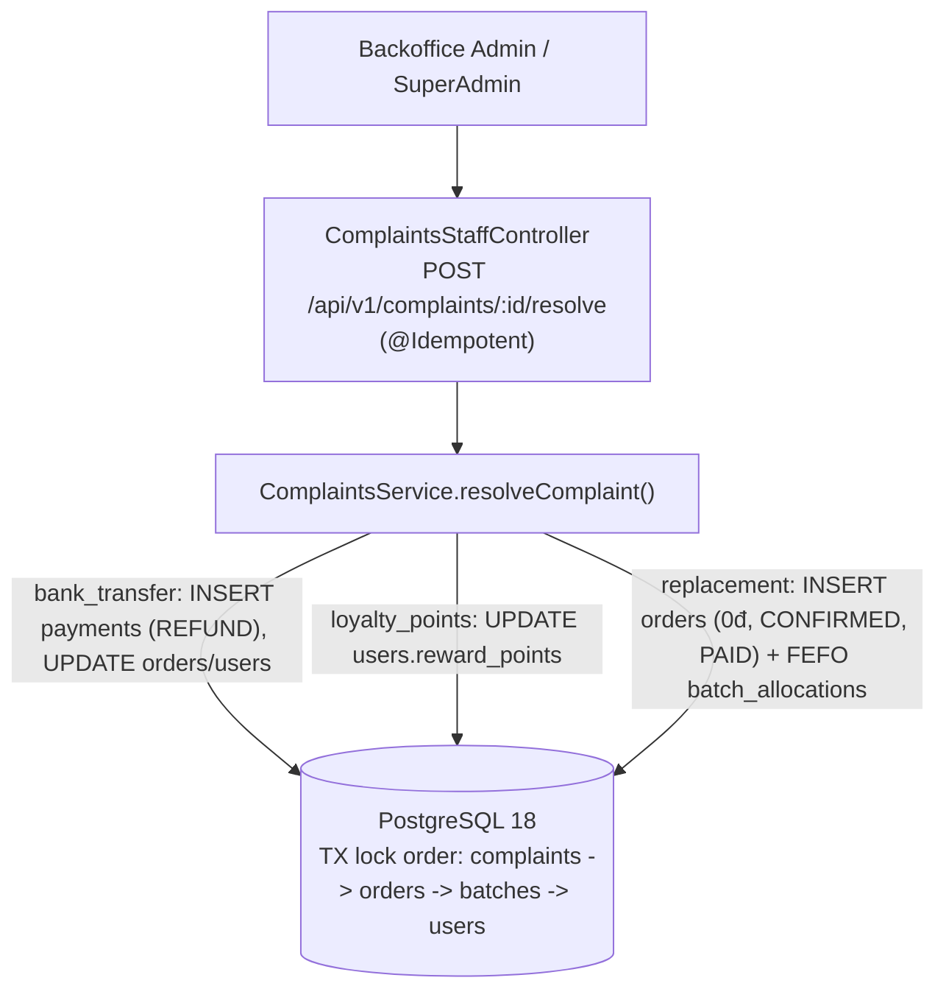
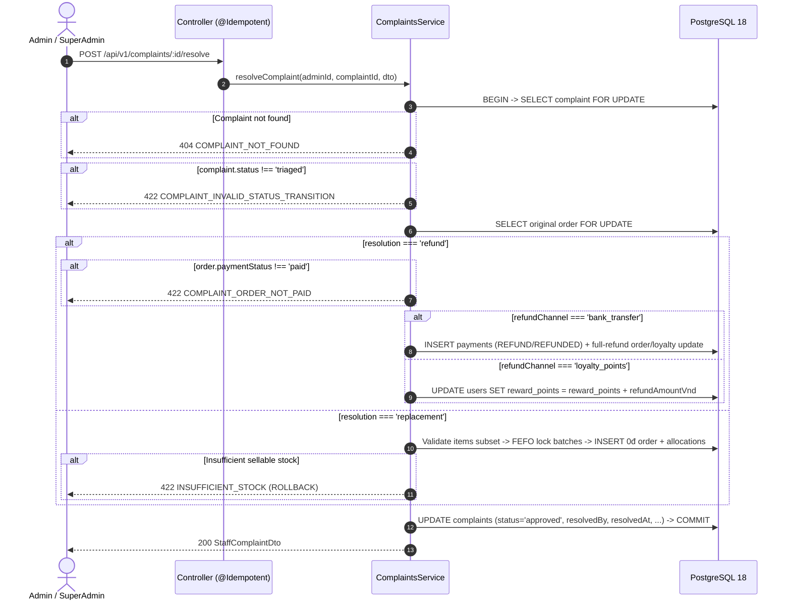

# Admin Complaint Refund & Zero-VND Replacement Resolution Formal Specification

## Overview & Context

This specification defines the implementation contract for `#247` (split from `#33`, Epic `#13`), recorded in `ADR-0046` (extending `ADR-0004`, `ADR-0008`, `ADR-0033`, `ADR-0043`, and `ADR-0045`). It enables authenticated `ADMIN` and `SUPER_ADMIN` staff to atomically resolve a `triaged` complaint via dual-channel refund (`bank_transfer` ledger or `loyalty_points` credit) or a `0đ` FEFO-allocated replacement order.

### Goals

- Add `ComplaintRefundChannel` (`bank_transfer`, `loyalty_points`) and RFC 9457 error codes (`COMPLAINT_ORDER_NOT_PAID`, `COMPLAINT_REPLACEMENT_ITEMS_INVALID`, `COMPLAINT_REFUND_AMOUNT_INVALID`) to `@greenroots/shared`.
- Add `resolvedAt`, `resolutionNote`, `refundChannel`, `refundAmountVnd`, and `replacementOrderId` (nullable FK `orders.id` `ON DELETE SET NULL`) to `complaints` via a forward-only Drizzle migration (`ADR-0002`, `ADR-0005` `CHECK` on `refundAmountVnd > 0`).
- Implement `POST /api/v1/complaints/:id/resolve` guarded by `@ApiAuth(UserRole.ADMIN, UserRole.SUPER_ADMIN)` and `@Idempotent()`, enforcing `FOR UPDATE` lock order `complaints -> orders -> batches -> users`.
- Support `ComplaintResolution.REFUND` (`bank_transfer` creating a `payments` `REFUND`/`REFUNDED` row, or `loyalty_points` crediting `users.rewardPoints`) and `ComplaintResolution.REPLACEMENT` (creating a `0đ` `CONFIRMED` + `PAID` `COD` order with FEFO batch allocation).
- Update `bun run types:sync` and add unit + E2E integration tests covering `INV-CMP-9..13`.

### Non-Goals

- Staff complaint listing or `pending -> triaged | rejected` triage (`#246`, `ADR-0045`).
- Automated PayOS bank-transfer payout API calls (unsupported by PayOS VietQR).
- Backoffice `BO-05` resolution modal UI (`#59`).

## Architecture

## Operational Flow

## Domain Invariants

- **`INV-CMP-9` (Admin-Only Resolution & Idempotency)**: `POST /api/v1/complaints/:id/resolve` MUST permit only `UserRole.ADMIN` and `UserRole.SUPER_ADMIN`, require `Idempotency-Key` (`ADR-0008`), and accept only `ComplaintStatus.TRIAGED` complaints (`422 COMPLAINT_INVALID_STATUS_TRANSITION` otherwise).
- **`INV-CMP-10` (Deterministic Lock Ordering)**: All database row locks inside `resolveComplaint` MUST acquire `complaints -> orders -> batches -> users` in order to prevent deadlocks with checkout (`ADR-0038`) and COD confirmation (`ADR-0043`).
- **`INV-CMP-11` (Paid-Order Gate for Refunds)**: Any `ComplaintResolution.REFUND` (`bank_transfer` or `loyalty_points`) MUST fail with `422 COMPLAINT_ORDER_NOT_PAID` if `orders.paymentStatus !== PaymentStatus.PAID`, and MUST enforce `1 <= refundAmountVnd <= order.totalAmount`.
- **`INV-CMP-12` (Ledger vs Store-Credit Isolation)**: `bank_transfer` MUST insert a `payments` row (`transactionType: REFUND`, `status: REFUNDED`) and set `orders.paymentStatus = REFUNDED` + refund `loyaltyPointsUsed` only on full refund (`refundAmountVnd === order.totalAmount`). `loyalty_points` MUST credit `users.rewardPoints` without creating a `payments` row or mutating `orders.paymentStatus`.
- **`INV-CMP-13` (Zero-VND FEFO Replacement Order)**: `ComplaintResolution.REPLACEMENT` MUST validate any requested `items` as a positive subset of the original order's `order_items` (defaulting to full copy), allocate sellable stock via FEFO (`ADR-0033`), and persist a `0đ` order (`paymentMethod: COD`, `paymentStatus: PAID`, `orderStatus: CONFIRMED`) linked via `complaints.replacementOrderId`.

## Phased Implementation Plan (Atomic Slices)

1. **Slice 1 — Shared Contracts & Migration (`packages/shared`, `apps/api/src/database`)**:
   - Add `ComplaintRefundChannel` enum and 3 RFC 9457 error codes (`COMPLAINT_ORDER_NOT_PAID`, `COMPLAINT_REPLACEMENT_ITEMS_INVALID`, `COMPLAINT_REFUND_AMOUNT_INVALID`) in `@greenroots/shared` + `MESSAGES.COMPLAINTS` in `apps/api`.
   - Update `complaints` schema (`resolvedAt`, `resolutionNote`, `refundChannel`, `refundAmountVnd`, `replacementOrderId`) and generate forward-only Drizzle migration.
2. **Slice 2 — DTOs & Transactional Resolution Service (`apps/api/src/modules/complaints`, `orders`, `payments`)**:
   - Add `ResolveComplaintDto` (discriminated union / Zod refinement for `refund` vs `replacement`) and extend `StaffComplaintDto` with resolution fields.
   - Implement `resolveComplaint` in `ComplaintsService` reusing FEFO batch allocation and order-code generation helpers without duplicating checkout logic.
3. **Slice 3 — Controller, Tests & OpenAPI Sync**:
   - Wire `POST /api/v1/complaints/:id/resolve` with `@ApiAuth(UserRole.ADMIN, UserRole.SUPER_ADMIN)` and `@Idempotent()`.
   - Add unit specs and E2E integration tests verifying `INV-CMP-9..13` (`// Invariant: INV-CMP-9..13`).
   - Run `bun run types:sync`, `bun run check`, `bun run test`, and `bun run test:e2e`.
