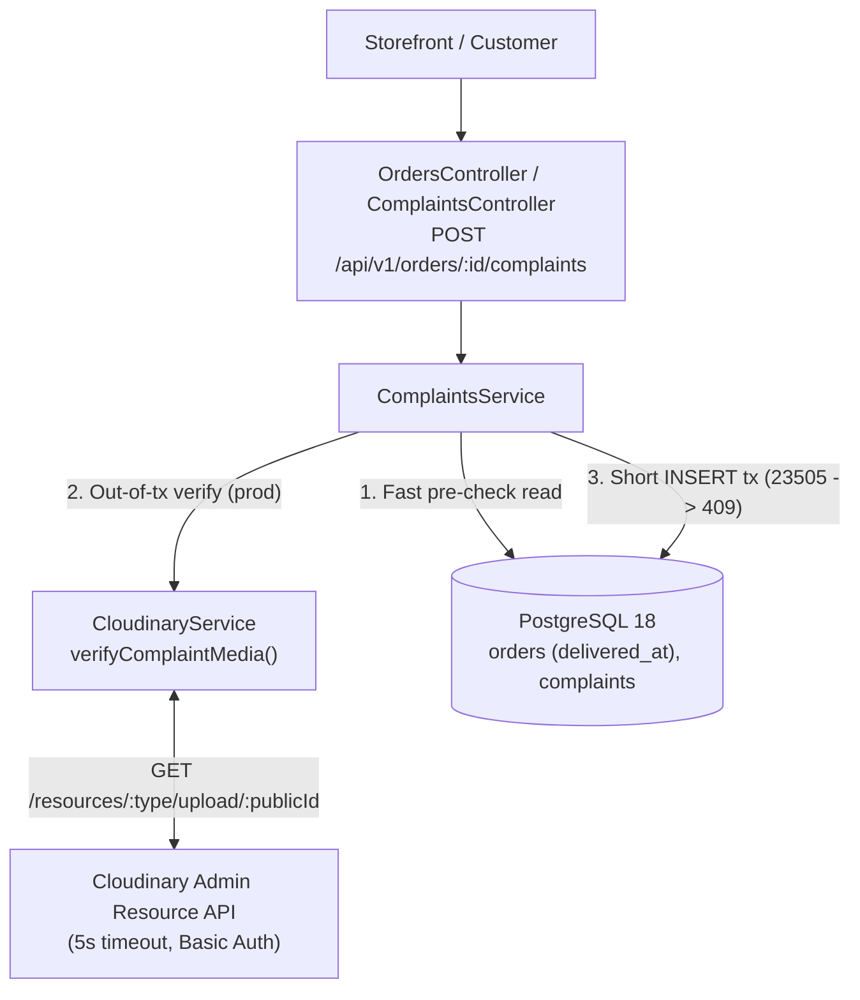
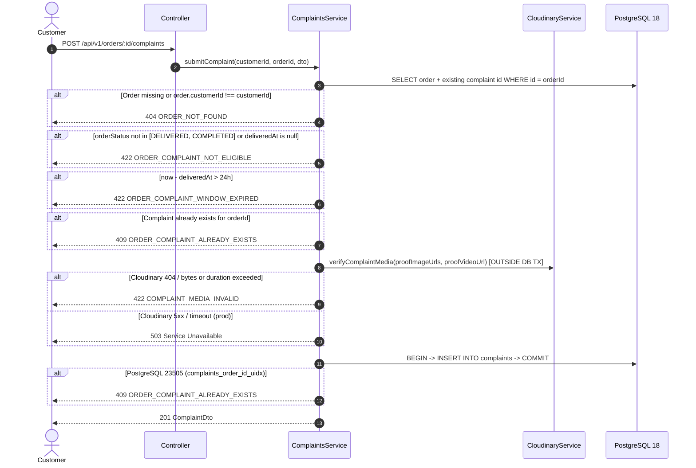

# 24-Hour Complaint Submission & Server-Side Media Verification Formal Specification

## Overview & Context

This specification defines the implementation contract for `#32` (Epic `#13`), recorded in `ADR-0040` (extending `ADR-0009`, `ADR-0032`, and `ADR-0033`). It enables authenticated customers (`UserRole.CUSTOMER`) to submit a single post-delivery complaint against an owned order within 24 hours of delivery, backed by 1–5 Cloudinary proof images (`<= 5MB` each) and an optional proof video (`<= 15MB`, `<= 15s`) verified server-side via Cloudinary Admin API.

### Goals

- Add `COMPLAINT_MIN_IMAGES: 1`, `COMPLAINT_MAX_IMAGES: 5`, and `COMPLAINT_VIDEO_MAX_SECONDS: 15` to `BUSINESS_RULES`, plus RFC 9457 error codes (`ORDER_COMPLAINT_NOT_ELIGIBLE`, `ORDER_COMPLAINT_WINDOW_EXPIRED`, `ORDER_COMPLAINT_ALREADY_EXISTS`, `COMPLAINT_MEDIA_INVALID`) in `@greenroots/shared`.
- Add nullable `deliveredAt` (`delivered_at`, `timestamptz`) to `orders` in `apps/api/src/database/schemas/order.schema.ts` via a forward-only Drizzle migration, and stamp `deliveredAt` once in `OrdersService.updateOrderStatus` when transitioning to `OrderStatus.DELIVERED`.
- Extend `CloudinaryService` (`apps/api/src/modules/media`) with out-of-transaction metadata verification against Cloudinary's Admin Resource API (`bytes` and `duration`), keeping dev/test `CLOUDINARY_API_SECRET`-absent mock bypass (`ADR-0009`) and failing closed (`503`) on production outages/timeouts.
- Implement `POST /api/v1/orders/:id/complaints` (`201 Created`, `ComplaintDto` omitting `resolvedBy`) enforcing anti-enumeration `404 ORDER_NOT_FOUND`, `DELIVERED`/`COMPLETED` eligibility, strict 24-hour window from `deliveredAt`, single-complaint uniqueness (`409`), and HTML-stripped `reason` (`10..2000` chars).
- Update `bun run types:sync` and add unit + E2E integration tests covering 24h boundary, `COMPLETED` within 24h, ownership isolation, duplicate `409`, and media constraint enforcement.

### Non-Goals

- Staff complaint listing, Sales triage (`PATCH /api/v1/complaints/:id/triage`), or Admin refund/replacement resolution (`POST /api/v1/complaints/:id/resolve`) (`#33`).
- Blocking `DELIVERED -> COMPLETED` order transitions while a complaint is `PENDING` (deferred to `#33`).
- Storefront `SF-05` complaint submission UI (`#58`).

## Architecture

## Operational Flow

### 1. Delivery Timestamp Recording (`OrdersService.updateOrderStatus`)

1. When `targetStatus === OrderStatus.DELIVERED`, set `deliveredAt: now` alongside `orderStatus: OrderStatus.DELIVERED` and `updatedAt: now`.
2. Subsequent transitions (e.g., `DELIVERED -> COMPLETED`) MUST NOT overwrite `deliveredAt`.

### 2. Complaint Submission (`POST /api/v1/orders/:id/complaints`)

## Domain Invariants

- **`INV-CMP-1` (Anti-Enumeration Ownership)**: `POST /api/v1/orders/:id/complaints` MUST return `404 ORDER_NOT_FOUND` when the order does not exist or is owned by a different customer (`ADR-0032`).
- **`INV-CMP-2` (Immutable 24-Hour Delivery Window)**: Eligibility requires `orderStatus` in `[DELIVERED, COMPLETED]`, non-null `orders.deliveredAt`, and `now.getTime() - order.deliveredAt.getTime() <= BUSINESS_RULES.COMPLAINT_WINDOW_HOURS * 3600 * 1000`.
- **`INV-CMP-3` (Single Complaint Per Order)**: At most one row in `complaints` may reference a given `order_id` (`complaints_order_id_uidx`); duplicate submissions fail with `409 ORDER_COMPLAINT_ALREADY_EXISTS`.
- **`INV-CMP-4` (Server-Verified Media Boundaries)**: Every submitted proof image MUST reside in `complaints` and satisfy `bytes <= 5MB`; an optional proof video MUST reside in `complaints` and satisfy `bytes <= 15MB` and `duration <= 15s`, verified via Cloudinary Admin API outside any DB transaction (with `503` fail-closed on upstream failure in production and mock bypass when `CLOUDINARY_API_SECRET` is unset in dev/test).

## Phased Implementation Plan (Atomic Slices)

1. **Slice 1 — Shared Contracts & Migration (`packages/shared`, `apps/api/src/database`)**:
   - Add `COMPLAINT_MIN_IMAGES`, `COMPLAINT_MAX_IMAGES`, `COMPLAINT_VIDEO_MAX_SECONDS`, and 4 RFC 9457 error codes + Vietnamese messages in `@greenroots/shared`.
   - Add `deliveredAt` (`timestamptz`, nullable) to `orders` and generate Drizzle migration.
   - Update `OrdersService.updateOrderStatus` to stamp `deliveredAt` on `DELIVERED`.
2. **Slice 2 — Cloudinary Metadata Verification (`apps/api/src/modules/media`)**:
   - Add `verifyMediaAsset` / `verifyComplaintMedia` to `CloudinaryService` (parsing `public_id` from validated Cloudinary URL, calling Admin Resource API with 5s timeout, enforcing `5MB` / `15MB` / `15s`, fail-closed `503`, dev/test mock bypass).
3. **Slice 3 — Complaint Submission Endpoint & Tests (`apps/api/src/modules/complaints` or `orders`)**:
   - Implement DTO (`reason` `10..2000` trimmed + HTML stripped, `1..5` unique `proofImageUrls` `<= 500` chars, optional `proofVideoUrl` `<= 500` chars), `ComplaintDto`, service, controller, unit specs, and E2E specs (`// Invariant: INV-CMP-1..4`).
   - Run `bun run types:sync`, `bun run check`, `bun run test`, and `bun run test:e2e`.
