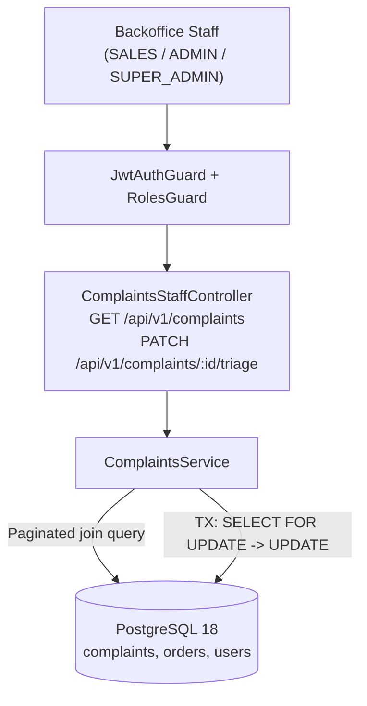
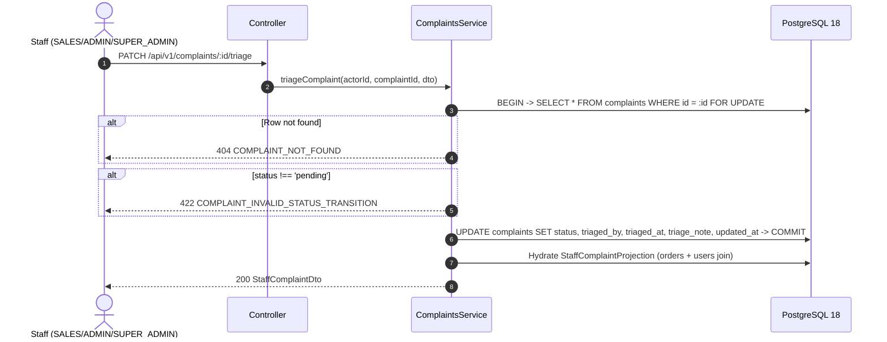

# Staff Complaint List & Triage Formal Specification

## Overview & Context

This specification defines the implementation contract for `#246` (split from `#33`, Epic `#13`), recorded in `ADR-0045` (extending `ADR-0040`, `ADR-0019`, and `ADR-0033`). It enables authenticated staff (`UserRole.SALES`, `UserRole.ADMIN`, `UserRole.SUPER_ADMIN`) to list, filter, and triage customer complaints via `GET /api/v1/complaints` and `PATCH /api/v1/complaints/:id/triage`.

### Goals

- Add `ComplaintStatus.TRIAGED = "triaged"` to `packages/shared/src/domain.enums.ts` and RFC 9457 error codes (`COMPLAINT_NOT_FOUND`, `COMPLAINT_INVALID_STATUS_TRANSITION`) to `@greenroots/shared`.
- Add `triagedBy` (`uuid`, nullable FK `users.id` `ON DELETE SET NULL`), `triagedAt` (`timestamptz`, nullable), and `triageNote` (`text`, nullable) to `complaints`, plus `complaint_status` enum value `'triaged'` via a forward-only Drizzle migration (`ADR-0002`).
- Introduce `StaffComplaintDto` (`apps/api/src/modules/complaints/dto/staff-complaint.dto.ts`) joining `orders` (`orderCode`, `totalVnd`, `paymentMethod`, `deliveredAt`) and `users` (`customerName`, `customerPhone`) while keeping customer `ComplaintDto` unchanged.
- Implement `GET /api/v1/complaints` with pagination (`page`, `limit <= 100`), filtering (`status`, `resolution`, `orderId`, `customerId`, `from`, `to`, `search`), and deterministic sorting (`createdAt DESC, id DESC`).
- Implement `PATCH /api/v1/complaints/:id/triage` enforcing `{SALES, ADMIN, SUPER_ADMIN}` RBAC, row-level `FOR UPDATE` locking, strict `pending -> triaged | rejected` transitions, and mandatory `triageNote` (`5..500` chars) on `rejected`.
- Update `bun run types:sync` and add unit + integration tests covering RBAC, concurrency, FSM transitions, and filter/pagination behavior.

### Non-Goals

- Admin financial refund or `0đ` replacement order resolution (`POST /api/v1/complaints/:id/resolve`, sibling `#247`).
- Customer complaint submission (`#32`, already implemented) or Backoffice `BO-05` UI (`#59`).
- Re-triaging complaints that have already left `pending` status.

## Architecture

## Operational Flow

### 1. Staff Complaint List (`GET /api/v1/complaints`)

1. Validate query parameters (`page` >= 1 default `1`, `limit` `1..100` default `20`, optional `status`, `resolution`, `orderId`, `customerId`, `from`/`to` ISO datetime with `from <= to`, `search` `2..100` trimmed chars).
2. Execute `COUNT(*)` (joining `orders` and `users` when `search` is present) and return empty `items: []` early when `total === 0` or `offset >= total`.
3. Fetch paginated `complaints` joined with `orders` and `users`, ordered by `createdAt DESC, id DESC`, and map to `StaffComplaintProjection`.

### 2. Staff Complaint Triage (`PATCH /api/v1/complaints/:id/triage`)

## Domain Invariants

- **`INV-CMP-5` (Staff RBAC Boundary)**: `GET /api/v1/complaints` and `PATCH /api/v1/complaints/:id/triage` MUST permit only `UserRole.SALES`, `UserRole.ADMIN`, and `UserRole.SUPER_ADMIN`; `customer`, `guest`, and `farm_staff` receive `403`.
- **`INV-CMP-6` (One-Shot Triage FSM & Concurrency)**: `PATCH /api/v1/complaints/:id/triage` MUST lock the target `complaints` row with `FOR UPDATE` and allow transitions strictly from `ComplaintStatus.PENDING` to `ComplaintStatus.TRIAGED` or `ComplaintStatus.REJECTED`. Any non-`pending` complaint MUST fail with `422 COMPLAINT_INVALID_STATUS_TRANSITION`.
- **`INV-CMP-7` (Mandatory Rejection Rationale)**: Transitioning a complaint to `ComplaintStatus.REJECTED` MUST require a trimmed, HTML-stripped `triageNote` between `5` and `500` characters; `ComplaintStatus.TRIAGED` allows an optional `triageNote` (`<= 500` chars, `null` if omitted/empty).
- **`INV-CMP-8` (Staff Projection Isolation)**: Internal fields (`triagedBy`, `triagedAt`, `triageNote`, `resolvedBy`) MUST be exposed only on `StaffComplaintDto` and MUST NOT leak into customer `ComplaintDto`.

## Phased Implementation Plan (Atomic Slices)

1. **Slice 1 — Shared Contracts & Migration (`packages/shared`, `apps/api/src/database`)**:
   - Add `ComplaintStatus.TRIAGED = "triaged"` and error codes `COMPLAINT_NOT_FOUND`, `COMPLAINT_INVALID_STATUS_TRANSITION` in `@greenroots/shared` (plus `MESSAGES.COMPLAINTS` in `apps/api`).
   - Update `complaints` schema (`triagedBy`, `triagedAt`, `triageNote`) and generate Drizzle forward-only migration adding enum value `'triaged'` and the 3 nullable columns.
2. **Slice 2 — DTOs & Query/Triage Service (`apps/api/src/modules/complaints`)**:
   - Add `StaffComplaintDto`, `ListComplaintsQueryDto` (with `from <= to` and `search` bounds), and `TriageComplaintDto` (with `status in [triaged, rejected]` and conditional `triageNote` refinement).
   - Implement `listComplaints` and `triageComplaint` in `ComplaintsService` with `FOR UPDATE` locking and `StaffComplaintProjection` hydration.
3. **Slice 3 — Staff Controller, Tests & OpenAPI Sync**:
   - Add staff routes (`GET /api/v1/complaints`, `PATCH /api/v1/complaints/:id/triage`) with `@ApiAuth(UserRole.SALES, UserRole.ADMIN, UserRole.SUPER_ADMIN)`.
   - Add unit specs and E2E integration tests verifying `INV-CMP-5..8` (`// Invariant: INV-CMP-5..8`).
   - Run `bun run types:sync`, `bun run check`, `bun run test`, and `bun run test:e2e`.
