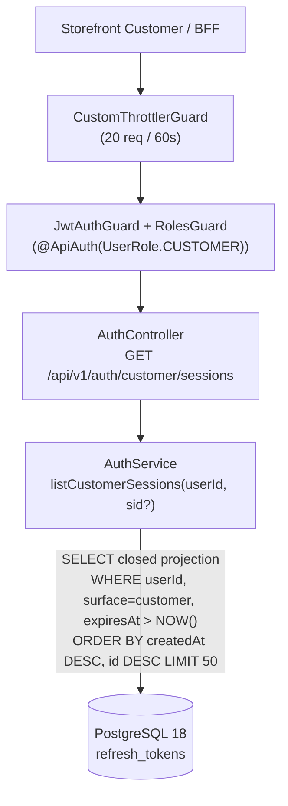
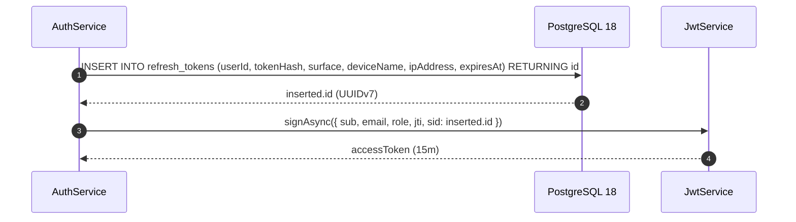
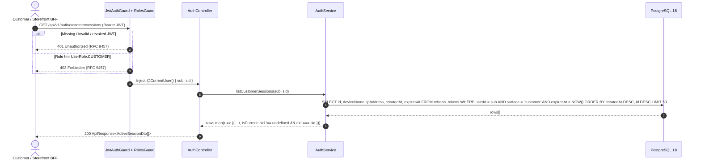

# Customer Active Sessions Endpoint Formal Specification

## Overview & Context

This specification defines the implementation contract for `#182` (Epic `#7`, follow-up to `#17`, `#123`, `#183` / `ADR-0037`, and `#145` / `ADR-0039`). It enables authenticated customers (`UserRole.CUSTOMER`) to inspect their non-expired active customer sessions—including which session corresponds to the caller's current access token—via `GET /api/v1/auth/customer/sessions`.

### Goals

- Expose `GET /api/v1/auth/customer/sessions` (`AUTH_ROUTES.CUSTOMER_SESSIONS`) guarded by `@ApiAuth(UserRole.CUSTOMER)` and `@Throttle({ default: { limit: 20, ttl: 60000 } })`.
- Enforce service-layer isolation on `refresh_tokens` (`userId = sub`, `surface = AuthSurface.CUSTOMER`, `expiresAt > NOW()`), sorted deterministically (`createdAt DESC, id DESC`), and bounded by `MAX_ACTIVE_SESSIONS_LIST = 50`.
- Embed `sid` (`refresh_tokens.id`) into `JwtPayload` during `AuthService.createTokenSession` by inserting `refreshTokens` before signing the JWT, allowing `isCurrent` computation without an extra DB query or schema migration.
- Expose a closed projection `ActiveSessionDto` (`id`, `deviceName`, `ipAddress`, `createdAt`, `expiresAt`, `isCurrent`) via `@ApiOkResponseGeneric(ActiveSessionDto, { isArray: true })`.
- Sync OpenAPI contracts (`bun run types:sync`) and verify via unit and integration tests.

### Non-Goals

- Selective single-session revocation (`DELETE /api/v1/auth/customer/sessions/:id`) or Storefront UI wiring.
- Staff session listing (`GET /api/v1/auth/staff/sessions`, deferred to Backoffice).
- New database migrations or composite indexes on `refresh_tokens`.
- Client metadata forwarding across Storefront BFF (already completed in `#183` / `ADR-0037`).

## Architecture

## Operational Flow

### 1. Session Issuance (`createTokenSession`) & `sid` Binding

### 2. Customer Session Listing (`GET /api/v1/auth/customer/sessions`)

## Security & Reliability

- **RBAC & Surface Isolation (`ADR-0039`)**: `@ApiAuth(UserRole.CUSTOMER)` rejects staff roles (`farm_staff`, `sales`, `admin`, `super_admin`) and unauthenticated callers at the guard boundary (`403` / `401`). `AuthService.listCustomerSessions` additionally filters by `eq(refreshTokens.surface, AuthSurface.CUSTOMER)` as defense-in-depth.
- **Closed Projection & Secret Redaction**: `refresh_tokens.token` (SHA-256 digest) and `surface` are never selected from PostgreSQL or included in `ActiveSessionDto`. Handler and service MUST NOT log `ipAddress`, `deviceName`, or raw tokens (`docs/standards/security-and-cryptography.md` §7).
- **Backward Compatibility & Rotation Semantics for `isCurrent`**: Pre-deploy access tokens without a `sid` claim evaluate `isCurrent` to `false` safely. After a refresh token rotation (`ADR-0015`), an older access token's `sid` references the deleted row and likewise yields `isCurrent: false` until the client adopts the rotated access token.
- **Rate Limiting & Bounded Payload**: `@Throttle({ default: { limit: 20, ttl: 60000 } })` caps polling abuse; `LIMIT 50` (`MAX_ACTIVE_SESSIONS_LIST`) prevents unbounded memory/JSON serialization spikes on accounts with high login volume.

## Domain Invariant Taxonomy

| Invariant ID          | Rule                                                                                                                                                                                              | Enforcement Layer                                             | Verification Mapping             |
| :-------------------- | :------------------------------------------------------------------------------------------------------------------------------------------------------------------------------------------------ | :------------------------------------------------------------ | :------------------------------- |
| **`INV-AUTH-SESS-1`** | Only authenticated `UserRole.CUSTOMER` accounts may access `GET /api/v1/auth/customer/sessions`; unauthenticated requests return `401` and non-customer roles return `403`.                       | `JwtAuthGuard` + `RolesGuard` (`@ApiAuth(UserRole.CUSTOMER)`) | E2E & controller unit tests      |
| **`INV-AUTH-SESS-2`** | Query MUST return only rows where `userId = jwt.sub`, `surface = AuthSurface.CUSTOMER`, and `expiresAt > NOW()`, ordered by `createdAt DESC, id DESC` with `LIMIT 50`.                            | `AuthService.listCustomerSessions` (Drizzle `SELECT`)         | Service unit + integration tests |
| **`INV-AUTH-SESS-3`** | Response items MUST match the closed `ActiveSessionDto` keyset (`id`, `deviceName`, `ipAddress`, `createdAt`, `expiresAt`, `isCurrent`) and MUST NOT expose `token` digests or other users' rows. | Drizzle explicit column projection + `ActiveSessionDto`       | Service unit + E2E tests         |
| **`INV-AUTH-SESS-4`** | `isCurrent` MUST be `true` if and only if `jwt.sid` is present and equals `refresh_tokens.id` (`false` when `sid` is absent or rotated away).                                                     | `AuthService.createTokenSession` + `listCustomerSessions`     | Service unit + E2E tests         |

## Phased Implementation Plan (Atomic Slices)

1. **Slice 1 — JWT `sid` Binding & Auth Constants (`apps/api/src/common`, `apps/api/src/modules/auth`)**:
   - Add optional `sid?: string` to `JwtPayload` in `apps/api/src/common/decorators/current-user.decorator.ts` and `apps/api/src/modules/auth/auth.interface.ts`.
   - Define `MAX_ACTIVE_SESSIONS_LIST = 50` in `apps/api/src/modules/auth/auth.constant.ts` (per `docs/standards/api-design-and-error-handling.md` §8).
   - Update `AuthService.createTokenSession` to insert `refreshTokens` first with `.returning({ id: refreshTokens.id })` and include `sid` in the signed JWT payload.
2. **Slice 2 — `ActiveSessionDto`, Route & Service Query (`apps/api/src/modules/auth`)**:
   - Add `CUSTOMER_SESSIONS: "customer/sessions"` to `AUTH_ROUTES` in `apps/api/src/modules/auth/auth.routes.ts`.
   - Create `ActiveSessionDto` (`activeSessionSchema`) in `apps/api/src/modules/auth/dto/active-session.dto.ts` and export from `dto/index.ts`.
   - Implement `AuthService.listCustomerSessions(userId: string, currentSessionId?: string)` and wire `GET /api/v1/auth/customer/sessions` in `AuthController`.
3. **Slice 3 — Tests & OpenAPI Contract Sync**:
   - Add unit tests in `auth.service.spec.ts` and integration/E2E tests verifying `INV-AUTH-SESS-1..4`.
   - Run `bun run types:sync`, `bun run check`, and `bun run test:api`.
