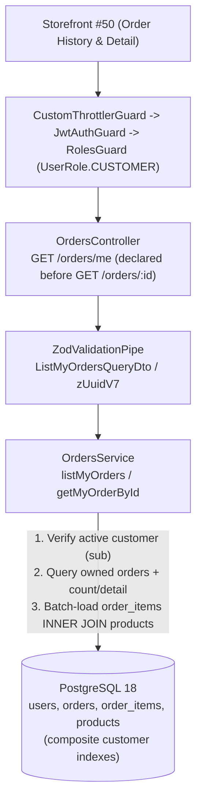
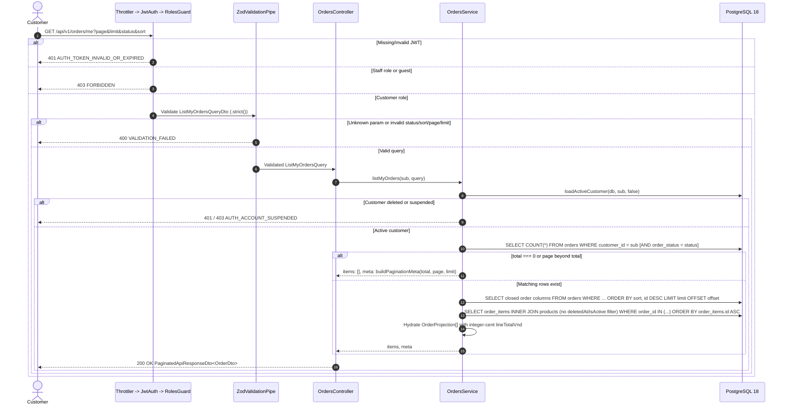
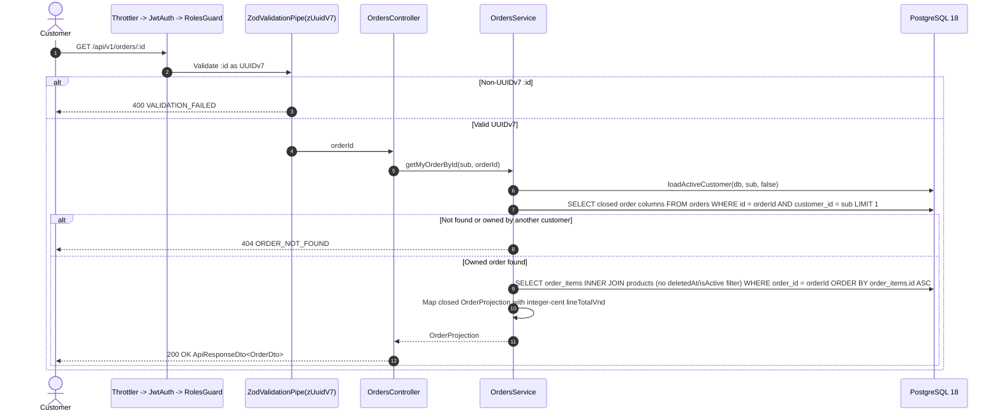

# Customer Order History Formal Specification

## Overview & Context

This specification defines the read-only customer order history endpoints `GET /api/v1/orders/me` and `GET /api/v1/orders/:id` in `apps/api/src/modules/orders/*` for `#85` (split from `#26`, parent epic `#10`, storefront consumer `#50`).

Architectural decisions are recorded in `ADR-0032` (extending `ADR-0031`). Money handling follows `ADR-0004`, soft-delete boundaries follow `ADR-0003`, OpenAPI sync follows `ADR-0007`, DTO co-location and response envelopes follow `ADR-0011` and `ADR-0012`, and RFC 9457 error formatting follows `ADR-0013`.

### Goals

- Add `API_ERROR_CODES.ORDER_NOT_FOUND` and its Vietnamese dictionary message to `packages/shared/src/error-dictionary.ts`, and `MESSAGES.ORDERS.NOT_FOUND` to `apps/api/src/common/constants/messages.constant.ts`.
- Add composite customer order history indexes (`orders_customer_created_at_idx` and `orders_customer_status_created_at_idx`) on `orders` in `apps/api/src/database/schemas/order.schema.ts` via a forward-only Drizzle migration.
- Expose `GET /api/v1/orders/me` (`PaginatedApiResponseDto<OrderDto>`) with `page`, `limit`, `status`, and `sort` query validation (`ListMyOrdersQueryDto`).
- Expose `GET /api/v1/orders/:id` (`ApiResponseDto<OrderDto>`) with UUIDv7 parameter validation, strict JWT `sub` ownership scoping, and anti-enumeration `404 ORDER_NOT_FOUND` for missing or foreign orders.
- Enforce active-customer status checks (`loadActiveCustomer`), extend `OrderItemDto` with `productImageUrl` (`products.imageUrls?.[0] ?? null`), include all customer-owned orders (both retail and `subscriptionId !== null`) without joining `payments` or exposing `batchAllocations`/staff fields, and preserve `order_items` hydration even when referenced `products` are inactive or soft-deleted.
- Run `bun run types:sync` and commit generated OpenAPI and TypeScript client contracts.

### Non-Goals

- Admin or staff order list/detail endpoints (`BO-04`).
- Order confirmation, FEFO batch allocation, order status transitions, or cancellation (`#86`).
- Pick-list endpoints (`#87`), payment status polling or PayOS webhook capture (`#28`), and unpaid order expiration (`#29`).
- Invoices, PDF exports, or product-name snapshot migrations on `order_items`.

## Architecture

Symbols and module layout:

- `API_ERROR_CODES.ORDER_NOT_FOUND` and `API_ERROR_DICTIONARY` entry in `packages/shared/src/error-dictionary.ts`.
- `MESSAGES.ORDERS.NOT_FOUND` in `apps/api/src/common/constants/messages.constant.ts`.
- `orders_customer_created_at_idx` and `orders_customer_status_created_at_idx` in `apps/api/src/database/schemas/order.schema.ts`.
- `ORDERS_ROUTES` (`ME: "me"`, `BY_ID: ":id"`) in `apps/api/src/modules/orders/orders.routes.ts`.
- `ORDER_SORT_OPTIONS` and `OrderSortOption` in `apps/api/src/modules/orders/orders.interface.ts` (`ADR-0011`).
- `listMyOrdersQuerySchema`, `ListMyOrdersQuery`, and `ListMyOrdersQueryDto` in `apps/api/src/modules/orders/dto/list-my-orders-query.dto.ts` (re-exported via `dto/index.ts`), alongside `OrderItemDto` (`orderItemSchema`, adding `productImageUrl: z.string().nullable()`) and `OrderDto` / `OrderProjection` in `apps/api/src/modules/orders/dto/order.dto.ts`.
- `OrdersService.listMyOrders`, `OrdersService.getMyOrderById`, `OrdersService.loadCatalogProductsWithStock`, and `OrdersService.insertOrderAndPaymentRecords` in `apps/api/src/modules/orders/orders.service.ts`.
- `OrdersController.listMyOrders` and `OrdersController.getMyOrderById` in `apps/api/src/modules/orders/orders.controller.ts`.

## Operational Flow

### 1. List Customer Orders (`GET /api/v1/orders/me`)

### 2. Read Single Customer Order (`GET /api/v1/orders/:id`)

### 3. Query, Hydration, and Projection Rules

1. **Whitelist sorting**: `ORDER_SORT_OPTIONS` permits strictly `"createdAt:desc"` (default), `"createdAt:asc"`, `"totalAmount:desc"`, and `"totalAmount:asc"`. Every sort option appends `desc(orders.id)` as a deterministic tie-breaker so pagination boundaries remain stable when orders share timestamps or totals.
2. **Two-query batch hydration**: `listMyOrders` queries the `orders` page and `COUNT(*)` first, short-circuiting the item query when `orderRows.length === 0`. When rows exist, a single query fetches `order_items` joined with `products` for `inArray(orderItems.orderId, orderIds)` ordered deterministically by `asc(orderItems.id)` and groups them into a `Map<string, OrderItemProjection[]>`.
3. **Historical product visibility & thumbnail projection**: The `INNER JOIN products` on `orderItems.productId = products.id` intentionally omits `products.deletedAt IS NULL` and `products.isActive = true` filters because `order_items` references `products` via `ON DELETE RESTRICT` and relies on `products` for `name`, `slug`, `unit`, and `imageUrls`. Each item maps `productImageUrl: row.imageUrls?.[0] ?? null` (consistent with `checkoutCod`).
4. **Subscription order inclusion**: `listMyOrders` and `getMyOrderById` filter solely by `orders.customerId = sub` (and optional `status`) without excluding `orders.subscriptionId IS NOT NULL`, while keeping `subscriptionId` omitted from `OrderDto`.
5. **Numeric & monetary precision**:
   - `shippingDistanceKm` (`numeric(6, 2)`) and `quantity` (`numeric(10, 2)`) are converted with `Number(...)` to match `OrderDto`.
   - `lineTotalVnd` is computed with integer-cent math: `Math.round((Math.round(Number(row.quantity) * 100) * row.unitPrice) / 100)`, matching `OrdersService.computeLineTotalVnd` from `#84`.
6. **Closed projection boundary & zero `payments` join**: Neither endpoint joins the `payments` table or selects/returns `orders.customerId`, `orders.subscriptionId`, `batch_allocations`, `payments.rawPayload`, `payments.paymentUrl`, `payments.referenceCode`, `payments.verifiedBy`, cost prices, or staff audit metadata.

## API Contract

### Endpoints

- `GET /api/v1/orders/me`
  - **Auth & RBAC**: `@ApiAuth(UserRole.CUSTOMER)` — unauthenticated callers receive `401`; `guest` and internal staff roles (`farm_staff`, `sales`, `admin`, `super_admin`) receive `403 FORBIDDEN`.
  - **Controller Ordering**: Must be declared above `@Get(ORDERS_ROUTES.BY_ID)` in `OrdersController` so `/orders/me` is never matched as `:id`.
  - **Query (`ListMyOrdersQueryDto`, `.strict()`)**:
    - `page`: integer `>= 1`, default `1` (`zNumericString`).
    - `limit`: integer `1..100`, default `20` (`zNumericString`).
    - `status`: optional `OrderStatus` enum (`z.enum(OrderStatus)`).
    - `sort`: optional `ORDER_SORT_OPTIONS` enum, default `"createdAt:desc"`.
  - **HTTP Status**: `200 OK` (`@ApiOkResponsePaginated(OrderDto)`).
  - **Errors**: `400 VALIDATION_FAILED` (unknown query parameter, invalid `status`, invalid `sort`, `page < 1`, `limit < 1` or `> 100`), `401 AUTH_TOKEN_INVALID_OR_EXPIRED`, `403 FORBIDDEN` / `403 AUTH_ACCOUNT_SUSPENDED`, `429 TOO_MANY_REQUESTS`, `500 INTERNAL_SERVER_ERROR`.
- `GET /api/v1/orders/:id`
  - **Auth & RBAC**: `@ApiAuth(UserRole.CUSTOMER)`.
  - **Path Param**: `:id` validated via `ZodValidationPipe(zUuidV7())` (`400 VALIDATION_FAILED` for non-UUIDv7 strings or `orderCode`).
  - **HTTP Status**: `200 OK` (`@ApiOkResponseGeneric(OrderDto)`).
  - **Errors**: `400 VALIDATION_FAILED`, `401 AUTH_TOKEN_INVALID_OR_EXPIRED`, `403 FORBIDDEN` / `403 AUTH_ACCOUNT_SUSPENDED`, `404 ORDER_NOT_FOUND` (missing order or order owned by another customer), `429 TOO_MANY_REQUESTS`, `500 INTERNAL_SERVER_ERROR`.

### DTOs & Schemas

- `ListMyOrdersQueryDto` (`apps/api/src/modules/orders/dto/list-my-orders-query.dto.ts`): `.strict()` Zod query DTO enforcing `page`, `limit`, `status`, and `sort`.
- `OrderItemDto` & `OrderDto` (`apps/api/src/modules/orders/dto/order.dto.ts`): Reused across `#84` checkout and `#85` order history, extending `orderItemSchema` with `productImageUrl: z.string().nullable()` (`products.imageUrls?.[0] ?? null`).

## Security & Reliability

- **JWT `sub` identity & IDOR prevention**: `customerId` is read exclusively from `@CurrentUser("sub")`. Any client-supplied `customerId` or `userId` query parameter is rejected with `400 UNRECOGNIZED_KEYS` by `.strict()`.
- **Anti-enumeration**: `GET /api/v1/orders/:id` predicates both `orders.id = orderId` and `orders.customerId = sub` in the same SQL query and maps empty results to `404 ORDER_NOT_FOUND`, revealing no existence signal for another customer's UUID.
- **Account lifecycle enforcement**: Both endpoints call `loadActiveCustomer(this.db, sub, false)` before reading `orders`, blocking deleted (`401`) and suspended (`403 AUTH_ACCOUNT_SUSPENDED`) accounts.
- **Query efficiency & lock-free reads**: Both endpoints execute plain `READ COMMITTED` `SELECT` statements with explicit column projection (no `SELECT *`, no row locks, no transactions), supported by `orders_customer_created_at_idx` and `orders_customer_status_created_at_idx`.
- **Rate limiting**: Inherits `CustomThrottlerGuard` `default` tier (`100 req / 60s`).

## Domain Invariant Taxonomy

Continuing `OrdersDomainInvariants` from `docs/design/cod-checkout-and-cart-validation-formal-spec.md` (`INV-ORD-1..6`):

| Invariant    | Name                                   | Formal Statement                                                                                                                                                                                                                   | Enforcement Seam                                                   | Verification Test                                                                                                                         |
| :----------- | :------------------------------------- | :--------------------------------------------------------------------------------------------------------------------------------------------------------------------------------------------------------------------------------- | :----------------------------------------------------------------- | :---------------------------------------------------------------------------------------------------------------------------------------- |
| `INV-ORD-7`  | Customer Ownership & Non-Enumerability | `GET /api/v1/orders/me` filters strictly by `orders.customerId = sub` (rejecting client `customerId`/`userId` params with `400`), and `GET /api/v1/orders/:id` returns `404 ORDER_NOT_FOUND` whenever `orders.customerId !== sub`. | `OrdersService.listMyOrders` / `getMyOrderById` + `.strict()` DTO  | Customer A lists only own orders; Customer A requesting Customer B's order UUID receives `404 ORDER_NOT_FOUND`                            |
| `INV-ORD-8`  | Closed Customer Order Projection       | Neither `GET /api/v1/orders/me` nor `GET /api/v1/orders/:id` exposes `customerId`, `subscriptionId`, `batchAllocations`, `payments` gateway/verification columns, cost prices, or staff fields.                                    | Explicit column select + `OrderDto` mapping                        | Integration tests assert absent forbidden keys on both `/orders/me` items and `/orders/:id` even when `payments`/`allocations` rows exist |
| `INV-ORD-9`  | Customer-Only Read RBAC & Account Gate | Both customer order endpoints reject unauthenticated callers (`401`), reject `guest` and staff roles (`403 FORBIDDEN`), and reject suspended/deleted customer accounts via `loadActiveCustomer`.                                   | `@ApiAuth(UserRole.CUSTOMER)` + `OrdersService.loadActiveCustomer` | Unauthenticated returns `401`; `sales`, `admin`, `farm_staff`, `super_admin`, `guest`, and suspended `customer` receive `403`             |
| `INV-ORD-10` | Historical Catalog Join Preservation   | Order line-item hydration joins `order_items` to `products` without `products.deletedAt IS NULL` or `products.isActive = true` filters and preserves integer-cent `lineTotalVnd` consistency with `orders.subtotal`.               | `OrdersService.hydrateOrderItemsByOrderIds`                        | Deactivating or soft-deleting a product after checkout still returns the full line item on `/orders/me` and `/orders/:id`                 |

### Edge Cases (`EDGE-1..12`)

| ID        | Case                                                                                                     | Expected Behaviour                                                                                                               |
| :-------- | :------------------------------------------------------------------------------------------------------- | :------------------------------------------------------------------------------------------------------------------------------- |
| `EDGE-1`  | `GET /orders/me` called before any order exists                                                          | `200 OK`, `data: []`, `meta: { page: 1, limit: 20, total: 0, totalPages: 1, hasNextPage: false, hasPrevPage: false }`            |
| `EDGE-2`  | `GET /orders/me?page=99` beyond last page                                                                | `200 OK`, `data: []`, `meta.total` reflects actual count, `hasNextPage: false`, `hasPrevPage: true`                              |
| `EDGE-3`  | `GET /orders/me` with unknown query param (e.g. `customerId=...` or `foo=bar`)                           | `400 VALIDATION_FAILED` (`UNRECOGNIZED_KEYS`)                                                                                    |
| `EDGE-4`  | `GET /orders/me` with `limit=101`, `limit=0`, or `page=0`                                                | `400 VALIDATION_FAILED` (`TOO_BIG` / `TOO_SMALL`)                                                                                |
| `EDGE-5`  | `GET /orders/me` with invalid `status` or invalid `sort`                                                 | `400 VALIDATION_FAILED` (`INVALID_VALUE`)                                                                                        |
| `EDGE-6`  | `GET /orders/me` when two orders share identical `createdAt` or `totalAmount`                            | Deterministic order stabilized by `desc(orders.id)` tie-breaker across pages                                                     |
| `EDGE-7`  | `GET /orders/me` routing vs `GET /orders/:id`                                                            | `/orders/me` matches `listMyOrders`, never treated as `:id = "me"`                                                               |
| `EDGE-8`  | `GET /orders/:id` with non-UUIDv7 or `ORD-...` code                                                      | `400 VALIDATION_FAILED` (`INVALID_UUID`)                                                                                         |
| `EDGE-9`  | `GET /orders/:id` for valid UUIDv7 belonging to another customer                                         | `404 ORDER_NOT_FOUND` (not `403`)                                                                                                |
| `EDGE-10` | Order contains an item whose product was later soft-deleted or deactivated                               | `200 OK`, line item remains present with `productName`, `productSlug`, `unit`, `productImageUrl`, `unitPriceVnd`, `lineTotalVnd` |
| `EDGE-11` | Customer has a subscription-generated order (`subscriptionId !== null`, `paymentMethod: "subscription"`) | Included in `GET /orders/me` and readable via `GET /orders/:id`; `subscriptionId` remains absent from `OrderDto`                 |
| `EDGE-12` | Product has `imageUrls: null` or `[]`                                                                    | Line item returns `productImageUrl: null` without error                                                                          |

### Concurrency & Adversarial Matrix (`ADV-1..4`)

| ID      | Scenario                                                                                                      | Expected Behaviour                                                                   |
| :------ | :------------------------------------------------------------------------------------------------------------ | :----------------------------------------------------------------------------------- |
| `ADV-1` | Customer A sends `GET /orders/me?customerId=<Customer B UUID>`                                                | Rejected with `400 VALIDATION_FAILED` (`UNRECOGNIZED_KEYS`) by `.strict()` query DTO |
| `ADV-2` | Customer A probes `GET /orders/<Customer B orderId>` when `batch_allocations` and `payments.rawPayload` exist | Rejected with `404 ORDER_NOT_FOUND`; zero order or payment data leaked               |
| `ADV-3` | Staff (`sales`, `admin`, `farm_staff`, `super_admin`) or `guest` calls `GET /orders/me` or `GET /orders/:id`  | Rejected by `RolesGuard` with `403 FORBIDDEN`                                        |
| `ADV-4` | Customer A's account is suspended after checkout and before calling `GET /orders/me` or `GET /orders/:id`     | Rejected by `loadActiveCustomer` with `403 AUTH_ACCOUNT_SUSPENDED`                   |

## Test Matrix

1. **Shared Unit Tests (`packages/shared/src/error-dictionary.spec.ts`)**:
   - Verify `API_ERROR_CODES.ORDER_NOT_FOUND` resolves localized Vietnamese copy via `resolveSharedApiErrorMessage`.
2. **API Unit Tests (`apps/api/src/modules/orders/orders.service.spec.ts`)**:
   - `listMyOrders` short-circuits item hydration when `total === 0`, applies `status` filter and all 4 `ORDER_SORT_OPTIONS`, computes `PaginationMetaDto`, and hydrates `items[]` with integer-cent `lineTotalVnd` in a single batch query.
   - `getMyOrderById` throws `NotFoundException` (`ORDER_NOT_FOUND`) when missing/unowned and maps `OrderProjection` accurately when owned.
3. **API Integration Tests (`apps/api/test/integration/orders-history.spec.ts`)**:
   - Following `docs/standards/testing-and-fixtures.md` (`api-schema.d.ts` response typing, `// Invariant: INV-ORD-N` comments):
   - Empty history (`total: 0`, `data: []`), multi-page pagination (`page`, `limit`, `totalPages`, `hasNextPage`, `hasPrevPage`), status filtering (`PENDING_CONFIRMATION`, `PACKING`, `CANCELLED`, etc.), and sorting (`createdAt:desc/asc`, `totalAmount:desc/asc`).
   - Query validation rejections (`400` on `customerId`, unknown params, invalid `status`/`sort`, out-of-bounds `page`/`limit`, non-UUIDv7 `:id`).
   - Ownership isolation: Customer A sees only Customer A's orders on `/orders/me`; Customer A requesting Customer B's order UUID on `/orders/:id` gets `404 ORDER_NOT_FOUND`.
   - Closed projection assertion: seed companion `payments` (`rawPayload`, `referenceCode`, `paymentUrl`, `verifiedBy`) and `batch_allocations` rows, verify none of those fields (nor `customerId` or `subscriptionId`) appear in `/orders/me` or `/orders/:id` JSON payloads.
   - Historical product preservation & thumbnails: soft-delete and deactivate a product after checkout and confirm `/orders/me` and `/orders/:id` still return its line item intact with `productImageUrl` (`imageUrls[0]` when present, `null` when empty/null); verify `orders-checkout.spec.ts` reflects `productImageUrl`.
   - Subscription order inclusion: seed an order with `subscriptionId` set and `paymentMethod: "subscription"`, confirm it appears in `/orders/me` and `/orders/:id` without exposing `subscriptionId`.
   - Auth & RBAC matrix: unauthenticated (`401`), `guest` and staff roles (`403`), suspended customer (`403 AUTH_ACCOUNT_SUSPENDED`).
4. **Database & Contract Sync**:
   - `drizzle-kit generate` creates forward-only index migration; `EXPLAIN (ANALYZE, BUFFERS)` verifies composite index usage on `(customer_id, order_status, created_at, id)`.
   - `bun run types:sync` executed cleanly and OpenAPI/client types committed.

## Risks & Rollback

- **Composite index migration timing**: Forward-only index addition locks `orders` briefly during `CREATE INDEX` in migration execution; if `orders` grows large in production later, create future indexes `CONCURRENTLY`.
- **Product rename mutability**: Because `order_items` joins `products` without a name snapshot, renaming an existing `products.name` changes historical display labels; if immutable product titles are required later, add `product_name` snapshot columns via an expand-and-contract migration.
- **Rollback**: Revert the `#85` code changes and run `bun run types:sync`; keep the additive composite indexes (`orders_customer_created_at_idx`, `orders_customer_status_created_at_idx`) in place per `docs/standards/database-and-migrations.md` §5.
