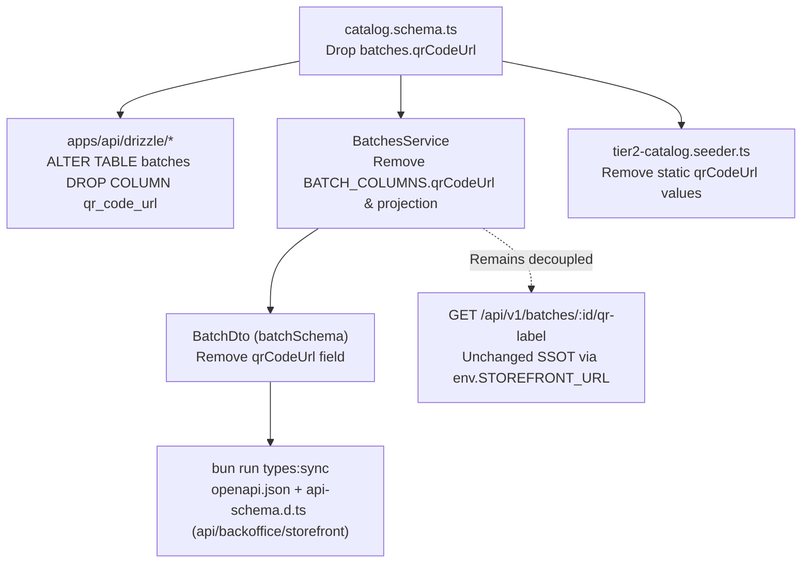

# Drop Deprecated batches.qr_code_url and BatchDto.qrCodeUrl Formal Specification

## Overview & Context

This specification defines the Contract-phase removal of the deprecated `batches.qr_code_url` column and `BatchDto.qrCodeUrl` API response field tracked in #102 (parent epic #9; following #82 and #83) across `apps/api`, `apps/backoffice`, and `apps/storefront` generated contracts.

Architectural commitments are recorded in ADR-0028 (updated to execute `#102` ahead of `#47` while the repository is pre-production and `apps/backoffice/src/routes/farming/batches.tsx` has no consumer code reading `BatchDto.qrCodeUrl`); batch intake invariants follow ADR-0026; OpenAPI generation and type sync follow ADR-0007; DTO co-location follows ADR-0011; forward-only destructive migration rules follow `docs/standards/database-and-migrations.md` §5.

Currently, `batches.qrCodeUrl` in `apps/api/src/database/schemas/catalog.schema.ts` is always inserted as `null` by `BatchesService.createBatch` (`apps/api/src/modules/inventory/batches.service.ts`), ignored by `BatchesService.getBatchQrLabel` (#83), yet still populated with static `https://greenroots.farm/trace/...` strings in `apps/api/src/database/seeds/tiers/tier2-catalog.seeder.ts` and exposed in `BatchDto` (`apps/api/src/modules/inventory/dto/batch.dto.ts`). This spec partially supersedes `docs/design/batch-intake-and-hsd-formal-spec.md` (`BatchDto` shape and `POST /api/v1/batches` insert projection) and `docs/design/batch-qr-label-formal-spec.md` (Contract timing relative to `#47`) while keeping those historical specs intact as point-in-time records.

### Goals

- Remove `qrCodeUrl` from `batches` in `apps/api/src/database/schemas/catalog.schema.ts` and generate one forward-only Drizzle migration (`ALTER TABLE "batches" DROP COLUMN "qr_code_url"`) in `apps/api/drizzle/`.
- Remove `qrCodeUrl` from `BATCH_COLUMNS`, `BatchesService.createBatch` insert values, and `BatchesService.toProjection` in `apps/api/src/modules/inventory/batches.service.ts`, as well as from `batchSchema` / `BatchDto` in `apps/api/src/modules/inventory/dto/batch.dto.ts`.
- Remove static `qrCodeUrl` values from `apps/api/src/database/seeds/tiers/tier2-catalog.seeder.ts` and update unit/integration tests (`batches.service.spec.ts`, `batches.spec.ts`) so `NewBatch` compiles cleanly and assertions verify absence of `qrCodeUrl`.
- Keep `CreateBatchDto` (`apps/api/src/modules/inventory/dto/create-batch.dto.ts`) `.strict()` rejection of client-supplied `qrCodeUrl` intact (returning `400 VALIDATION_FAILED`).
- Regenerate and commit OpenAPI and workspace TypeScript clients (`apps/api/openapi.json`, `apps/api/test/generated/api-schema.d.ts`, `apps/backoffice/src/types/api-schema.d.ts`, `apps/storefront/src/types/api-schema.d.ts`) via `bun run types:sync`.

### Non-Goals

- Modifying `GET /api/v1/batches/:id/qr-label` (`BatchQrLabelDto`, #83) or `GET /api/v1/trace/:batchCode` (`TraceRecordDto`, #21).
- Altering `batches.batch_code`, `batches.harvest_date`, `batches.expiration_date`, `batches_sellable_stock_idx`, or existing `CHECK` constraints on `batches`.
- Archiving or backfilling legacy `batches.qr_code_url` values prior to drop (pre-production only; `POST /api/v1/batches` never persisted non-null URLs).
- Implementing Backoffice `BO-03` UI views (#47).

## Architecture



Symbols and module layout:

- `batches` in `apps/api/src/database/schemas/catalog.schema.ts` removes `qrCodeUrl: text()`, leaving all other columns, `batches_batch_code_uidx`, `batches_sellable_stock_idx`, `batches_fefo_outbound_idx`, and `CHECK` constraints untouched.
- `apps/api/drizzle/20261121004301_drop_batches_qr_code_url/migration.sql` + `snapshot.json` generated via `drizzle-kit generate` executes the forward-only `DROP COLUMN`.
- `batchSchema` and `BatchDto` in `apps/api/src/modules/inventory/dto/batch.dto.ts` drop `qrCodeUrl: z.string().nullable()`, updating `BatchProjection` (`z.infer<typeof batchSchema>`).
- `createBatchSchema` in `apps/api/src/modules/inventory/dto/create-batch.dto.ts` retains `.strict()` so client-supplied `qrCodeUrl` continues failing with `400 VALIDATION_FAILED`.
- `BatchesService` in `apps/api/src/modules/inventory/batches.service.ts` removes `qrCodeUrl` from `BATCH_COLUMNS`, `.insert(batches).values(...)`, and `toProjection(...)`.
- `seedTier2Catalog` in `apps/api/src/database/seeds/tiers/tier2-catalog.seeder.ts` drops `qrCodeUrl` from the three seeded `batches` rows (`batchTomato`, `batchSpinach`, `batchLettuce`).
- `apps/api/openapi.json`, `apps/api/test/generated/api-schema.d.ts`, `apps/backoffice/src/types/api-schema.d.ts`, and `apps/storefront/src/types/api-schema.d.ts` are updated atomically via `bun run types:sync`.

## Operational Flow

### 1. Forward-Only Contract Migration & API Surface Alignment

```mermaid
sequenceDiagram
    autonumber
    participant Ops as Migration Runner (drizzle-kit migrate)
    participant PG as PostgreSQL 18 (batches)
    actor Staff as FarmStaff / Admin / SuperAdmin
    participant Ctrl as BatchesController
    participant Pipe as ZodValidationPipe
    participant Svc as BatchesService

    Ops->>PG: ALTER TABLE "batches" DROP COLUMN "qr_code_url"
    PG-->>Ops: Column removed; batches_sellable_stock_idx & CHECKs intact

    Staff->>Ctrl: POST /api/v1/batches (with unexpected qrCodeUrl key)
    Ctrl->>Pipe: Validate CreateBatchDto (.strict())
    Pipe-->>Staff: 400 VALIDATION_FAILED (UNRECOGNIZED_KEYS)

    Staff->>Ctrl: POST /api/v1/batches (valid payload)
    Ctrl->>Svc: createBatch(input)
    Svc->>PG: INSERT INTO batches (...) RETURNING BATCH_COLUMNS (no qr_code_url)
    PG-->>Svc: Inserted row
    Svc-->>Staff: 201 Created ApiResponseDto<BatchDto> (without qrCodeUrl)

    Staff->>Ctrl: GET /api/v1/batches/:id/qr-label
    Ctrl->>Svc: getBatchQrLabel(id)
    Svc->>PG: SELECT batch_code, harvest_date, expiration_date, products.name, products.unit
    Svc-->>Staff: 200 OK ApiResponseDto<BatchQrLabelDto> (traceUrl from env.STOREFRONT_URL)
```

## API Contract

### Endpoints

| Method & Path                      | Access                               | Contract Change                                                              | Success                                   | RFC 9457 Errors                                                       |
| :--------------------------------- | :----------------------------------- | :--------------------------------------------------------------------------- | :---------------------------------------- | :-------------------------------------------------------------------- |
| `POST /api/v1/batches`             | `farm_staff`, `admin`, `super_admin` | Response `BatchDto` omits `qrCodeUrl`; `.strict()` still rejects `qrCodeUrl` | `201` `ApiResponseDto<BatchDto>`          | `400` (`VALIDATION_FAILED`), `401`, `403`, `404`, `409`, `422`, `503` |
| `GET /api/v1/batches`              | `farm_staff`, `admin`, `super_admin` | Items of `BatchDto` omit `qrCodeUrl`                                         | `200` `PaginatedApiResponseDto<BatchDto>` | `400` (`VALIDATION_FAILED`), `401`, `403`                             |
| `GET /api/v1/batches/:id`          | `farm_staff`, `admin`, `super_admin` | Response `BatchDto` omits `qrCodeUrl`                                        | `200` `ApiResponseDto<BatchDto>`          | `400` (`VALIDATION_FAILED`), `401`, `403`, `404`                      |
| `GET /api/v1/batches/:id/qr-label` | `farm_staff`, `admin`, `super_admin` | Unchanged; remains the single source for `traceUrl` and `labelPayload`       | `200` `ApiResponseDto<BatchQrLabelDto>`   | `400`, `401`, `403`, `404`                                            |

### DTOs, Projections & Validation Rules

1. **`BatchDto` (`batchSchema` in `apps/api/src/modules/inventory/dto/batch.dto.ts`)**:
   - Closed projection becomes `{ id, batchCode, productId, seasonId, product, season, harvestDate, expirationDate, initialQuantity, availableQuantity, status, createdAt, updatedAt }` with `qrCodeUrl` removed.
   - `BatchDto` is serialized cleanly without extra persistence columns; OpenAPI removes `qrCodeUrl` from `components.schemas.BatchDto.properties` and `required`.
2. **`CreateBatchDto` (`createBatchSchema` in `apps/api/src/modules/inventory/dto/create-batch.dto.ts`)**:
   - Input contract stays unchanged; `.strict()` continues rejecting any client-supplied `qrCodeUrl` with `400 VALIDATION_FAILED`.
3. **Database Schema & Migration (`apps/api/src/database/schemas/catalog.schema.ts`)**:
   - Forward-only migration drops `qr_code_url` from `batches` with zero changes to `batches_batch_code_uidx`, `batches_season_id_idx`, `batches_product_id_idx`, `batches_fefo_outbound_idx`, `batches_sellable_stock_idx`, or `CHECK` constraints.
   - No new `API_ERROR_CODES` or `MESSAGES` keys are required.

## Security & Reliability

### Access & Exposure Matrix

| Route / Operation         | Unauthenticated / `customer` / `sales` | `farm_staff` / `admin` / `super_admin` |
| :------------------------ | :------------------------------------: | :------------------------------------: |
| `POST /api/v1/batches`    |             `401` / `403`              |                  Yes                   |
| `GET /api/v1/batches`     |             `401` / `403`              |                  Yes                   |
| `GET /api/v1/batches/:id` |             `401` / `403`              |                  Yes                   |

### Controls Across Baseline Domains

- **Security & Trust Boundary**: RBAC (`CustomThrottlerGuard -> JwtAuthGuard -> RolesGuard`) and `.strict()` unknown-key rejection on `CreateBatchDto` remain intact; clients cannot inject arbitrary `qrCodeUrl` values or persist unvalidated external URLs onto `batches`.
- **UX & Consumer Alignment (`BO-03` / `#47`)**: Removing `BatchDto.qrCodeUrl` before wiring `apps/backoffice/src/routes/farming/batches.tsx` eliminates dead generated client fields and forces `#47` to read QR payloads exclusively from `GET /api/v1/batches/:id/qr-label`.
- **Performance & Lock Scope**: Dropping a nullable `text` column with no dependent indexes, triggers, or views acquires an `ACCESS EXCLUSIVE` lock on `batches` only for metadata catalog removal (sub-millisecond at pre-production table size), and shrinks `BATCH_COLUMNS` projections and `BatchDto` JSON payloads.
- **Reliability & Forward-Only Discipline**: Migration is forward-only per `docs/standards/database-and-migrations.md` §5; `tier2-catalog.seeder.ts` remains idempotent (`onConflictDoNothing()`) without stale hardcoded `https://greenroots.farm/trace/...` strings.
- **Maintainability & Single Source of Truth**: Eliminates split-truth between stored `batches.qr_code_url` (`null` on intake, static URL in seeder) and dynamically computed `traceUrl` from `env.STOREFRONT_URL` (#83).
- **Observability**: Boot/migration verification runs through `bun run db:migrate`, `bun run types:sync`, `bun run check`, `bun run test`, and `bun run test:e2e`.

## Domain Invariant Taxonomy

| Invariant          | Name                                 | Formal Statement                                                                                                                         | Enforcement Seam                                                                    | Verification Test                                                                                                       |
| :----------------- | :----------------------------------- | :--------------------------------------------------------------------------------------------------------------------------------------- | :---------------------------------------------------------------------------------- | :---------------------------------------------------------------------------------------------------------------------- |
| `INV-BATCH-DROP-1` | Schema & Projection Absence          | Neither `batches` (`catalog.schema.ts`) nor `BatchDto` (`batch.dto.ts` / OpenAPI) contains `qr_code_url` / `qrCodeUrl`                   | `catalog.schema.ts`, `BatchesService` (`BATCH_COLUMNS`, `toProjection`), `BatchDto` | Unit & E2E assertions verifying `"qrCodeUrl" in dto === false` and OpenAPI contract sync (`bun run types:sync`)         |
| `INV-BATCH-DROP-2` | Input Rejection Preserved            | Any request to `POST /api/v1/batches` supplying `qrCodeUrl` is rejected with `400 VALIDATION_FAILED`                                     | `createBatchSchema.strict()` + `ZodValidationPipe`                                  | E2E test sending `{ ..., qrCodeUrl: "https://evil.example/..." }` expecting `400`                                       |
| `INV-BATCH-DROP-3` | Origin-Derived QR Label Independence | `GET /api/v1/batches/:id/qr-label` continues returning deterministic `traceUrl` derived solely from `env.STOREFRONT_URL` and `batchCode` | `BatchesService.getBatchQrLabel`                                                    | Refactored `INV-QR-LABEL-2` E2E test verifying `traceUrl` tracks runtime `env.STOREFRONT_URL` changes without DB column |

### Edge Cases (`EDGE-1..4`)

| ID       | Case                                                                                                     | Expected Behaviour                                                                                 |
| :------- | :------------------------------------------------------------------------------------------------------- | :------------------------------------------------------------------------------------------------- |
| `EDGE-1` | Client sends `qrCodeUrl: null` or `qrCodeUrl: "https://..."` in `POST /api/v1/batches`                   | Rejected by `createBatchSchema.strict()` with `400 VALIDATION_FAILED` (`UNRECOGNIZED_KEYS`)        |
| `EDGE-2` | Existing database initialized from earlier migrations has `batches.qr_code_url` containing seeded values | Forward-only migration drops `qr_code_url` cleanly with no FK, index, or trigger dependency errors |
| `EDGE-3` | Seeder `seedTier2Catalog` runs on clean or already-seeded DB (`--clean` or repeated run)                 | Inserts the 3 demo batches cleanly without `qrCodeUrl` and remains idempotent                      |
| `EDGE-4` | `env.STOREFRONT_URL` changes between environments (dev `localhost:3001` vs staging/prod HTTPS origin)    | `GET /api/v1/batches/:id/qr-label` dynamically reflects the active origin without DB updates       |

### Concurrency & Adversarial Matrix (`ADV-1..3`)

| ID      | Scenario                                                                                             | Expected Behaviour                                                                                                   |
| :------ | :--------------------------------------------------------------------------------------------------- | :------------------------------------------------------------------------------------------------------------------- |
| `ADV-1` | Unreleased or stale client relies on `BatchDto.qrCodeUrl`                                            | Prevented at compile time by `bun run types:sync` removing `qrCodeUrl` from `backoffice` & `storefront` types        |
| `ADV-2` | Concurrent `POST /api/v1/batches` during `ALTER TABLE batches DROP COLUMN qr_code_url` in deployment | `ACCESS EXCLUSIVE` lock serializes writes cleanly; rollout deploys API code reading/writing new shape with migration |
| `ADV-3` | Caller attempts mass-assignment of `qrCodeUrl` on `POST /api/v1/batches`                             | Blocked at `ZodValidationPipe` before `BatchesService` executes                                                      |

## Test Matrix

- **Unit specs (`apps/api/src/modules/inventory/batches.service.spec.ts`)**:
  - Remove `qrCodeUrl: null` from mock `returning(...)` / query rows and replace `expect(result.qrCodeUrl).toBeNull()` with `expect("qrCodeUrl" in result).toBe(false)`.
- **E2E Integration suite (`apps/api/test/integration/batches.spec.ts`)**:
  - Replace `expect(body.data.qrCodeUrl).toBeNull()` in `POST /api/v1/batches` with `expect("qrCodeUrl" in body.data).toBe(false)`, and verify both `GET /api/v1/batches` items and `GET /api/v1/batches/:id` omit `qrCodeUrl`.
  - Add or assert in `POST /api/v1/batches` validation spec that sending `qrCodeUrl` returns `400 VALIDATION_FAILED`.
  - Refactor `GET /api/v1/batches/:id/qr-label` test (`INV-QR-LABEL-2`) to remove `qrCodeUrl` from `createBatch(...)` overrides and verify `traceUrl` dynamically tracks `env.STOREFRONT_URL` across origin changes.
- **Verification commands**:
  - `bun run --cwd apps/api db:generate` (to generate the forward-only `DROP COLUMN` migration)
  - `bun run types:sync`
  - `bun run check`
  - `bun run test`
  - `bun run test:e2e`

## Risks & Rollback

- **Pre-production Sequencing Assumption**: Proceeding ahead of `#47` (`BO-03`) assumes no active production Backoffice deployment currently reads `BatchDto.qrCodeUrl`. Confirmed in repo (`apps/backoffice/src/routes/farming/batches.tsx` is an unimplemented placeholder with zero references to `qrCodeUrl`).
- **Irreversible Data Drop**: `DROP COLUMN "qr_code_url"` permanently discards any static seeded URLs in `batches.qr_code_url`. Since `POST /api/v1/batches` always stored `null` (`ADR-0026`) and `GET /api/v1/batches/:id/qr-label` computes `traceUrl` dynamically (`ADR-0028`), no runtime data is lost.
- **Rollback**: Because migrations are forward-only, rolling back after deployment requires a new forward migration (`ALTER TABLE "batches" ADD COLUMN "qr_code_url" text`) plus reverting `catalog.schema.ts`, `BatchDto`, `BatchesService`, `tier2-catalog.seeder.ts`, and re-running `bun run types:sync`.
