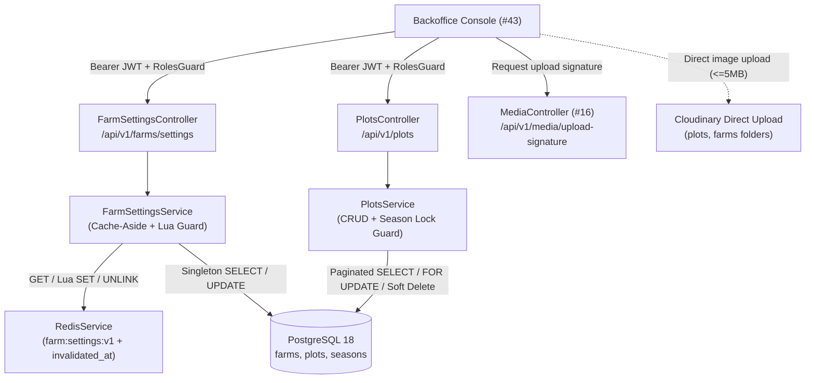
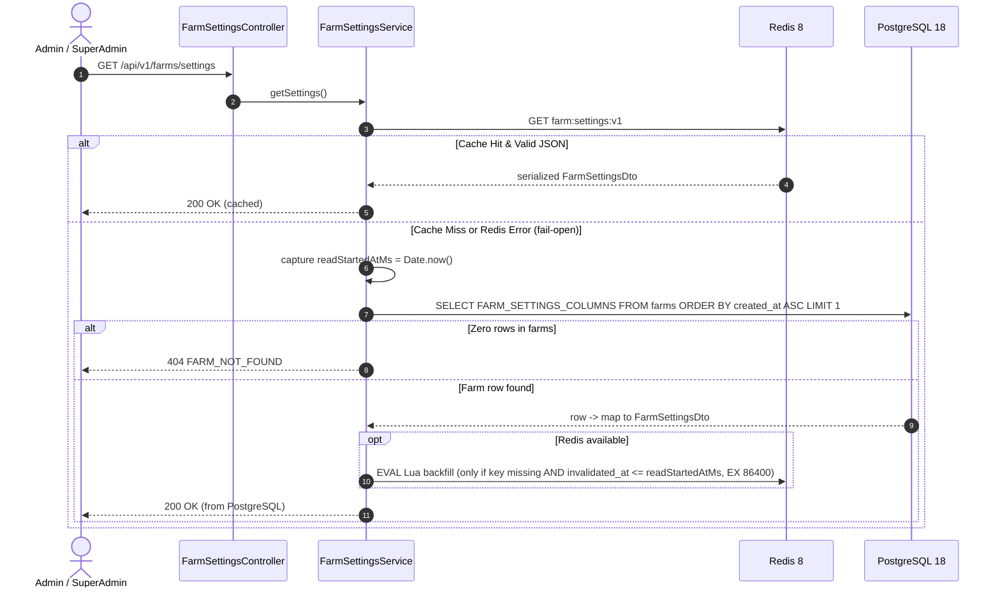
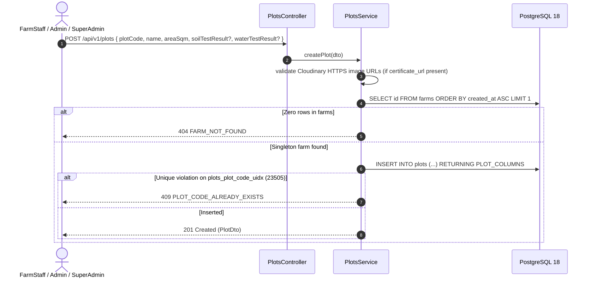
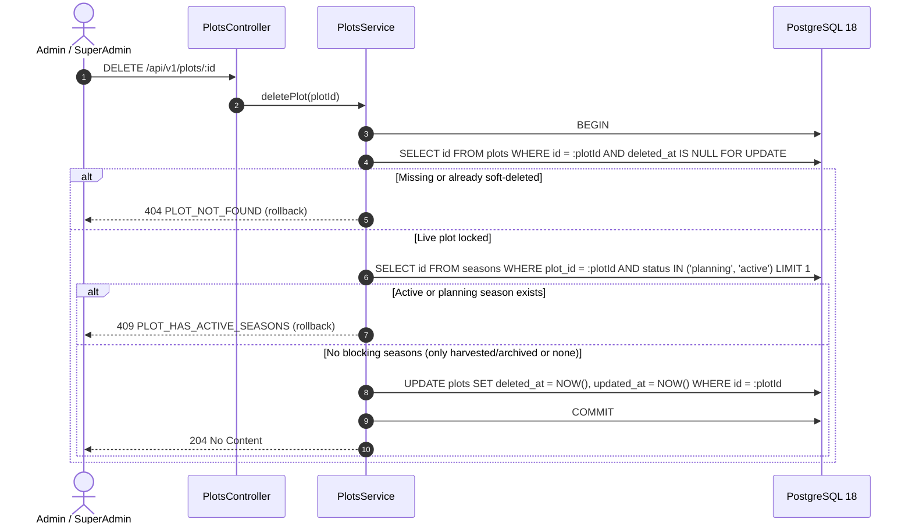

# Farm Settings & Plots Formal Specification

## Overview & Context

This document specifies the Farm Settings (`UC-21`) and Plots management endpoints introduced by #78 (split from #19; parent epic #8; Backoffice consumer #43). Architectural decisions are recorded in ADR-0021; soft-delete scope follows ADR-0003; database constraints follow ADR-0005; signed media uploads follow ADR-0009 (as amended by ADR-0021); DTO co-location, envelopes, and RFC 9457 error contracts follow ADR-0011, ADR-0012, and ADR-0013.

`apps/api/src/database/schemas/farm.schema.ts` already defines `farms`, `plots`, `seasons`, and `farmingLogs`, and `apps/api/src/modules/farms/farms.module.ts` exists as an empty skeleton. However, the API currently exposes no HTTP endpoints for reading or updating farm configuration or managing plots, `media.interface.ts` lacks `"plots"` and `"farms"` folders, and `plots` lacks a positive `area_sqm` check constraint.

### Goals

- Expose `GET /api/v1/farms/settings` (`admin`, `super_admin`) backed by a 24-hour Redis cache (`farm:settings:v1`) with fail-open PostgreSQL fallback and stale-write race protection.
- Expose `PATCH /api/v1/farms/settings` (`super_admin` only) with strict validation, payment-method availability invariant (`isPayosEnabled || isCodEnabled`), and post-commit Redis `UNLINK` + `invalidated_at` invalidation.
- Expose `GET /api/v1/plots` (paginated, filtered, sorted) and `GET /api/v1/plots/:id` to internal staff (`STAFF_ROLES`), excluding soft-deleted rows (`deletedAt IS NULL`).
- Expose `POST /api/v1/plots` and `PATCH /api/v1/plots/:id` (`farm_staff`, `admin`, `super_admin`) enforcing `plotCode` active uniqueness, `areaSqm > 0`, and structured `SoilTestResult` / `WaterTestResult` JSONB validation.
- Expose `DELETE /api/v1/plots/:id` (`admin`, `super_admin`) performing transactional soft delete (`204 No Content`) while blocking deletion if any `planning` or `active` season references the plot.
- Expand `ALLOWED_MEDIA_FOLDERS` with `"plots"` and `"farms"` (image-only ≤ 5 MB) and restrict persistable certificate URLs to the configured Cloudinary HTTPS image delivery origin.

### Non-Goals

- Seasons CRUD (`GET/POST/PATCH /seasons`), farming logs, batch creation, or public traceability endpoints.
- Direct multipart image/PDF upload or `raw` PDF upload support in `#16`.
- Geospatial polygon mapping of plot boundaries.
- Farm settings audit log or version history table.
- Public storefront endpoint for dynamic delivery fees (Storefront `estimateDeliveryQuote()` continues using `BUSINESS_RULES` defaults until a dedicated storefront settings/quote integration is scheduled).

## Architecture



Symbols and module layout:

- `FARMS_ROUTES` in `apps/api/src/modules/farms/farms.routes.ts` defines frozen constants (`TAG`, `SETTINGS_BASE`: `"farms/settings"`, `PLOTS_BASE`: `"plots"`, `PLOT_BY_ID`: `":id"`).
- `FarmSettingsController` in `apps/api/src/modules/farms/farm-settings.controller.ts` exposes `GET` and `PATCH` `/api/v1/farms/settings` with class-level `@ApiBadRequestResponseRfc9457()` and `@ApiInternalServerErrorResponseRfc9457()`.
- `PlotsController` in `apps/api/src/modules/farms/plots.controller.ts` exposes `GET`, `POST`, `GET :id`, `PATCH :id`, and `DELETE :id` under `/api/v1/plots`.
- `FarmSettingsService` in `apps/api/src/modules/farms/farm-settings.service.ts` owns singleton resolution, `FARM_SETTINGS_COLUMNS` closed projection, 24-hour Redis read-through caching, Lua backfill guard, and post-commit `UNLINK` invalidation.
- `PlotsService` in `apps/api/src/modules/farms/plots.service.ts` owns `PLOT_COLUMNS` closed projection, paginated listing, active-season `FOR UPDATE` soft-delete guard, and `23505` / `23514` conflict mapping.
- `farms.interface.ts` holds compile-time interfaces, cache key/TTL constants, and sort/projection constants only (no Zod schemas per ADR-0011).
- `dto/` holds co-located Zod schemas, inferred input/output types, and `createZodDto()` classes (`farm-settings.dto.ts`, `update-farm-settings.dto.ts`, `plot.dto.ts`, `create-plot.dto.ts`, `update-plot.dto.ts`, `list-plots-query.dto.ts`).
- `CloudinaryService` and `media.interface.ts` in `apps/api/src/modules/media/` expand `ALLOWED_MEDIA_FOLDERS` and `FOLDER_PERMISSIONS` with `"plots"` and `"farms"`.
- `@greenroots/shared` (`packages/shared`) adds `maxRadiusKm?: number` and `subscriptionFreeRadiusKm?: number` to `FarmShippingConfig` in `jsonb-contracts.type.ts`, plus domain error codes in `error-dictionary.ts`.

## Operational Flow

### 1. Read Farm Settings (24h Cache-Aside + Stale-Write Guard)



### 2. Update Farm Settings (`super_admin` + `UNLINK` Invalidation)

```mermaid
sequenceDiagram
    autonumber
    actor SuperAdmin
    participant Ctrl as FarmSettingsController
    participant Svc as FarmSettingsService
    participant DB as PostgreSQL 18
    participant Redis as Redis 8

    SuperAdmin->>Ctrl: PATCH /api/v1/farms/settings { ...partialFields }
    Ctrl->>Svc: updateSettings(dto)
    Svc->>DB: BEGIN
    Svc->>DB: SELECT FARM_SETTINGS_COLUMNS FROM farms ORDER BY created_at ASC LIMIT 1 FOR UPDATE
    alt Zero rows in farms
        Svc-->>SuperAdmin: 404 FARM_NOT_FOUND (rollback)
    else Effective isPayosEnabled=false AND isCodEnabled=false
        Svc-->>SuperAdmin: 422 FARM_PAYMENT_METHOD_REQUIRED (rollback)
    else Valid update
        Svc->>DB: UPDATE farms SET ..., updated_at = NOW() WHERE id = farm.id RETURNING FARM_SETTINGS_COLUMNS
        Svc->>DB: COMMIT
        Svc->>Redis: Pipeline UNLINK farm:settings:v1 + SET farm:settings:invalidated_at <nowMs> EX 60
        alt Redis pipeline fails
            Svc->>Svc: logger.error (ops alert; do not fail committed request)
        end
        Svc-->>SuperAdmin: 200 OK (updated FarmSettingsDto)
    end
```

### 3. Create & Update Plot



### 4. Soft-Delete Plot with Active-Season Lock Guard



## API Contract

### Endpoints

| Method & Path                  | Allowed Roles                                                 | Success                                  | Additional RFC 9457 Errors                                                     | Notes                                    |
| :----------------------------- | :------------------------------------------------------------ | :--------------------------------------- | :----------------------------------------------------------------------------- | :--------------------------------------- |
| `GET /api/v1/farms/settings`   | `admin`, `super_admin`                                        | `200` `ApiResponseDto<FarmSettingsDto>`  | `401`, `403`, `404` (`FARM_NOT_FOUND`)                                         | 24h Redis cache-aside; Postgres fallback |
| `PATCH /api/v1/farms/settings` | `super_admin`                                                 | `200` `ApiResponseDto<FarmSettingsDto>`  | `401`, `403`, `404` (`FARM_NOT_FOUND`), `422` (`FARM_PAYMENT_METHOD_REQUIRED`) | Partial top-level update; `UNLINK` cache |
| `GET /api/v1/plots`            | `STAFF_ROLES` (`farm_staff`, `sales`, `admin`, `super_admin`) | `200` `PaginatedApiResponseDto<PlotDto>` | `401`, `403`                                                                   | Excludes `deletedAt IS NOT NULL`         |
| `GET /api/v1/plots/:id`        | `STAFF_ROLES`                                                 | `200` `ApiResponseDto<PlotDto>`          | `401`, `403`, `404` (`PLOT_NOT_FOUND`)                                         | UUIDv7 `:id`; excludes soft-deleted      |
| `POST /api/v1/plots`           | `farm_staff`, `admin`, `super_admin`                          | `201` `ApiResponseDto<PlotDto>`          | `401`, `403`, `404` (`FARM_NOT_FOUND`), `409` (`PLOT_CODE_ALREADY_EXISTS`)     | Injects singleton `farmId` server-side   |
| `PATCH /api/v1/plots/:id`      | `farm_staff`, `admin`, `super_admin`                          | `200` `ApiResponseDto<PlotDto>`          | `401`, `403`, `404` (`PLOT_NOT_FOUND`), `409` (`PLOT_CODE_ALREADY_EXISTS`)     | Allows clearing test JSONB with `null`   |
| `DELETE /api/v1/plots/:id`     | `admin`, `super_admin`                                        | `204` No Content                         | `401`, `403`, `404` (`PLOT_NOT_FOUND`), `409` (`PLOT_HAS_ACTIVE_SEASONS`)      | Soft delete guarded by `seasons` status  |

### DTOs, Projections & Validation Rules

All request DTOs use `.strict()` so unknown keys return `400 VALIDATION_FAILED` (`UNRECOGNIZED_KEYS`). Path parameter `:id` on `/plots/:id` uses `ZodValidationPipe(zUuidV7())` (`400 VALIDATION_FAILED`, `invalidParams[0].code = INVALID_FORMAT`).

1. **`FarmSettingsDto`** (`FARM_SETTINGS_COLUMNS` closed projection):
   - Exposes: `id`, `name`, `legalName`, `tagline`, `taxId`, `address`, `latitude` (number), `longitude` (number), `certificationUrl`, `hotlines`, `emails`, `workingHours`, `bankInfo`, `shippingConfig`, `flashSaleConfig`, `isPayosEnabled`, `isCodEnabled`, `createdAt`, `updatedAt`.
   - Note on `numeric`: `farms.latitude` and `farms.longitude` (`numeric(10,8)` / `numeric(11,8)`) are parsed to `number` in `FarmSettingsDto` and formatted back to fixed-precision decimal strings when persisting.
2. **`UpdateFarmSettingsDto`** (`.strict()`, requires at least one defined key -> `400` `MESSAGES.VALIDATION.AT_LEAST_ONE_FARM_SETTING_FIELD`):
   - `name`, `legalName`: `zSanitizedString({ min: 1, max: 255 })`.
   - `tagline`: `zSanitizedString({ min: 1, max: 255 }).nullable()`.
   - `taxId`: `zOptionalTaxId()` (`VN_TAX_ID_REGEX`).
   - `address`: `zSanitizedString({ min: 1, max: 500 })`.
   - `latitude`: number in `[-90, 90]`; `longitude`: number in `[-180, 180]`.
   - `certificationUrl`: nullable Cloudinary HTTPS image URL (see URL boundary below).
   - `hotlines`: `{ primary: zSanitizedString({ min: 1, max: 30 }), support?: zSanitizedString({ min: 1, max: 30 }) }` (strict).
   - `emails`: `{ primary: zEmail(), support?: zEmail() }` (strict).
   - `workingHours`: `{ weekdays: zSanitizedString({ min: 1, max: 100 }), weekend: zSanitizedString({ min: 1, max: 100 }) }` (strict).
   - `bankInfo`: `{ bankName: zSanitizedString({ min: 1, max: 100 }), accountNumber: zSanitizedString({ min: 1, max: 50 }), accountHolder: zSanitizedString({ min: 1, max: 150 }) }.nullable()` (strict).
   - `shippingConfig`: `{ baseFeeVnd: int >= 0, freeKmThreshold: number >= 0, perKmRateVnd: int >= 0, detourFactor: number >= 1, maxRadiusKm?: number > 0, subscriptionFreeRadiusKm?: number > 0 }` (strict).
   - `flashSaleConfig`: `{ hoursThreshold: int >= 1 && <= 168, discountPercent: int >= 1 && <= 99 }` (strict).
   - `isPayosEnabled`, `isCodEnabled`: `boolean`.
3. **`PlotDto`** (`PLOT_COLUMNS` closed projection, omitting `deletedAt`):
   - `id`, `farmId`, `plotCode`, `name`, `areaSqm` (parsed `number` from PostgreSQL `numeric(10, 2)`), `soilTestResult` (`SoilTestResult | null`), `waterTestResult` (`WaterTestResult | null`), `createdAt`, `updatedAt`.
4. **`ListPlotsQueryDto`** (`.strict()`):
   - `q`: optional `zSanitizedString({ min: 1, max: 100 })` matching `plotCode` or `name` (`ILIKE` with `%`, `_`, `\` escaped).
   - `page`: `zNumericString({ integer: true, min: 1 }).default(1)`.
   - `limit`: `zNumericString({ integer: true, min: 1, max: 100 }).default(20)`.
   - `sort`: whitelist enum `createdAt:desc` (default), `createdAt:asc`, `plotCode:asc`, `plotCode:desc`, `areaSqm:asc`, `areaSqm:desc`, with deterministic tie-breaker `id DESC`.
5. **`CreatePlotDto`** & **`UpdatePlotDto`** (`.strict()`):
   - `CreatePlotDto`: `plotCode` (`zSanitizedString({ min: 1, max: 50 })`, trimmed/normalized), `name` (`zSanitizedString({ min: 1, max: 255 })`), `areaSqm` (`number >= 0.01 && <= 10_000_000`, finite, matching `numeric(10, 2)` precision), optional/nullable `soilTestResult` and `waterTestResult`.
   - `UpdatePlotDto`: all fields optional, requires at least one defined field (`MESSAGES.VALIDATION.AT_LEAST_ONE_PLOT_FIELD`), allowing `soilTestResult: null` / `waterTestResult: null` to clear lab records.
   - `soilTestResult` (`SoilTestResult`): strict object validating `ph` (`0..14`), `nitrogen_ppm >= 0`, `phosphorus_ppm >= 0`, `potassium_ppm >= 0`, `heavy_metals` (`{ lead_ppm >= 0, cadmium_ppm >= 0, pass: boolean }`), `tested_at` (ISO-8601 datetime string), `certificate_url?` (Cloudinary HTTPS image URL).
   - `waterTestResult` (`WaterTestResult`): strict object validating `ph` (`0..14`), `ec_ms_cm >= 0`, `dissolved_oxygen_ppm >= 0`, `e_coli_cfu_100ml >= 0`, `heavy_metals_pass: boolean`, `tested_at` (ISO-8601 datetime string), `certificate_url?` (Cloudinary HTTPS image URL).
6. **Cloudinary URL Trust Boundary**:
   - Helper `zCloudinaryMediaUrl({ resourceTypes: ["image"] })` in `apps/api/src/common/schemas/zod-primitives.ts` (or `farms` schema helper) enforces HTTPS (`url.protocol === "https:"`), host `res.cloudinary.com`, and pathname prefix `/<cloudName>/image/upload/` matching `env.CLOUDINARY_CLOUD_NAME` (defaulting to `"greenroots-dev"` in non-production and required in `production`), rejecting `http://`, external domains, query/fragment injection, or `/raw/upload/`. Non-matching URLs fail DTO validation with `400 VALIDATION_FAILED` (`INVALID_URL`).

### Shared Contracts, Error Codes & Migration

- `@greenroots/shared`:
  - `packages/shared/src/jsonb-contracts.type.ts`: add optional `maxRadiusKm?: number` and `subscriptionFreeRadiusKm?: number` to `FarmShippingConfig`.
  - `packages/shared/src/error-dictionary.ts`: add `FARM_NOT_FOUND` (`404`), `FARM_PAYMENT_METHOD_REQUIRED` (`422`), `PLOT_NOT_FOUND` (`404`), `PLOT_CODE_ALREADY_EXISTS` (`409`), `PLOT_HAS_ACTIVE_SEASONS` (`409`) with Vietnamese copy in `API_ERROR_DICTIONARY`.
- `apps/api/src/common/constants/messages.constant.ts`: add `MESSAGES.FARMS` and `MESSAGES.PLOTS` English developer messages plus `AT_LEAST_ONE_FARM_SETTING_FIELD` and `AT_LEAST_ONE_PLOT_FIELD` under `MESSAGES.VALIDATION`.
- `apps/api/src/modules/media/media.interface.ts`: add `"plots"` (`[UserRole.FARM_STAFF, UserRole.ADMIN, UserRole.SUPER_ADMIN]`) and `"farms"` (`[UserRole.ADMIN, UserRole.SUPER_ADMIN]`) to `ALLOWED_MEDIA_FOLDERS` and `FOLDER_PERMISSIONS`.
- Database schema & migration (`apps/api/src/database/schemas/farm.schema.ts`):
  - Add Drizzle `check("plots_area_sqm_positive_chk", sql\`${table.areaSqm} > 0\`)`on`plots`and generate one forward-only migration per`docs/standards/database-and-migrations.md` §5.
  - Update `tier1-reference.seeder.ts` (`certificationUrl`) and `tier2-catalog.seeder.ts` (`soilTestResult.certificate_url`) to use valid `https://res.cloudinary.com/greenroots-dev/image/upload/...` URLs.

## Security & Reliability

### Role Matrix

| Action                                    | `guest` / `customer` | `sales` | `farm_staff` | `admin` | `super_admin` |
| :---------------------------------------- | :------------------: | :-----: | :----------: | :-----: | :-----------: |
| `GET /api/v1/farms/settings`              |          —           |    —    |      —       |   Yes   |      Yes      |
| `PATCH /api/v1/farms/settings`            |          —           |    —    |      —       |    —    |      Yes      |
| `GET /api/v1/plots` & `GET /plots/:id`    |          —           |   Yes   |     Yes      |   Yes   |      Yes      |
| `POST /api/v1/plots` & `PATCH /plots/:id` |          —           |    —    |     Yes      |   Yes   |      Yes      |
| `DELETE /api/v1/plots/:id`                |          —           |    —    |      —       |   Yes   |      Yes      |
| Sign upload for folder `"plots"`          |          —           |    —    |     Yes      |   Yes   |      Yes      |
| Sign upload for folder `"farms"`          |          —           |    —    |      —       |   Yes   |      Yes      |

### Controls

- **Authorization**: Every route requires `@ApiAuth(...)` (`JwtAuthGuard` + `RolesGuard`). Unauthenticated calls receive `401`; unauthorized roles receive `403`.
- **Cache fail-open & stale-write mitigation**:
  - `FarmSettingsService` wraps Redis operations around `RedisService.getClient()` with short timeouts (`commandTimeout: 500` in `RedisService`). Any Redis read error or malformed JSON payload triggers a fallback read from PostgreSQL (`GET` never returns `500` due to Redis).
  - Lua backfill on `GET` compares `farm:settings:invalidated_at` (millisecond timestamp) against `readStartedAtMs` captured before querying PostgreSQL. If `invalidated_at >= readStartedAtMs` or `farm:settings:v1` already exists, Lua skips `SET` so a slow `GET` cannot overwrite a newer `PATCH` for 24 hours.
  - On `PATCH`, PostgreSQL commits first; `UNLINK farm:settings:v1` and `SET farm:settings:invalidated_at <nowMs> EX 60` run immediately post-commit. A Redis pipeline failure logs an error (`logger.error`) and still returns `200` so committed writes are never masked as `503`.
  - In E2E test runs, `FarmSettingsService` uses the injected Redis client / key-prefix hygiene compatible with `app.helper.ts` (`test:<workerSchema>:`) so parallel Jest/Bun workers never share `farm:settings:v1`.
- **Locking & race safety**:
  - `PATCH /api/v1/farms/settings` locks the singleton `farms` row (`FOR UPDATE`) so concurrent partial updates serialize cleanly under `READ COMMITTED` before evaluating `isPayosEnabled || isCodEnabled`.
  - `DELETE /api/v1/plots/:id` acquires `FOR UPDATE` on the target `plots` row before checking `seasons`. Any future `POST /seasons` implementation must lock the parent `plots` row (`WHERE id = :plotId AND deleted_at IS NULL FOR UPDATE`) before inserting a season (`plots -> seasons` lock order) to prevent TOCTOU races and deadlocks.
- **Input sanitization & projection safety**: All string fields pass through `zSanitizedString` (`sanitizeString` + whitespace normalization). Queries and `RETURNING` clauses project explicit column subsets (`FARM_SETTINGS_COLUMNS`, `PLOT_COLUMNS`), never `SELECT *`.
- **Rate limiting**: Standard `CustomThrottlerGuard` `default` tier (`100 req / 60s`).

## Domain Invariant Taxonomy

| Invariant    | Name                         | Formal Statement                                                                                                                                                      | Enforcement Seam                                                     | Verification Test                                                                         |
| :----------- | :--------------------------- | :-------------------------------------------------------------------------------------------------------------------------------------------------------------------- | :------------------------------------------------------------------- | :---------------------------------------------------------------------------------------- |
| `INV-FARM-1` | Singleton Resolution         | Farm settings read/write targets the unique operational `farms` row without client `:farmId`; empty table yields `404 FARM_NOT_FOUND`                                 | `FarmSettingsService` singleton query                                | Unseeded DB `GET`/`PATCH` returns `404`                                                   |
| `INV-FARM-2` | Cache Fallback & Consistency | `GET` reads Redis (`86400s` TTL) first, falls back to PostgreSQL on miss/Redis error without `500`, and `PATCH` invalidates via `UNLINK` + `invalidated_at` Lua guard | `FarmSettingsService` + Redis Lua script                             | Miss, Redis down, post-`PATCH` `UNLINK`, and stale-backfill guard                         |
| `INV-FARM-3` | At Least One Payment Method  | After every `PATCH /farms/settings`, `isPayosEnabled` or `isCodEnabled` must remain `true`                                                                            | `FarmSettingsService.updateSettings` under `FOR UPDATE`              | Disabling both PayOS and COD -> `422 FARM_PAYMENT_METHOD_REQUIRED`                        |
| `INV-FARM-4` | Cloudinary Image Boundary    | Non-null `certificationUrl` and `certificate_url` values must use `https://res.cloudinary.com/<cloudName>/image/upload/...`                                           | `zCloudinaryMediaUrl` (`resourceTypes: ["image"]`) in DTO validation | Arbitrary/HTTP/raw URLs -> `400 VALIDATION_FAILED`                                        |
| `INV-PLOT-1` | Soft-Delete Visibility       | Every `/api/v1/plots*` read and `PATCH`/`DELETE` lookup filters `deleted_at IS NULL`                                                                                  | `PlotsService` base predicates                                       | Soft-deleted plot absent from list and `404` on `GET :id`                                 |
| `INV-PLOT-2` | Active Plot Code Uniqueness  | Among rows with `deleted_at IS NULL`, `plot_code` is unique; soft-deleted codes may be reused                                                                         | `plots_plot_code_uidx` + `23505` error mapping                       | Duplicate active `plotCode` -> `409 PLOT_CODE_ALREADY_EXISTS`; after soft delete -> `201` |
| `INV-PLOT-3` | Positive Plot Area           | `plots.area_sqm > 0` enforced at both Zod DTO and PostgreSQL `CHECK` levels                                                                                           | `CreatePlotDto`/`UpdatePlotDto` + `plots_area_sqm_positive_chk`      | `areaSqm <= 0` -> `400`; direct SQL `<= 0` -> `23514` (`422`)                             |
| `INV-PLOT-4` | Active-Season Delete Guard   | `DELETE /plots/:id` cannot soft-delete a plot linked to any season in `planning` or `active` status                                                                   | `PlotsService.deletePlot` (`FOR UPDATE` + `seasons` check)           | Plot with `active`/`planning` season -> `409 PLOT_HAS_ACTIVE_SEASONS`                     |
| `INV-PLOT-5` | Structured Lab Telemetry     | `soilTestResult` and `waterTestResult` conform strictly to `SoilTestResult` and `WaterTestResult` contracts                                                           | `CreatePlotDto` / `UpdatePlotDto` `.strict()` schemas                | Missing metrics or unknown keys -> `400 VALIDATION_FAILED`                                |

### Edge Cases (`EDGE-1..16`)

| ID        | Case                                                                                             | Expected Behaviour                                               |
| :-------- | :----------------------------------------------------------------------------------------------- | :--------------------------------------------------------------- |
| `EDGE-1`  | `GET /api/v1/farms/settings` called by `farm_staff`, `sales`, or `customer`                      | `403 FORBIDDEN`                                                  |
| `EDGE-2`  | `PATCH /api/v1/farms/settings` called by `admin`                                                 | `403 FORBIDDEN` (`super_admin` only)                             |
| `EDGE-3`  | `PATCH /api/v1/farms/settings` with `{}` (empty payload) or unknown key                          | `400 VALIDATION_FAILED` (`UNRECOGNIZED_KEYS` for extra keys)     |
| `EDGE-4`  | `PATCH /api/v1/farms/settings` setting `isPayosEnabled: false, isCodEnabled: false`              | `422 FARM_PAYMENT_METHOD_REQUIRED`                               |
| `EDGE-5`  | `PATCH /api/v1/farms/settings` setting `bankInfo: null`                                          | Allowed (`200 OK`); clears `bankInfo`                            |
| `EDGE-6`  | `GET /api/v1/farms/settings` when Redis contains corrupt non-JSON payload                        | Logs warning, treats as cache miss, reads PostgreSQL (`200 OK`)  |
| `EDGE-7`  | `GET /api/v1/farms/settings` when Redis connection is closed/unreachable                         | Falls back to PostgreSQL without returning `500` (`200 OK`)      |
| `EDGE-8`  | `GET /api/v1/plots?q=100%` (SQL wildcard characters in `q`)                                      | `%`, `_`, `\` escaped; matches literal substring safely          |
| `EDGE-9`  | `GET /api/v1/plots?unknown=1` or invalid `sort`                                                  | `400 VALIDATION_FAILED`                                          |
| `EDGE-10` | `GET /api/v1/plots/:id` with non-UUIDv7 `:id`                                                    | `400 VALIDATION_FAILED` (`INVALID_FORMAT`)                       |
| `EDGE-11` | `POST /api/v1/plots` with `areaSqm: 0`, `-5`, or `0.001`                                         | `400 VALIDATION_FAILED`                                          |
| `EDGE-12` | `POST /api/v1/plots` with `certificate_url: "https://evil.com/x.png"` or `.../raw/upload/...pdf` | `400 VALIDATION_FAILED` (`INVALID_URL`)                          |
| `EDGE-13` | `PATCH /api/v1/plots/:id` with `soilTestResult: null`                                            | Allowed (`200 OK`); clears `soilTestResult`                      |
| `EDGE-14` | `POST /api/v1/plots` reusing `plotCode` of a previously soft-deleted plot                        | `201 Created` (partial unique index scopes `deleted_at IS NULL`) |
| `EDGE-15` | `DELETE /api/v1/plots/:id` called by `farm_staff`                                                | `403 FORBIDDEN`                                                  |
| `EDGE-16` | `DELETE /api/v1/plots/:id` on plot with only `harvested` / `archived` seasons                    | `204 No Content`; plot soft-deleted                              |

### Concurrency & Adversarial Matrix (`ADV-1..5`)

| ID      | Scenario                                                                                                                                                   | Expected Behaviour                                                                                                                                   |
| :------ | :--------------------------------------------------------------------------------------------------------------------------------------------------------- | :--------------------------------------------------------------------------------------------------------------------------------------------------- |
| `ADV-1` | Slow `GET /farms/settings` misses cache (reads `V1`), `PATCH` commits `V2` + runs `UNLINK` + `SET invalidated_at`, then slow `GET` attempts Redis backfill | Lua script detects `invalidated_at >= readStartedAtMs` and aborts `SET`; next `GET` reads `V2` from DB and caches `V2`                               |
| `ADV-2` | Two concurrent `PATCH /farms/settings` disabling alternating payment methods (`{ isPayosEnabled: false }` vs `{ isCodEnabled: false }`)                    | Serialized by `FOR UPDATE` on singleton `farms` row; first commits (`200`), second sees remaining flag `false` -> `422 FARM_PAYMENT_METHOD_REQUIRED` |
| `ADV-3` | Two concurrent `POST /plots` with the same `plotCode`                                                                                                      | First commits (`201`), second hits `plots_plot_code_uidx` (`23505`) -> `409 PLOT_CODE_ALREADY_EXISTS`                                                |
| `ADV-4` | Concurrent `DELETE /plots/:id` and `POST /seasons` (future `#19`) on the same plot                                                                         | Both lock parent `plots` row (`FOR UPDATE`); serialized `plots -> seasons` lock order prevents deleting a plot that just gained an active season     |
| `ADV-5` | Staff attempts `POST /media/upload-signature` with `folder: "farms"` as `farm_staff`                                                                       | Rejected with `403 FORBIDDEN` (`MESSAGES.MEDIA.FOLDER_ACCESS_DENIED`); only `admin` and `super_admin` may sign `"farms"` uploads                     |

## Test Matrix

- **Factories & Mothers (`apps/api/test/factories/`)**:
  - `createFarm(db, overrides)` / `FarmMother.default()` (idempotent singleton helper for tests needing an unseeded or custom farm).
  - `createPlot(db, overrides)` / `PlotMother.standard()` / `PlotMother.withLabTests()`.
- **Unit specs**:
  - `FarmSettingsService` (`farm-settings.service.spec.ts`): cache hit, cache miss backfill, Redis failure fallback, Lua stale-guard behavior, `UNLINK` failure resilience, payment-method invariant.
  - `PlotsService` (`plots.service.spec.ts`): query filter/sort escaping, `numeric` <-> `number` conversion, soft-delete active-season branch.
  - `CloudinaryService` (`cloudinary.service.spec.ts`): folder permissions for `"plots"` (`farm_staff`, `admin`, `super_admin`) and `"farms"` (`admin`, `super_admin`).
- **E2E Integration suite (`apps/api/test/integration/farms.spec.ts`)**:
  - RBAC matrix across `guest`/`customer`, `sales`, `farm_staff`, `admin`, `super_admin` for `/farms/settings`, `/plots*`, and `/media/upload-signature` (`plots`, `farms`).
  - `GET`/`PATCH /farms/settings`: Redis key population (`TTL <= 86400`), cache hit without DB change reflection until `PATCH` invalidates via `UNLINK`, Redis offline fallback without `500`, `422 FARM_PAYMENT_METHOD_REQUIRED`, `400` validation rejections (`UNRECOGNIZED_KEYS`, invalid `taxId`, negative VND, invalid Cloudinary URL).
  - `GET`/`POST`/`PATCH`/`DELETE /plots`: pagination/filtering/sorting, soft-delete hiding, `plotCode` uniqueness & reuse after soft-delete, `areaSqm <= 0` DTO (`400`) & DB check (`23514`), `409 PLOT_HAS_ACTIVE_SEASONS` vs `204` with `harvested` season, and `Promise.all` concurrency tests (`ADV-2`, `ADV-3`).
- **Contract propagation**: run `bun run types:sync`, `bun run check`, `bun run test`, and `bun run test:e2e` after implementation and commit generated OpenAPI/type artifacts.

## Risks & Rollback

- **Redis isolation in parallel tests**: If `FarmSettingsService` constructs its own Redis client without honoring the test worker prefix, parallel E2E workers will pollute each other's `farm:settings:v1` key. Mitigation: reuse `RedisService.getClient()` and verify test harness isolation or key prefixing in `app.helper.ts`.
- **Brief Redis-outage stale window**: If Redis fails only during `PATCH` `UNLINK` and immediately recovers with old keys intact, stale settings can remain until TTL expires. Mitigation: log structured error alert on `UNLINK` failure and include `updatedAt` in the cached payload.
- **Image-only lab certificate restriction**: Lab reports arriving solely as multi-page PDFs require conversion to PNG/JPEG images before upload until a future ADR adds signed `allowed_formats=pdf` handling.
- **Rollback**: Revert application changes and re-run `bun run types:sync`; if rolling back the `plots_area_sqm_positive_chk` constraint migration in non-production environments, issue a forward compensating migration dropping that check constraint.
