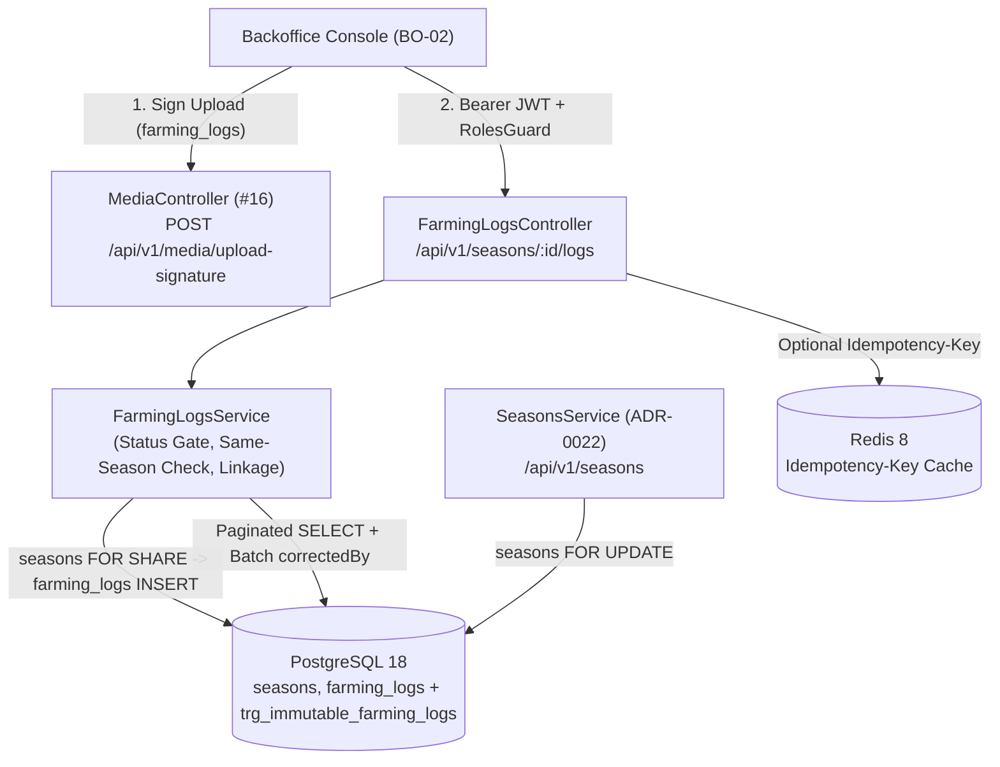
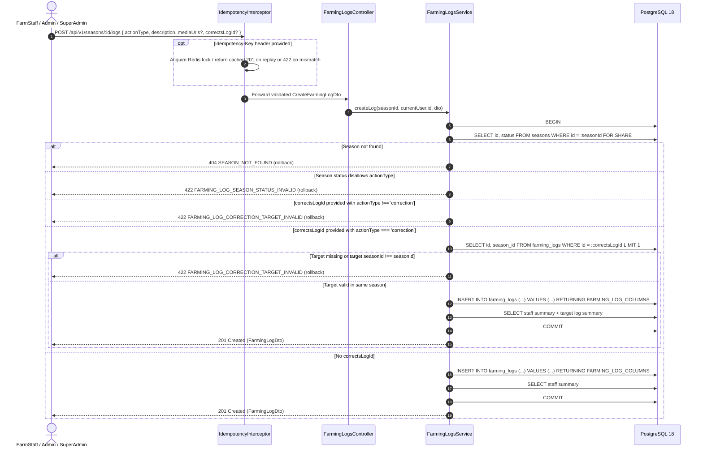
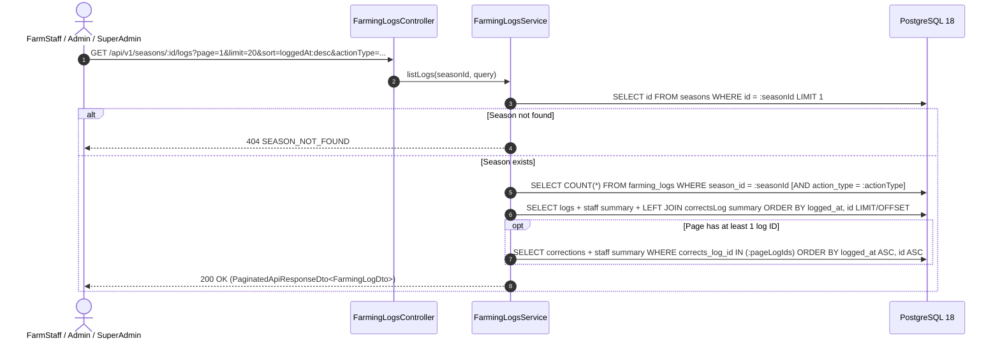
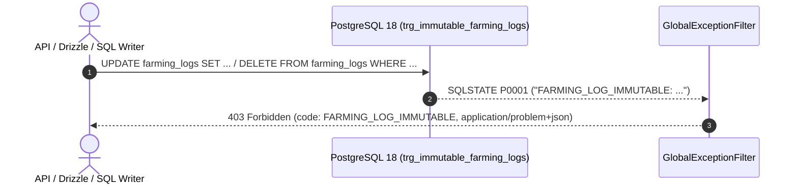

# Append-Only Farming Logs Formal Specification

## Overview & Context

This specification defines the append-only cultivation log endpoints introduced by #20 (parent epic #8; Backoffice consumer `BO-02`; downstream Storefront consumer #21 `GET /api/v1/trace/:batchCode`) in `apps/api/src/modules/farms`. Architectural commitments are recorded in ADR-0023 and `apps/api/docs/adr/0001-append-only-farming-logs.md`; DB-enforced invariants follow ADR-0005; idempotency follows ADR-0008; media boundaries follow ADR-0009; DTO co-location, response envelopes, and RFC 9457 error contracts follow ADR-0011, ADR-0012, and ADR-0013; season lifecycle and delete guards follow ADR-0022.

`apps/api/src/database/schemas/farm.schema.ts` already defines `farmingLogs` (`id`, `seasonId`, `staffId`, `actionType`, `description`, `mediaUrls`, `loggedAt`), and migration `20261113020004_immutable_farming_logs` installs `trg_immutable_farming_logs` / `prevent_farming_log_mutation()` to reject `UPDATE` and `DELETE` with `FARMING_LOG_IMMUTABLE` (mapped to HTTP `403` by `GlobalExceptionFilter`). However, `farming_logs` currently lacks `corrects_log_id` and same-season DB constraints, `apps/api/src/modules/farms` exposes no log endpoints, and `isCloudinaryImageUrl` in `apps/api/src/common/schemas/zod-primitives.ts` supports neither `video` uploads nor `farming_logs` folder scoping.

### Goals

- Add nullable `corrects_log_id` to `farming_logs` with composite unique `(id, season_id)`, composite same-season self-FK `(corrects_log_id, season_id)`, `CHECK` constraints (`correction` requirement and non-self-reference), and a partial index via one forward-only DDL migration.
- Expose `POST /api/v1/seasons/:id/logs` (`farm_staff`, `admin`, `super_admin`) creating an immutable log entry with server-assigned `staffId` and `loggedAt`, phase-gated `actionType`, optional `correctsLogId` (when `actionType === 'correction'`), optional `mediaUrls` (up to 3 unique Cloudinary `image`/`video` URLs under `farming_logs`), and optional `Idempotency-Key` support.
- Expose `GET /api/v1/seasons/:id/logs` (`farm_staff`, `admin`, `super_admin`) returning paginated logs ordered deterministically by `loggedAt` (default `loggedAt:desc`), filtered optionally by `actionType`, with closed `staff` summary and bidirectional correction linkage (`correctsLog` and `correctedBy`).
- Verify `403 FARMING_LOG_IMMUTABLE` on direct Drizzle `UPDATE` and `DELETE` against `farming_logs` and via `GlobalExceptionFilter`.
- Register domain error codes in `@greenroots/shared` and propagate OpenAPI/TypeScript contracts via `bun run types:sync`.

### Non-Goals

- Issuing Cloudinary upload credentials or accepting multipart file bytes (handled by #16 `POST /api/v1/media/upload-signature`).
- Editing or deleting `farming_logs` rows (strictly append-only; corrections append new rows).
- Season CRUD (#79), batch intake (#82), or harvest yield calculations.
- Public traceability rendering (#21 `GET /api/v1/trace/:batchCode`).
- Client-supplied backdated timestamps (deferred unless an offline-sync schema adds a separate server-owned `created_at` column).

## Architecture

Symbols and module layout:

- `FARMS_ROUTES` in `apps/api/src/modules/farms/farms.routes.ts` adds frozen route constants (`SEASON_LOGS_BASE`: `"seasons/:id/logs"`).
- `FarmingLogsController` in `apps/api/src/modules/farms/farming-logs.controller.ts` exposes `GET` and `POST` under `/api/v1/seasons/:id/logs` with class-level `@ApiBadRequestResponseRfc9457()` and `@ApiInternalServerErrorResponseRfc9457()`.
- `FarmingLogsService` in `apps/api/src/modules/farms/farming-logs.service.ts` owns `FARMING_LOG_COLUMNS`, `FARMING_LOG_STAFF_COLUMNS`, `FARMING_LOG_TARGET_COLUMNS`, `seasons ... FOR SHARE` locking, phase-scoped `actionType` gating, same-season correction validation, DB constraint error mapping (`23503`, `23514`), and batched bidirectional linkage hydration.
- `FarmsModule` in `apps/api/src/modules/farms/farms.module.ts` registers `FarmingLogsController` and `FarmingLogsService` (and exports `FarmingLogsService`).
- `farms.interface.ts` in `apps/api/src/modules/farms/farms.interface.ts` adds compile-time constants (`FARMING_LOG_SORT_OPTIONS`, `FarmingLogSortOption`, `SEASON_ALLOWED_FARMING_ACTIONS`) without runtime Zod schemas (per ADR-0011).
- `apps/api/src/modules/farms/dto/` holds co-located Zod schemas and `createZodDto()` classes (`farming-log.dto.ts`, `create-farming-log.dto.ts`, `list-farming-logs-query.dto.ts`).
- `apps/api/src/common/schemas/zod-primitives.ts` adds `isCloudinaryMediaUrl()` and `zCloudinaryMediaUrl()` supporting configurable `folder` and `resourceTypes` (`image` | `video`).
- `apps/api/src/database/schemas/farm.schema.ts` and `apps/api/src/database/schemas/relations.ts` add `correctsLogId`, composite unique/FK/check constraints, partial index, and self-relations (`correctsLog` / `correctedBy`).
- `@greenroots/shared` (`packages/shared/src/error-dictionary.ts` and `packages/shared/GLOSSARY.md`) registers `FARMING_LOG_CORRECTION_TARGET_INVALID` and `FARMING_LOG_SEASON_STATUS_INVALID`, and defines `Farming Log` and `Correction Log`.

## Operational Flow

### 1. Append Farming Log or Correction (`POST /api/v1/seasons/:id/logs`)

### 2. List Paginated Season Logs (`GET /api/v1/seasons/:id/logs`)

### 3. Direct Mutation Trigger Rejection (`403 FARMING_LOG_IMMUTABLE`)

### Season Status × Farming Action Gate Matrix

| Season Status | Allowed `FarmingActionType` Values                                                                                    | Rejected `actionType` Result (`422`) |
| :------------ | :-------------------------------------------------------------------------------------------------------------------- | :----------------------------------- |
| `planning`    | `soil_testing`, `correction`                                                                                          | `FARMING_LOG_SEASON_STATUS_INVALID`  |
| `active`      | All (`seeding`, `watering`, `bio_fertilizing`, `weeding`, `pest_control`, `soil_testing`, `harvesting`, `correction`) | None                                 |
| `harvested`   | All (`seeding`, `watering`, `bio_fertilizing`, `weeding`, `pest_control`, `soil_testing`, `harvesting`, `correction`) | None                                 |
| `completed`   | `correction` only                                                                                                     | `FARMING_LOG_SEASON_STATUS_INVALID`  |

## API Contract

### Endpoints

| Method & Path                   | Allowed Roles                        | Success                                        | Additional RFC 9457 Errors                                                                                                                                            | Notes                                                                                 |
| :------------------------------ | :----------------------------------- | :--------------------------------------------- | :-------------------------------------------------------------------------------------------------------------------------------------------------------------------- | :------------------------------------------------------------------------------------ |
| `POST /api/v1/seasons/:id/logs` | `farm_staff`, `admin`, `super_admin` | `201` `ApiResponseDto<FarmingLogDto>`          | `401`, `403`, `404` (`SEASON_NOT_FOUND`), `409` (`CONCURRENCY_CONFLICT`), `422` (`FARMING_LOG_CORRECTION_TARGET_INVALID`, `FARMING_LOG_SEASON_STATUS_INVALID`), `503` | UUIDv7 `:id`; server-sets `staffId` and `loggedAt`; optional `Idempotency-Key` header |
| `GET /api/v1/seasons/:id/logs`  | `farm_staff`, `admin`, `super_admin` | `200` `PaginatedApiResponseDto<FarmingLogDto>` | `401`, `403`, `404` (`SEASON_NOT_FOUND`)                                                                                                                              | UUIDv7 `:id`; filters: `actionType`; default `loggedAt:desc`                          |

### DTOs, Projections & Validation Rules

All request DTOs use `.strict()` so unknown keys fail with `400 VALIDATION_FAILED` (`UNRECOGNIZED_KEYS`). Path parameter `:id` uses `ZodValidationPipe(zUuidV7())`.

1. **`FarmingLogStaffSummaryDto`** (nested closed projection on `FarmingLogDto` and `FarmingLogCorrectionRefDto`):
   - `id` (`zUuidV7()`), `fullName` (`string`).
   - Excludes `email`, `phone`, `passwordHash`, and auth metadata.
2. **`FarmingLogTargetSummaryDto`** (nested `correctsLog` projection when `correctsLogId !== null`):
   - `id` (`zUuidV7()`), `actionType` (`FarmingActionType`), `description` (`string`), `loggedAt` (`z.iso.datetime()`).
3. **`FarmingLogCorrectionRefDto`** (item inside `correctedBy[]`):
   - `id` (`zUuidV7()`), `loggedAt` (`z.iso.datetime()`), `staff` (`FarmingLogStaffSummaryDto`).
4. **`FarmingLogDto`** (closed projection):
   - `id` (`zUuidV7()`), `seasonId` (`zUuidV7()`), `staffId` (`zUuidV7()`), `staff` (`FarmingLogStaffSummaryDto`), `actionType` (`FarmingActionType`), `description` (`string`), `mediaUrls` (`z.array(z.string())`, normalized from `null` to `[]`), `correctsLogId` (`zUuidV7().nullable()`), `correctsLog` (`FarmingLogTargetSummaryDto.nullable()`), `correctedBy` (`z.array(FarmingLogCorrectionRefDto)`), `loggedAt` (`z.iso.datetime()`).
5. **`CreateFarmingLogDto`** (`.strict()`):
   - `actionType`: `z.enum(FarmingActionType)`.
   - `description`: `zSanitizedString({ min: 1, max: 2000 })` (strips HTML tags and trims whitespace).
   - `mediaUrls`: optional `z.array(zCloudinaryMediaUrl({ folder: "farming_logs", resourceTypes: ["image", "video"] })).max(3)` with uniqueness refinement (duplicate URLs rejected with `400 VALIDATION_FAILED`).
   - `correctsLogId`: optional `zUuidV7()` (must be omitted or `undefined` unless `actionType === 'correction'`; non-`correction` payloads carrying `correctsLogId` fail in `FarmingLogsService` with `422 FARMING_LOG_CORRECTION_TARGET_INVALID`).
   - Does not accept `staffId`, `seasonId`, or `loggedAt` (extra keys rejected by `.strict()`).
6. **`ListFarmingLogsQueryDto`** (`.strict()`):
   - `actionType`: optional `z.enum(FarmingActionType)`.
   - `page`: `zNumericString({ integer: true, min: 1 }).default(1)`.
   - `limit`: `zNumericString({ integer: true, min: 1, max: 100 }).default(20)`.
   - `sort`: whitelist enum `loggedAt:desc` (default) | `loggedAt:asc`, paired with deterministic `farmingLogs.id` tie-breaker in matching direction.

### Media URL Boundary Rule (`zCloudinaryMediaUrl`)

`isCloudinaryMediaUrl(rawUrl, { folder: "farming_logs", resourceTypes: ["image", "video"] })` accepts a string only if all hold:

1. Valid HTTPS URL (`parsed.protocol === "https:"`), `parsed.hostname === "res.cloudinary.com"`.
2. Empty `port`, `username`, `password`, `search`, and `hash` (rejects `?` and `#`).
3. Pathname matches `^/<CLOUDINARY_CLOUD_NAME>/(image|video)/upload/(?:v\d+/)?farming_logs/[^/]+(?:/[^/]+)*$` (no `..` segments, no empty suffix, no arbitrary transformation segments before `farming_logs/`).

### Shared Contracts, Error Codes & Migration

- `@greenroots/shared` (`packages/shared/src/error-dictionary.ts`):
  - Keep `FARMING_LOG_IMMUTABLE` (`403`).
  - Add `FARMING_LOG_CORRECTION_TARGET_INVALID` (`422`) and `FARMING_LOG_SEASON_STATUS_INVALID` (`422`) with Vietnamese copy in `API_ERROR_DICTIONARY`.
- `apps/api/src/common/constants/messages.constant.ts`:
  - Add `MESSAGES.FARMING_LOGS` (`CORRECTION_TARGET_MISSING_OR_CROSS_SEASON`, `CORRECTION_ID_NOT_ALLOWED_FOR_ACTION`, `SELF_CORRECTION_FORBIDDEN`, `SEASON_STATUS_DISALLOWS_ACTION`) and `MESSAGES.VALIDATION.DUPLICATE_MEDIA_URL` (with `zCloudinaryMediaUrl` reusing `MESSAGES.VALIDATION.INVALID_URL`).
- Database schema & migration (`apps/api/src/database/schemas/farm.schema.ts`):
  - Add nullable `correctsLogId: uuid()`.
  - Add `uniqueIndex("farming_logs_id_season_id_uidx").on(table.id, table.seasonId)`.
  - Add composite self-FK `foreignKey({ columns: [table.correctsLogId, table.seasonId], foreignColumns: [table.id, table.seasonId], name: "farming_logs_corrects_log_same_season_fkey" }).onDelete("restrict")`.
  - Add `index("farming_logs_corrects_log_id_idx").on(table.correctsLogId).where(sql\`${table.correctsLogId} IS NOT NULL\`)`.
  - Add `check("farming_logs_correction_action_chk", sql\`${table.correctsLogId} IS NULL OR ${table.actionType} = 'correction'\`)`.
  - Add `check("farming_logs_no_self_correction_chk", sql\`${table.correctsLogId} IS NULL OR ${table.correctsLogId} <> ${table.id}\`)`.
  - Generate one forward-only DDL migration per `docs/standards/database-and-migrations.md` §5 without touching existing rows (preserving `trg_immutable_farming_logs`).

## Security & Reliability

### Role Matrix

| Action                             | `guest` / `customer` | `sales` | `farm_staff` | `admin` | `super_admin` |
| :--------------------------------- | :------------------: | :-----: | :----------: | :-----: | :-----------: |
| `POST /api/v1/seasons/:id/logs`    |          —           |    —    |     Yes      |   Yes   |      Yes      |
| `GET /api/v1/seasons/:id/logs`     |          —           |    —    |     Yes      |   Yes   |      Yes      |
| `UPDATE` / `DELETE` `farming_logs` |          —           |    —    |      —       |    —    |       —       |

### Controls

- **Authorization & Actor Attribution**: Both routes carry `@ApiAuth(UserRole.FARM_STAFF, UserRole.ADMIN, UserRole.SUPER_ADMIN)` (`JwtAuthGuard` + `RolesGuard`). Unauthenticated callers receive `401`; unauthorized roles (`guest`, `customer`, `sales`) receive `403`. `staffId` is bound exclusively from the verified JWT `@CurrentUser("sub")` (`users.id`), never from request payloads.
- **Deadlock-Free Concurrency & Lock Ordering**:
  - `POST /api/v1/seasons/:id/logs` acquires `SELECT id, status FROM seasons WHERE id = :seasonId FOR SHARE` before reading `farming_logs` or inserting.
  - Lock hierarchy is strictly `seasons -> farming_logs` (no `plots` lock is acquired), preventing deadlocks against `PlotsService` (`plots -> seasons`) and `SeasonsService` (`plots -> seasons`).
  - Multiple staff logging concurrently on the same season share the `FOR SHARE` lock without blocking each other, while `SeasonsService.updateSeason` and `SeasonsService.deleteSeason` (`FOR UPDATE`) wait for in-flight log transactions to commit before advancing to `completed` or checking `farming_logs` deletion guards.
- **Database Immutability & Constraint Authority**:
  - `trg_immutable_farming_logs` remains the unbypassable append-only enforcement for all SQL writers, raising `P0001` (`FARMING_LOG_IMMUTABLE`), mapped by `GlobalExceptionFilter` to HTTP `403`.
  - `farming_logs_corrects_log_same_season_fkey`, `farming_logs_correction_action_chk`, and `farming_logs_no_self_correction_chk` backstop service validation against concurrent or direct SQL anomalies (`23503` / `23514` mapped cleanly in `FarmingLogsService`).
- **Idempotency & Rate Limiting**:
  - `POST /api/v1/seasons/:id/logs` carries `@Idempotent()` (`required: false`), honoring `Idempotency-Key` via Redis (`INV-IDEMP-1..5`) when supplied by mobile/backoffice clients.
  - `CustomThrottlerGuard` `default` tier (`100 req / 60s`) applies to both endpoints.

## Domain Invariant Taxonomy

| Invariant    | Name                               | Formal Statement                                                                                                                        | Enforcement Seam                                                                          | Verification Test                                                                                         |
| :----------- | :--------------------------------- | :-------------------------------------------------------------------------------------------------------------------------------------- | :---------------------------------------------------------------------------------------- | :-------------------------------------------------------------------------------------------------------- |
| `INV-FLOG-1` | Append-Only Row Immutability       | Every `UPDATE` or `DELETE` on `farming_logs` fails with `FARMING_LOG_IMMUTABLE` (`P0001` -> HTTP `403`)                                 | `trg_immutable_farming_logs` + `GlobalExceptionFilter`                                    | Direct Drizzle `update`/`delete` raises `P0001`; filter returns `403 FARMING_LOG_IMMUTABLE`               |
| `INV-FLOG-2` | Same-Season Correction Linkage     | When `corrects_log_id IS NOT NULL`, `action_type = 'correction'`, `corrects_log_id <> id`, and target shares identical `season_id`      | `FarmingLogsService.createLog` + `farming_logs_corrects_log_same_season_fkey` + `check()` | Non-`correction` with `correctsLogId`, missing target, or cross-season target -> `422`                    |
| `INV-FLOG-3` | Phase-Scoped Action Gate           | `planning` accepts only `soil_testing`/`correction`; `active`/`harvested` accept all actions; `completed` accepts only `correction`     | `FarmingLogsService.createLog` under `seasons ... FOR SHARE`                              | Disallowed `actionType` in `planning` or `completed` -> `422 FARMING_LOG_SEASON_STATUS_INVALID`           |
| `INV-FLOG-4` | Folder-Scoped Cloudinary Media     | `mediaUrls` contains at most 3 unique HTTPS `res.cloudinary.com/<cloudName>/(image\|video)/upload/` URLs inside `farming_logs/`         | `CreateFarmingLogDto` (`zCloudinaryMediaUrl`)                                             | Arbitrary host, `http://`, wrong folder (`products`/`complaints`), >3 or duplicate URLs -> `400`          |
| `INV-FLOG-5` | Server-Owned Attribution & Clock   | `staffId` equals authenticated actor ID and `loggedAt` equals server insertion timestamp                                                | `FarmingLogsController` + `CreateFarmingLogDto` (`.strict()`) + `FarmingLogsService`      | Payload with `staffId` or `loggedAt` -> `400 UNRECOGNIZED_KEYS`; persisted values match server            |
| `INV-FLOG-6` | Acyclic Append-Only Correction DAG | A `correction` may target any pre-existing same-season log (including another `correction`) and multiple corrections may share a target | Composite FK `farming_logs_corrects_log_same_season_fkey` + `no_self_correction_chk`      | Multi-correction and correction-of-correction succeed `201`; `GET` hydrates `correctsLog` & `correctedBy` |

### Edge Cases (`EDGE-1..14`)

| ID        | Case                                                                                                                        | Expected Behaviour                                                                           |
| :-------- | :-------------------------------------------------------------------------------------------------------------------------- | :------------------------------------------------------------------------------------------- |
| `EDGE-1`  | `GET` or `POST /api/v1/seasons/:id/logs` called unauthenticated or by `guest`, `customer`, or `sales`                       | `401 UNAUTHORIZED` (unauthenticated) or `403 FORBIDDEN` (`guest`/`customer`/`sales`)         |
| `EDGE-2`  | `POST` or `GET /api/v1/seasons/:id/logs` with non-UUIDv7 `:id` or non-existent season `:id`                                 | `400 VALIDATION_FAILED` (non-UUIDv7) or `404 SEASON_NOT_FOUND` (missing season)              |
| `EDGE-3`  | `POST /api/v1/seasons/:id/logs` with `actionType: "correction"` and **no** `correctsLogId`                                  | `201 Created` (`correctsLogId: null`, `correctsLog: null`, `correctedBy: []`)                |
| `EDGE-4`  | `POST /api/v1/seasons/:id/logs` with `actionType: "watering"` and a `correctsLogId`                                         | `422 FARMING_LOG_CORRECTION_TARGET_INVALID`                                                  |
| `EDGE-5`  | `POST /api/v1/seasons/:id/logs` with `correctsLogId` referencing a log from another season or unknown UUID                  | `422 FARMING_LOG_CORRECTION_TARGET_INVALID`                                                  |
| `EDGE-6`  | `POST /api/v1/seasons/:id/logs` with `actionType: "seeding"` in `planning` or `"harvesting"` in `completed`                 | `422 FARMING_LOG_SEASON_STATUS_INVALID`                                                      |
| `EDGE-7`  | `POST /api/v1/seasons/:id/logs` with `actionType: "soil_testing"` in `planning` or `"correction"` in `completed`            | `201 Created`                                                                                |
| `EDGE-8`  | `POST /api/v1/seasons/:id/logs` with `mediaUrls` containing 1 image URL and 1 video URL under `farming_logs`                | `201 Created`; both preserved in `mediaUrls`                                                 |
| `EDGE-9`  | `POST /api/v1/seasons/:id/logs` with Cloudinary URL from `/products/` or `/complaints/`, `http://`, `?token=1`, or >3 items | `400 VALIDATION_FAILED`                                                                      |
| `EDGE-10` | `POST /api/v1/seasons/:id/logs` with duplicate URLs in `mediaUrls` or XSS HTML `<script>` in `description`                  | Duplicate URLs -> `400 VALIDATION_FAILED`; HTML stripped & trimmed in `description`          |
| `EDGE-11` | `POST /api/v1/seasons/:id/logs` with client-supplied `loggedAt` or `staffId`                                                | `400 VALIDATION_FAILED` (`UNRECOGNIZED_KEYS`)                                                |
| `EDGE-12` | `GET /api/v1/seasons/:id/logs` where original log is on page 2 and its `correction` is on page 1                            | Page 2 original still includes `correctedBy` entry; page 1 correction includes `correctsLog` |
| `EDGE-13` | `GET /api/v1/seasons/:id/logs?sort=loggedAt:asc&actionType=correction`                                                      | Ordered ascending by `loggedAt`, `id`, filtered strictly to `correction` rows                |
| `EDGE-14` | `POST /api/v1/seasons/:id/logs` omitting `mediaUrls` (DB column `null`)                                                     | `201 Created` and subsequent `GET` normalize `mediaUrls` to `[]`                             |

### Concurrency & Adversarial Matrix (`ADV-1..5`)

| ID      | Scenario                                                                                                                   | Expected Behaviour                                                                                                                                                                           |
| :------ | :------------------------------------------------------------------------------------------------------------------------- | :------------------------------------------------------------------------------------------------------------------------------------------------------------------------------------------- |
| `ADV-1` | Concurrent `POST /seasons/:id/logs` (`soil_testing`) and `DELETE /seasons/:id` on the same `planning` season               | Serialized via `FOR SHARE` vs `FOR UPDATE` on `seasons`: either `DELETE` commits (`204`) and `POST` returns `404`, or `POST` inserts (`201`) and `DELETE` returns `409 SEASON_NOT_DELETABLE` |
| `ADV-2` | Concurrent `POST /seasons/:id/logs` (`harvesting`) and `PATCH /seasons/:id` (`harvested -> completed`) on the same season  | Serialized on `seasons`: either `POST` commits (`201`) before `completed`, or `PATCH` commits first (`200`) and `POST` rejects with `422 FARMING_LOG_SEASON_STATUS_INVALID`                  |
| `ADV-3` | Two concurrent `POST /seasons/:id/logs` requests by different staff on the same `active` season                            | Both acquire `FOR SHARE` and commit (`201`) with distinct UUIDv7 IDs and deterministic ordering                                                                                              |
| `ADV-4` | Replayed `POST /seasons/:id/logs` with identical `Idempotency-Key` and body vs same key with altered body                  | Identical replay returns cached `201` without inserting a second row; altered body returns `422` (`INV-IDEMP-2`)                                                                             |
| `ADV-5` | Direct SQL / Drizzle `UPDATE` and `DELETE` attempts on `farming_logs`, plus self-referencing `corrects_log_id = id` in SQL | `UPDATE`/`DELETE` aborted by `trg_immutable_farming_logs` (`P0001` -> `403 FARMING_LOG_IMMUTABLE`); self-reference aborted by `farming_logs_no_self_correction_chk` (`23514`)                |

## Test Matrix

- **Factories & Mothers (`apps/api/test/factories/`)**:
  - Extend `createMinimalFarmingLogForSeason` / add `createFarmingLog(db, overrides)` and `FarmingLogMother` supporting `correctsLogId`, `mediaUrls`, and `actionType` presets.
- **Unit specs**:
  - `zod-primitives.spec.ts`: `isCloudinaryMediaUrl` / `zCloudinaryMediaUrl` covering `image` and `video` URLs in `farming_logs`, optional `v1234/` prefix, nested subfolders, rejection of wrong cloud name, wrong folder (`complaints`, `products`), non-HTTPS, query/fragment, path traversal (`..`), and intermediate transformation chains.
  - `farming-logs.service.spec.ts`: `SEASON_ALLOWED_FARMING_ACTIONS` matrix across all 4 `SeasonStatus` values, `correctsLogId` rules, DB constraint mapping (`23503`, `23514`), and bidirectional linkage assembly.
- **E2E Integration suite (`apps/api/test/integration/farming-logs.spec.ts`)**:
  - Full RBAC matrix (`guest`, `customer`, `sales`, `farm_staff`, `admin`, `super_admin`) for `GET` and `POST`.
  - `POST /api/v1/seasons/:id/logs`: standard actions, `correction` with and without `correctsLogId`, correction-of-correction chain, multiple corrections on one target, cross-season & missing `correctsLogId` (`422`), non-correction carrying `correctsLogId` (`422`), `planning` & `completed` status gates (`422`), image + video `mediaUrls` (`201`), invalid/wrong-folder/duplicate/>3 `mediaUrls` (`400`), client-supplied `loggedAt`/`staffId` (`400`), XSS sanitization, and `Idempotency-Key` replay/mismatch (`ADV-4`).
  - `GET /api/v1/seasons/:id/logs`: pagination (`page`, `limit`, `meta`), `loggedAt:desc` default & `loggedAt:asc` sort with tie-breaker `id`, `actionType` filter, cross-page `correctedBy` + `correctsLog` hydration, and `404 SEASON_NOT_FOUND`.
  - Repository/Drizzle immutability verification (`INV-FLOG-1`): direct `db.update(farmingLogs)` and `db.delete(farmingLogs)` raising `P0001` (`FARMING_LOG_IMMUTABLE`) and `GlobalExceptionFilter` mapping to HTTP `403 FARMING_LOG_IMMUTABLE`.
  - Concurrency tests (`Promise.all`) for `ADV-1`, `ADV-2`, and `ADV-3`.
- **Contract propagation**: run `bun run types:sync`, `bun run check`, `bun run test`, and `bun run test:e2e`, and commit generated OpenAPI and TypeScript schema artifacts.

## Risks & Rollback

- **Existing seeded or pre-existing `farming_logs` rows**: Adding nullable `corrects_log_id` (`NULL` by default) passes existing rows cleanly because `CHECK (corrects_log_id IS NULL OR ...)` holds when `NULL` and no `UPDATE` is executed against `trg_immutable_farming_logs`. Verify `tier2-catalog.seeder.ts` requires no modification to existing log rows; note that `tier2-catalog.seeder.ts` fixture URLs remain legacy read data and only write DTOs enforce `zCloudinaryMediaUrl`.
- **Downstream coupling with #21 (`GET /api/v1/trace/:batchCode`)**: #21 can reuse `correctsLogId` and the append-only DAG structure when rendering public timeline disclosures without schema changes.
- **Rollback**: Revert application changes and re-run `bun run types:sync`; in non-production environments, drop the added constraints/indexes and `corrects_log_id` column via a forward compensating DDL migration (never `UPDATE` rows while `trg_immutable_farming_logs` is active).
