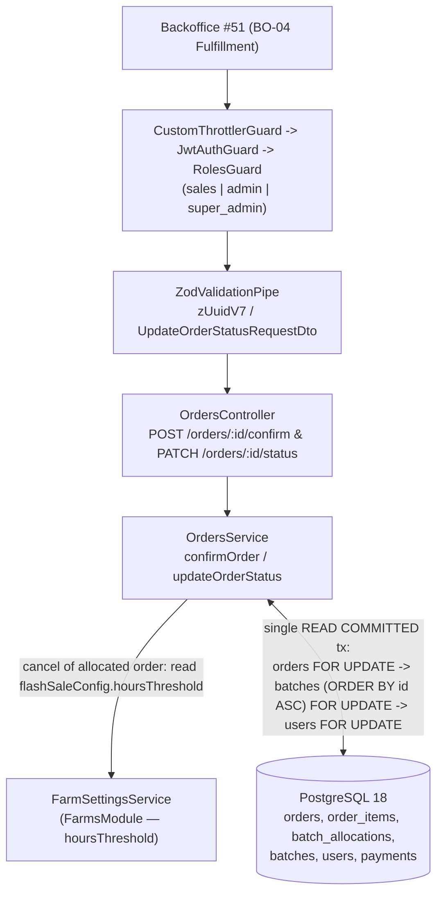
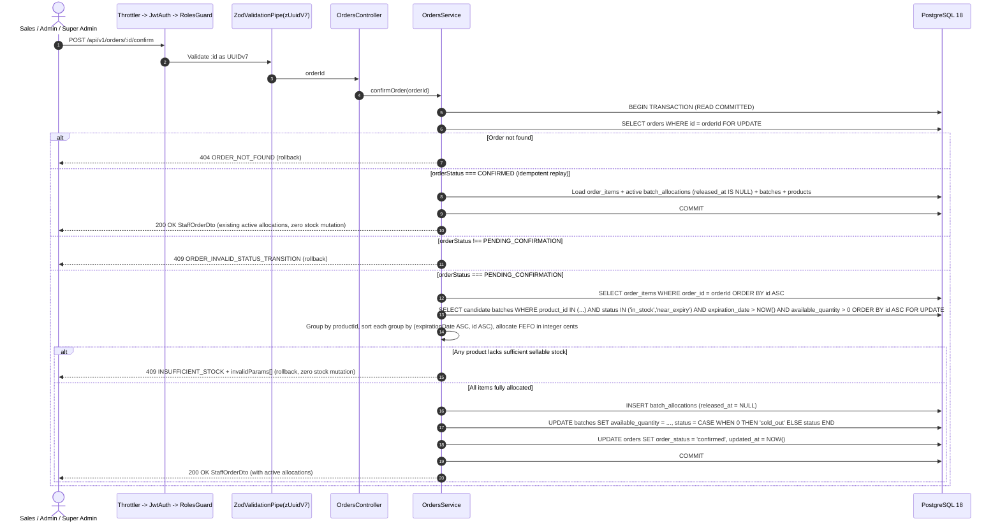

# FEFO Order Confirmation and Order Status FSM Formal Specification

## Overview & Context

This specification defines `POST /api/v1/orders/:id/confirm` (atomic First-Expired-First-Out batch allocation) and `PATCH /api/v1/orders/:id/status` (finite state machine transitions, cancellation stock release, batch status restoration, and loyalty refund) in `apps/api/src/modules/orders/*` for `#86` (split from `#27`, parent epic `#10`, sibling `#87`, backoffice consumer `#51` `BO-04`).

Architectural decisions are recorded in `ADR-0033` (reconciling `#86` with `OrderStatus`, `PaymentStatus`, `batch_allocations`, `#87`, `#28`, `#29`, `ADR-0002`, `ADR-0005`, `ADR-0008`, `ADR-0020`, `ADR-0026`, `ADR-0027`, `ADR-0029`, `ADR-0031`, and `ADR-0032`). OpenAPI contract sync follows `ADR-0007`, DTO co-location and response envelopes follow `ADR-0011` and `ADR-0012`, and RFC 9457 error formatting follows `ADR-0013`.

### Goals

- Extend `OrderStatus` with `CONFIRMED: "confirmed"` (`ORDER_STATUS_LABELS` `"Đã xác nhận"`) and `PaymentStatus` with `CANCELLED: "cancelled"` in `packages/shared`, plus `API_ERROR_CODES.ORDER_INVALID_STATUS_TRANSITION` and `API_ERROR_CODES.ORDER_PAID_CANCELLATION_FORBIDDEN` (with Vietnamese `API_ERROR_DICTIONARY` copy) in `packages/shared/src/error-dictionary.ts`.
- Evolve `batch_allocations` in `apps/api/src/database/schemas/order.schema.ts` with `releasedAt` (`timestamptz` nullable), `batch_allocations_quantity_positive` (`allocated_quantity > 0`), and `batch_allocations_active_item_batch_uidx` (`UNIQUE (order_item_id, batch_id) WHERE released_at IS NULL`), alongside enum updates via one forward-only Drizzle migration.
- Implement `POST /api/v1/orders/:id/confirm` (`200 OK`, `sales | admin | super_admin`) using single-statement `ORDER BY batches.id ASC FOR UPDATE` locking, deterministic FEFO allocation `(expirationDate ASC, id ASC)`, `BatchStatus.SOLD_OUT` depletion transitions, and natural DB-level idempotency when already `confirmed`.
- Implement `PATCH /api/v1/orders/:id/status` (`200 OK`, `sales | admin | super_admin`) enforcing the 8-state `OrderStatus` FSM, forbidding direct transitions into `confirmed`, blocking cancellation of `PAID` or non-COD orders (`422`), soft-releasing `batch_allocations` (`released_at = NOW()`), restoring `batches.availableQuantity` and `batches.status` (`EXPIRED` / `NEAR_EXPIRY` / `IN_STOCK`), cancelling `PENDING` COD `payments`, and refunding `loyaltyPointsUsed` to `users.rewardPoints`.
- Expose closed staff DTOs (`StaffOrderDto`, `StaffOrderItemDto`, `BatchAllocationSummaryDto`, `UpdateOrderStatusRequestDto`) separate from customer `OrderDto` (`ADR-0032`) and run `bun run types:sync`.

### Non-Goals

- Pick-list read endpoint `GET /api/v1/orders/:id/pick-list` (`#87`).
- PayOS payment initiation, webhook capture, or online payment refunds (`#28`).
- BullMQ 15-minute unpaid order expiration worker or COD reconciliation (`#29`).
- Post-delivery 1% loyalty point awarding (`LOYALTY_POINT_CONVERSION_PERCENT`), delivery routing, or customer self-service cancellation endpoints.

## Architecture



Symbols and module layout:

- `OrderStatus` (adding `CONFIRMED: "confirmed"`) and `PaymentStatus` (adding `CANCELLED: "cancelled"`) in `packages/shared/src/domain.enums.ts`.
- `ORDER_STATUS_LABELS` (adding `[OrderStatus.CONFIRMED]: "Đã xác nhận"`) in `packages/shared/src/shared-labels.ts`.
- `API_ERROR_CODES.ORDER_INVALID_STATUS_TRANSITION`, `API_ERROR_CODES.ORDER_PAID_CANCELLATION_FORBIDDEN`, and `API_ERROR_DICTIONARY` entries in `packages/shared/src/error-dictionary.ts`.
- `batchAllocations` (`releasedAt`, `batch_allocations_quantity_positive`, `batch_allocations_active_item_batch_uidx`) in `apps/api/src/database/schemas/order.schema.ts`.
- `MESSAGES.ORDERS` (`INVALID_STATUS_TRANSITION`, `PAID_CANCELLATION_FORBIDDEN`) in `apps/api/src/common/constants/messages.constant.ts`.
- `ORDERS_ROUTES` (`CONFIRM: ":id/confirm"`, `STATUS: ":id/status"`) in `apps/api/src/modules/orders/orders.routes.ts`.
- `ORDER_STATUS_TRANSITIONS`, `ALLOCATED_CANCELLABLE_STATUSES`, and `FULFILLMENT_ALLOWED_ROLES` in `apps/api/src/modules/orders/orders.interface.ts` (`ADR-0011`).
- `BatchAllocationSummaryDto`, `StaffOrderItemDto`, `StaffOrderDto`, and `UpdateOrderStatusRequestDto` in `apps/api/src/modules/orders/dto/` (re-exported via `dto/index.ts`).
- `OrdersService.confirmOrder` and `OrdersService.updateOrderStatus` in `apps/api/src/modules/orders/orders.service.ts` (consuming `FarmSettingsService` already imported via `FarmsModule` in `OrdersModule`).
- `OrdersController.confirmOrder` and `OrdersController.updateOrderStatus` in `apps/api/src/modules/orders/orders.controller.ts` (note: `@ApiAuth(UserRole.CUSTOMER)` moves from controller class-level to customer methods, or staff endpoints override `@Roles(...)` explicitly so `customer` is rejected with `403 FORBIDDEN` on staff routes and staff roles remain rejected with `403 FORBIDDEN` on customer routes).

## Operational Flow

### 1. FEFO Order Confirmation (`POST /api/v1/orders/:id/confirm`)



### 2. Order Status Transition & Cancellation (`PATCH /api/v1/orders/:id/status`)

```mermaid
sequenceDiagram
    autonumber
    actor Staff as Sales / Admin / Super Admin
    participant Ctrl as OrdersController
    participant Svc as OrdersService
    participant Farm as FarmSettingsService
    participant DB as PostgreSQL 18

    Staff->>Ctrl: PATCH /api/v1/orders/:id/status { status }
    Ctrl->>Svc: updateOrderStatus(orderId, input.status)
    opt input.status === CANCELLED
        Svc->>Farm: getSettings() -> resolve flashSaleConfig.hoursThreshold (ADR-0026)
    end
    Svc->>DB: BEGIN TRANSACTION (READ COMMITTED)
    Svc->>DB: SELECT orders WHERE id = orderId FOR UPDATE
    alt Order not found
        Svc-->>Staff: 404 ORDER_NOT_FOUND (rollback)
    else Transition disallowed by ORDER_STATUS_TRANSITIONS
        Svc-->>Staff: 422 ORDER_INVALID_STATUS_TRANSITION (rollback)
    else input.status === CANCELLED
        alt paymentStatus === PAID OR paymentMethod === SUBSCRIPTION
            Svc-->>Staff: 422 ORDER_PAID_CANCELLATION_FORBIDDEN (rollback)
        else Unpaid COD or pending_payment PayOS order
            opt orderStatus in {CONFIRMED, PACKING}
                Svc->>DB: Load active batch_allocations (released_at IS NULL) for order
                Svc->>DB: SELECT batches WHERE id IN (...) ORDER BY id ASC FOR UPDATE
                Svc->>DB: UPDATE batches (restore availableQuantity; if > 0 re-evaluate EXPIRED / NEAR_EXPIRY / IN_STOCK)
                Svc->>DB: UPDATE batch_allocations SET released_at = NOW() WHERE id IN (...) AND released_at IS NULL
            end
            opt order.loyaltyPointsUsed > 0
                Svc->>DB: SELECT users WHERE id = order.customerId AND deleted_at IS NULL FOR UPDATE
                Svc->>DB: UPDATE users SET reward_points = reward_points + order.loyaltyPointsUsed
            end
            Svc->>DB: UPDATE orders SET order_status = 'cancelled', payment_status = 'cancelled', updated_at = NOW()
            Svc->>DB: UPDATE payments SET status = 'cancelled', updated_at = NOW() WHERE order_id = orderId AND status = 'pending' AND transaction_type = 'payment'
            Svc->>DB: COMMIT
            Svc-->>Staff: 200 OK StaffOrderDto (including released allocations with releasedAt !== null)
        end
    else Forward transition (confirmed -> packing -> shipping -> delivered -> completed)
        Svc->>DB: UPDATE orders SET order_status = input.status, updated_at = NOW()
        Svc->>DB: COMMIT
        Svc-->>Staff: 200 OK StaffOrderDto (with active allocations where releasedAt === null)
    end
```

### 3. OrderStatus Transition Matrix

| Current Status         | Allowed Next Statuses (via `PATCH /status`) | Allowed via `POST /confirm` | Terminal | Active Allocations Required  |
| :--------------------- | :------------------------------------------ | :-------------------------- | :------- | :--------------------------- |
| `pending_payment`      | `cancelled`                                 | No (`409`)                  | No       | No                           |
| `pending_confirmation` | `cancelled`                                 | Yes -> `confirmed`          | No       | No                           |
| `confirmed`            | `packing`, `cancelled`                      | Idempotent `200`            | No       | Yes (`released_at IS NULL`)  |
| `packing`              | `shipping`, `cancelled`                     | No (`409`)                  | No       | Yes (`released_at IS NULL`)  |
| `shipping`             | `delivered`                                 | No (`409`)                  | No       | Yes (`released_at IS NULL`)  |
| `delivered`            | `completed`                                 | No (`409`)                  | No       | Audit only                   |
| `completed`            | None (`422`)                                | No (`409`)                  | Yes      | Audit only                   |
| `cancelled`            | None (`422`)                                | No (`409`)                  | Yes      | Soft-released (`releasedAt`) |

_Note_: `pending_payment -> confirmed` is reserved exclusively for `#28` (PayOS webhook settlement paired with FEFO allocation) and is rejected on both `#86` endpoints.

### 4. FEFO Allocation & Batch Restoration Arithmetic

1. **Integer-cent quantity precision**: All batch `availableQuantity` and `order_items.quantity` (`numeric(10, 2)`) arithmetic executes in integer cents (`Math.round(Number(val) * 100)`) and serializes back via `(cents / 100).toFixed(2)` to eliminate IEEE-754 rounding drift.
2. **Deterministic FEFO ordering**: Within each product, locked sellable batches (`status IN ('in_stock', 'near_expiry') AND expiration_date > NOW() AND available_quantity > 0`) are sorted by `expirationDate.getTime() ASC`, breaking identical expiration timestamps deterministically by `batch.id ASC` (UUIDv7).
3. **Partial consumption & depletion**: Each item splits greedily across sorted batches (`takeCents = Math.min(remainingCents, batchRemainingCents)`). In-memory `batchRemainingCents` tracks consumption across multiple items only if duplicate `productId` lines ever exist on legacy rows; `batch_allocations` inserts one row per `(orderItemId, batchId)` pair. Any batch ending at `0` cents transitions to `BatchStatus.SOLD_OUT`.
4. **Batch status restoration on cancellation**: When restoring `restoredCents` onto a locked batch (`newAvailableCents = currentAvailableCents + restoredCents > 0`), status is re-evaluated against `now` (`new Date()`):
   - If `batch.expirationDate <= now` -> `BatchStatus.EXPIRED` (prevents expired stock from returning to sellable listings).
   - Else if `batch.expirationDate.getTime() - now.getTime() < hoursThreshold * TIME_IN_MS.HOUR` -> `BatchStatus.NEAR_EXPIRY`.
   - Else -> `BatchStatus.IN_STOCK`.

## API Contract

### Endpoints

- `POST /api/v1/orders/:id/confirm`
  - **Auth & RBAC**: `@ApiAuth(UserRole.SALES, UserRole.ADMIN, UserRole.SUPER_ADMIN)` — `customer`, `farm_staff`, and `guest` receive `403 FORBIDDEN`; unauthenticated requests receive `401`.
  - **Path Param**: `:id` validated via `ZodValidationPipe(zUuidV7())` (`400 VALIDATION_FAILED`).
  - **Request Body**: None (reject any unexpected route structure; standard empty POST).
  - **HTTP Status**: `200 OK` (`@HttpCode(HttpStatus.OK)`), returning `ApiResponseDto<StaffOrderDto>`.
  - **Errors**: `400 VALIDATION_FAILED`, `401 AUTH_TOKEN_INVALID_OR_EXPIRED`, `403 FORBIDDEN`, `404 ORDER_NOT_FOUND`, `409 ORDER_INVALID_STATUS_TRANSITION` (order not in `pending_confirmation` or `confirmed`), `409 INSUFFICIENT_STOCK` (`invalidParams[]` per short SKU with `{ productId, requested, available }`), `429 TOO_MANY_REQUESTS`, `500 INTERNAL_SERVER_ERROR`.
- `PATCH /api/v1/orders/:id/status`
  - **Auth & RBAC**: `@ApiAuth(UserRole.SALES, UserRole.ADMIN, UserRole.SUPER_ADMIN)`.
  - **Path Param**: `:id` validated via `ZodValidationPipe(zUuidV7())`.
  - **Request Body (`UpdateOrderStatusRequestDto`, `.strict()`)**: `{ status: z.enum(OrderStatus) }`.
  - **HTTP Status**: `200 OK`, returning `ApiResponseDto<StaffOrderDto>`.
  - **Errors**: `400 VALIDATION_FAILED` (invalid UUIDv7, invalid `OrderStatus`, unknown payload keys), `401 AUTH_TOKEN_INVALID_OR_EXPIRED`, `403 FORBIDDEN`, `404 ORDER_NOT_FOUND`, `404 FARM_NOT_FOUND` (prod only if `farms` unseeded during `confirmed`/`packing` cancellation), `422 ORDER_INVALID_STATUS_TRANSITION` (disallowed FSM transition, same-status no-op, or direct jump into `confirmed`), `422 ORDER_PAID_CANCELLATION_FORBIDDEN` (cancelling `PAID` or non-COD order), `429 TOO_MANY_REQUESTS`, `500 INTERNAL_SERVER_ERROR`.

### DTOs & Projections

- `BatchAllocationSummaryDto` (`apps/api/src/modules/orders/dto/staff-order.dto.ts`): `id`, `batchId`, `batchCode`, `expirationDate` (ISO-8601 datetime), `allocatedQuantity` (positive number), `releasedAt` (`z.iso.datetime().nullable()`).
- `StaffOrderItemDto`: extends `OrderItemDto` fields (`id`, `productId`, `productName`, `productSlug`, `productImageUrl`, `unit`, `quantity`, `unitPriceVnd`, `lineTotalVnd`) with `allocations: z.array(BatchAllocationSummaryDto)`.
- `StaffOrderDto`: mirrors `OrderDto` header fields plus `customerId` (`zUuidV7()`) and `items: z.array(StaffOrderItemDto)`, while still omitting raw `payments.rawPayload` and cost fields. (Customer `OrderDto` on `GET /orders/me`, `GET /orders/:id`, and `POST /orders/checkout` remains strictly unchanged.)
- `UpdateOrderStatusRequestDto`: `.strict()` Zod DTO with `status: z.enum(OrderStatus)`.

## Security & Reliability

- **RBAC isolation on shared `OrdersController`**: Replace controller-wide `@ApiAuth(UserRole.CUSTOMER)` with per-method `@ApiAuth(...)` decorators (`UserRole.CUSTOMER` on `listMyOrders`, `getMyOrderById`, `validateCart`, `checkout`; `UserRole.SALES, UserRole.ADMIN, UserRole.SUPER_ADMIN` on `confirmOrder`, `updateOrderStatus`), ensuring customers and `farm_staff` receive `403 FORBIDDEN` on staff fulfillment endpoints while staff roles continue receiving `403 FORBIDDEN` on customer endpoints.
- **Deadlock-free global lock ordering**:
  - `confirmOrder` locks `orders` (`FOR UPDATE`) -> candidate `batches` in **one** `ORDER BY batches.id ASC FOR UPDATE` query.
  - `updateOrderStatus` (`cancelled`) locks `orders` (`FOR UPDATE`) -> allocated `batches` in **one** `ORDER BY batches.id ASC FOR UPDATE` query -> `users` (`FOR UPDATE`, only if `loyaltyPointsUsed > 0`).
  - Because `checkoutCod` (`ADR-0031`) locks only `users` for a brand-new order and `WasteLogsService.approveWasteLog` (`ADR-0029`) locks `waste_logs -> batches`, lock acquisition forms a strict DAG with zero cycle paths.
  - PostgreSQL lock timeout / `40P01` serialization traps (if any external writer ever contends) map via `GlobalExceptionFilter` to `409 CONCURRENCY_CONFLICT`, never `500`.
- **Transaction brevity**: `FarmSettingsService.getSettings()` is awaited before opening `db.transaction` on cancellation, keeping Redis/network calls outside DB row locks (`docs/standards/database-and-migrations.md` §4).
- **Rate limiting**: Inherits `CustomThrottlerGuard` `default` tier (`100 req / 60s`).

## Domain Invariant Taxonomy

Continuing `OrdersDomainInvariants` from `docs/design/customer-order-history-formal-spec.md` (`INV-ORD-7..10`):

| Invariant    | Name                                       | Formal Statement                                                                                                                                                                                                                                                                                                                                                                                               | Enforcement Seam                                                                                | Verification Test                                                                                                                                           |
| :----------- | :----------------------------------------- | :------------------------------------------------------------------------------------------------------------------------------------------------------------------------------------------------------------------------------------------------------------------------------------------------------------------------------------------------------------------------------------------------------------- | :---------------------------------------------------------------------------------------------- | :---------------------------------------------------------------------------------------------------------------------------------------------------------- |
| `INV-ORD-11` | Atomic Ascending-ID FEFO Allocation        | `POST /api/v1/orders/:id/confirm` locks all candidate sellable batches (`in_stock`/`near_expiry`, `expiration_date > NOW()`, `available_quantity > 0`) in one `ORDER BY id ASC FOR UPDATE` query, allocates strictly by `(expiration_date ASC, id ASC)`, transitions depleted batches to `sold_out`, and rolls back completely (`409 INSUFFICIENT_STOCK`) on any shortage without negative stock or deadlocks. | `OrdersService.confirmOrder` + `batches_available_quantity_non_negative`                        | 10 parallel crossed-item confirmations allocate FEFO without `500`/deadlock or negative `availableQuantity`; short item rolls back all lines (`409`)        |
| `INV-ORD-12` | Natural Idempotent Confirmation            | Repeating `POST /api/v1/orders/:id/confirm` on an already `confirmed` order returns `200 OK` with existing active `batch_allocations` (`released_at IS NULL`) without decrementing `batches.availableQuantity` or inserting duplicate allocation rows; any other status outside `pending_confirmation`/`confirmed` returns `409 ORDER_INVALID_STATUS_TRANSITION`.                                              | `OrdersService.confirmOrder` (`orders FOR UPDATE`) + `batch_allocations_active_item_batch_uidx` | 10 parallel `POST /confirm` requests on one order produce 1 set of `batch_allocations`, decrement batch stock once, and all succeed `200 OK`                |
| `INV-ORD-13` | Strict OrderStatus FSM Gate                | `PATCH /api/v1/orders/:id/status` permits only `confirmed -> packing -> shipping -> delivered -> completed` and `{pending_payment, pending_confirmation, confirmed, packing} -> cancelled`; direct transitions into `confirmed`, backwards/skipped transitions, and mutations on terminal `completed`/`cancelled` fail with `422 ORDER_INVALID_STATUS_TRANSITION`.                                             | `OrdersService.updateOrderStatus` + `ORDER_STATUS_TRANSITIONS`                                  | Invalid transitions (`pending_confirmation -> confirmed`, `packing -> delivered`, `delivered -> cancelled`, `completed -> *`) return `422`                  |
| `INV-ORD-14` | Soft-Release Stock & Batch Status Recovery | Cancelling a `confirmed` or `packing` order stamps `batch_allocations.released_at = NOW()` (preserving rows), restores exact `allocated_quantity` to each original `batch_id`, and restores `sold_out` batches to `expired` if `expiration_date <= NOW()`, `near_expiry` if `< hoursThreshold`, or `in_stock` otherwise.                                                                                       | `OrdersService.updateOrderStatus` + `batch_allocations_quantity_positive`                       | Cancelling a `confirmed` order that depleted a batch to `sold_out` restores exact quantity and transitions status accurately (including expired case)       |
| `INV-ORD-15` | Paid-Order Guard & Unpaid Side Effects     | `PATCH /api/v1/orders/:id/status` rejects cancelling `PAID` or `SUBSCRIPTION` orders (`422 ORDER_PAID_CANCELLATION_FORBIDDEN`), marks unpaid `orders.paymentStatus` and `payments.status` as `PaymentStatus.CANCELLED`, and atomically refunds `orders.loyaltyPointsUsed` to `users.rewardPoints` under `FOR UPDATE`.                                                                                          | `OrdersService.updateOrderStatus` + `ADR-0020` / `ADR-0031`                                     | Cancelling a `PAID` PayOS or `SUBSCRIPTION` order returns `422`; cancelling an unpaid order with `loyaltyPointsUsed = 50_000` restores `users.rewardPoints` |
| `INV-ORD-16` | Fulfillment Staff RBAC & DTO Boundary      | Both `POST /api/v1/orders/:id/confirm` and `PATCH /api/v1/orders/:id/status` allow only `sales`, `admin`, and `super_admin` (`403` for `customer`, `farm_staff`, `guest`), while returning `StaffOrderDto` without exposing `allocations` on customer `OrderDto` routes.                                                                                                                                       | `@ApiAuth(SALES, ADMIN, SUPER_ADMIN)` + `StaffOrderDto`                                         | RBAC matrix passes for `sales`/`admin`/`super_admin` and returns `403` for `customer`/`farm_staff`/`guest`                                                  |

### Edge Cases (`EDGE-1..12`)

| ID        | Case                                                                                                                            | Expected Behaviour                                                                                                                                               |
| :-------- | :------------------------------------------------------------------------------------------------------------------------------ | :--------------------------------------------------------------------------------------------------------------------------------------------------------------- |
| `EDGE-1`  | `POST /orders/:id/confirm` with non-UUIDv7 `:id`                                                                                | `400 VALIDATION_FAILED` (`CUSTOM_VALIDATION_ERROR`)                                                                                                              |
| `EDGE-2`  | `POST /orders/:id/confirm` or `PATCH /orders/:id/status` for unknown order UUID                                                 | `404 ORDER_NOT_FOUND`                                                                                                                                            |
| `EDGE-3`  | `POST /orders/:id/confirm` on `pending_payment` (unpaid PayOS), `packing`, `shipping`, `delivered`, `completed`, or `cancelled` | `409 ORDER_INVALID_STATUS_TRANSITION`                                                                                                                            |
| `EDGE-4`  | Confirming multi-item order where item 1 succeeds in memory but item 2 lacks stock                                              | Transaction rolls back; `409 INSUFFICIENT_STOCK` (`invalidParams[]` lists item 2); batch stock for item 1 stays untouched and order stays `pending_confirmation` |
| `EDGE-5`  | Two sellable batches have identical `expirationDate`                                                                            | Batch with smaller `id` (UUIDv7 ascending) is allocated first                                                                                                    |
| `EDGE-6`  | Expired batch (`status = 'in_stock'` before midnight cron, `expirationDate <= NOW()`)                                           | Excluded by `expiration_date > NOW()` predicate during `confirm`; order falls back to newer valid batch or returns `409 INSUFFICIENT_STOCK`                      |
| `EDGE-7`  | Batch depleted to `0.00` (`sold_out`) during `confirm`, then expires before cancel                                              | On cancellation, `availableQuantity` is restored and `status` becomes `BatchStatus.EXPIRED` (never `in_stock` or `near_expiry`)                                  |
| `EDGE-8`  | Batch depleted to `0.00` (`sold_out`) during `confirm`, still within HSD threshold on cancel                                    | On cancellation, `availableQuantity` is restored and `status` becomes `BatchStatus.NEAR_EXPIRY`                                                                  |
| `EDGE-9`  | `PATCH /orders/:id/status` sending `{ status: "confirmed" }` from `pending_confirmation`                                        | `422 ORDER_INVALID_STATUS_TRANSITION` (must use `POST /orders/:id/confirm`)                                                                                      |
| `EDGE-10` | `PATCH /orders/:id/status` sending same status (e.g. `packing -> packing`)                                                      | `422 ORDER_INVALID_STATUS_TRANSITION`                                                                                                                            |
| `EDGE-11` | `PATCH /orders/:id/status` cancelling `pending_confirmation` COD order with `loyaltyPointsUsed > 0`                             | Succeeds `200 OK`; refunds `loyaltyPointsUsed` to `users.rewardPoints`, sets `paymentStatus = cancelled` and `payments.status = cancelled`, zero batch work      |
| `EDGE-12` | `PATCH /orders/:id/status` cancelling a `PAID` PayOS or `SUBSCRIPTION` order                                                    | `422 ORDER_PAID_CANCELLATION_FORBIDDEN`                                                                                                                          |

### Concurrency & Adversarial Matrix (`ADV-1..5`)

| ID      | Scenario                                                                                                                                    | Expected Behaviour                                                                                                                                                        |
| :------ | :------------------------------------------------------------------------------------------------------------------------------------------ | :------------------------------------------------------------------------------------------------------------------------------------------------------------------------ |
| `ADV-1` | 10 parallel `POST /orders/:id/confirm` requests on the same `pending_confirmation` order                                                    | Serialized on `orders FOR UPDATE`; first allocates FEFO and transitions to `confirmed`, remaining 9 hit `confirmed` branch and return `200 OK` with identical allocations |
| `ADV-2` | 10 parallel `POST /orders/:id/confirm` requests across crossed-item orders (Order A `[P1, P2]`, Order B `[P2, P1]`) sharing limited batches | Single-statement `ORDER BY batches.id ASC FOR UPDATE` eliminates `40P01` deadlocks; winners allocate FEFO, losers return `409 INSUFFICIENT_STOCK`, zero negative stock    |
| `ADV-3` | Concurrent `POST /orders/:id/confirm` and `PATCH /orders/:id/status { status: "cancelled" }` on the same order                              | Serialized on `orders FOR UPDATE`: either `cancel` runs first (`confirm` returns `409`), or `confirm` runs first (`cancel` releases the newly allocated batches cleanly)  |
| `ADV-4` | Concurrent `POST /orders/:id/confirm` and `POST /waste-logs/:id/approve` targeting the same batch                                           | Both lock `batches` (`FOR UPDATE`): winner takes stock (`availableQuantity >= 0`), loser fails cleanly with `409 INSUFFICIENT_STOCK`                                      |
| `ADV-5` | `customer`, `farm_staff`, or `guest` calls `/orders/:id/confirm` or `/orders/:id/status`                                                    | Rejected by `RolesGuard` with `403 FORBIDDEN`                                                                                                                             |

## Test Matrix

1. **Shared Unit Tests (`packages/shared/src/error-dictionary.spec.ts`)**:
   - Verify `OrderStatus.CONFIRMED`, `PaymentStatus.CANCELLED`, `ORDER_STATUS_LABELS[OrderStatus.CONFIRMED]`, `ORDER_INVALID_STATUS_TRANSITION`, and `ORDER_PAID_CANCELLATION_FORBIDDEN`.
2. **API Unit Tests (`apps/api/src/modules/orders/orders.service.spec.ts`)**:
   - FEFO sorting across multiple batches (including `near_expiry` before `in_stock`, identical `expirationDate` tie-broken by `id ASC`, and fractional decimal cent arithmetic).
   - Batch status transition to `sold_out` on exact depletion and restoration (`in_stock` / `near_expiry` / `expired`) on cancellation.
   - `ORDER_STATUS_TRANSITIONS` valid/invalid paths and `ORDER_PAID_CANCELLATION_FORBIDDEN` guard.
3. **API Integration & Concurrency Tests (`apps/api/test/integration/orders-fulfillment.spec.ts`)**:
   - Following `docs/standards/testing-and-fixtures.md` (`api-schema.d.ts` response typing, `// Invariant: INV-ORD-N` comments):
   - Happy-path multi-batch FEFO confirmation (`200 OK`, `confirmed`, `batch_allocations` rows persisted, `batches.availableQuantity` decremented, `sold_out` when depleted).
   - `409 INSUFFICIENT_STOCK` multi-item rollback (partial first-item stock remains unallocated) and expired-timestamp exclusion (`expirationDate <= NOW()`).
   - **Concurrency suite**: (a) `Promise.all` of 10 parallel `POST /orders/:id/confirm` calls for the same order (1 allocation set, 0 double-decrements); (b) `Promise.all` of 10 parallel crossed-item `POST /orders/:id/confirm` calls (0 `500` errors, 0 `40P01` deadlocks, no negative batch `availableQuantity`); (c) concurrent `confirm` vs `cancel` on the same order.
   - Full `OrderStatus` FSM traversal (`confirmed -> packing -> shipping -> delivered -> completed`), `422` invalid transitions (including `pending_confirmation -> confirmed` via `PATCH`, backward moves, terminal states), and `409` on `POST /confirm` outside `pending_confirmation`/`confirmed`.
   - Cancellation from `pending_payment`, `pending_confirmation`, `confirmed`, and `packing`: soft-release `released_at !== null`, exact batch stock restoration, `sold_out -> in_stock / near_expiry / expired` recovery, `PaymentStatus.CANCELLED` on order + payment, `loyaltyPointsUsed` refund to `users.rewardPoints`, and `422 ORDER_PAID_CANCELLATION_FORBIDDEN` on `PAID`/non-COD orders.
   - RBAC matrix: `sales`, `admin`, `super_admin` succeed; `customer`, `farm_staff`, `guest` receive `403`; unauthenticated receives `401`.
4. **Contract Sync**:
   - `drizzle-kit generate` creates forward-only enum + `batch_allocations` migration cleanly.
   - `bun run types:sync` executed cleanly and generated OpenAPI/client contracts committed.

## Risks & Rollback

- **PostgreSQL enum migration & `BO-04`/`#87` alignment**: Adding `OrderStatus.CONFIRMED` and `PaymentStatus.CANCELLED` alters `order_status` and `payment_status` enums; `#87` (pick-list) and `#51` (`BO-04`) must use real `OrderStatus` values (`confirmed`, `packing`, `shipping`) and filter `batch_allocations.released_at IS NULL`.
- **Legacy operational seed fixture**: `tier3-operational.seeder.ts` seeds `orderRetail` as `PENDING_CONFIRMATION` alongside sample `batchAllocations`; fulfillment tests must create fresh unallocated orders rather than relying on `orderRetail` having empty allocations.
- **Rollback**: Revert `#86` code changes and run `bun run types:sync`; keep the additive `batch_allocations.released_at` column, constraints, and enum values per forward-only migration rules (`docs/standards/database-and-migrations.md` §5).
