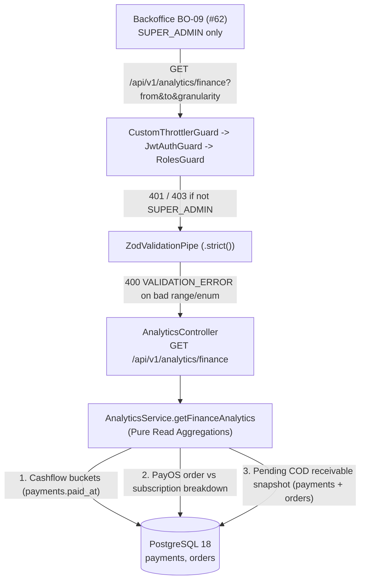
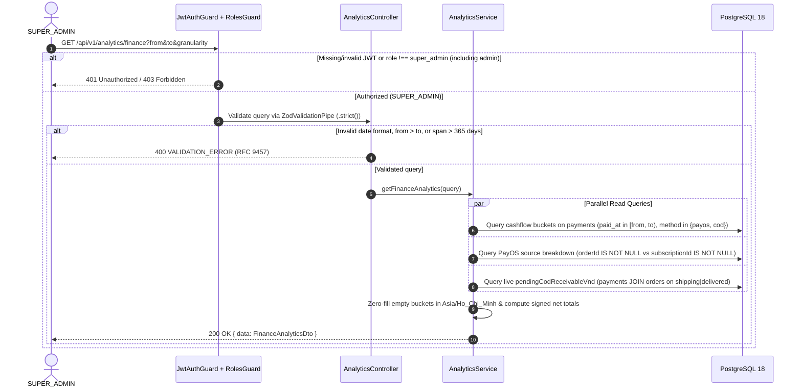

# SuperAdmin Financial Cashflow Analytics Endpoint Formal Specification

## Overview & Context

This specification defines `GET /api/v1/analytics/finance`, its `SUPER_ADMIN`-only RBAC boundary, cash-basis PayOS vs. COD aggregation semantics, live `pendingCodReceivableVnd` snapshot, query/response OpenAPI contracts, and the `payments.paid_at` schema invariant migration for #251 (parent epic #14; split from #35; sibling operational analytics issue #250; Backoffice `BO-09` consumer #62) in `apps/api/src/modules/analytics`.

Architectural commitments are recorded in `ADR-0049`; staff RBAC follows `ADR-0019`; integer VND storage follows `ADR-0004`; database invariants follow `ADR-0005`; DTO co-location, envelopes, OpenAPI sync, and RFC 9457 contracts follow `ADR-0007`, `ADR-0011`, `ADR-0012`, and `ADR-0013`; subscription PayOS purchases follow `ADR-0041`; PayOS order checkout/webhooks follow `ADR-0042`; COD confirmation follows `ADR-0043`; complaint `bank_transfer` refunds follow `ADR-0046`; and shared analytics module structure/timezone/window helpers follow `ADR-0048`.

`apps/api/src/modules/analytics/` currently implements only `GET /api/v1/analytics/operations` (`ADMIN` + `SUPER_ADMIN`), and `payments` in `apps/api/src/database/schemas/payment.schema.ts` has `paidAt` without a `CHECK` constraint or index for `paid`/`refunded` range queries.

### Goals

- Extend `AnalyticsModule` (`ANALYTICS_ROUTES`, `AnalyticsController`, `AnalyticsService`, `analytics.constant.ts`, `analytics.interface.ts`, and `dto/`) with `GET /api/v1/analytics/finance`.
- Enforce `@ApiAuth(UserRole.SUPER_ADMIN)` (`403` for `ADMIN` and all lower roles).
- Aggregate cash-basis PayOS (orders + subscriptions) and COD inflows, `bank_transfer` refund outflows (`PaymentTransactionType.REFUND`), and signed net cashflow anchored on `payments.paid_at` in `Asia/Ho_Chi_Minh`.
- Return a window-independent `pendingCodReceivableVnd` live snapshot for `shipping`/`delivered` COD orders with `payments.status = 'pending'`.
- Evolve `payments` in `apps/api/src/database/schemas/payment.schema.ts` via one forward-only Drizzle migration: backfill null `paid_at` on `paid`/`refunded` rows, add `CHECK` `payments_paid_at_required`, and add partial index `payments_paid_at_idx`.
- Verify via integration tests (`apps/api/test/integration/analytics.spec.ts`) and regenerate OpenAPI contracts via `bun run types:sync`.

### Non-Goals

- Modifying `GET /api/v1/analytics/operations` (`#250`, `ADR-0048`).
- Backoffice `BO-09` Recharts UI wiring (`#62`).
- Redis caching, CSV/PDF export, or real-time streaming analytics.

## Architecture

Symbols and module layout:

- `ANALYTICS_ROUTES` in `apps/api/src/modules/analytics/analytics.routes.ts`: add `FINANCE: "finance"`.
- `analytics.constant.ts`: add `ANALYTICS_FINANCE_ALLOWED_ROLES = [UserRole.SUPER_ADMIN] as const`, `ANALYTICS_FINANCE_PAYMENT_METHODS = [PaymentMethod.PAYOS, PaymentMethod.COD] as const`, `ANALYTICS_PENDING_COD_ORDER_STATUSES = [OrderStatus.SHIPPING, OrderStatus.DELIVERED] as const`.
- `AnalyticsController` in `apps/api/src/modules/analytics/analytics.controller.ts`: `@Get(ANALYTICS_ROUTES.FINANCE)`, `@ApiAuth(...ANALYTICS_FINANCE_ALLOWED_ROLES)`, `@ApiOkResponseGeneric(FinanceAnalyticsDto)`, `@ApiTooManyRequestsResponseRfc9457()`.
- `AnalyticsService` in `apps/api/src/modules/analytics/analytics.service.ts`: add `getFinanceAnalytics(query: FinanceAnalyticsQuery)` executing bounded read queries against `payments` (and `orders` solely for the `pendingCodReceivableVnd` snapshot) and zero-filling missing buckets in `Asia/Ho_Chi_Minh`.
- `apps/api/src/modules/analytics/dto/finance-analytics.dto.ts` & `finance-analytics-query.dto.ts` (co-located Zod schemas + NestJS DTO classes per `ADR-0011`, reusing `analyticsPeriodSchema` / window validation helpers from `analytics.util.ts`).
- `apps/api/src/database/schemas/payment.schema.ts`: adds `payments_paid_at_required` `check()` and `payments_paid_at_idx` partial `index()`.

## Operational Flow

## Contracts & Data Model

### Query Contract (`FinanceAnalyticsQueryDto`)

| Parameter     | Type                         | Default                                                        | Constraints                                                           |
| :------------ | :--------------------------- | :------------------------------------------------------------- | :-------------------------------------------------------------------- |
| `from`        | `string` (`YYYY-MM-DD`)      | `to - 29 days` (inclusive 30-day window in `Asia/Ho_Chi_Minh`) | Valid ISO calendar date; `from <= to`                                 |
| `to`          | `string` (`YYYY-MM-DD`)      | Today in `Asia/Ho_Chi_Minh`                                    | Valid ISO calendar date; inclusive span `(to - from) + 1 <= 365` days |
| `granularity` | `"day" \| "week" \| "month"` | `"day"`                                                        | Strict enum                                                           |

Note on window bounds: `[from, to]` is interpreted in `Asia/Ho_Chi_Minh` (`UTC+07:00`) as `[from 00:00:00+07:00, (to + 1 day) 00:00:00+07:00)` (half-open UTC instant interval).

### Response Contract (`FinanceAnalyticsDto`)

- `period`: `{ from: string, to: string, granularity: "day" | "week" | "month", timezone: "Asia/Ho_Chi_Minh" }`
- `summary`:
  - `payosInflowVnd`: `number` (integer >= 0) — `SUM(payments.amount)` where `payment_method = 'payos'`, `transaction_type = 'payment'`, `status = 'paid'`, `paid_at` in window (orders + subscriptions).
  - `payosOrderInflowVnd`: `number` (integer >= 0) — subset of `payosInflowVnd` where `order_id IS NOT NULL`.
  - `payosSubscriptionInflowVnd`: `number` (integer >= 0) — subset of `payosInflowVnd` where `subscription_id IS NOT NULL`.
  - `payosOutflowVnd`: `number` (integer >= 0) — `SUM(payments.amount)` where `payment_method = 'payos'`, `transaction_type = 'refund'`, `status = 'refunded'`, `paid_at` in window.
  - `payosNetVnd`: `number` (signed integer) — `payosInflowVnd - payosOutflowVnd`.
  - `codInflowVnd`: `number` (integer >= 0) — `SUM(payments.amount)` where `payment_method = 'cod'`, `transaction_type = 'payment'`, `status = 'paid'`, `paid_at` in window.
  - `codOutflowVnd`: `number` (integer >= 0) — `SUM(payments.amount)` where `payment_method = 'cod'`, `transaction_type = 'refund'`, `status = 'refunded'`, `paid_at` in window.
  - `codNetVnd`: `number` (signed integer) — `codInflowVnd - codOutflowVnd`.
  - `totalInflowVnd`: `number` (integer >= 0) — `payosInflowVnd + codInflowVnd`.
  - `totalOutflowVnd`: `number` (integer >= 0) — `payosOutflowVnd + codOutflowVnd`.
  - `netCashflowVnd`: `number` (signed integer) — `payosNetVnd + codNetVnd`.
  - `pendingCodReceivableVnd`: `number` (integer >= 0) — live window-independent `SUM(payments.amount)` where `payments.payment_method = 'cod'`, `payments.status = 'pending'`, `payments.transaction_type = 'payment'`, and `orders.order_status IN ('shipping', 'delivered')`.
- `cashflowSeries`: `Array<{ bucket: string, payosInflowVnd: number, payosOutflowVnd: number, payosNetVnd: number, codInflowVnd: number, codOutflowVnd: number, codNetVnd: number, netCashflowVnd: number }>` (ordered ascending by `bucket`, zero-filled; `bucket` formatted as `YYYY-MM-DD` for `day`/`week` Monday-start ISO week, `YYYY-MM` for `month`).

### Schema Migration (`apps/api/src/database/schemas/payment.schema.ts`)

1. Pre-constraint backfill in migration SQL:
   `UPDATE payments SET paid_at = COALESCE(paid_at, updated_at) WHERE status IN ('paid', 'refunded') AND paid_at IS NULL;`
2. `CHECK` constraint `payments_paid_at_required`:
   `(${table.status} NOT IN ('paid', 'refunded') OR ${table.paidAt} IS NOT NULL)`
3. Partial index `payments_paid_at_idx`:
   `index("payments_paid_at_idx").on(table.paidAt).where(sql`${table.status} IN ('paid', 'refunded') AND ${table.paidAt} IS NOT NULL`)`

## Security & Reliability

- **RBAC Boundary**: `JwtAuthGuard` + `RolesGuard` enforce `UserRole.SUPER_ADMIN` exclusively. `UserRole.ADMIN` and all non-SuperAdmin roles receive `403`.
- **Input & Resource Bounds**: `ZodValidationPipe` (`.strict()`) rejects unknown query parameters, `from > to`, and spans exceeding `365` days with `400 VALIDATION_ERROR` before hitting PostgreSQL.
- **Query Determinism & Resilience**: Read-only queries run without transactions or locks; `payments_paid_at_required` and `payments_paid_at_idx` guarantee index-backed `paid_at` lookups; `pendingCodReceivableVnd` uses `payments_status_idx` (`status = 'pending'`).

## Invariants (`AnalyticsDomainInvariants` — Finance Extension)

- **INV-6 (SuperAdmin-Only Financial RBAC)**: Only `UserRole.SUPER_ADMIN` may invoke `GET /api/v1/analytics/finance`. `UserRole.ADMIN`, `SALES`, `FARM_STAFF`, `CUSTOMER`, and `GUEST` MUST receive `403 Forbidden`.
- **INV-7 (Cash-Basis & Channel Accounting Identity)**: Across `summary` and every `cashflowSeries` bucket, `payosNetVnd === payosInflowVnd - payosOutflowVnd`, `codNetVnd === codInflowVnd - codOutflowVnd`, `netCashflowVnd === payosNetVnd + codNetVnd`, and `payosInflowVnd === payosOrderInflowVnd + payosSubscriptionInflowVnd`. `PaymentMethod.SUBSCRIPTION` (`0đ`) and `loyalty_points` refunds MUST NEVER contribute to inflows or outflows.
- **INV-8 (Paid-At Non-Null Invariant)**: Every `payments` row in `paid` or `refunded` status MUST have a non-null `paid_at`, enforced at the database level by `payments_paid_at_required`.
- **INV-9 (Pending COD Receivable Isolation)**: `pendingCodReceivableVnd` MUST aggregate only `payments` with `payment_method = 'cod'`, `status = 'pending'`, `transaction_type = 'payment'` belonging to `orders` in `shipping` or `delivered` status (excluding `pending_confirmation`, `confirmed`, `packing`, `completed`, `cancelled`), independent of `[from, to]`, and MUST NEVER be added to `netCashflowVnd`.
- **INV-10 (Bounded Window & Zero-Filled Cashflow Series)**: Query span MUST NOT exceed `365` days (`400 VALIDATION_ERROR` otherwise), and `cashflowSeries` MUST contain one contiguous entry per bucket across `[from, to]` in `Asia/Ho_Chi_Minh`.

## Edge Cases & Adversarial Matrix

| ID          | Class          | Scenario                                                                                              | Expected Behavior                                                                                         |
| :---------- | :------------- | :---------------------------------------------------------------------------------------------------- | :-------------------------------------------------------------------------------------------------------- |
| **EDGE-7**  | Boundary       | Empty date window (no `paid` or `refunded` payments in `[from, to]`)                                  | `200 OK` with `0` cashflow totals, live `pendingCodReceivableVnd`, and zero-filled `cashflowSeries`       |
| **EDGE-8**  | Boundary       | Period where `bank_transfer` refunds exceed inflows (`outflow > inflow`)                              | `payosNetVnd` / `codNetVnd` / `netCashflowVnd` return exact negative signed integer VND                   |
| **EDGE-9**  | Boundary       | PayOS payment paid at `2026-11-01T22:00:00Z` (`2026-11-02 05:00+07:00`), order delivered `2026-11-04` | Appears in `2026-11-02` bucket (anchored on `payments.paid_at` in `Asia/Ho_Chi_Minh`, not `delivered_at`) |
| **EDGE-10** | Data Lifecycle | Prepaid PayOS subscription purchase (`orderId = null`, `subscriptionId != null`)                      | Included in `payosInflowVnd` and `payosSubscriptionInflowVnd`                                             |
| **EDGE-11** | Data Lifecycle | Subscription redemption order (`PaymentMethod.SUBSCRIPTION`) or `loyalty_points` complaint refund     | Excluded from `payos*`, `cod*`, and `netCashflowVnd`                                                      |
| **EDGE-12** | Data Lifecycle | COD order in `pending_confirmation` vs. `shipping`/`delivered` vs. `cancelled`                        | Only `shipping` and `delivered` pending COD payments count toward `pendingCodReceivableVnd`               |
| **ADV-3**   | Adversarial    | `UserRole.ADMIN` calls `GET /api/v1/analytics/finance`                                                | `403 Forbidden`                                                                                           |
| **ADV-4**   | Adversarial    | Unauthenticated caller or revoked token calls `GET /api/v1/analytics/finance`                         | `401 Unauthorized`                                                                                        |

## Verification Plan

1. **Migration & Schema**: Generate Drizzle migration for `payments_paid_at_required` and `payments_paid_at_idx`, apply cleanly, and verify existing integration tests inserting `PAID`/`REFUNDED` payments pass (backfilling `paidAt` in any test fixtures missing it).
2. **Integration Tests**: Extend `apps/api/test/integration/analytics.spec.ts` covering `INV-6` through `INV-10` and `EDGE-7` through `ADV-4` against real PostgreSQL with `// Invariant: INV-N` comments per `docs/standards/testing-and-fixtures.md`.
3. **Contracts & Checks**: Run `bun run types:sync` and `bun run check` (`typecheck`, `lint`, OpenAPI sync).
