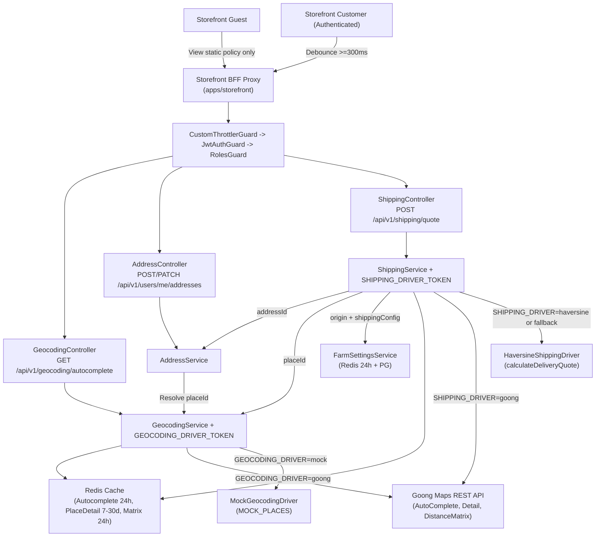
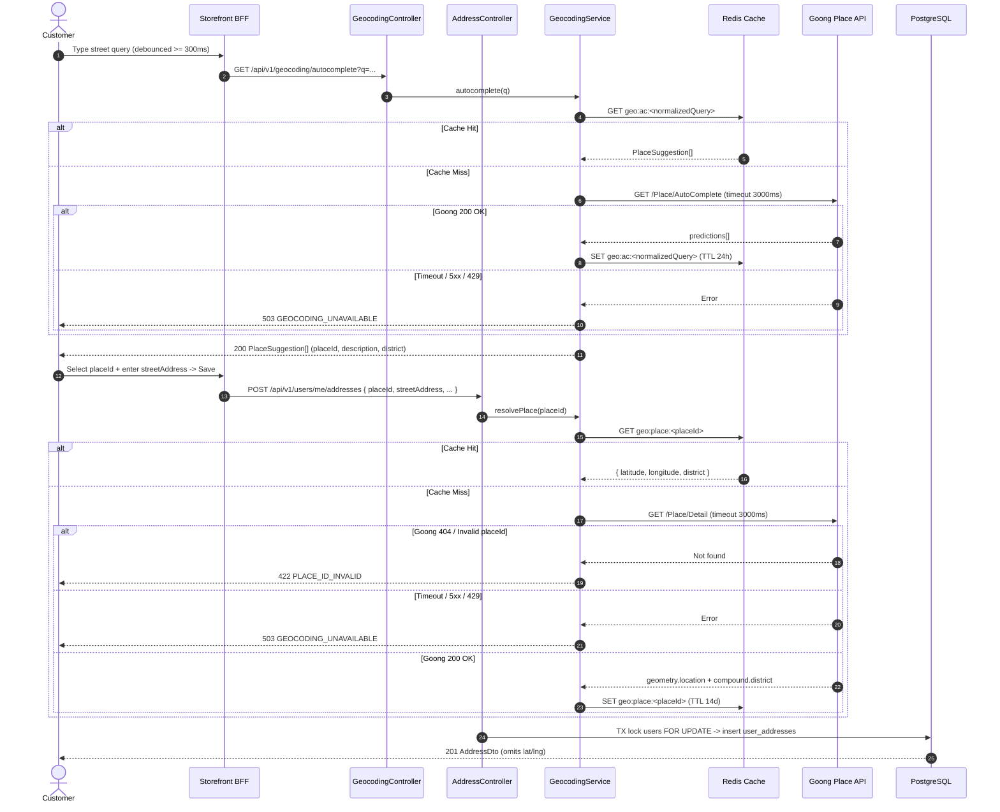
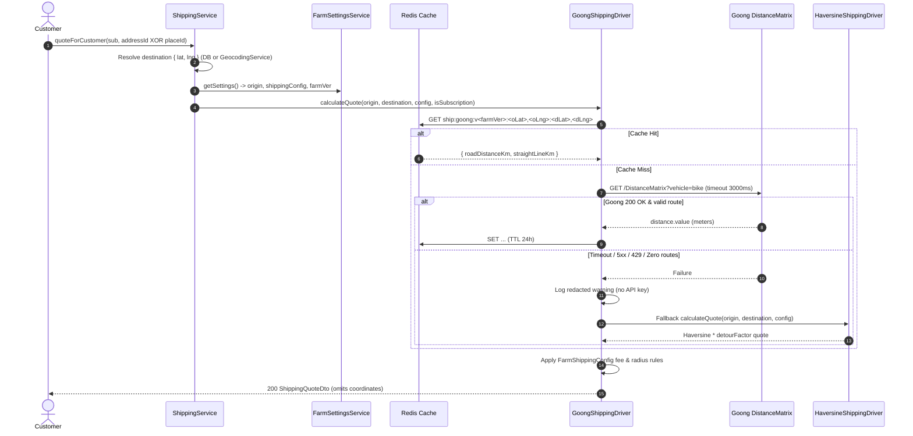

# Goong Place Geocoding and Road-Distance Shipping Formal Specification

## Overview & Context

This specification defines the breaking architectural transition from district-centroid delivery estimation (`HCMC_DISTRICTS` + `districtCode` per `ADR-0018` and `ADR-0030`) to street-level Goong Place geocoding (`#199`) and real road-distance routing (`#107`). Architectural commitments are recorded in `ADR-0044`, which amends `ADR-0018` and `ADR-0030`.

Currently, `user_addresses` requires `district_code NOT NULL`, resolving coordinates from the 24 static centroids in `HCMC_DISTRICTS`. This causes 10–15 km fee and radius drift in large districts (such as TP. Thủ Đức and Bình Chánh) and 0 km distance for all addresses in Bình Thạnh (where `FULFILLMENT_HUB` and the `binh-thanh` centroid share identical coordinates). Meanwhile, `ShippingService` only supports `SHIPPING_DRIVER=haversine`.

### Goals

- **Remove `districtCode` as a geographic input and schema column** across `user_addresses`, `AddressDto`, `CreateAddressDto`, `UpdateAddressDto`, `ShippingQuoteRequestDto` (`addressId` XOR `placeId`), `ValidateCartDto`, and `apps/storefront` (`HcmcDistrictSelect` and guest district picker).
- **Introduce `GeocodingDriver` (`GEOCODING_DRIVER=goong|mock`)**:
  - `GoongGeocodingDriver` calls Goong Place Autocomplete and Place Detail using `GOONG_API_KEY` (fail-fast in `production` when `GEOCODING_DRIVER=goong` or `SHIPPING_DRIVER=goong`).
  - `MockGeocodingDriver` resolves deterministic `MOCK_PLACES` entries for offline development and E2E suites without network calls.
- **Preserve coordinate trust (`INV-ADDR-1`)**: Client payloads MUST NEVER supply raw `latitude` or `longitude` (`400 UNRECOGNIZED_KEYS`). Clients send `placeId`, and the backend resolves `latitude`, `longitude`, and display `district` (parsed from Goong `compound.district`) server-side.
- **Implement `GoongShippingDriver` (`SHIPPING_DRIVER=goong`)** under `ShippingModule` to compute real Ho Chi Minh City road distances via Goong Distance Matrix, with Redis caching and automatic fallback to `HaversineShippingDriver` on timeout/5xx/429.
- **Restrict Goong API usage to authenticated customers (`UserRole.CUSTOMER`)**: Guests on the storefront see general delivery coverage policy (e.g., max radius and base fee from `FarmSettings`) and must sign in to search addresses and request exact quotes.
- **Run `bun run types:sync`** to update OpenAPI and generated TypeScript clients in `apps/storefront` and `apps/backoffice`.

### Non-Goals

- Arbitrary client map-pin dragging (`latitude`/`longitude` submission); only `placeId` selection plus free-text `streetAddress` (house number / alley / delivery note) is supported.
- Live third-party courier dispatch, waybill creation, or tracking webhooks (GrabExpress / AhaMove).
- Removing `HaversineShippingDriver` (retained for `SHIPPING_DRIVER=haversine` offline dev/tests and as the runtime fallback for `GoongShippingDriver`).

---

## Architecture

### Module & Symbol Layout

- **Environment & Config**:
  - `GEOCODING_DRIVERS` (`"mock" | "goong"`), `GeocodingDriverKind`, and `SHIPPING_DRIVERS` (`"haversine" | "goong"`), `ShippingDriverKind` in `apps/api/src/common/constants/environment.constant.ts`.
  - `env.config.ts` validates `GOONG_API_KEY` (required non-empty string when `NODE_ENV === "production"` and either `GEOCODING_DRIVER === "goong"` or `SHIPPING_DRIVER === "goong"`).
- **Database Schema (`apps/api/src/database/schemas/user.schema.ts`)**:
  - `userAddresses` drops `districtCode` and adds `placeId` (`varchar(255)`). `latitude` (`numeric(10, 8)`) and `longitude` (`numeric(11, 8)`) become `NOT NULL` server-derived columns. `district` (`varchar(100)`) remains `NOT NULL` and is populated server-side from Goong `compound.district` (or `"TP. Hồ Chí Minh"` fallback if omitted by Goong).
  - Forward-only Drizzle migration backfills existing seeded rows to `mock_place_*` identifiers before enforcing `NOT NULL` on `place_id`, `latitude`, and `longitude`, and dropping `district_code`.
- **Geocoding Infrastructure (`apps/api/src/modules/geocoding/*`)**:
  - `GeocodingDriver`, `PlaceSuggestion`, `ResolvedPlace`, and `GEOCODING_DRIVER_TOKEN` in `geocoding.interface.ts`.
  - `GoongGeocodingDriver` (`goong-geocoding.driver.ts`) and `MockGeocodingDriver` (`mock-geocoding.driver.ts` backed by `MOCK_PLACES` in `geocoding.constant.ts`).
  - `GeocodingService` (`geocoding.service.ts`) managing Redis caching (`geo:ac:<normalizedQuery>`, `geo:place:<placeId>`) and `503 GEOCODING_UNAVAILABLE` translation.
  - `GeocodingController` (`geocoding.controller.ts`) exposing `GET /api/v1/geocoding/autocomplete?q=...` behind `@ApiAuth(UserRole.CUSTOMER)` and strict throttling.
- **Users / Addresses (`apps/api/src/modules/users/*`)**:
  - `CreateAddressDto` and `UpdateAddressDto` replace `districtCode` with `placeId` (`z.string().trim().min(1).max(255)`), still rejecting `latitude`, `longitude`, `city`, and unknown keys with `400 UNRECOGNIZED_KEYS`.
  - `AddressDto` replaces `districtCode` with `placeId` while continuing to omit `latitude` and `longitude`.
  - `AddressService` calls `GeocodingService.resolvePlace(placeId)` before inserting/updating `user_addresses` (preserving `users -> user_addresses` `FOR UPDATE` lock order).
- **Shipping (`apps/api/src/modules/orders/shipping/*`)**:
  - `GoongShippingDriver` (`drivers/goong-shipping.driver.ts`) implementing `ShippingDriver` via Goong Distance Matrix (`vehicle=bike`), Redis cache keyed by `farm_ver` and rounded `(origin, destination)` coordinates, and automatic fallback to `HaversineShippingDriver` on timeout/5xx/429.
  - `ShippingQuoteRequestDto` enforces strict XOR `addressId` (UUIDv7) vs `placeId` (`string`).
  - `ShippingService` resolves `addressId` via `AddressService.resolveAddressForQuote` and `placeId` via `GeocodingService.resolvePlace`.
- **Orders & Storefront**:
  - `ValidateCartDto` and `OrdersService.resolveCartValidationShipping` accept `addressId` or `placeId` instead of `districtCode`.
  - `apps/storefront` removes `HcmcDistrictSelect` and `AddressDialogGuestContent` district picker, replaces address selection/creation with debounced Goong Place Autocomplete (`usePlaceAutocomplete`), and displays static delivery radius/base fee copy for guests.

---

## Operational Flow

### 1. Address Autocomplete & Creation (`GET /geocoding/autocomplete`, `POST /users/me/addresses`)

### 2. Road-Distance Shipping Quote & Fallback (`POST /shipping/quote`, Checkout, Subscriptions)

---

## Security & Reliability

### Trust Boundaries & Secret Hygiene

1. **Zero Client Coordinate Trust (`INV-ADDR-1`)**: `CreateAddressDto`, `UpdateAddressDto`, `ShippingQuoteRequestDto`, and `ValidateCartDto` use Zod `.strict()` schemas rejecting `latitude`, `longitude`, `city`, `districtCode`, and any unknown field with `400 UNRECOGNIZED_KEYS`.
2. **Server-Side API Key Isolation**: `GOONG_API_KEY` is never exposed to `apps/storefront` or `apps/backoffice` bundles, never logged, and stripped from all HTTP error messages/stack traces before structured logging.
3. **Production Fail-Fast**: `env.config.ts` throws at boot if `NODE_ENV === "production"` and `(GEOCODING_DRIVER === "goong" || SHIPPING_DRIVER === "goong")` while `GOONG_API_KEY` is missing or empty.
4. **Authentication & Quota Protection**:
   - `GET /api/v1/geocoding/autocomplete` requires `@ApiAuth(UserRole.CUSTOMER)` and a stricter rate limit (e.g. `30 req / 60s` per user) to prevent automated Goong quota exhaustion.
   - Storefront BFF debounces autocomplete queries (`>= 300ms`, minimum `3` characters) and does not expose autocomplete to unauthenticated guests.

### Degradation, Edge Cases & Adversarial Matrix

| ID       | Class                  | Scenario                                                                                     | Expected System Behavior                                                                                                                                                                                |
| :------- | :--------------------- | :------------------------------------------------------------------------------------------- | :------------------------------------------------------------------------------------------------------------------------------------------------------------------------------------------------------ |
| `EDGE-1` | Boundary & Input       | Autocomplete query `< 3` chars or whitespace-only                                            | Return `400 VALIDATION_FAILED` (or empty `[]` on client before dispatch) without calling Goong.                                                                                                         |
| `EDGE-2` | Boundary & Input       | `ShippingQuoteRequestDto` supplies both `addressId` and `placeId`, or neither                | Reject with `400 VALIDATION_FAILED` (`SHIPPING_QUOTE_TARGET_XOR`).                                                                                                                                      |
| `EDGE-3` | Boundary & Input       | Goong Place Detail omits `compound.district` (e.g., industrial zone or highway)              | Fallback `district` column to `BUSINESS_RULES.DEFAULT_DELIVERY_CITY` (`"TP. Hồ Chí Minh"`), never fail on missing district name if `lat/lng` are present.                                               |
| `ADV-1`  | Concurrency & State    | Backoffice updates `FarmSettings` origin coordinates while Distance Matrix cache is warm     | `farm_ver` epoch increments on `FarmSettingsService.updateSettings()` (per `ADR-0024` pattern), immediately invalidating cached Goong matrix keys.                                                      |
| `ADV-2`  | Failure & Partitions   | Goong Distance Matrix times out (`> 3000ms`), returns `429`/`5xx`, or returns `ZERO_RESULTS` | `GoongShippingDriver` logs redacted warning and delegates to `HaversineShippingDriver` on the exact `(origin, destination)` coordinates; checkout never fails.                                          |
| `ADV-3`  | Failure & Partitions   | Goong Place Detail times out or returns `429`/`5xx` for an uncached `placeId`                | Fail closed with `503 GEOCODING_UNAVAILABLE`; never persist `user_addresses` with `NULL` coordinates. Existing saved addresses remain unaffected.                                                       |
| `ADV-4`  | Adversarial & Security | Client supplies `placeId` outside Ho Chi Minh City (e.g., Hanoi)                             | Server resolves real coordinates; `ShippingService` evaluates `roadDistanceKm > maxRadiusKm` (`25 km`) and returns `isDeliverable: false, feeVnd: null` (and `422 OUT_OF_DELIVERY_RADIUS` at checkout). |

---

## Domain Invariant Taxonomy

| Invariant    | Statement                                                                                                                                                                                                                                                 | Enforcement Point                                                                       | Verification Test Mapping                                                                       |
| :----------- | :-------------------------------------------------------------------------------------------------------------------------------------------------------------------------------------------------------------------------------------------------------- | :-------------------------------------------------------------------------------------- | :---------------------------------------------------------------------------------------------- |
| `INV-ADDR-1` | Client payloads MUST NEVER supply `latitude` or `longitude`; all stored and quoted coordinates originate server-side from `GeocodingDriver.resolvePlace(placeId)`.                                                                                        | `CreateAddressDto`, `UpdateAddressDto`, `ShippingQuoteRequestDto`, `AddressService`     | `// Invariant: INV-ADDR-1` in `address.service.spec.ts` & `shipping.service.spec.ts`            |
| `INV-GEO-1`  | Every persisted `user_addresses` row has non-null `place_id`, `latitude`, and `longitude` resolved before DB commit; `GeocodingService` fails closed (`503`) if uncached resolution fails.                                                                | `userAddresses` schema (`NOT NULL`), `AddressService.create/update`, `GeocodingService` | `// Invariant: INV-GEO-1` in `address.service.spec.ts` & `geocoding.service.spec.ts`            |
| `INV-GEO-2`  | `GOONG_API_KEY` is never returned in HTTP responses, client bundles, or error logs; production boot fails fast if Goong drivers are enabled without a key.                                                                                                | `env.config.ts`, `GoongGeocodingDriver`, `GoongShippingDriver`                          | `// Invariant: INV-GEO-2` in `goong-geocoding.driver.spec.ts` & `goong-shipping.driver.spec.ts` |
| `INV-SHIP-1` | `GoongShippingDriver` applies `FarmShippingConfig` (`maxRadiusKm`, `subscriptionFreeRadiusKm`, `baseFeeVnd`, `freeKmThreshold`, `perKmRateVnd`) identically to `HaversineShippingDriver` and falls back to `HaversineShippingDriver` on upstream failure. | `GoongShippingDriver.calculateQuote`                                                    | `// Invariant: INV-SHIP-1` in `goong-shipping.driver.spec.ts`                                   |
| `INV-SHIP-2` | `ShippingQuoteDto` and `AddressDto` never expose `latitude` or `longitude` coordinates to customers.                                                                                                                                                      | `ADDRESS_COLUMNS`, `ShippingService.quoteForCoordinates`                                | `// Invariant: INV-SHIP-2` in `address.service.spec.ts` & `shipping.service.spec.ts`            |
