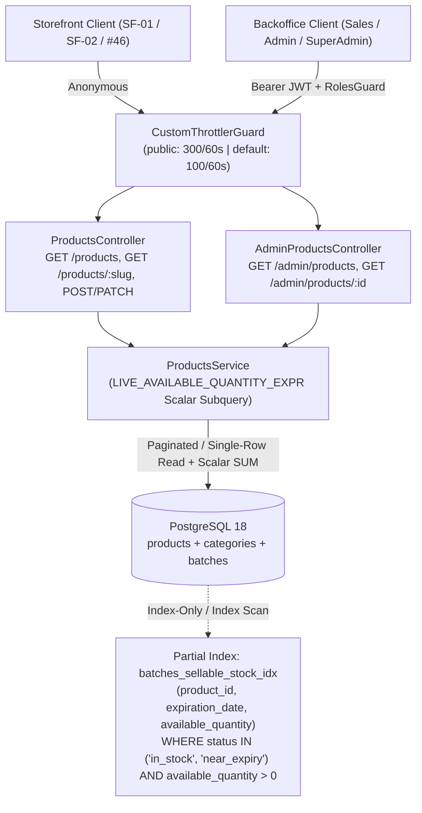
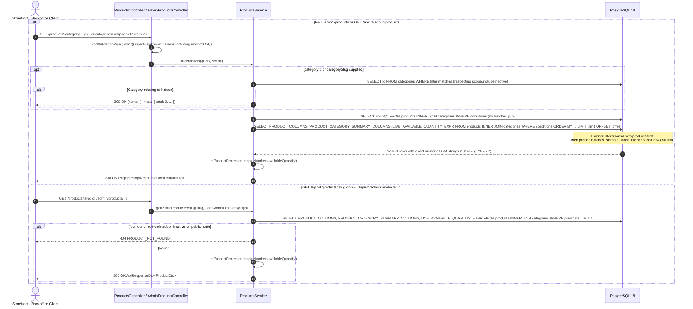
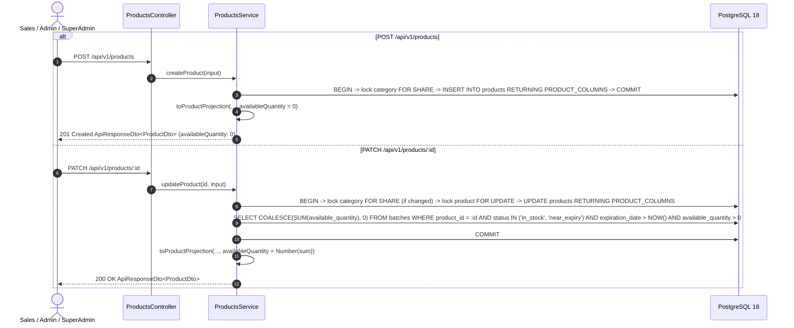

# Live Product Stock Aggregation Formal Specification

## Overview & Context

This specification defines live, uncached product stock aggregation (`availableQuantity`) on catalog product endpoints introduced by #81 (split from #22; parent epic #9; building on #80 and #82; consumed by Storefront #46 `SF-01`/`SF-02`) in `apps/api/src/modules/catalog` and `apps/api/src/database/schemas/catalog.schema.ts`. Architectural decisions are recorded in ADR-0027; catalog visibility and pricing semantics follow ADR-0025; batch `timestamptz` expiration semantics follow ADR-0026; OpenAPI contract distribution follows ADR-0007; DTO co-location and envelope structure follow ADR-0011 and ADR-0012.

`products` intentionally omits any stored stock column (`batches.available_quantity` of type `numeric(10, 2)` is the sole source of truth). Prior to #81, `ProductDto` (`apps/api/src/modules/catalog/dto/product.dto.ts`) did not expose `availableQuantity`, and `batches` defined only `batches_product_id_idx` and `batches_fefo_outbound_idx`, lacking a partial sellable-stock index for single-query `SUM` aggregation.

### Goals

- Expose `availableQuantity` (`z.number().nonnegative()`) on `ProductDto` across `GET /api/v1/products`, `GET /api/v1/products/:slug`, `GET /api/v1/admin/products`, `GET /api/v1/admin/products/:id`, `POST /api/v1/products` (`0`), and `PATCH /api/v1/products/:id` (live sum).
- Compute `availableQuantity` directly in PostgreSQL as `COALESCE(SUM(batches.available_quantity), 0)` filtered strictly by `batches.product_id = products.id`, `batches.status IN ('in_stock', 'near_expiry')`, `batches.expiration_date > NOW()`, and `batches.available_quantity > 0`.
- Execute the aggregation in a single database query per product read (correlated scalar subquery evaluated after `products`/`categories` filtering, sorting, and `LIMIT`/`OFFSET`), with zero per-product N+1 application loops.
- Return `availableQuantity: 0` (never `null` and never omitting the product) when an active, non-deleted product in an active, non-deleted category has zero sellable batches, while excluding soft-deleted products and soft-deleted/inactive categories on public reads.
- Add partial composite index `batches_sellable_stock_idx` on `batches` via one forward-only Drizzle migration and verify the query plan with `EXPLAIN (ANALYZE, BUFFERS)` on seeded data.
- Cover mixed batch states, exact `expiration_date` vs `NOW()` boundaries, soft-deleted product/category exclusion, and zero-batch products in integration tests, then run `bun run types:sync` and commit generated contracts.

### Non-Goals

- Stock reservation, cart locking, checkout decrement, or FEFO batch allocation (`#84`).
- Redis caching or materialized/trigger-maintained `products.stock` columns.
- Expiry cron transitions (`@Cron("0 0 * * *")`), `GET /inventory/near-expiry`, or 50% batch Flash Sale toggle/pricing (`#34`).
- Adding `inStockOnly` query filtering or stock-based `sort` options to `ListProductsQueryDto` / `AdminListProductsQueryDto` (unknown query keys remain rejected with `400`).
- Pending `waste_logs` (`pending_approval`) deduction prior to approval, low-stock badges, or inventory analytics.

## Architecture

Symbols and module touchpoints:

- `apps/api/src/database/schemas/catalog.schema.ts`: Adds `batches_sellable_stock_idx` partial index on `batches` (`productId`, `expirationDate`, `availableQuantity`) with predicate `status IN ('in_stock', 'near_expiry') AND available_quantity > 0`.
- `apps/api/drizzle/<timestamp>_batches_sellable_stock_idx/migration.sql`: Forward-only Drizzle migration creating `batches_sellable_stock_idx`.
- `apps/api/src/modules/catalog/dto/product.dto.ts`: Extends `productSchema` (`ProductProjection` and `ProductDto`) with `availableQuantity: z.number().nonnegative()`.
- `apps/api/src/modules/catalog/products.service.ts`: Defines a shared `LIVE_AVAILABLE_QUANTITY_EXPR` correlated scalar subquery expression using Drizzle `sql<string>` over `batches`, includes `availableQuantity` in `listProducts`, `getPublicProductBySlug`, `getAdminProductById`, and `updateProduct`, sets `availableQuantity: 0` in `createProduct`, and maps `Number(rawAvailableQuantity)` in `toProductProjection`.
- `apps/api/src/modules/catalog/products.service.spec.ts`: Updates unit fixtures and adds scalar mapping / zero-stock / `updateProduct` stock assertions.
- `apps/api/test/integration/catalog.spec.ts`: Adds integration tests for live stock aggregation across mixed `BatchStatus` rows, `expiration_date` boundaries around `NOW()`, zero-batch products, soft-deleted/inactive product/category exclusion, and `PATCH /api/v1/products/:id` preserving live stock.
- `apps/api/openapi.json`, `apps/api/test/generated/api-schema.d.ts`, `apps/storefront/src/types/api-schema.d.ts`, `apps/backoffice/src/types/api-schema.d.ts`: Regenerated via `bun run types:sync`.

## Operational Flow

### 1. Live Stock Read Aggregation (`GET /api/v1/products`, `GET /api/v1/products/:slug`, `GET /api/v1/admin/products*`)

### 2. Product Mutations (`POST /api/v1/products` & `PATCH /api/v1/products/:id`)

## API Contract

### Endpoints

| Method & Path                    | Access                          | Rate Limit Tier             | Success                                     | Stock Behaviour                                                                              |
| :------------------------------- | :------------------------------ | :-------------------------- | :------------------------------------------ | :------------------------------------------------------------------------------------------- |
| `GET /api/v1/products`           | `@Public()`                     | `public` (`300 req / 60s`)  | `200` `PaginatedApiResponseDto<ProductDto>` | Live aggregated `availableQuantity` (`0` if no sellable batches); excludes inactive/deleted  |
| `GET /api/v1/products/:slug`     | `@Public()`                     | `public` (`300 req / 60s`)  | `200` `ApiResponseDto<ProductDto>`          | Live aggregated `availableQuantity` (`0` if no sellable batches); `404` if inactive/deleted  |
| `GET /api/v1/admin/products`     | `sales`, `admin`, `super_admin` | `default` (`100 req / 60s`) | `200` `PaginatedApiResponseDto<ProductDto>` | Live aggregated `availableQuantity` across active and inactive non-deleted products          |
| `GET /api/v1/admin/products/:id` | `sales`, `admin`, `super_admin` | `default` (`100 req / 60s`) | `200` `ApiResponseDto<ProductDto>`          | Live aggregated `availableQuantity` for any non-deleted product (`isActive = false` allowed) |
| `POST /api/v1/products`          | `sales`, `admin`, `super_admin` | `default` (`100 req / 60s`) | `201` `ApiResponseDto<ProductDto>`          | Returns `availableQuantity: 0` (new product has no batches)                                  |
| `PATCH /api/v1/products/:id`     | `sales`, `admin`, `super_admin` | `default` (`100 req / 60s`) | `200` `ApiResponseDto<ProductDto>`          | Queries and returns live `availableQuantity` inside the update transaction                   |

### DTOs, Projections & Database Index

1. **`ProductDto` (`apps/api/src/modules/catalog/dto/product.dto.ts`)**:
   - Retains all existing fields from ADR-0025 (`id`, `categoryId`, `category`, `name`, `slug`, `description`, `basePriceVnd`, `salePriceVnd`, `unit`, `imageUrls`, `isVietGap`, `isUsda`, `isSubscriptionEligible`, `isActive`, `createdAt`, `updatedAt`).
   - Adds `availableQuantity: z.number().nonnegative()` (decimal number serialized from PostgreSQL `numeric(10, 2)` sum, matching `BatchDto.availableQuantity` and `StorefrontProduct.availableQuantity`, e.g., `0` or `45.5`).
2. **Query DTOs (`ListProductsQueryDto` & `AdminListProductsQueryDto` in `apps/api/src/modules/catalog/dto/list-products-query.dto.ts`)**:
   - Unchanged in #81. Both remain `.strict()`, rejecting unrecognized query keys (including `inStockOnly` or unknown `sort` values) with `400 VALIDATION_FAILED`.
3. **Database Schema & Migration (`apps/api/src/database/schemas/catalog.schema.ts`)**:
   - Add `batches_sellable_stock_idx` on `batches` indexing `(product_id, expiration_date, available_quantity)` with partial predicate `WHERE status IN ('in_stock', 'near_expiry') AND available_quantity > 0`.
   - Generate one forward-only Drizzle migration (`bun run --cwd apps/api db:generate`) so `apps/api/drizzle/meta/*` snapshots stay authoritative per `docs/standards/database-and-migrations.md` §6.
4. **No new RFC 9457 error codes**:
   - #81 introduces no new error codes; existing catalog errors (`PRODUCT_NOT_FOUND`, `VALIDATION_FAILED`, etc.) and `GlobalExceptionFilter` contracts apply unchanged.

## Security & Reliability

### Access & Exposure Matrix

| Operation / Data                                                     | Public (`@Public()`)  | `customer` / `farm_staff` | `sales` / `admin` / `super_admin` |
| :------------------------------------------------------------------- | :-------------------: | :-----------------------: | :-------------------------------: |
| `availableQuantity` on active products in active categories          |          Yes          |            Yes            |                Yes                |
| Batch breakdown (`batchCode`, `seasonId`, `expirationDate`, per-lot) |        Hidden         |          Hidden           |    Only via `/api/v1/batches*`    |
| Inactive products (`isActive = false`) or inactive categories        | Hidden (`[]` / `404`) |   Hidden (`[]` / `404`)   |    Yes via `/admin/products*`     |
| Soft-deleted products or categories (`deletedAt IS NOT NULL`)        | Hidden (`[]` / `404`) |   Hidden (`[]` / `404`)   |       Hidden (`[]` / `404`)       |

### Controls

- **Zero Batch Metadata Leakage**: Public product endpoints expose only the aggregated scalar `availableQuantity`. Individual `batchCode`, `harvestDate`, `expirationDate`, and `seasonId` remain isolated inside `InventoryModule` (`farm_staff`/`admin`/`super_admin`) and redacted `TraceService` (`/api/v1/trace/:batchCode`).
- **Uncached Read Freshness**: Catalog reads intentionally bypass Redis caching so batch intake (`#82`), flash-sale/expiry boundaries (`#34` + `expiration_date > NOW()`), approved waste write-offs (`batches.available_quantity` updates), and checkout deductions (`#84`) become visible immediately on the next read.
- **Planner & Bounded Probe Protection**: Filtering, sorting, and `LIMIT`/`OFFSET` (capped at `limit <= 100` by `ListProductsQueryDto`) run on `products` + `categories` before the correlated scalar subquery executes, guaranteeing at most 100 targeted `batches_sellable_stock_idx` probes per list request and 1 probe per detail/patch request.
- **Rate Limiting**: Public reads stay protected by `@Throttle({ public: { limit: 300, ttl: 60000 } })` (`CustomThrottlerGuard` runs before DB access and fails open only on Redis timeout/outage per `docs/standards/api-design-and-error-handling.md` §10).
- **Decimal Arithmetic Precision**: Summing `numeric(10, 2)` inside PostgreSQL (`COALESCE(SUM(batches.available_quantity), 0)`) avoids JavaScript binary floating-point accumulation drift (`0.1 + 0.2`) across multi-batch products.
- **Strict Query Surface**: `.strict()` on `ListProductsQueryDto` and `AdminListProductsQueryDto` rejects uncontracted parameters at the HTTP boundary (`400 VALIDATION_FAILED`).

## Domain Invariant Taxonomy

| Invariant    | Name                                   | Formal Statement                                                                                                                                                                                                                                                                             | Enforcement Seam                                                                                 | Verification Test                                                                                                                   |
| :----------- | :------------------------------------- | :------------------------------------------------------------------------------------------------------------------------------------------------------------------------------------------------------------------------------------------------------------------------------------------- | :----------------------------------------------------------------------------------------------- | :---------------------------------------------------------------------------------------------------------------------------------- |
| `INV-PROD-3` | Live Sellable Stock Sum                | `ProductDto.availableQuantity` equals `SUM(batches.available_quantity)` over `batches` where `product_id = products.id`, `status IN ('in_stock', 'near_expiry')`, `expiration_date > NOW()`, and `available_quantity > 0`; products with zero qualifying rows return `0` and remain readable | `LIVE_AVAILABLE_QUANTITY_EXPR` in `ProductsService` + `ProductDto.availableQuantity`             | Integration test with mixed `in_stock`, `near_expiry`, `sold_out`, `expired`, past-`expiration_date` (`<= NOW()`), and 0-batch rows |
| `INV-PROD-4` | Single-Query Sliced Stock Aggregation  | `ProductsService` MUST compute `availableQuantity` inside the database row query (zero per-product N+1 queries) after `products`/`categories` filtering, sorting, and `LIMIT`/`OFFSET`                                                                                                       | `ProductsService.listProducts`, `getPublicProductBySlug`, `getAdminProductById`, `updateProduct` | `EXPLAIN (ANALYZE, BUFFERS)` verification on seeded data + unit/integration assertions verifying single-query projection            |
| `INV-PROD-5` | Catalog Soft-Delete & Active Exclusion | Soft-deleted products (`products.deleted_at IS NOT NULL`) and products in soft-deleted categories (`categories.deleted_at IS NOT NULL`) are excluded from all reads; public reads also exclude `isActive = false` on both tables                                                             | `ProductsService` `INNER JOIN categories` conditions (`INV-CAT-1` + `INV-PROD-5`)                | Public & admin read tests verifying soft-deleted product/category exclusion even when sellable batches exist in `batches`           |

### Edge Cases (`EDGE-1..8`)

| ID       | Case                                                                                                      | Expected Behaviour                                                                                             |
| :------- | :-------------------------------------------------------------------------------------------------------- | :------------------------------------------------------------------------------------------------------------- |
| `EDGE-1` | Active product has 0 rows in `batches`                                                                    | Included in `GET /api/v1/products` and `GET /api/v1/products/:slug` with `availableQuantity: 0`                |
| `EDGE-2` | Product has only `sold_out` or `expired` batches                                                          | Product remains readable with `availableQuantity: 0`                                                           |
| `EDGE-3` | Batch has `status = 'in_stock'` or `'near_expiry'` but `expiration_date <= NOW()` (pre-cron lag)          | Excluded by `expiration_date > NOW()`; contributes `0` to `availableQuantity`                                  |
| `EDGE-4` | Batch has `expiration_date = NOW()` (exact boundary)                                                      | Excluded because sellability requires strict `expiration_date > NOW()`                                         |
| `EDGE-5` | Batch has `status = 'in_stock'`, `expiration_date > NOW()`, `available_quantity = 12.50` + another `3.25` | `availableQuantity` returns `15.75` (exact decimal sum from PostgreSQL `numeric(10, 2)`)                       |
| `EDGE-6` | Product has a `waste_logs` row in `pending_approval` status for `2.00` kg                                 | Pending waste does NOT reduce `availableQuantity` until approved (when `batches.available_quantity` decreases) |
| `EDGE-7` | Soft-deleted product or product under a soft-deleted/inactive category still has `in_stock` batches       | Excluded from `GET /products` and returns `404 PRODUCT_NOT_FOUND` on `GET /products/:slug`                     |
| `EDGE-8` | `PATCH /api/v1/products/:id` updates product name/price while product already has `25.00` sellable stock  | Response `ProductDto` returns `availableQuantity: 25`, never reset to `0`                                      |

### Concurrency & Adversarial Matrix (`ADV-1..4`)

| ID      | Scenario                                                                                                 | Expected Behaviour                                                                                                                            |
| :------ | :------------------------------------------------------------------------------------------------------- | :-------------------------------------------------------------------------------------------------------------------------------------------- |
| `ADV-1` | Batch intake (`POST /api/v1/batches`) or waste approval commits concurrently with `GET /api/v1/products` | Under `READ COMMITTED`, reads reflect the latest committed `batches.available_quantity` immediately with zero stale cache window              |
| `ADV-2` | `PATCH /api/v1/products/:id` runs concurrently with batch intake for the same `productId`                | `updateProduct` computes `availableQuantity` inside its transaction (`READ COMMITTED` snapshot post-update) and returns consistent live stock |
| `ADV-3` | Anonymous client queries `GET /api/v1/products?inStockOnly=true` or `?sort=stock:desc`                   | `.strict()` DTO validation rejects with `400 VALIDATION_FAILED` (`UNRECOGNIZED_KEYS` / invalid enum)                                          |
| `ADV-4` | High-cardinality historical `batches` table (thousands of `expired` / `sold_out` rows per active SKU)    | `batches_sellable_stock_idx` partial predicate skips historical rows so read latency remains bounded to active sellable batches               |

## Test Matrix

- **Unit specs (`apps/api/src/modules/catalog/products.service.spec.ts`)**:
  - `listProducts`, `getPublicProductBySlug`, `getAdminProductById`: verify `Number(availableQuantity)` mapping (including `"0"`, `"0.00"`, and fractional `"45.50"`).
  - `createProduct`: returns `availableQuantity: 0`.
  - `updateProduct`: queries and maps live `availableQuantity` inside transaction rather than hardcoding `0`.
- **E2E Integration suite (`apps/api/test/integration/catalog.spec.ts`)**:
  - `GET /api/v1/products` & `GET /api/v1/products/:slug`:
    - Sums `in_stock` + `near_expiry` batches with `expiration_date > NOW()` accurately (including fractional `numeric(10, 2)` sums).
    - Excludes `sold_out`, `expired`, and `in_stock`/`near_expiry` batches with `expiration_date <= NOW()`.
    - Returns `availableQuantity: 0` while keeping the product readable when it has zero batches or only non-sellable batches.
    - Excludes soft-deleted products, soft-deleted categories, and inactive categories/products even when sellable batches exist.
  - `GET /api/v1/admin/products`, `GET /api/v1/admin/products/:id`, `POST /api/v1/products`, `PATCH /api/v1/products/:id`:
    - Verify `availableQuantity` matches live sellable sum (`0` on `POST`, live sum on `PATCH` and admin reads, including `isActive = false` products).
- **Query plan verification (`EXPLAIN (ANALYZE, BUFFERS)`)**:
  - Run `EXPLAIN (ANALYZE, BUFFERS)` against seeded PostgreSQL data for both `GET /api/v1/products` (with filters + sorting + `LIMIT 20`) and `GET /api/v1/products/:slug`, confirming `batches_sellable_stock_idx` usage and zero sequential scan / full-catalog `HashAggregate`.
- **Verification commands**:
  - Run `bun run types:sync`, `bun run check`, `bun run test`, and `bun run test:e2e`.

## Risks & Rollback

- **Storefront & Backoffice downstream expectations (`#46`, `#47`, `#34`)**:
  - `#46` (`SF-01`/`SF-02`) receives `availableQuantity` via `ProductDto`, while rescue-deal fields (`isRescueDeal`, `hoursRemaining`, flash-sale pricing) still depend on `#34`. If `#46` later requires server-side `inStockOnly` filtering, it must be added in a separate ticket updating `ListProductsQueryDto` and `count(*)`.
- **PostgreSQL visibility map & Index-Only Scan**:
  - Immediately after bulk seed or heavy `batches` updates before autovacuum runs, `EXPLAIN (ANALYZE, BUFFERS)` may show heap fetches alongside `Index Only Scan` on `batches_sellable_stock_idx`; running `VACUUM ANALYZE batches` in seeded verification confirms clean Index-Only Scans.
- **Rollback**:
  - Revert `productSchema.availableQuantity` in `apps/api/src/modules/catalog/dto/product.dto.ts`, remove `LIVE_AVAILABLE_QUANTITY_EXPR` from `ProductsService`, and re-run `bun run types:sync`. To drop `batches_sellable_stock_idx`, emit a compensating forward migration `DROP INDEX IF EXISTS batches_sellable_stock_idx` per `docs/standards/database-and-migrations.md` §5.
