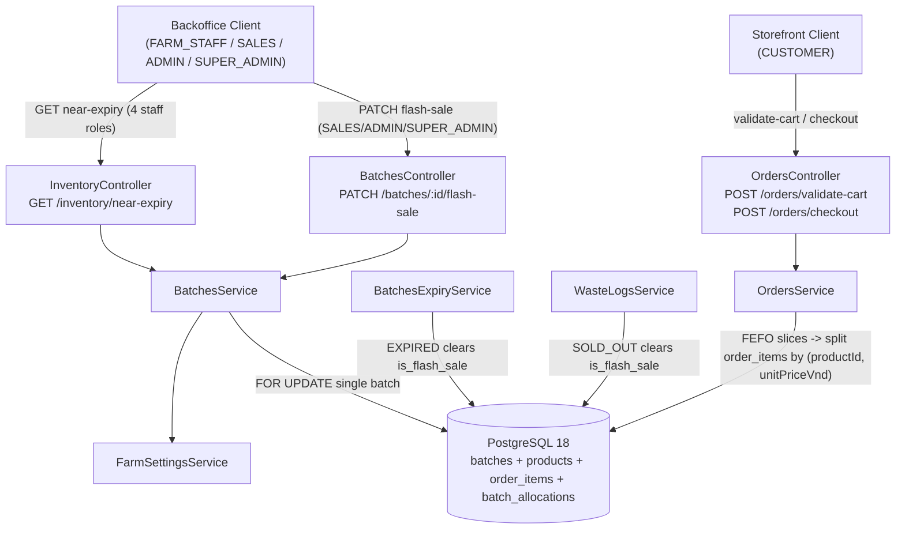
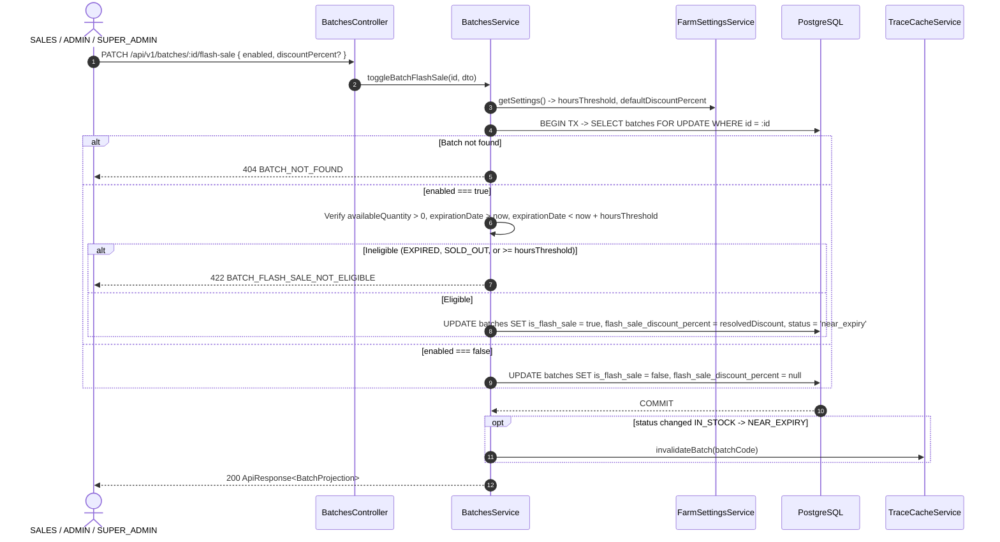

# Near-Expiry Inventory Query, Batch Flash-Sale Toggle & FEFO Checkout Pricing Formal Specification

## Overview & Context

This specification defines the database schema extension, API contracts, concurrency/locking boundaries, and FEFO checkout pricing rules for `#249` (parent epic `#14`; split from `#34`) across `apps/api/src/modules/inventory`, `apps/api/src/modules/orders`, `apps/api/src/database/schemas/catalog.schema.ts`, and `packages/shared`. Architectural commitments are recorded in `ADR-0050` (extending `ADR-0025`, `ADR-0026`, `ADR-0031`, `ADR-0033`, `ADR-0038`, and `ADR-0048`).

Currently, `BatchesExpiryService` transitions `in_stock` batches within `farms.flash_sale_config.hoursThreshold` (`48h` default) to `BatchStatus.NEAR_EXPIRY` every 5 minutes, but `batches` has no Flash Sale opt-in or discount persistence, `InventoryModule` lacks `GET /api/v1/inventory/near-expiry` and `PATCH /api/v1/batches/:id/flash-sale`, and `OrdersService` prices every item at SKU catalog price (`COALESCE(sale_price, base_price)`) without batch-level Flash Sale awareness.

### Goals

- Add `isFlashSale` (`boolean`, default `false`) and `flashSaleDiscountPercent` (`integer`, nullable) to `batches` with DB `CHECK` constraint `batches_flash_sale_state_consistent` (`ADR-0005`) via one forward-only Drizzle migration, and expose them on `BatchDto`.
- Implement `GET /api/v1/inventory/near-expiry` (`FARM_STAFF`, `SALES`, `ADMIN`, `SUPER_ADMIN`) returning paginated near-expiry batches (`expirationDate > now AND expirationDate < now + hoursThreshold`, `availableQuantity > 0`, `status IN ('in_stock', 'near_expiry')`) in FEFO order with computed `rescuePriceVnd` and `hoursRemaining`.
- Implement `PATCH /api/v1/batches/:id/flash-sale` (`SALES`, `ADMIN`, `SUPER_ADMIN`) with `SELECT ... FOR UPDATE` locking, eligibility validation, optional custom `discountPercent` (`1..99`, defaulting to `farms.flash_sale_config.discountPercent`), and atomic `IN_STOCK -> NEAR_EXPIRY` promotion when inside `hoursThreshold`.
- Auto-clear `isFlashSale = false` and `flashSaleDiscountPercent = null` on all `EXPIRED` (`BatchesExpiryService`) and `SOLD_OUT` (`OrdersService`, `WasteLogsService`) transitions.
- Upgrade `OrdersService.validateCart` and `OrdersService.checkout` (`COD` and `PayOS`) to price FEFO batch slices using batch Flash Sale pricing anchored on `products.base_price` and split `order_items` by `(productId, unitPriceVnd)`.
- Regenerate OpenAPI contracts via `bun run types:sync` and verify with unit and integration tests.

### Non-Goals

- Implementing a `@Public()` Storefront Rescue Deals showcase endpoint (`SF-01` `#61`).
- Building Backoffice `BO-07` (`#60`) or Storefront `SF-01` (`#61`) UI components.
- Modifying `products.sale_price` (`ADR-0025`) or `BatchesExpiryService` sweep interval (`#34` sibling worker).
- Rewriting `OrderDto` or `AnalyticsService` (`ADR-0048`) schemas (`order_items` schema remains unchanged).

## Architecture

### Module & File Touchpoints

- `packages/shared/src/error-codes.ts` (or error code dictionary): Add `BATCH_FLASH_SALE_NOT_ELIGIBLE` (`422`).
- `apps/api/src/database/schemas/catalog.schema.ts`: Add `isFlashSale` and `flashSaleDiscountPercent` columns and `batches_flash_sale_state_consistent` check constraint on `batches`.
- `apps/api/drizzle/<timestamp>_batches_flash_sale/migration.sql`: Forward-only migration.
- `apps/api/src/modules/inventory/inventory.routes.ts`: Add `INVENTORY_BASE: "inventory"`, `INVENTORY_NEAR_EXPIRY: "near-expiry"`, `BATCH_FLASH_SALE: ":id/flash-sale"`.
- `apps/api/src/modules/inventory/inventory.constant.ts`: Add `FLASH_SALE_DISCOUNT_MIN = 1`, `FLASH_SALE_DISCOUNT_MAX = 99`.
- `apps/api/src/modules/inventory/dto/`:
  - Update `batch.dto.ts` (`isFlashSale`, `flashSaleDiscountPercent`).
  - Add `near-expiry-batch.dto.ts` & `list-near-expiry-query.dto.ts`.
  - Add `toggle-batch-flash-sale.dto.ts`.
- `apps/api/src/modules/inventory/inventory.controller.ts`: New controller at `@Controller({ path: INVENTORY_ROUTES.INVENTORY_BASE, version: "1" })` exposing `GET /api/v1/inventory/near-expiry`.
- `apps/api/src/modules/inventory/batches.controller.ts`: Add `PATCH /api/v1/batches/:id/flash-sale`.
- `apps/api/src/modules/inventory/batches.service.ts`: Implement `listNearExpiryBatches` and `toggleBatchFlashSale`.
- `apps/api/src/modules/inventory/batches-expiry.service.ts`: Clear `isFlashSale = false, flashSaleDiscountPercent = null` when transitioning to `EXPIRED`.
- `apps/api/src/modules/inventory/waste-logs.service.ts`: Clear `isFlashSale = false, flashSaleDiscountPercent = null` when `availableQuantity` reaches `0` (`SOLD_OUT`).
- `apps/api/src/modules/orders/orders.service.ts` & `apps/api/src/modules/orders/fefo-allocation.util.ts`: Clear Flash Sale flags on `SOLD_OUT`; compute batch-level unit prices during FEFO planning (`validateCart` and `checkout`) and split `order_items` by `(productId, unitPriceVnd)`.

## Operational Flow

### 1. `PATCH /api/v1/batches/:id/flash-sale`

### 2. FEFO Checkout & Cart Validation Price Splitting

1. **Price resolution per batch**:
   - If `batch.isFlashSale === true` and `batch.flashSaleDiscountPercent !== null`:
     `batchUnitPriceVnd = Math.round((product.basePrice * (100 - batch.flashSaleDiscountPercent)) / 100)`
   - Otherwise:
     `batchUnitPriceVnd = product.salePrice ?? product.basePrice`
2. **Slice grouping**:
   - FEFO (`expirationDate ASC, id ASC`) allocates requested `quantityCents` across sellable batches (`status IN ('in_stock', 'near_expiry') AND expirationDate > now AND availableQuantity > 0`).
   - Allocated slices for a `productId` are grouped by `(productId, batchUnitPriceVnd)` in first-seen FEFO order.
   - Each `(productId, unitPriceVnd)` group produces one `order_items` row (`quantity = sum(sliceCents) / 100`, `unitPrice = unitPriceVnd`), and its constituent `batch_allocations` rows reference that `order_items.id`.
3. **Cart validation (`POST /api/v1/orders/validate-cart`)**:
   - Runs the same FEFO slice grouping in read-only mode (no `FOR UPDATE` lock) so `ValidateCartResponseDto.items` and `subtotalVnd` match checkout pricing accurately.

## Security & Reliability

### RBAC & Input Validation

- `GET /api/v1/inventory/near-expiry`: `@ApiAuth(UserRole.FARM_STAFF, UserRole.SALES, UserRole.ADMIN, UserRole.SUPER_ADMIN)`. Query DTO uses `.strict()`.
- `PATCH /api/v1/batches/:id/flash-sale`: `@ApiAuth(UserRole.SALES, UserRole.ADMIN, UserRole.SUPER_ADMIN)`. Path `:id` validated with `zUuidV7()`. Body DTO uses `.strict()`:
  - `enabled: z.boolean()`
  - `discountPercent: z.number().int().min(1).max(99).optional()` (rejected if provided when `enabled === false`, or ignored? Strict validation: reject `discountPercent` when `enabled === false` with `400 VALIDATION_FAILED` to prevent operator confusion).

### Core Invariants (`INV-1..N`)

- **INV-1 (Schema Consistency)**: `is_flash_sale = true` implies `flash_sale_discount_percent BETWEEN 1 AND 99`, `status IN ('in_stock', 'near_expiry')`, and `available_quantity > 0`. `is_flash_sale = false` implies `flash_sale_discount_percent IS NULL`.
- **INV-2 (Catalog Price Isolation, `ADR-0025`)**: `PATCH /api/v1/batches/:id/flash-sale` NEVER mutates `products.sale_price` or `products.base_price`.
- **INV-3 (Base-Price Anchoring)**: Flash Sale unit price is always computed from `products.base_price`, never stacked onto `products.sale_price`.
- **INV-4 (Exact Line-Total Accounting)**: Every `order_items` row satisfies `lineTotalVnd = Math.round((quantityCents * unitPriceVnd) / 100)`, and `orders.subtotal` equals the sum of all `order_items` line totals.
- **INV-5 (Atomic Transition Cleanup)**: Transitioning any batch to `EXPIRED` or `SOLD_OUT` MUST clear `is_flash_sale = false` and `flash_sale_discount_percent = null` in the same SQL `UPDATE`.

## Edge Cases & Failure Modes

| ID       | Scenario                                                                                                                                    | Expected Behaviour                                                                                                                                               |
| :------- | :------------------------------------------------------------------------------------------------------------------------------------------ | :--------------------------------------------------------------------------------------------------------------------------------------------------------------- |
| `EDGE-1` | Batch is `< hoursThreshold` from expiry, `availableQuantity > 0`, but `BatchesExpiryService` 5-min sweep hasn't run (`status = 'in_stock'`) | `GET /inventory/near-expiry` includes it; `PATCH /batches/:id/flash-sale` (`enabled: true`) succeeds and promotes `status` to `near_expiry` inside `FOR UPDATE`. |
| `EDGE-2` | Operator calls `PATCH /batches/:id/flash-sale` (`enabled: true`) on `EXPIRED`, `SOLD_OUT`, or `>= hoursThreshold` batch                     | Rejected with `422 BATCH_FLASH_SALE_NOT_ELIGIBLE`.                                                                                                               |
| `EDGE-3` | Operator calls `PATCH /batches/:id/flash-sale` (`enabled: false`) on a batch already `isFlashSale = false`                                  | Naturally idempotent `200` returning current batch projection.                                                                                                   |
| `EDGE-4` | Concurrent checkout depletes batch `availableQuantity` to `0` (`SOLD_OUT`) right before `PATCH /batches/:id/flash-sale` acquires lock       | `PATCH` sees `availableQuantity === 0` after `FOR UPDATE` and returns `422 BATCH_FLASH_SALE_NOT_ELIGIBLE`.                                                       |
| `EDGE-5` | Customer orders `5 kg` spanning `2 kg` Flash Sale batch (`50,000đ`) + `3 kg` regular batch (`100,000đ`)                                     | `validateCart` and `checkout` return 2 item lines (`2 kg @ 50,000đ`, `3 kg @ 100,000đ`), `subtotalVnd = 400,000đ`.                                               |
| `EDGE-6` | Order containing Flash Sale allocation is cancelled (`OrdersService`)                                                                       | Soft-released stock restores `availableQuantity`; `status` re-evaluates to `near_expiry` or `expired`; if `expired`, `isFlashSale` is cleared (`false / null`).  |

## Verification Plan

- **Unit specs**:
  - `batches.service.spec.ts`: `listNearExpiryBatches` (window boundaries, filters, rescue price calculation) and `toggleBatchFlashSale` (enable with custom/default discount, promote `in_stock -> near_expiry`, disable idempotency, `404`/`422` rejections).
  - `batches-expiry.service.spec.ts` & `waste-logs.service.spec.ts`: verify `isFlashSale` / `flashSaleDiscountPercent` cleared on `EXPIRED` and `SOLD_OUT`.
  - `orders.service.spec.ts`: verify `validateCart` and `checkout` (`COD` + `PayOS`) split `order_items` across mixed Flash Sale + regular batches, compute `subtotal` / `loyaltyPointsUsed` / `totalAmount` accurately, and clear `isFlashSale` on `SOLD_OUT`.
- **Integration & Contract checks**:
  - Run `apps/api` integration tests covering `GET /api/v1/inventory/near-expiry`, `PATCH /api/v1/batches/:id/flash-sale`, and mixed-batch `POST /api/v1/orders/checkout`.
  - Run `bun run types:sync` and `bun run check`.
