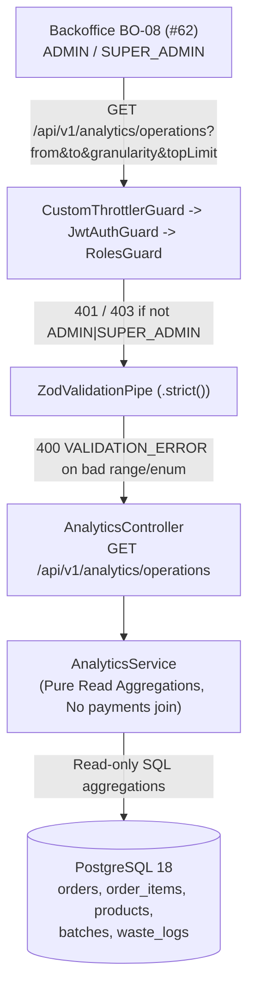
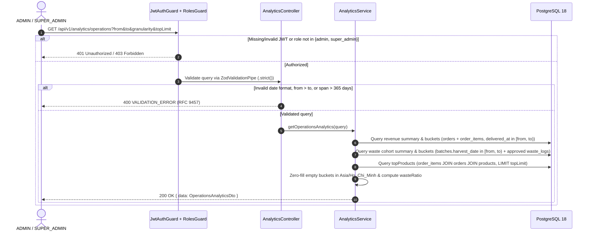

# Operational Analytics Endpoint (Admin & SuperAdmin) Formal Specification

## Overview & Context

This specification defines `GET /api/v1/analytics/operations`, its RBAC and zero-cashflow-leakage boundaries, query/response OpenAPI contracts, PostgreSQL aggregation semantics, and the `orders.delivered_at` schema invariant migration for #250 (parent epic #14; split from #35; sibling financial cashflow issue #251; Backoffice `BO-08` consumer #62) in `apps/api/src/modules/analytics`.

Architectural commitments are recorded in `ADR-0048`; staff RBAC follows `ADR-0019`; integer VND storage follows `ADR-0004`; database invariants follow `ADR-0005`; DTO co-location, envelopes, OpenAPI sync, and RFC 9457 contracts follow `ADR-0007`, `ADR-0011`, `ADR-0012`, and `ADR-0013`; two-step waste write-offs follow `ADR-0029`; order delivery timestamps follow `ADR-0040`.

`apps/api/src/modules/` currently has no `analytics` module, and `orders` in `apps/api/src/database/schemas/order.schema.ts` has `deliveredAt` without a `CHECK` constraint or partial index for `delivered`/`completed` queries.

### Goals

- Create `apps/api/src/modules/analytics/` (`AnalyticsModule`, `AnalyticsController`, `AnalyticsService`, `analytics.routes.ts`, `analytics.interface.ts`, `analytics.constant.ts`, and `dto/`) registered in `AppModule`.
- Expose `GET /api/v1/analytics/operations` gated by `@ApiAuth(UserRole.ADMIN, UserRole.SUPER_ADMIN)` returning `summary`, zero-filled `revenueSeries`, zero-filled `wasteSeries`, and `topProducts`.
- Enforce strict zero-leakage isolation from `#251`: zero joins on `payments` and zero cashflow/discount/shipping fields in the DTO.
- Evolve `orders` in `apps/api/src/database/schemas/order.schema.ts` via one forward-only Drizzle migration: backfill null `delivered_at` on `delivered`/`completed` rows, add `CHECK` `orders_delivered_at_required`, and add partial index `orders_delivered_at_idx`.
- Verify via integration tests (`apps/api/src/modules/analytics/analytics.service.spec.ts` / controller integration spec) and regenerate OpenAPI contracts via `bun run types:sync`.

### Non-Goals

- `GET /api/v1/analytics/finance` (`SUPER_ADMIN` PayOS vs. COD net cashflow, `#251`).
- Backoffice `BO-08` Recharts UI wiring (`#62`).
- Redis caching, CSV/PDF export, or real-time streaming analytics.

## Architecture

Symbols and module layout:

- `ANALYTICS_ROUTES` in `apps/api/src/modules/analytics/analytics.routes.ts`: `TAG: "Analytics"`, `BASE: "analytics"`, `OPERATIONS: "operations"`.
- `analytics.constant.ts` (per `ADR-0035`): `ANALYTICS_TIMEZONE = "Asia/Ho_Chi_Minh"`, `ANALYTICS_DEFAULT_RANGE_DAYS = 30`, `ANALYTICS_MAX_RANGE_DAYS = 365`, `ANALYTICS_DEFAULT_TOP_LIMIT = 5`, `ANALYTICS_MAX_TOP_LIMIT = 20`, `ANALYTICS_GRANULARITIES = ["day", "week", "month"] as const`, `ANALYTICS_REVENUE_ORDER_STATUSES = [OrderStatus.DELIVERED, OrderStatus.COMPLETED] as const`.
- `AnalyticsController` in `apps/api/src/modules/analytics/analytics.controller.ts`: `@ApiTags(ANALYTICS_ROUTES.TAG)`, `@Controller({ path: ANALYTICS_ROUTES.BASE, version: "1" })`, `@Get(ANALYTICS_ROUTES.OPERATIONS)`, `@ApiAuth(UserRole.ADMIN, UserRole.SUPER_ADMIN)`, `@ApiOkResponseGeneric(OperationsAnalyticsDto)`.
- `AnalyticsService` in `apps/api/src/modules/analytics/analytics.service.ts`: executes bounded read queries against `orders`, `order_items`, `products`, `batches`, and `waste_logs`, and zero-fills missing time buckets in `Asia/Ho_Chi_Minh`.
- `apps/api/src/modules/analytics/dto/operations-analytics.dto.ts` & `operations-analytics-query.dto.ts` (co-located Zod schemas + NestJS DTO classes per `ADR-0011`).
- `apps/api/src/database/schemas/order.schema.ts`: adds `orders_delivered_at_required` `check()` and `orders_delivered_at_idx` partial `index()`.

## Operational Flow

## Contracts & Data Model

### Query Contract (`OperationsAnalyticsQueryDto`)

| Parameter     | Type                         | Default                                                        | Constraints                                                           |
| :------------ | :--------------------------- | :------------------------------------------------------------- | :-------------------------------------------------------------------- |
| `from`        | `string` (`YYYY-MM-DD`)      | `to - 29 days` (inclusive 30-day window in `Asia/Ho_Chi_Minh`) | Valid ISO calendar date; `from <= to`                                 |
| `to`          | `string` (`YYYY-MM-DD`)      | Today in `Asia/Ho_Chi_Minh`                                    | Valid ISO calendar date; inclusive span `(to - from) + 1 <= 365` days |
| `granularity` | `"day" \| "week" \| "month"` | `"day"`                                                        | Strict enum                                                           |
| `topLimit`    | `number` (integer)           | `5`                                                            | `1 <= topLimit <= 20`                                                 |

Note on window bounds: `[from, to]` is interpreted in `Asia/Ho_Chi_Minh` (`UTC+07:00`) as `[from 00:00:00+07:00, (to + 1 day) 00:00:00+07:00)` (half-open UTC instant interval).

### Response Contract (`OperationsAnalyticsDto`)

- `period`: `{ from: string, to: string, granularity: "day" | "week" | "month", timezone: "Asia/Ho_Chi_Minh" }`
- `summary`:
  - `grossItemRevenueVnd`: `number` (integer >= 0) — `SUM(order_items.quantity * order_items.unit_price)` for `delivered`/`completed` orders with `delivered_at` in window.
  - `deliveredOrderCount`: `number` (integer >= 0) — count of distinct `delivered`/`completed` orders with `delivered_at` in window.
  - `totalInitialQuantity`: `number` (>= 0, rounded to 2 decimal places) — `SUM(batches.initial_quantity)` for batches with `harvest_date` in window.
  - `totalDiscardedQuantity`: `number` (>= 0, rounded to 2 decimal places) — `SUM(waste_logs.discarded_quantity)` where `waste_logs.status = 'approved'` for those cohort batches.
  - `wasteRatio`: `number` (`0 <= wasteRatio <= 1`, rounded to 4 decimal places) — `0` when `totalInitialQuantity === 0`, else `Math.round((totalDiscardedQuantity / totalInitialQuantity) * 10000) / 10000`.
- `revenueSeries`: `Array<{ bucket: string, grossItemRevenueVnd: number, deliveredOrderCount: number }>` (ordered ascending by `bucket`, zero-filled; `bucket` formatted as `YYYY-MM-DD` for `day`/`week` Monday-start ISO week, `YYYY-MM` for `month`).
- `wasteSeries`: `Array<{ bucket: string, initialQuantity: number, discardedQuantity: number, wasteRatio: number }>` (ordered ascending by `bucket`, zero-filled).
- `topProducts`: `Array<{ productId: string, productName: string, unit: string, totalQuantity: number, grossItemRevenueVnd: number }>` (ordered by `grossItemRevenueVnd DESC, totalQuantity DESC, productId ASC`, `LIMIT topLimit`; includes soft-deleted products).

### Schema Migration (`apps/api/src/database/schemas/order.schema.ts`)

1. Pre-constraint backfill in migration SQL:
   `UPDATE orders SET delivered_at = COALESCE(delivered_at, updated_at) WHERE order_status IN ('delivered', 'completed') AND delivered_at IS NULL;`
2. `CHECK` constraint `orders_delivered_at_required`:
   `(${table.orderStatus} NOT IN ('delivered', 'completed') OR ${table.deliveredAt} IS NOT NULL)`
3. Partial index `orders_delivered_at_idx`:
   `index("orders_delivered_at_idx").on(table.deliveredAt).where(sql`${table.orderStatus} IN ('delivered', 'completed') AND ${table.deliveredAt} IS NOT NULL`)`

## Security & Reliability

- **RBAC & Zero-Leakage Boundary**: `JwtAuthGuard` + `RolesGuard` enforce `UserRole.ADMIN` or `UserRole.SUPER_ADMIN`. `AnalyticsService` never joins `payments` and never projects `paymentMethod`, `paidAmount`, `refundedAmount`, `netCashflowVnd`, `shippingFeeVnd`, or `discountAmountVnd`.
- **Input & Resource Bounds**: `ZodValidationPipe` (`.strict()`) rejects unknown query parameters, `from > to`, spans exceeding `365` days, and `topLimit > 20` with `400 VALIDATION_ERROR` before hitting PostgreSQL, preventing unbounded full-table scans.
- **Query Determinism & Resilience**: Read-only queries run without transactions or locks; zero-denominator `wasteRatio` safely degrades to `0`; `orders_delivered_at_required` and `orders_delivered_at_idx` guarantee index-backed `delivered_at` lookups.

## Invariants (`AnalyticsDomainInvariants`)

- **INV-1 (RBAC & Cashflow Isolation)**: Only `UserRole.ADMIN` and `UserRole.SUPER_ADMIN` may invoke `GET /api/v1/analytics/operations` (`CUSTOMER`, `GUEST`, `FARM_STAFF`, `SALES` receive `403`). The response and underlying queries MUST NEVER join `payments` or expose `paymentMethod`, `paidAmount`, `refundedAmount`, `netCashflowVnd`, `shippingFeeVnd`, or `discountAmountVnd`.
- **INV-2 (Gross Item Revenue & Order Status Scope)**: `grossItemRevenueVnd` MUST aggregate only `order_items.quantity * order_items.unit_price` (never `orders.total_amount`, `orders.shipping_fee`, or `orders.discount_amount`) across orders with `order_status IN ('delivered', 'completed')` and `orders.delivered_at` within the half-open `Asia/Ho_Chi_Minh` window.
- **INV-3 (Delivered-At Non-Null Invariant)**: Every `orders` row in `delivered` or `completed` status MUST have a non-null `delivered_at`, enforced at the database level by `orders_delivered_at_required`.
- **INV-4 (Cohort Waste Ratio Bounds)**: `wasteRatio` MUST be computed over `batches` whose `harvest_date` falls in the bucket/window paired with `approved` `waste_logs` on those batches, MUST return `0` when `totalInitialQuantity === 0`, and MUST satisfy `0 <= wasteRatio <= 1`.
- **INV-5 (Bounded Window & Zero-Filled Series)**: Query span MUST NOT exceed `365` days (`400 VALIDATION_ERROR` otherwise), `topLimit` MUST be bounded to `1..20`, and `revenueSeries` / `wasteSeries` MUST contain one contiguous entry per bucket across `[from, to]`.

## Edge Cases & Adversarial Matrix

| ID         | Class          | Scenario                                                                                                 | Expected Behavior                                                                             |
| :--------- | :------------- | :------------------------------------------------------------------------------------------------------- | :-------------------------------------------------------------------------------------------- |
| **EDGE-1** | Boundary       | Empty date window (no delivered orders, no harvested batches)                                            | `200 OK` with `0` totals, `wasteRatio: 0`, `topProducts: []`, and zero-filled series          |
| **EDGE-2** | Boundary       | Replacement order (`0đ`, `CONFIRMED` -> `DELIVERED`, `ADR-0046`)                                         | Counted in `deliveredOrderCount` with `0` `grossItemRevenueVnd` (no negative/null distortion) |
| **EDGE-3** | Boundary       | `from > to` or `(to - from) + 1 > 365` or `topLimit > 20`                                                | `400 VALIDATION_ERROR` via `ZodValidationPipe`                                                |
| **EDGE-4** | Boundary       | Order placed at `2026-11-01T22:00:00Z` (`2026-11-02 05:00+07:00`) and delivered `2026-11-03 10:00+07:00` | Appears in `2026-11-03` bucket (anchored on `delivered_at` in `Asia/Ho_Chi_Minh`)             |
| **EDGE-5** | Data Lifecycle | Top-selling product later soft-deleted (`products.deleted_at IS NOT NULL`)                               | Still included in `topProducts` with historical `productName` and `unit`                      |
| **EDGE-6** | Data Lifecycle | `waste_logs` in `pending_approval` or `rejected` status                                                  | Excluded from `totalDiscardedQuantity` and `wasteRatio`                                       |
| **ADV-1**  | Adversarial    | `SALES`, `FARM_STAFF`, `CUSTOMER`, or `GUEST` calls `GET /api/v1/analytics/operations`                   | `403 Forbidden`                                                                               |
| **ADV-2**  | Adversarial    | Unauthenticated caller or revoked token                                                                  | `401 Unauthorized`                                                                            |

## Verification Plan

1. **Migration & Schema**: Generate Drizzle migration for `orders_delivered_at_required` and `orders_delivered_at_idx`, apply cleanly, and verify existing `orders` tests pass.
2. **Integration Tests**: Test `INV-1` through `INV-5` and `EDGE-1` through `ADV-2` against real PostgreSQL with `// Invariant: INV-N` comments per `docs/standards/testing-and-fixtures.md`.
3. **Contracts & Checks**: Run `bun run types:sync` and `bun run check` (`typecheck`, `lint`, OpenAPI sync).
