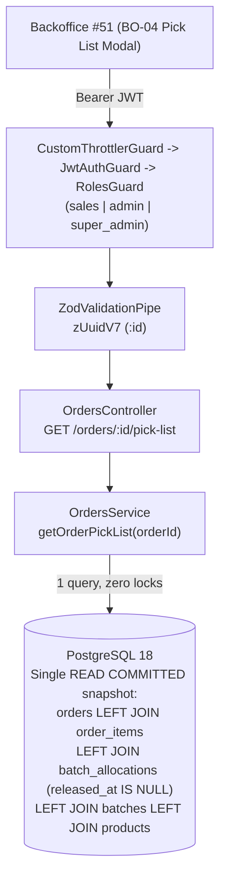
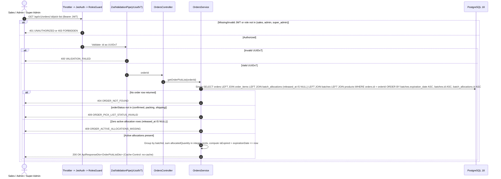

# Order Pick List Projection Formal Specification

## Overview & Context

This specification defines the read-only fulfillment pick-list endpoint `GET /api/v1/orders/:id/pick-list` in `apps/api/src/modules/orders/*` for `#87` (split from `#27`, parent epic `#10`, upstream dependency `#86`, backoffice consumer `#51` `BO-04`, E2E consumer `#37`).

Architectural commitments for `OrderStatus.CONFIRMED`, `batch_allocations.released_at`, and staff fulfillment RBAC are defined in `ADR-0033` (`docs/design/fefo-confirmation-and-order-fsm-formal-spec.md`). Historical `products` join preservation follows `ADR-0032`, integer-cent quantity precision follows `ADR-0031`, OpenAPI contract generation follows `ADR-0007`, DTO co-location and response envelopes follow `ADR-0011` and `ADR-0012`, and RFC 9457 error formatting follows `ADR-0013`. (No separate ADR is issued for `#87` because this endpoint is a read-only projection over `ADR-0033` state rather than a schema or FSM mutation.)

### Goals

- Add `API_ERROR_CODES.ORDER_PICK_LIST_STATUS_INVALID` and `API_ERROR_CODES.ORDER_ACTIVE_ALLOCATIONS_MISSING` (with Vietnamese copy in `API_ERROR_DICTIONARY`) to `packages/shared/src/error-dictionary.ts`, and matching English developer details (`MESSAGES.ORDERS.PICK_LIST_STATUS_INVALID`, `MESSAGES.ORDERS.ACTIVE_ALLOCATIONS_MISSING`) to `apps/api/src/common/constants/messages.constant.ts`.
- Expose `GET /api/v1/orders/:id/pick-list` (`200 OK`, restricted to `sales`, `admin`, and `super_admin`) returning `ApiResponseDto<OrderPickListDto>` grouped by `batchId` from active allocations (`batch_allocations.released_at IS NULL`) in deterministic FEFO order (`expirationDate ASC`, `batchId ASC`).
- Guarantee atomic snapshot consistency between `orders.order_status` and active `batch_allocations` using a single SQL `LEFT JOIN` statement under `READ COMMITTED` (zero write/share locks and zero TOCTOU race with concurrent `confirm` or `cancel` transactions).
- Reject non-pickable order statuses (anything outside `confirmed`, `packing`, `shipping`) with `409 ORDER_PICK_LIST_STATUS_INVALID`, and reject pickable-status orders with zero active allocations (`released_at IS NULL`) with `409 ORDER_ACTIVE_ALLOCATIONS_MISSING` instead of returning an empty batch array.
- Preserve historical product metadata (`products.name`, `products.unit`) even when a product was later deactivated or soft-deleted, surface `batchStatus` and `isExpired` (`expirationDate <= now`) for warehouse spoilage inspection, exclude customer delivery PII (`receiverPhone`, `shippingAddress`), and run `bun run types:sync`.

### Non-Goals

- FEFO allocation, confirmation, status transitions, or stock mutation (`#86`).
- Staff order list or detail endpoints (`GET /api/v1/orders`, `GET /api/v1/orders/:id`) for `BO-04` (`#51`).
- PDF generation, thermal label layout, printing, or multi-order wave/batch picking consolidation.
- Delivery routing, driver assignment, or customer-facing access to batch codes.

## Architecture

Symbols and module layout:

- `API_ERROR_CODES.ORDER_PICK_LIST_STATUS_INVALID`, `API_ERROR_CODES.ORDER_ACTIVE_ALLOCATIONS_MISSING`, and `API_ERROR_DICTIONARY` entries in `packages/shared/src/error-dictionary.ts`.
- `MESSAGES.ORDERS.PICK_LIST_STATUS_INVALID` and `MESSAGES.ORDERS.ACTIVE_ALLOCATIONS_MISSING` in `apps/api/src/common/constants/messages.constant.ts`.
- `ORDERS_ROUTES` in `apps/api/src/modules/orders/orders.routes.ts` adding `PICK_LIST: ":id/pick-list"`.
- `PICK_LIST_ALLOWED_STATUSES` in `apps/api/src/modules/orders/orders.interface.ts` (`[OrderStatus.CONFIRMED, OrderStatus.PACKING, OrderStatus.SHIPPING]`) alongside existing `FULFILLMENT_ALLOWED_ROLES` (`sales`, `admin`, `super_admin`).
- `pickListBatchItemSchema`, `orderPickListSchema`, `PickListBatchItemProjection`, `OrderPickListProjection`, `PickListBatchItemDto`, and `OrderPickListDto` in `apps/api/src/modules/orders/dto/order-pick-list.dto.ts` (re-exported via `apps/api/src/modules/orders/dto/index.ts`, per `ADR-0011`).
- `OrdersService.getOrderPickList(orderId: string)` in `apps/api/src/modules/orders/orders.service.ts`.
- `OrdersController.getOrderPickList(@Param("id", new ZodValidationPipe(zUuidV7())) orderId: string)` in `apps/api/src/modules/orders/orders.controller.ts`, decorated with `@Get(ORDERS_ROUTES.PICK_LIST)`, `@ApiAuth(...FULFILLMENT_ALLOWED_ROLES)`, `@Header("Cache-Control", "no-cache")`, `@ApiOkResponseGeneric(OrderPickListDto)`, `@ApiNotFoundResponseRfc9457()`, `@ApiConflictResponseRfc9457()`, and `@ApiTooManyRequestsResponseRfc9457()`.

## Operational Flow

### 1. Atomic Snapshot Pick-List Read (`GET /api/v1/orders/:id/pick-list`)

### 2. OrderStatus Eligibility & Conflict Decision Matrix

| `orders.order_status`  | Active `batch_allocations` (`released_at IS NULL`) | Outcome | Error Code                         |
| :--------------------- | :------------------------------------------------- | :------ | :--------------------------------- |
| Order missing          | N/A                                                | `404`   | `ORDER_NOT_FOUND`                  |
| `pending_payment`      | 0                                                  | `409`   | `ORDER_PICK_LIST_STATUS_INVALID`   |
| `pending_confirmation` | 0 (or legacy rows)                                 | `409`   | `ORDER_PICK_LIST_STATUS_INVALID`   |
| `confirmed`            | `>= 1`                                             | `200`   | —                                  |
| `confirmed`            | `0` (integrity anomaly)                            | `409`   | `ORDER_ACTIVE_ALLOCATIONS_MISSING` |
| `packing`              | `>= 1`                                             | `200`   | —                                  |
| `packing`              | `0` (integrity anomaly)                            | `409`   | `ORDER_ACTIVE_ALLOCATIONS_MISSING` |
| `shipping`             | `>= 1`                                             | `200`   | —                                  |
| `shipping`             | `0` (integrity anomaly)                            | `409`   | `ORDER_ACTIVE_ALLOCATIONS_MISSING` |
| `delivered`            | Audit rows                                         | `409`   | `ORDER_PICK_LIST_STATUS_INVALID`   |
| `completed`            | Audit rows                                         | `409`   | `ORDER_PICK_LIST_STATUS_INVALID`   |
| `cancelled`            | `0` active (all `released_at IS NOT NULL`)         | `409`   | `ORDER_PICK_LIST_STATUS_INVALID`   |

### 3. Batch Grouping, Integer-Cent Aggregation, and Ordering

1. **Batch-centric 1:1 product invariant**: In `apps/api/src/database/schemas/catalog.schema.ts`, `batches.productId` is a non-null foreign key to `products.id`, so each `batchId` maps to a single product. Grouping allocations into a flat `batches` array eliminates redundant single-element nested item arrays.
2. **Duplicate `productId` line-item aggregation**: Because `order_items` has no `UNIQUE (order_id, product_id)` constraint (per `ADR-0033`), multiple `batch_allocations` rows within one order can reference the same `batchId`. `OrdersService.getOrderPickList` accumulates `allocatedQuantity` per `batchId` in integer cents (`Math.round(Number(val) * 100)`) and divides by `100` at projection time so fractional decimal weights never suffer IEEE-754 drift.
3. **Deterministic FEFO ordering**: Grouped entries preserve ascending `(batches.expirationDate, batches.id)` order so warehouse staff pick nearest-expiry batches first.
4. **Historical product and post-allocation expiry tolerance**: Joining `products` without `products.deletedAt IS NULL` or `products.isActive = true` prevents confirmed orders from dropping items when a catalog SKU is later archived (`ADR-0032`). Similarly, batches whose `expirationDate <= now` after confirmation are still returned with `batchStatus` and `isExpired: true` so staff can immediately identify which lot must be held back and replaced/cancelled.

## API Contract

### Endpoints

| Method & Path                      | Access                          | Rate Limit Tier             | Idempotency | Success                                  | RFC 9457 Errors                                                                                                                                                                                 |
| :--------------------------------- | :------------------------------ | :-------------------------- | :---------- | :--------------------------------------- | :---------------------------------------------------------------------------------------------------------------------------------------------------------------------------------------------- |
| `GET /api/v1/orders/:id/pick-list` | `sales`, `admin`, `super_admin` | `default` (`100 req / 60s`) | Safe `GET`  | `200` `ApiResponseDto<OrderPickListDto>` | `400` (`VALIDATION_FAILED`), `401` (`UNAUTHORIZED`), `403` (`FORBIDDEN`), `404` (`ORDER_NOT_FOUND`), `409` (`ORDER_PICK_LIST_STATUS_INVALID`, `ORDER_ACTIVE_ALLOCATIONS_MISSING`), `429`, `500` |

### DTOs, Projections & Validation Rules

1. **Path Parameter `:id`**:
   - Validated with `new ZodValidationPipe(zUuidV7())`; malformed UUIDs or non-v7 UUIDs return `400 VALIDATION_FAILED`.
2. **`PickListBatchItemDto` (`pickListBatchItemSchema` in `apps/api/src/modules/orders/dto/order-pick-list.dto.ts`)**:
   - `batchId`: `zUuidV7()` — primary key of `batches`.
   - `batchCode`: `z.string()` — uppercase server-assigned batch code (`batches.batchCode`).
   - `expirationDate`: `z.iso.datetime()` — ISO-8601 UTC expiration timestamp (`batches.expirationDate.toISOString()`).
   - `batchStatus`: `z.enum(BatchStatus)` — persisted batch status (`batches.status`).
   - `isExpired`: `z.boolean()` — runtime check `batch.expirationDate.getTime() <= now.getTime()` catching batches that expired after confirmation before nightly status sweep.
   - `productId`: `zUuidV7()` — SKU identifier (`products.id`).
   - `productName`: `z.string()` — display name (`products.name`).
   - `unit`: `z.string()` — packaging/weight unit (`products.unit`).
   - `allocatedQuantity`: `z.number().positive()` — summed active `batch_allocations.allocatedQuantity` (`released_at IS NULL`) for this `batchId` in this order.
3. **`OrderPickListDto` (`orderPickListSchema`)**:
   - `orderId`: `zUuidV7()` — `orders.id`.
   - `orderCode`: `z.string()` — `orders.orderCode`.
   - `orderStatus`: `z.enum(PICK_LIST_ALLOWED_STATUSES)` — narrowed in OpenAPI and runtime to `confirmed | packing | shipping`.
   - `generatedAt`: `z.iso.datetime()` — server timestamp when the pick-list snapshot was produced (`now.toISOString()`).
   - `batches`: `z.array(pickListBatchItemSchema).min(1)` — non-empty FEFO-ordered array of grouped batch picks.
4. **Headers & OpenAPI**:
   - Emit `Cache-Control: no-cache` so intermediaries and browsers never serve stale pick lists after an order advances or cancels.
   - Run `bun run types:sync` so `apps/api/test/generated/api-schema.d.ts`, `apps/backoffice/src/types/api-schema.d.ts`, and `apps/storefront/src/types/api-schema.d.ts` receive `OrderPickListDto` and the new error codes.

## Security & Reliability

### Access & Exposure Matrix

| Route / Operation                  | Unauthenticated | `customer` / `farm_staff` / `guest` | `sales` / `admin` / `super_admin` |
| :--------------------------------- | :-------------: | :---------------------------------: | :-------------------------------: |
| `GET /api/v1/orders/:id/pick-list` |      `401`      |                `403`                |               `200`               |

### Controls Across Baseline Domains

- **Domain A — Security & Privacy**: Enforces `@ApiAuth(UserRole.SALES, UserRole.ADMIN, UserRole.SUPER_ADMIN)` via `CustomThrottlerGuard -> JwtAuthGuard -> RolesGuard`, keeping batch codes and allocated lot quantities strictly internal while omitting customer PII (`receiverName`, `receiverPhone`, `shippingAddress`) and payment details from `OrderPickListDto`. Path `:id` is validated with `zUuidV7()` before querying PostgreSQL.
- **Domain B — UI/UX & Usability**: Distinct RFC 9457 error codes (`ORDER_PICK_LIST_STATUS_INVALID` vs `ORDER_ACTIVE_ALLOCATIONS_MISSING`) allow `BO-04` (`#51`) to render accurate Vietnamese feedback via `resolveSharedApiErrorMessage` instead of misleading status-transition messages; `isExpired` and `batchStatus` highlight post-confirmation spoilage in the modal.
- **Domain C — Performance & Scalability**: Executes a single indexed SQL `LEFT JOIN` query (`orders_pkey`, `order_items_order_id_idx`, `batch_allocations_order_item_id_idx`, `batches_pkey`, `products_pkey`) with zero write/share locks and zero Redis dependency, protected by `CustomThrottlerGuard` `default` tier (`100 req / 60s`).
- **Domain D — Reliability & Resilience**: Single-statement execution under PostgreSQL `READ COMMITTED` evaluates `orders.order_status` and `batch_allocations.released_at IS NULL` in one atomic snapshot, eliminating TOCTOU races with concurrent `POST /confirm` or `PATCH /status { status: "cancelled" }`. Never mutates stock or allocations.
- **Domain E — Maintainability & Architecture**: Reuses `FULFILLMENT_ALLOWED_ROLES` (`orders.interface.ts`), integer-cent helpers (`orders.service.ts`), and unfiltered historical product joining (`ADR-0032`) without duplicating allocation logic (`#86`) or widening customer `OrderDto`.
- **Domain F — Observability & Operations**: Structured NestJS HTTP access logging and `GlobalExceptionFilter` telemetry surface `409 ORDER_ACTIVE_ALLOCATIONS_MISSING` alerts whenever a pickable order lacks active allocations, aiding operational data-integrity triage.
- **Domain G — Business & Compliance**: Enforces the `ADR-0033` invariant that only `confirmed`, `packing`, and `shipping` orders have active FEFO pick lists and refuses to mask missing allocations behind a silent `200 []`.

## Domain Invariant Taxonomy

Continuing `OrdersDomainInvariants` from `docs/design/fefo-confirmation-and-order-fsm-formal-spec.md` (`INV-ORD-11..16`):

| Invariant    | Name                                         | Formal Statement                                                                                                                                                                                                                                                                                        | Enforcement Seam                                                       | Verification Test                                                                                                                                                                                                              |
| :----------- | :------------------------------------------- | :------------------------------------------------------------------------------------------------------------------------------------------------------------------------------------------------------------------------------------------------------------------------------------------------------ | :--------------------------------------------------------------------- | :----------------------------------------------------------------------------------------------------------------------------------------------------------------------------------------------------------------------------- |
| `INV-ORD-17` | Pickable OrderStatus & Non-Empty Active Gate | `GET /api/v1/orders/:id/pick-list` succeeds (`200`) only when `orders.orderStatus` is in `{confirmed, packing, shipping}` (`409 ORDER_PICK_LIST_STATUS_INVALID` otherwise) AND at least one `batch_allocations` row has `released_at IS NULL` (`409 ORDER_ACTIVE_ALLOCATIONS_MISSING` instead of `[]`). | `OrdersService.getOrderPickList` + `PICK_LIST_ALLOWED_STATUSES`        | Integration tests return `200` for `confirmed`/`packing`/`shipping`, `409` for `pending_payment`/`pending_confirmation`/`delivered`/`completed`/`cancelled`, and `409` when active allocations are absent or all soft-released |
| `INV-ORD-18` | Batch-Grouped Active-Only FEFO Projection    | Pick-list grouping reads exclusively `batch_allocations.released_at IS NULL` rows, sums `allocatedQuantity` per `batchId` in integer cents, orders by `(expirationDate ASC, batchId ASC)`, and never mutates `batches` or `batch_allocations`.                                                          | `OrdersService.getOrderPickList`                                       | Multi-batch, soft-released-plus-reallocated, and duplicate-`productId`-item tests verify exact summed quantities, FEFO order, exclusion of `released_at !== null` rows, and unchanged stock                                    |
| `INV-ORD-19` | Single-Snapshot Read & Historical Resilience | `getOrderPickList` evaluates order state and active allocations in one atomic SQL `LEFT JOIN` snapshot without filtering `products.deletedAt`/`isActive`, and reports `isExpired: expirationDate <= now` on allocated lots.                                                                             | `OrdersService.getOrderPickList` (single query, unfiltered `products`) | Soft-deleted/deactivated product and post-confirm expired batch still return `200` (`isExpired: true`); concurrent `GET /pick-list` + `cancel` yields either valid `200` or `409 ORDER_PICK_LIST_STATUS_INVALID`               |
| `INV-ORD-20` | Pick-List Staff RBAC & PII Exclusion         | `GET /api/v1/orders/:id/pick-list` permits only `sales`, `admin`, and `super_admin` (`401` unauthenticated, `403` `customer`/`farm_staff`/`guest`), and omits customer delivery PII (`receiverName`, `receiverPhone`, `shippingAddress`).                                                               | `@ApiAuth(...FULFILLMENT_ALLOWED_ROLES)` + `orderPickListSchema`       | RBAC matrix passes for `sales`/`admin`/`super_admin` and returns `403` for `customer`/`farm_staff`/`guest`; response schema asserts closed keys without PII                                                                    |

### Edge Cases (`EDGE-1..8`)

| ID       | Case                                                                                                           | Expected Behaviour                                                                                                  |
| :------- | :------------------------------------------------------------------------------------------------------------- | :------------------------------------------------------------------------------------------------------------------ |
| `EDGE-1` | `:id` is malformed or non-UUIDv7                                                                               | `ZodValidationPipe(zUuidV7())` rejects with `400 VALIDATION_FAILED`                                                 |
| `EDGE-2` | `:id` is a valid UUIDv7 that does not exist in `orders`                                                        | Returns `404 ORDER_NOT_FOUND`                                                                                       |
| `EDGE-3` | Order is `pending_payment`, `pending_confirmation`, `delivered`, `completed`, or `cancelled`                   | Returns `409 ORDER_PICK_LIST_STATUS_INVALID`                                                                        |
| `EDGE-4` | Order is `confirmed`/`packing`/`shipping` with zero active allocations (e.g., seeded gap or all soft-released) | Returns `409 ORDER_ACTIVE_ALLOCATIONS_MISSING` (never `200` with `batches: []`)                                     |
| `EDGE-5` | Order has historical soft-released rows (`released_at IS NOT NULL`) plus new active rows                       | Only `released_at IS NULL` allocations are included in `batches[]`                                                  |
| `EDGE-6` | Order has two `order_items` for the same `productId` both allocated from the same `batchId`                    | Pick list emits one entry for that `batchId` with `allocatedQuantity` equal to the integer-cent sum of both rows    |
| `EDGE-7` | Linked `product` was soft-deleted (`deletedAt IS NOT NULL`) or deactivated (`isActive = false`) after confirm  | Still returns `200 OK` with historical `productName` and `unit`                                                     |
| `EDGE-8` | Allocated batch passed `expirationDate <= now` while order sat in `confirmed` or `packing`                     | Still returns `200 OK` with `isExpired: true` so warehouse staff see the affected `batchCode` and cancel/reallocate |

### Concurrency & Adversarial Matrix (`ADV-1..4`)

| ID      | Scenario                                                                                                | Expected Behaviour                                                                                                                                                                                  |
| :------ | :------------------------------------------------------------------------------------------------------ | :-------------------------------------------------------------------------------------------------------------------------------------------------------------------------------------------------- |
| `ADV-1` | `customer`, `farm_staff`, or `guest` calls `GET /api/v1/orders/:id/pick-list`                           | `RolesGuard` rejects with `403 FORBIDDEN` before `OrdersService` executes                                                                                                                           |
| `ADV-2` | Unauthenticated caller requests `GET /api/v1/orders/:id/pick-list`                                      | `JwtAuthGuard` rejects with `401 UNAUTHORIZED`                                                                                                                                                      |
| `ADV-3` | Concurrent `GET /orders/:id/pick-list` while `PATCH /orders/:id/status { status: "cancelled" }` commits | Single-query `READ COMMITTED` snapshot returns either pre-cancel `200` with active allocations or post-cancel `409 ORDER_PICK_LIST_STATUS_INVALID`, never a torn `ORDER_ACTIVE_ALLOCATIONS_MISSING` |
| `ADV-4` | Repeated `GET /orders/:id/pick-list` calls (e.g., modal reopen / reprint)                               | Deterministic batch grouping and quantities; `batches.availableQuantity` and `batch_allocations` remain completely unmodified                                                                       |

## Test Matrix

1. **Shared Unit Tests (`packages/shared/src/error-dictionary.spec.ts`)**:
   - Assert `ORDER_PICK_LIST_STATUS_INVALID` and `ORDER_ACTIVE_ALLOCATIONS_MISSING` exist in `API_ERROR_CODES` with non-empty Vietnamese copy in `API_ERROR_DICTIONARY`.
2. **API Unit Tests (`apps/api/src/modules/orders/orders.service.spec.ts`)**:
   - Grouping by `batchId`, integer-cent summation when duplicate `order_items` share a `batchId`, FEFO ordering `(expirationDate ASC, batchId ASC)`, `isExpired` boundary check (`expirationDate <= now`), historical soft-deleted product retention, `404 ORDER_NOT_FOUND`, `409 ORDER_PICK_LIST_STATUS_INVALID`, and `409 ORDER_ACTIVE_ALLOCATIONS_MISSING`.
3. **API Integration Tests (`apps/api/test/integration/orders-fulfillment.spec.ts` or `orders-pick-list.spec.ts`)**:
   - Following `docs/standards/testing-and-fixtures.md` (`components["schemas"]["OrderPickListDto"]` from `test/generated/api-schema.d.ts`, `// Invariant: INV-ORD-N` comments):
   - Multi-batch FEFO grouping & quantity summation across `confirmed`, `packing`, and `shipping` orders (`200 OK`, `Cache-Control: no-cache`, zero stock mutation).
   - Invalid-status rejection (`pending_payment`, `pending_confirmation`, `delivered`, `completed`, `cancelled` -> `409 ORDER_PICK_LIST_STATUS_INVALID`).
   - Missing or soft-released (`released_at IS NOT NULL`) allocations on `confirmed` order -> `409 ORDER_ACTIVE_ALLOCATIONS_MISSING` (never `[]`).
   - Soft-deleted product (`200`) and post-allocation expired batch (`200`, `isExpired: true`).
   - RBAC matrix: `sales`, `admin`, `super_admin` -> `200`; `customer`, `farm_staff`, `guest` -> `403`; unauthenticated -> `401`.
4. **Verification & Contract Sync**:
   - `bun run types:sync`
   - `bun run check`
   - `bun run test`
   - `bun run test:e2e`

## Risks & Rollback

- **Downstream coordination (`#51` `BO-04`)**: Because `OrderPickListDto` intentionally excludes customer delivery PII (`receiverName`, `receiverPhone`, `shippingAddress`), `#51` must render shipping/recipient headers from its order row/detail context (when a staff order list/detail endpoint is added) while sourcing batch picking rows from `GET /api/v1/orders/:id/pick-list`.
- **Legacy seed data (`tier3-operational.seeder.ts`)**: `orderRetail` or test fixtures manually forced into `confirmed` without running `POST /orders/:id/confirm` will return `409 ORDER_ACTIVE_ALLOCATIONS_MISSING`; integration tests must confirm orders through the real `#86` path (or seed matching active `batch_allocations`).
- **Rollback**: Revert the `GET /orders/:id/pick-list` route, `OrderPickListDto`, `OrdersService.getOrderPickList`, and error dictionary keys, then re-run `bun run types:sync`. Zero database migrations are introduced by `#87`, so rollback is code-only and non-destructive.
