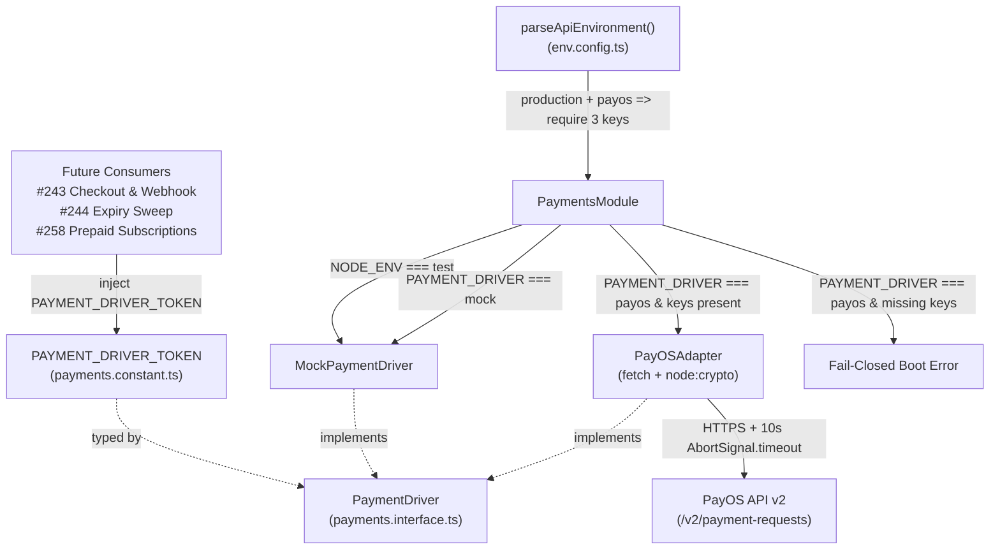
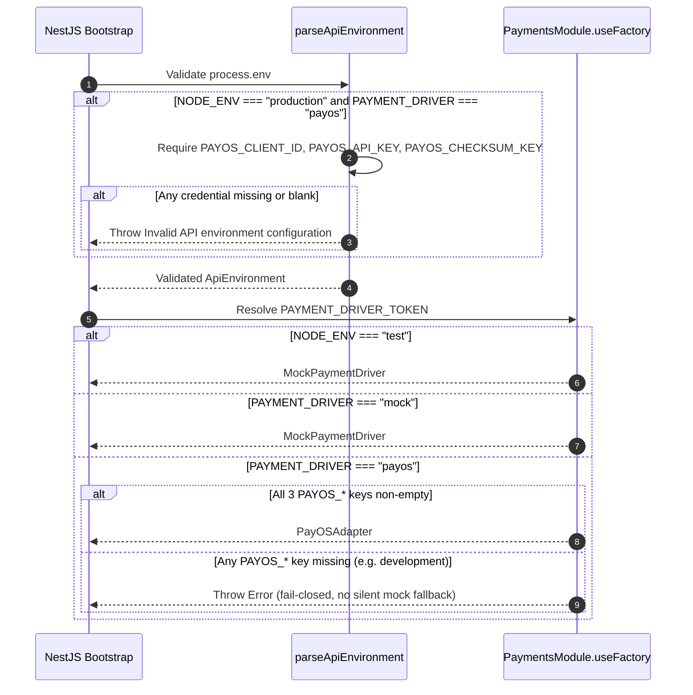
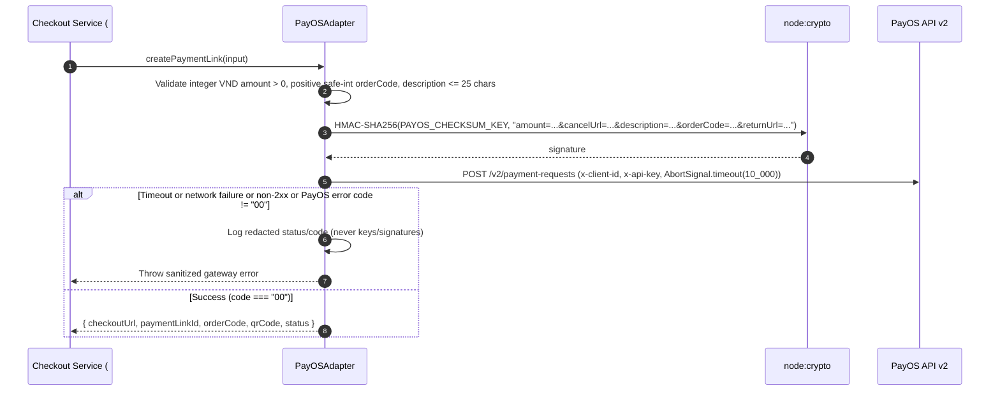

# Payments Driver Seam and PayOS Adapter Formal Specification

## Overview & Context

This specification defines the `PaymentsModule` dependency-injection seam (`PaymentDriver` and `PAYMENT_DRIVER_TOKEN`), `MockPaymentDriver`, `PayOSAdapter`, and fail-closed environment validation introduced for issue `#242` (parent epic `#11`, split from `#28`; downstream consumers `#243`, `#244`, `#258`). It also records the accompanying fail-closed fix for `MailModule` (`mail.module.ts`) as a separate atomic commit.

Architectural conventions follow `ADR-0004` (integer VND money), `ADR-0010` (driver DI pattern), `ADR-0013` (RFC 9457 error handling), `ADR-0030` (non-`I`-prefixed `ShippingDriver` + `*DriverKind` environment union), and `ADR-0035` (compile-time-only `*.interface.ts` separated from runtime `*.constant.ts`). Persistence relies on the existing `payments` table in `apps/api/src/database/schemas/payment.schema.ts`.

### Goals

- Rename `PaymentDriver` in `apps/api/src/common/constants/environment.constant.ts` to `PaymentDriverKind` (`"payos" | "mock"`, aligning with `ShippingDriverKind` in `ADR-0030`) and define the pure TypeScript `PaymentDriver` interface in `apps/api/src/modules/payments/payments.interface.ts`.
- Define `PAYMENT_DRIVER_TOKEN` and PayOS adapter constants (e.g., request timeout, description max length, API base URL) in `apps/api/src/modules/payments/payments.constant.ts` per `ADR-0035`.
- Implement `MockPaymentDriver` and `PayOSAdapter` (built directly on `fetch` + `node:crypto` + `AbortSignal.timeout(10_000)`, without cloning `payos-lib-node` or adding `@payos/node`) supporting three operations: `createPaymentLink`, `verifyWebhook`, and `cancelPaymentLink`.
- Enforce fail-closed startup validation in `parseApiEnvironment` (`apps/api/src/common/config/env.config.ts`) requiring non-empty `PAYOS_CLIENT_ID`, `PAYOS_API_KEY`, and `PAYOS_CHECKSUM_KEY` when `PAYMENT_DRIVER === "payos"` in `production`.
- Enforce fail-closed driver selection in `PaymentsModule` (`NODE_ENV === "test"` forces `MockPaymentDriver`; `NODE_ENV !== "test"` with `PAYMENT_DRIVER === "payos"` throws if any PayOS credential is missing rather than silently falling back to `MockPaymentDriver`).
- Fix `MailModule` (`apps/api/src/modules/mail/mail.module.ts`) in a separate commit to fail closed when `NODE_ENV !== "test"`, `MAIL_DRIVER === "resend"`, and `RESEND_API_KEY` is missing.
- Cover driver selection, `MockPaymentDriver`, `PayOSAdapter` (link creation, HMAC canonicalization & verification, link cancellation, timeout/error handling), and `parseApiEnvironment` PayOS validation in unit tests (`bun run test:api`).

### Non-Goals

- Implementing PayOS checkout initiation endpoints or `POST /api/v1/payments/payos/webhook` (`#243`).
- Implementing the 15-minute unpaid reservation expiry sweep integration (`#244`) or staff payment ledger / COD confirmation (`#245`).
- Building storefront or backoffice payment UI (`#52`, `#53`).
- Cloning or vendoring `payos-lib-node` or installing `@payos/node`.

## Architecture



Module layout and symbol locations:

- `apps/api/src/common/constants/environment.constant.ts`: `PAYMENT_DRIVERS` (`["payos", "mock"]`) and `PaymentDriverKind`.
- `apps/api/src/common/config/env.config.ts`: `parseApiEnvironment` `superRefine` checks for `PAYOS_CLIENT_ID`, `PAYOS_API_KEY`, and `PAYOS_CHECKSUM_KEY` when `NODE_ENV === "production"` and `PAYMENT_DRIVER === "payos"`.
- `apps/api/src/modules/payments/payments.constant.ts`: `PAYMENT_DRIVER_TOKEN` (`Symbol("PAYMENT_DRIVER_TOKEN")`), `PAYOS_API_BASE_URL`, `PAYOS_REQUEST_TIMEOUT_MS` (`10_000`), `PAYOS_DESCRIPTION_MAX_LENGTH` (`25`).
- `apps/api/src/modules/payments/payments.interface.ts`: compile-time-only types (`CreatePaymentLinkInput`, `CreatePaymentLinkResult`, `PayosWebhookPayload`, `VerifiedPaymentWebhookData`, `CancelPaymentLinkResult`, `PaymentDriver`).
- `apps/api/src/modules/payments/drivers/mock-payment.driver.ts`: `MockPaymentDriver` deterministic in-memory/test implementation.
- `apps/api/src/modules/payments/drivers/payos.adapter.ts`: `PayOSAdapter` implementing `PaymentDriver` over `fetch` and `node:crypto` HMAC-SHA256.
- `apps/api/src/modules/payments/payments.module.ts`: NestJS module wiring `PAYMENT_DRIVER_TOKEN` and exporting `PAYMENT_DRIVER_TOKEN` and `MockPaymentDriver`.
- `apps/api/src/app.module.ts`: imports `PaymentsModule`.
- `apps/api/src/modules/mail/mail.module.ts`: separate-commit fail-closed fix when `NODE_ENV !== "test"` and `MAIL_DRIVER === "resend"` without `RESEND_API_KEY`.

## Operational Flow

### 1. Driver Selection & Startup Validation



### 2. Payment Link Creation (`createPaymentLink`)



### 3. Webhook Verification (`verifyWebhook`) & Link Cancellation (`cancelPaymentLink`)

```mermaid
sequenceDiagram
    autonumber
    participant Caller as Webhook / Expiry Service (#243 / #244)
    participant Adapter as PayOSAdapter
    participant Crypto as node:crypto
    participant PayOS as PayOS API v2

    alt verifyWebhook(payload)
        Caller->>Adapter: verifyWebhook(payload)
        Adapter->>Adapter: Recursively sort payload.data keys alphabetically; serialize null/undefined as "" and arrays via JSON.stringify
        Adapter->>Crypto: HMAC-SHA256(PAYOS_CHECKSUM_KEY, canonicalQueryString)
        Crypto-->>Adapter: expectedSignature
        Adapter->>Crypto: timingSafeEqual(expectedSignature, payload.signature)
        alt Invalid hex length or signature mismatch
            Adapter-->>Caller: Throw invalid webhook signature error (fail-closed)
        else Valid signature
            Adapter-->>Caller: VerifiedPaymentWebhookData
        end
    else cancelPaymentLink(orderCode, reason?)
        Caller->>Adapter: cancelPaymentLink(orderCode, reason?)
        Adapter->>PayOS: POST /v2/payment-requests/{orderCode}/cancel (10s timeout)
        alt Success or already cancelled/paid upstream handling
            Adapter-->>Caller: CancelPaymentLinkResult
        end
    end
```

## Security & Reliability

- **Fail-closed credential validation**: `parseApiEnvironment` rejects `NODE_ENV === "production"` with `PAYMENT_DRIVER === "payos"` unless `PAYOS_CLIENT_ID`, `PAYOS_API_KEY`, and `PAYOS_CHECKSUM_KEY` are all non-empty. `PaymentsModule` factory also fails closed in non-test environments (`development`) instead of falling back to `MockPaymentDriver`.
- **Constant-time HMAC verification**: `PayOSAdapter.verifyWebhook` computes HMAC-SHA256 over the PayOS canonical query string and compares digests using `crypto.timingSafeEqual` after length/hex validation to prevent timing side-channels.
- **Secret redaction**: `PayOSAdapter` never logs `PAYOS_CLIENT_ID`, `PAYOS_API_KEY`, `PAYOS_CHECKSUM_KEY`, request headers, or computed signatures. Error messages surfaced to callers contain only redacted upstream status/code metadata.
- **Bounded network I/O**: Every outbound `fetch` call to PayOS uses `AbortSignal.timeout(10_000)` (`PAYOS_REQUEST_TIMEOUT_MS`) so gateway stalls cannot exhaust API worker connections.
- **Compile-time purity (`ADR-0035`)**: `payments.interface.ts` contains zero runtime statements (`export interface`, `export type`, `import type` only), verified by `apps/api/src/common/interface-purity.spec.ts`.

## Domain Invariant Taxonomy

| ID          | Invariant                                                                                                                                                                                           | Enforcement Point                                                          | Verification                                                          |
| :---------- | :-------------------------------------------------------------------------------------------------------------------------------------------------------------------------------------------------- | :------------------------------------------------------------------------- | :-------------------------------------------------------------------- |
| `INV-PAY-1` | Production fail-closed env check: `PAYMENT_DRIVER === "payos"` in `production` requires non-empty `PAYOS_CLIENT_ID`, `PAYOS_API_KEY`, and `PAYOS_CHECKSUM_KEY`.                                     | `parseApiEnvironment` in `env.config.ts`                                   | Unit tests in `env.config.spec.ts`                                    |
| `INV-PAY-2` | Non-test fail-closed driver selection: `PaymentsModule` always selects `MockPaymentDriver` in `test`, and throws in non-test environments if `PAYMENT_DRIVER === "payos"` with missing credentials. | `PaymentsModule` `PAYMENT_DRIVER_TOKEN` factory                            | Unit tests in `payments.module.spec.ts` / `payments.spec.ts`          |
| `INV-PAY-3` | PayOS `orderCode` is a positive safe integer (`1 <= orderCode <= Number.MAX_SAFE_INTEGER`) and `amount` is a positive integer VND (`ADR-0004`); `description` is bounded to `<= 25` characters.     | `PayOSAdapter.createPaymentLink` & `MockPaymentDriver.createPaymentLink`   | Unit tests in `payos.adapter.spec.ts` & `mock-payment.driver.spec.ts` |
| `INV-PAY-4` | Webhook verification fails closed on missing, malformed, or mismatched HMAC-SHA256 signatures using constant-time comparison (`crypto.timingSafeEqual`).                                            | `PayOSAdapter.verifyWebhook`                                               | Unit tests with PayOS canonical test vectors & tampered payloads      |
| `INV-PAY-5` | Every outbound PayOS HTTP request enforces a `10_000 ms` timeout (`AbortSignal.timeout`) and redacts all credentials from logs and thrown errors.                                                   | `PayOSAdapter` HTTP helper                                                 | Unit tests with mocked `fetch` abort/error responses                  |
| `INV-PAY-6` | `payments.interface.ts` emits zero runtime JavaScript (`ADR-0035`), and `environment.constant.ts` exports `PaymentDriverKind` (`"payos" \| "mock"`) without colliding with `PaymentDriver`.         | `payments.interface.ts`, `payments.constant.ts`, `environment.constant.ts` | `apps/api/src/common/interface-purity.spec.ts`                        |
| `INV-PAY-7` | `MailModule` fails closed when `NODE_ENV !== "test"` and `MAIL_DRIVER === "resend"` without `RESEND_API_KEY` (separate commit).                                                                     | `MailModule` `MAIL_DRIVER_TOKEN` factory                                   | Unit tests for `MailModule` driver selection                          |
