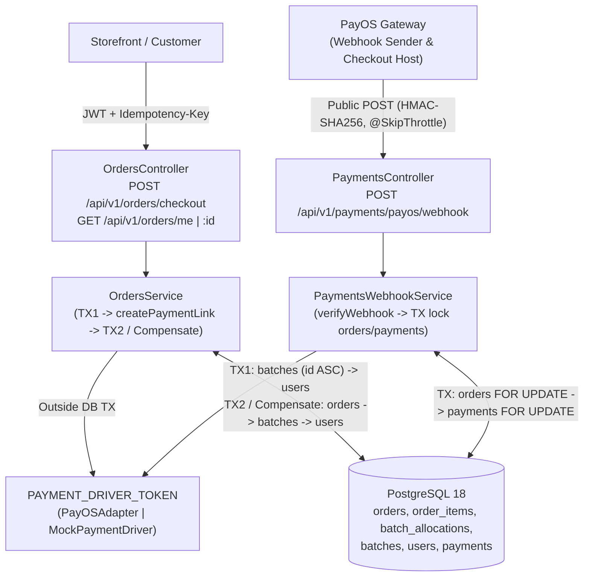
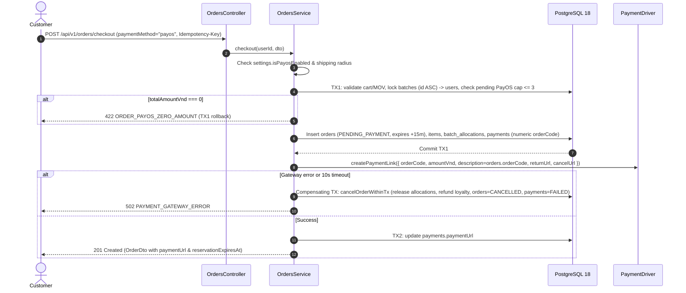

# PayOS Checkout Initiation and HMAC-Verified Webhook Formal Specification

## Overview & Context

This specification defines PayOS retail checkout initiation (`POST /api/v1/orders/checkout`) and HMAC-SHA256 webhook reconciliation (`POST /api/v1/payments/payos/webhook`) for issue `#243` (parent epic `#11`, split from `#28`), building on the `PaymentsModule` driver seam (`#242`) and checkout-time FEFO reservation architecture (`ADR-0038`, `ADR-0042`).

Architectural conventions follow `ADR-0004` (integer VND money), `ADR-0008` (Redis idempotency on checkout), `ADR-0013` (RFC 9457 error codes in `@greenroots/shared`), `ADR-0031` (cart/loyalty/MOV checkout rules), `ADR-0032` (`OrderDto` customer isolation), `ADR-0038` (FEFO lock order `batches (id ASC) -> users` and `reservation_expires_at`), and `ADR-0042` (two-phase PayOS checkout and webhook reconciliation).

### Goals

- Add `MAX_PENDING_PAYOS_ORDERS_PER_CUSTOMER: 3` to `BUSINESS_RULES` and seven RFC 9457 error codes (`ORDER_PAYOS_DISABLED`, `ORDER_PAYOS_PENDING_LIMIT_EXCEEDED`, `ORDER_PAYOS_ZERO_AMOUNT`, `PAYMENT_GATEWAY_ERROR`, `PAYMENT_WEBHOOK_SIGNATURE_INVALID`, `PAYMENT_NOT_FOUND`, `PAYMENT_AMOUNT_MISMATCH`) to `API_ERROR_CODES` / `API_ERROR_DICTIONARY` in `@greenroots/shared`, with matching English developer `MESSAGES` in `apps/api`.
- Extend `CheckoutRequestDto` (`apps/api/src/modules/orders/dto/checkout.dto.ts`) with optional `paymentMethod` (`cod | payos`, default `cod`) and `OrderDto` (`apps/api/src/modules/orders/dto/order.dto.ts`) with nullable `paymentUrl` and `reservationExpiresAt`.
- Update `OrdersModule` to import `PaymentsModule` and implement two-phase PayOS checkout in `OrdersService` (TX1 FEFO reservation + `payments.orderCode` generation -> `PaymentDriver.createPaymentLink` outside TX -> TX2 `paymentUrl` persistence or compensating `cancelOrderWithinTx`).
- Add `OrderStatus.PENDING_PAYMENT` to `ALLOCATED_CANCELLABLE_STATUSES` in `apps/api/src/modules/orders/orders.constant.ts` so customer self-cancel and expiry sweeps release FEFO stock on unpaid PayOS orders.
- Expose `POST /api/v1/payments/payos/webhook` in `PaymentsController` backed by `PaymentsWebhookService` (`PaymentsModule`) to verify HMAC-SHA256 signatures via `PaymentDriver.verifyWebhook`, reconcile `payments` + `orders` idempotently under `orders -> payments` `FOR UPDATE` locking, and return `apiSuccess({ received: true })`.
- Cover PayOS checkout initiation, gateway failure compensation, valid webhooks, invalid-HMAC rejections (`401`), amount mismatches (`422`), duplicate webhook replays (`200`), and late webhooks on cancelled orders (`200`, no resurrection) in integration tests, and run `bun run types:sync`.

### Non-Goals

- Integrating the 15-minute unpaid reservation expiry sweep with `cancelPaymentLink` (`#244`).
- Staff payment ledger (`GET /api/v1/payments`) or manual COD payment confirmation / refund workflows (`#245`, `#29`).
- Storefront or backoffice payment UI (`#52`, `#53`).
- Prepaid subscription PayOS checkout (`#258`).

## Architecture



## Operational Flow

### 1. Two-Phase PayOS Checkout (`POST /api/v1/orders/checkout`)



### 2. HMAC-Verified Webhook Reconciliation (`POST /api/v1/payments/payos/webhook`)

```mermaid
sequenceDiagram
    autonumber
    participant PayOS as PayOS Server
    participant Ctrl as PaymentsController
    participant Svc as PaymentsWebhookService
    participant Driver as PaymentDriver
    participant DB as PostgreSQL 18

    PayOS->>Ctrl: POST /api/v1/payments/payos/webhook (raw data + signature)
    Ctrl->>Svc: handlePayosWebhook(payload)
    Svc->>Driver: verifyWebhook(payload)
    alt Invalid or missing HMAC-SHA256 signature
        Driver-->>Svc: Throw signature error
        Svc-->>PayOS: 401 PAYMENT_WEBHOOK_SIGNATURE_INVALID
    end
    Driver-->>Svc: VerifiedPaymentWebhookData
    Svc->>DB: Begin TX: select payment by orderCode, lock orders FOR UPDATE -> payments FOR UPDATE
    alt Payment / orderCode not found
        Svc-->>PayOS: 404 PAYMENT_NOT_FOUND
    else Duplicate replay (payment.status === PAID or referenceCode already recorded)
        Svc-->>PayOS: 200 OK apiSuccess({ received: true })
    else Upstream non-success code (payload.code !== "00" or verified.code !== "00")
        Svc-->>PayOS: 200 OK apiSuccess({ received: true }) (no state mutation)
    else Amount mismatch (verified.amountVnd !== payment.amount)
        Svc-->>PayOS: 422 PAYMENT_AMOUNT_MISMATCH (fail-closed)
    else Order already CANCELLED (expiry sweep or customer self-cancel race)
        Svc->>DB: Persist rawPayload, referenceCode, paidAt; log critical alert; keep orderStatus=CANCELLED
        Svc-->>PayOS: 200 OK apiSuccess({ received: true })
    else Order in PENDING_PAYMENT
        Svc->>DB: Update payments (PAID, referenceCode, rawPayload, paidAt) & orders (paymentStatus=PAID, orderStatus=CONFIRMED, reservationExpiresAt=null)
        Svc-->>PayOS: 200 OK apiSuccess({ received: true })
    end
```

## Security & Reliability

- **Constant-time HMAC verification**: `PaymentsWebhookService` delegates exclusively to `PaymentDriver.verifyWebhook` (`crypto.timingSafeEqual` in `PayOSAdapter`) and rejects invalid signatures with `401 PAYMENT_WEBHOOK_SIGNATURE_INVALID` before touching the database.
- **Preserved webhook `data` keys**: The webhook DTO validates envelope shape (`code`, `desc`, `data`, `signature`) without `.strict()` stripping on `data` so unknown PayOS fields remain intact for canonical HMAC-SHA256 verification.
- **Server-derived redirect URLs**: `returnUrl` and `cancelUrl` are constructed exclusively on the server from `env.STOREFRONT_URL` (`${env.STOREFRONT_URL}/orders/${orderId}?payment=success` and `?payment=cancelled`), preventing open-redirect or phishing injection.
- **Rate-limiting & Idempotency**: `POST /api/v1/payments/payos/webhook` uses `@SkipThrottle({ default: true, auth: true })` and omits `@Idempotent()` because PayOS does not send `Idempotency-Key`; duplicate deliveries are deduplicated atomically in PostgreSQL.
- **Deadlock & Race safety**: Checkout preserves `batches (id ASC) -> users` lock order (`ADR-0038`) with zero network I/O inside DB transactions; webhook reconciliation locks `orders -> payments` (`FOR UPDATE`) and never resurrects `CANCELLED` orders.

## Domain Invariant Taxonomy

| ID              | Invariant                                                                                                                                                                                                                               | Enforcement Point                                                | Verification                                          |
| :-------------- | :-------------------------------------------------------------------------------------------------------------------------------------------------------------------------------------------------------------------------------------- | :--------------------------------------------------------------- | :---------------------------------------------------- |
| `INV-PAY-CHK-1` | PayOS checkout rejects disabled gateway (`422 ORDER_PAYOS_DISABLED`), `totalAmountVnd === 0` (`422 ORDER_PAYOS_ZERO_AMOUNT`), and `>= 3` pending PayOS orders (`422 ORDER_PAYOS_PENDING_LIMIT_EXCEEDED`).                               | `OrdersService` PayOS checkout & `Users` `FOR UPDATE` cap check  | Integration tests in `orders-payos-checkout.spec.ts`  |
| `INV-PAY-CHK-2` | Zero DB row locks are held during `PaymentDriver.createPaymentLink` HTTP I/O; gateway failures trigger compensating `cancelOrderWithinTx` (releasing `batch_allocations` and refunding `loyaltyPointsUsed`).                            | `OrdersService` two-phase PayOS checkout                         | Integration tests with failing/mocked `PaymentDriver` |
| `INV-PAY-CHK-3` | `payments.orderCode` is a unique positive safe integer (`1 <= orderCode <= Number.MAX_SAFE_INTEGER`) retried on `23505`; `description` is `orders.orderCode` (`<= 25` chars); `returnUrl`/`cancelUrl` derive from `env.STOREFRONT_URL`. | `OrdersService` PayOS link builder                               | Integration tests & `PayOSAdapter` validation         |
| `INV-PAY-CHK-4` | `ALLOCATED_CANCELLABLE_STATUSES` includes `OrderStatus.PENDING_PAYMENT` so customer self-cancel and expiry sweeps release FEFO stock.                                                                                                   | `orders.constant.ts` & `OrdersService.cancelOrderWithinTx`       | Integration tests for PayOS cancel & expiry           |
| `INV-PAY-CHK-5` | Webhook verification fails closed (`401`) on invalid/missing HMAC-SHA256, `404` on unknown `orderCode`, and `422` on `amountVnd` mismatch without mutating order state.                                                                 | `PaymentsWebhookService`                                         | Integration tests with invalid HMAC & tampered amount |
| `INV-PAY-CHK-6` | Duplicate PayOS webhook replays (by `payments.status === PAID` or `payments.referenceCode`) are idempotent (`200 OK`, zero duplicate state mutations).                                                                                  | `PaymentsWebhookService` under `orders -> payments` `FOR UPDATE` | Integration tests replaying identical webhooks        |
| `INV-PAY-CHK-7` | A late valid `PAID` webhook for an already-`CANCELLED` order never resurrects `orders.orderStatus` (remains `CANCELLED` with stock released), persists `rawPayload` + `paidAt` for reconciliation, and returns `200 OK`.                | `PaymentsWebhookService`                                         | Integration tests for cancel-then-webhook race        |

## Edge Cases & Adversarial Matrix

| ID       | Scenario / Class                                                                                                | Expected Behavior                                                                                                                                                       |
| :------- | :-------------------------------------------------------------------------------------------------------------- | :---------------------------------------------------------------------------------------------------------------------------------------------------------------------- |
| `EDGE-1` | Boundary: Customer redeems loyalty points so `totalAmountVnd === 0` on PayOS checkout                           | Rejected in TX1 with `422 ORDER_PAYOS_ZERO_AMOUNT`; stock and loyalty points rolled back                                                                                |
| `EDGE-2` | Boundary: PayOS webhook `data` contains new/extra fields from PayOS API                                         | Preserved through DTO validation so `PayOSAdapter.verifyWebhook` canonicalizes all `data` keys accurately                                                               |
| `ADV-1`  | Concurrency: Two identical PayOS webhooks arrive simultaneously for the same `orderCode`                        | Serialized by `orders -> payments` `FOR UPDATE`; first transitions `PENDING_PAYMENT -> CONFIRMED`, second sees `PAID` and returns `200` idempotently                    |
| `ADV-2`  | Failure: `PayOSAdapter.createPaymentLink` times out (`10_000 ms`) or returns 5xx                                | Compensating `cancelOrderWithinTx` releases `batch_allocations`, refunds `loyaltyPointsUsed`, marks `payments.status = FAILED`, and returns `502 PAYMENT_GATEWAY_ERROR` |
| `ADV-3`  | Concurrency/Race: Customer cancels order (or 15-min sweep expires it) milliseconds before PayOS webhook arrives | Order remains `CANCELLED` (allocations stay released); `rawPayload`, `referenceCode`, `paidAt` recorded with critical log alert; returns `200 OK`                       |
| `ADV-4`  | Adversarial: Tampered `amount` or forged `signature` in webhook payload                                         | Signature rejected with `401 PAYMENT_WEBHOOK_SIGNATURE_INVALID`; valid signature with mismatched `amountVnd` rejected with `422 PAYMENT_AMOUNT_MISMATCH`                |
