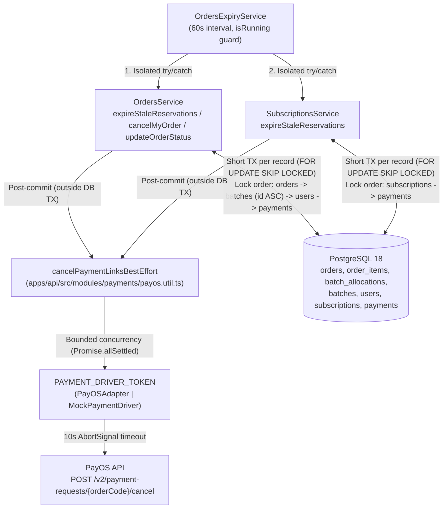
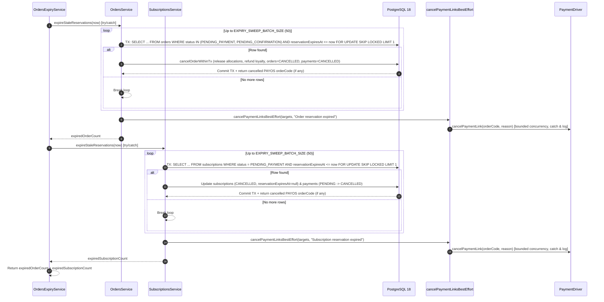

# PayOS Reservation Expiry Sweep and Upstream Link Cancellation Formal Specification

## Overview & Context

This specification defines the 15-minute `PENDING_PAYMENT` reservation expiry sweep and post-commit upstream PayOS link cancellation for both retail orders and prepaid subscriptions under issue `#244` (parent epic `#11`, split from `#29`).

Foundational pieces already landed in `#29`, `#242`, `#243`, and `#258`:

- `OrdersService.checkout` (`ADR-0042`) and `SubscriptionsService.createSubscriptionCheckout` (`ADR-0041`) already persist `reservationExpiresAt = NOW() + BUSINESS_RULES.ORDER_PAYMENT_TIMEOUT_MINUTES` (`15` minutes) and pass `expiredAt` to `PaymentDriver.createPaymentLink`.
- `PaymentsWebhookService` already clears `reservationExpiresAt = null` on verified `PAID` settlement and refuses to resurrect `CANCELLED` orders or subscriptions.
- `OrdersService.expireStaleReservations` (`ADR-0038`) already sweeps `PENDING_PAYMENT` and `PENDING_CONFIRMATION` orders using `FOR UPDATE SKIP LOCKED`, releasing `batch_allocations` and refunding `loyaltyPointsUsed`.

This spec closes the remaining gaps:

1. Calling `PaymentDriver.cancelPaymentLink` **post-commit** (outside `FOR UPDATE` DB transactions) for expired PayOS orders, customer self-cancelled PayOS orders, and staff-cancelled PayOS orders.
2. Adding `SubscriptionsService.expireStaleReservations` and wiring it into `OrdersExpiryService.runSweep` with isolated error boundaries.

### Goals

- Extract a shared post-commit best-effort helper `cancelPaymentLinksBestEffort` in `apps/api/src/modules/payments/payos.util.ts` using bounded concurrency (`Promise.allSettled`) and structured error logging without throwing.
- Update `OrdersService.cancelOrderWithinTx`, `OrdersService.expireStaleReservations`, `OrdersService.cancelMyOrder`, and `OrdersService.updateOrderStatus` (`CANCELLED`) to collect cancelled `PENDING` PayOS `orderCode`s and invoke `cancelPaymentLinksBestEffort` strictly **after** DB transaction commit.
- Implement `SubscriptionsService.expireStaleReservations` using `FOR UPDATE SKIP LOCKED` (`EXPIRY_SWEEP_BATCH_SIZE = 50`, 1 short TX per subscription) to cancel expired `PENDING_PAYMENT` subscriptions and their `PENDING` `payments`, followed by post-commit `cancelPaymentLinksBestEffort`.
- Wire `SubscriptionsModule` into `OrdersModule` and update `OrdersExpiryService.runSweep` to execute order and subscription sweeps in independent `try/catch` blocks.
- Cover all expiry and cancellation paths (including `cancelPaymentLink` failure/timeout resilience) in unit and integration tests (`orders-expiry.service.spec.ts`, `orders-payos-checkout.spec.ts`, `subscriptions.service.spec.ts`).

### Non-Goals

- Adding a separate BullMQ `order-queue` or a second `setInterval` timer for subscriptions (`ADR-0038`).
- Staff payment ledger or manual refund reconciliation endpoints (`#245`).
- Changing `EXPIRY_SWEEP_INTERVAL_MS` (`60_000`) or `EXPIRY_SWEEP_BATCH_SIZE` (`50`).

## Architecture

## Operational Flow

### 1. Expiry Sweep (`OrdersExpiryService.runSweep`)

### 2. Customer Self-Cancel & Staff Cancel (`PENDING_PAYMENT` Orders)

When `OrdersService.cancelMyOrder` or `OrdersService.updateOrderStatus(..., OrderStatus.CANCELLED)` cancels an order:

1. Inside `db.transaction`, `cancelOrderWithinTx` updates `orders` and any `PENDING` `PAYMENT` row in `payments`, returning the cancelled `orderCode` (when `paymentMethod === PaymentMethod.PAYOS` and `orderCode !== null`).
2. Strictly **after** `db.transaction` resolves, the service invokes `cancelPaymentLinksBestEffort` for that `orderCode` so an active VietQR link does not remain scannable on PayOS for the remainder of the 15-minute window.

## Security & Reliability

- **Zero network I/O inside `FOR UPDATE` transactions (`ADR-0042`)**: `PaymentDriver.cancelPaymentLink` is never called inside `db.transaction`. Perishable FEFO `batch_allocations`, `users.rewardPoints`, and `PENDING_PAYMENT` caps are released immediately upon DB commit regardless of PayOS availability.
- **No head-of-line blocking under PayOS outage**: `expireStaleReservations` commits all DB cancellations in the batch (both `COD` and `PAYOS`) before running `cancelPaymentLinksBestEffort`. With `PAYOS_REQUEST_TIMEOUT_MS = 10_000` and bounded concurrency (e.g., `5`), even a full outage across `50` expired links does not block COD expirations or hold DB locks.
- **Best-effort upstream cancellation**: If `cancelPaymentLink` throws (gateway timeout, 5xx, or link already cancelled/paid on PayOS), `cancelPaymentLinksBestEffort` logs a warning/error with `orderCode` and continues without rolling back local DB state. Any rare late payment arriving after local `CANCELLED` commit is caught fail-closed by `PaymentsWebhookService` (`ADR-0041`, `ADR-0042`).
- **Domain fault isolation**: `OrdersExpiryService.runSweep` wraps order expiry and subscription expiry in separate `try/catch` blocks so an unexpected failure in one sweep never starves the other.
- **No circular module dependency**: `OrdersModule` imports `SubscriptionsModule` (which imports `UsersModule`, `FarmsModule`, `ShippingModule`, `PaymentsModule` and does not import `OrdersModule`).

## Domain Invariant Taxonomy

| ID          | Invariant                                                                                                                                                                   | Enforcement Point                                             | Verification                                                                     |
| :---------- | :-------------------------------------------------------------------------------------------------------------------------------------------------------------------------- | :------------------------------------------------------------ | :------------------------------------------------------------------------------- |
| `INV-EXP-1` | `PaymentDriver.cancelPaymentLink` is invoked strictly after DB transaction commit for cancelled `PENDING_PAYMENT` PayOS orders/subscriptions, never inside `FOR UPDATE` TX. | `OrdersService`, `SubscriptionsService`, `payos.util.ts`      | Unit & integration tests asserting TX commit order and driver calls              |
| `INV-EXP-2` | Upstream `cancelPaymentLink` failures or timeouts never abort `expireStaleReservations`, `cancelMyOrder`, or `updateOrderStatus(CANCELLED)` and never roll back DB state.   | `cancelPaymentLinksBestEffort` (`Promise.allSettled` + catch) | Integration test with rejecting `MockPaymentDriver.cancelPaymentLink`            |
| `INV-EXP-3` | `OrdersService.expireStaleReservations` and `SubscriptionsService.expireStaleReservations` use `FOR UPDATE SKIP LOCKED` (limit `50`) and cancel `PENDING` `payments` rows.  | `OrdersService`, `SubscriptionsService`                       | Integration tests for order & subscription expiry sweeps                         |
| `INV-EXP-4` | `OrdersExpiryService.runSweep` isolates order sweep errors from subscription sweep errors and returns the combined expired count.                                           | `OrdersExpiryService.runSweep`                                | Unit tests in `orders-expiry.service.spec.ts`                                    |
| `INV-EXP-5` | `COD` orders (`PENDING_CONFIRMATION`) never trigger `PaymentDriver.cancelPaymentLink` upon expiry or cancellation.                                                          | `OrdersService.cancelOrderWithinTx` (`PaymentMethod.PAYOS`)   | Integration tests in `orders-checkout.spec.ts` / `orders-payos-checkout.spec.ts` |

## Edge Cases & Adversarial Matrix

| ID       | Scenario / Class                                                                                            | Expected Behavior                                                                                                                  |
| :------- | :---------------------------------------------------------------------------------------------------------- | :--------------------------------------------------------------------------------------------------------------------------------- |
| `EDGE-1` | Expired `PENDING_PAYMENT` PayOS order where `payments.paymentUrl` was never persisted (crash after TX1)     | Order & `PENDING` payment cancelled in DB; `cancelPaymentLink` runs best-effort (ignores upstream error if link was never created) |
| `EDGE-2` | Customer self-cancels `PENDING_PAYMENT` PayOS order at minute 2                                             | DB order/payment cancelled, stock/loyalty released, and `cancelPaymentLink` called post-commit so QR code is invalidated early     |
| `ADV-1`  | PayOS gateway returns 5xx or times out (`10_000 ms`) during a 50-order expiry sweep                         | All 50 DB records are cancelled and stock released first; `cancelPaymentLinksBestEffort` logs errors without failing sweep         |
| `ADV-2`  | `OrdersService.expireStaleReservations` throws an unexpected DB error during `OrdersExpiryService.runSweep` | Error is logged; `SubscriptionsService.expireStaleReservations` still executes in the same sweep pass                              |
| `ADV-3`  | Concurrent expiry sweep and PayOS `PAID` webhook race for the same `PENDING_PAYMENT` order/subscription     | Serialized by `FOR UPDATE`; whichever commits first wins, and late webhook on `CANCELLED` logs alert without resurrecting          |
