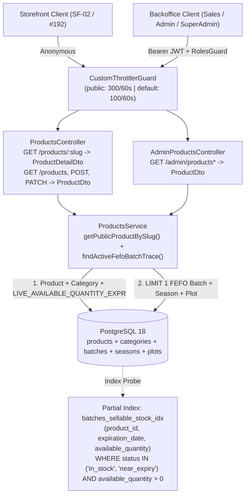
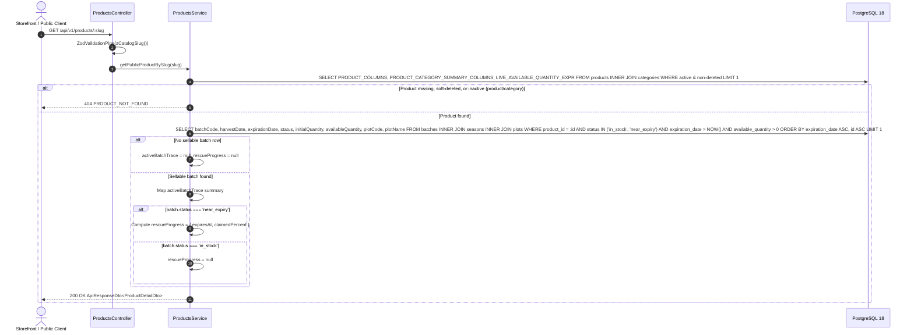

# Product Detail FEFO Batch Trace, Rescue Progress & Storage Metadata Formal Specification

## Overview & Context

This specification defines the API contract, database schema extension, query semantics, and security/redaction boundaries for `#255` (parent epic `#9`; split from `#192`) on `GET /api/v1/products/:slug` in `apps/api/src/modules/catalog` and `apps/api/src/database/schemas/catalog.schema.ts`. Architectural commitments are recorded in `ADR-0047` (amending `ADR-0027` by introducing `ProductDetailDto` for `:slug`), building on `ADR-0024` (traceability redaction), `ADR-0025` (catalog pricing vs. batch flash-sale separation), `ADR-0026` (`timestamptz` batch timestamps), `ADR-0007` (OpenAPI `types:sync`), and `ADR-0011`/`ADR-0012` (Zod DTO co-location and response envelopes).

Currently, `ProductsService.getPublicProductBySlug` returns `ProductDto`, which exposes catalog fields and `availableQuantity` (`LIVE_AVAILABLE_QUANTITY_EXPR`) but lacks any active FEFO batch trace summary, near-expiry rescue progress, or SKU storage instructions. Meanwhile, `TraceService.getTraceByBatchCode` (`GET /api/v1/trace/:batchCode`) already serves full redacted provenance behind Redis cache-aside.

### Goals

- Add nullable `storageInstructions` (`text`) to `products`, expose it on `CreateProductDto`, `UpdateProductDto`, and `ProductDto`, and persist it via one forward-only Drizzle migration.
- Introduce `ProductDetailDto` (`productSchema.extend(...)`) exclusively for `GET /api/v1/products/:slug`, adding nullable `activeBatchTrace` and nullable `rescueProgress` without changing `ProductDto` on list, admin, or mutation routes.
- Resolve `activeBatchTrace` from the first sellable batch in deterministic FEFO order (`expirationDate ASC, id ASC`) joined with `seasons` and `plots` (without filtering `plots.deletedAt`), projecting only redacted provenance fields (`batchCode`, `harvestDate`, `expirationDate`, `status`, `plotCode`, `plotName`).
- Resolve `rescueProgress` (`{ expiresAt, claimedPercent }`) strictly when the selected active FEFO batch has `status === BatchStatus.NEAR_EXPIRY`, computing `claimedPercent` (`0..100` integer) without exposing raw batch quantities (`initialQuantity`, `availableQuantity`) or unimplemented flash-sale discounts.
- Verify behaviour with unit specs, E2E integration tests, and `bun run types:sync`.

### Non-Goals

- Modifying `GET /api/v1/products`, `GET /api/v1/admin/products*`, `POST /api/v1/products`, or `PATCH /api/v1/products/:id` to return `activeBatchTrace` or `rescueProgress`.
- Duplicating `GET /api/v1/trace/:batchCode` (`#45` / `ADR-0024`) lab telemetry (`soilTestResult`, `waterTestResult`), `farm.certificationUrl`, or `farmingLogs` inside `GET /api/v1/products/:slug`.
- Implementing batch-level 50% flash-sale checkout pricing (`#34`) or exposing `discountPercent` / `rescuePriceVnd`.
- Querying `FarmsModule` (`FarmSettingsService` / `flashSaleConfig`) from `CatalogModule`.
- Building Storefront (`#192`) or Backoffice UI components.

## Architecture

Symbols and module touchpoints:

- `apps/api/src/database/schemas/catalog.schema.ts`: Adds nullable `storageInstructions: text()` to `products`.
- `apps/api/drizzle/<timestamp>_products_storage_instructions/migration.sql`: Forward-only Drizzle migration adding `storage_instructions` to `products`.
- `apps/api/src/modules/catalog/catalog.constant.ts`: Defines `MAX_STORAGE_INSTRUCTIONS_LENGTH` (`1000`).
- `apps/api/src/modules/catalog/dto/catalog-primitives.ts`: Adds `zCatalogStorageInstructions()` (sanitized optional/nullable string `<= 1000` chars normalizing empty/whitespace strings to `null`).
- `apps/api/src/modules/catalog/dto/create-product.dto.ts` & `apps/api/src/modules/catalog/dto/update-product.dto.ts`: Add `storageInstructions: zCatalogStorageInstructions()`.
- `apps/api/src/modules/catalog/dto/product.dto.ts`: Adds `storageInstructions: z.string().nullable()` to `productSchema` (`ProductDto` / `ProductProjection`), and defines `activeBatchTraceSchema`, `rescueProgressSchema`, `productDetailSchema` (`ProductDetailProjection`), and `ProductDetailDto`.
- `apps/api/src/modules/catalog/products.controller.ts`: Updates `GET /api/v1/products/:slug` (`getBySlug`) `@ApiOkResponseGeneric(ProductDetailDto)` and return type `ApiResponse<ProductDetailProjection>`.
- `apps/api/src/modules/catalog/products.service.ts`: Includes `storageInstructions` in `PRODUCT_COLUMNS`, `createProduct`, `updateProduct`, and `toProductProjection`; updates `getPublicProductBySlug` to query the first active FEFO batch (`batches -> seasons -> plots`) and map `activeBatchTrace` and `rescueProgress`.
- `apps/api/src/modules/catalog/products.service.spec.ts` & `apps/api/test/integration/catalog.spec.ts`: Unit and integration coverage for `storageInstructions`, `activeBatchTrace`, and `rescueProgress`.
- `apps/api/openapi.json`, `apps/api/test/generated/api-schema.d.ts`, `apps/storefront/src/types/api-schema.d.ts`, `apps/backoffice/src/types/api-schema.d.ts`: Regenerated via `bun run types:sync`.

## Operational Flow

### `GET /api/v1/products/:slug` Sequential Read Flow

## API Contract

### Endpoints

| Method & Path                 | Access                          | Rate Limit Tier             | Response Schema                             | Behaviour                                                                                   |
| :---------------------------- | :------------------------------ | :-------------------------- | :------------------------------------------ | :------------------------------------------------------------------------------------------ |
| `GET /api/v1/products/:slug`  | `@Public()`                     | `public` (`300 req / 60s`)  | `200` `ApiResponseDto<ProductDetailDto>`    | Returns `ProductDto` fields + `storageInstructions` + `activeBatchTrace` + `rescueProgress` |
| `GET /api/v1/products`        | `@Public()`                     | `public` (`300 req / 60s`)  | `200` `PaginatedApiResponseDto<ProductDto>` | Unchanged list projection plus `storageInstructions: string \| null`                        |
| `GET /api/v1/admin/products*` | `sales`, `admin`, `super_admin` | `default` (`100 req / 60s`) | `200` `ProductDto` (paginated or single)    | Unchanged admin projection plus `storageInstructions: string \| null`                       |
| `POST /api/v1/products`       | `sales`, `admin`, `super_admin` | `default` (`100 req / 60s`) | `201` `ApiResponseDto<ProductDto>`          | Accepts optional/nullable `storageInstructions` (`<= 1000` chars)                           |
| `PATCH /api/v1/products/:id`  | `sales`, `admin`, `super_admin` | `default` (`100 req / 60s`) | `200` `ApiResponseDto<ProductDto>`          | Accepts optional/nullable `storageInstructions` (`null` clears it)                          |

### DTOs & Schema Extensions

1. **`ProductDto` (`apps/api/src/modules/catalog/dto/product.dto.ts`)**:
   - Retains all existing `ADR-0025` and `ADR-0027` fields and adds `storageInstructions: z.string().nullable()`.
2. **`ProductDetailDto` (`apps/api/src/modules/catalog/dto/product.dto.ts`)**:
   - Extends `productSchema` with:
     - `activeBatchTrace`: `activeBatchTraceSchema.nullable()`, containing `batchCode`, `harvestDate` (ISO-8601 datetime), `expirationDate` (ISO-8601 datetime), `status` (`BatchStatus`), `plotCode`, and `plotName`.
     - `rescueProgress`: `rescueProgressSchema.nullable()`, containing `expiresAt` (ISO-8601 datetime matching `activeBatchTrace.expirationDate`) and `claimedPercent` (`z.number().int().min(0).max(100)`).
3. **Database Schema & Migration (`apps/api/src/database/schemas/catalog.schema.ts`)**:
   - Add `storageInstructions: text()` (nullable) on `products`.
   - Generate one forward-only Drizzle migration (`bun run --cwd apps/api db:generate`) keeping `apps/api/drizzle/meta/*` snapshots authoritative per `docs/standards/database-and-migrations.md`.
4. **No new RFC 9457 error codes**:
   - `#255` reuses `PRODUCT_NOT_FOUND` (`404`) and `VALIDATION_FAILED` (`400`) under `GlobalExceptionFilter`.

## Security & Reliability

### Access & Exposure Matrix

| Data Field                                                            | Public (`@Public()`) | `customer` / `farm_staff` | `sales` / `admin` / `super_admin` |
| :-------------------------------------------------------------------- | :------------------: | :-----------------------: | :-------------------------------: |
| `storageInstructions` on active products in active categories         |         Yes          |            Yes            |                Yes                |
| `activeBatchTrace` (`batchCode`, dates, `status`, `plotCode/Name`)    |         Yes          |            Yes            |                Yes                |
| `rescueProgress` (`expiresAt`, `claimedPercent`)                      |  Only `near_expiry`  |    Only `near_expiry`     |        Only `near_expiry`         |
| Batch `initialQuantity`, `availableQuantity`, `waste_logs`, `staffId` |        Hidden        |          Hidden           |    Only via `/api/v1/batches*`    |
| Batch `discountPercent` / `rescuePriceVnd`                            |        Hidden        |          Hidden           |         Deferred to `#34`         |

### Controls

- **Batch Quantity & Staff Redaction (`ADR-0024`)**: `initialQuantity` and `availableQuantity` are fetched internally only to compute `claimedPercent` in TypeScript and are never serialized into `ProductDetailDto`. Staff identifiers and `waste_logs` are never joined.
- **Pricing Integrity (`ADR-0025`, `ADR-0031`)**: `rescueProgress` omits any discount percentage or derived rescue price so public UI cannot display a discount that checkout does not yet honor.
- **XSS / Payload Bounds on `storageInstructions`**: Input passes through `zCatalogStorageInstructions()` (`zSanitizedString` with `max(1000)`), stripping control characters and normalizing blank strings to `null`.
- **Bounded Index Probe**: The second query filters on the exact `batches_sellable_stock_idx` predicate (`product_id`, `status IN ('in_stock', 'near_expiry')`, `available_quantity > 0`, `expiration_date > NOW()`) with `ORDER BY expiration_date ASC, id ASC LIMIT 1`.
- **Fail-Safe Non-Transactional Degradation**: Because no transaction spans the two reads, a concurrent sell-out between query 1 and query 2 degrades cleanly to `activeBatchTrace: null, rescueProgress: null` without `500` errors.

## Domain Invariant Taxonomy

| Invariant    | Name                                      | Formal Statement                                                                                                                                                                                                                                    | Enforcement Seam                                              | Verification Test                                                                                                    |
| :----------- | :---------------------------------------- | :-------------------------------------------------------------------------------------------------------------------------------------------------------------------------------------------------------------------------------------------------- | :------------------------------------------------------------ | :------------------------------------------------------------------------------------------------------------------- |
| `INV-PROD-6` | Deterministic Active FEFO Trace Selection | `ProductDetailDto.activeBatchTrace` selects the single sellable batch (`status IN ('in_stock', 'near_expiry')`, `expiration_date > NOW()`, `available_quantity > 0`) ordered by `expiration_date ASC, id ASC`, or `null` when none exists           | `ProductsService.getPublicProductBySlug` FEFO `LIMIT 1` query | Integration test with multiple sellable/expired/sold-out batches verifying earliest-expiry (`id ASC` tie-break) wins |
| `INV-PROD-7` | Redacted Near-Expiry Rescue Progress      | `ProductDetailDto.rescueProgress` is non-null iff the selected active FEFO batch has `status === BatchStatus.NEAR_EXPIRY`; `claimedPercent` is `clamp(round((initial - available) / initial * 100), 0, 100)` and never exposes raw batch quantities | `ProductsService.toRescueProgress` + `rescueProgressSchema`   | Unit + integration tests for `in_stock` (`null`), `near_expiry` (`0%`, partial `%`, `100%` clamp), and key absence   |
| `INV-PROD-8` | Historical Plot Trace Continuity          | Joining `seasons` and `plots` for an active sellable batch MUST NOT exclude rows where `plots.deleted_at IS NOT NULL`, preserving traceability if a plot was archived post-harvest                                                                  | `ProductsService` `INNER JOIN seasons` / `INNER JOIN plots`   | Integration test soft-deleting a plot after harvest and verifying `activeBatchTrace` still returns `plotCode/Name`   |

### Edge Cases (`EDGE-1..7`)

| ID       | Case                                                                                      | Expected Behaviour                                                                                 |
| :------- | :---------------------------------------------------------------------------------------- | :------------------------------------------------------------------------------------------------- |
| `EDGE-1` | Active product has 0 batches, or only `sold_out` / `expired` / `expiration_date <= NOW()` | `GET /api/v1/products/:slug` returns `200` with `activeBatchTrace: null`, `rescueProgress: null`   |
| `EDGE-2` | Product has Batch A (`near_expiry`, 2 kg) and Batch B (`in_stock`, 20 kg)                 | FEFO picks Batch A first; `activeBatchTrace` points to Batch A and `rescueProgress` is populated   |
| `EDGE-3` | Product has Batch A (`in_stock`, expires in 50h) and Batch B (`near_expiry`, expires 60h) | FEFO picks Batch A (`expirationDate ASC`); since Batch A is `in_stock`, `rescueProgress` is `null` |
| `EDGE-4` | Two sellable batches share identical `expirationDate`                                     | Deterministic tie-break `id ASC` selects the lower UUIDv7 batch                                    |
| `EDGE-5` | `near_expiry` batch has `availableQuantity === initialQuantity` (no orders/waste yet)     | `rescueProgress` returns `claimedPercent: 0`                                                       |
| `EDGE-6` | `storageInstructions` submitted as `""` or `"   "` on `POST`/`PATCH`                      | Normalized to `null` in DB and responses                                                           |
| `EDGE-7` | Plot linked to an active batch's `harvested` season is soft-deleted (`deletedAt` set)     | `activeBatchTrace` still resolves `plotCode` and `plotName`                                        |

### Concurrency & Adversarial Matrix (`ADV-1..3`)

| ID      | Scenario                                                                                 | Expected Behaviour                                                                                          |
| :------ | :--------------------------------------------------------------------------------------- | :---------------------------------------------------------------------------------------------------------- |
| `ADV-1` | Concurrent checkout depletes last sellable batch between query 1 and query 2             | `getPublicProductBySlug` returns `200` with `activeBatchTrace: null, rescueProgress: null` (no crash)       |
| `ADV-2` | Caller passes `storageInstructions` > 1000 chars or HTML/control chars on `POST`/`PATCH` | `ZodValidationPipe` rejects >1000 chars with `400 VALIDATION_FAILED` and sanitizes control chars            |
| `ADV-3` | Unauthenticated client inspects `GET /api/v1/products/:slug` response keys               | Payload contains neither `initialQuantity`, `availableQuantity` per batch, `discountPercent`, nor `staffId` |

## Test Matrix

- **Unit specs (`apps/api/src/modules/catalog/products.service.spec.ts`)**:
  - `toProductProjection`: maps `storageInstructions` (`string` and `null`).
  - `getPublicProductBySlug`: maps `activeBatchTrace` for `in_stock` (`rescueProgress: null`), maps `rescueProgress` (`claimedPercent` rounding & `0..100` clamp) for `near_expiry`, and returns `null`/`null` when no sellable batch exists.
- **E2E Integration suite (`apps/api/test/integration/catalog.spec.ts`)**:
  - `POST /api/v1/products` & `PATCH /api/v1/products/:id`: persist, update, and clear (`null` / whitespace) `storageInstructions`.
  - `GET /api/v1/products/:slug`:
    - Verifies FEFO ordering (`expiration_date ASC, id ASC`) across `in_stock`, `near_expiry`, `expired`, `sold_out`, and `expiration_date <= NOW()`.
    - Verifies `rescueProgress` is `null` for `in_stock` and `{ expiresAt, claimedPercent }` for `near_expiry`, with zero leaked batch quantities or discount fields.
    - Verifies `activeBatchTrace` still resolves when `plots.deletedAt` is set (`INV-PROD-8`).
- **Contract & Verification commands**:
  - Run `bun run types:sync`, `bun run check`, `bun run test`, and `bun run test:e2e`.

## Risks & Rollback

- **Cron lag on `near_expiry` transition**: Because `rescueProgress` checks `batch.status === BatchStatus.NEAR_EXPIRY` without consulting `FarmSettingsService`, batches crossing `hoursThreshold` between cron runs wait for the transition job. Acceptable per `ADR-0047`; if real-time threshold detection is later needed, only `ProductsService` needs an injected `hoursThreshold` lookup without changing `ProductDetailDto`.
- **Rollback**: Revert `ProductDetailDto` on `GET /api/v1/products/:slug` back to `ProductDto`, remove `storageInstructions` from DTOs/service, re-run `bun run types:sync`, and emit a compensating forward migration `ALTER TABLE products DROP COLUMN IF EXISTS storage_instructions` per `docs/standards/database-and-migrations.md`.
