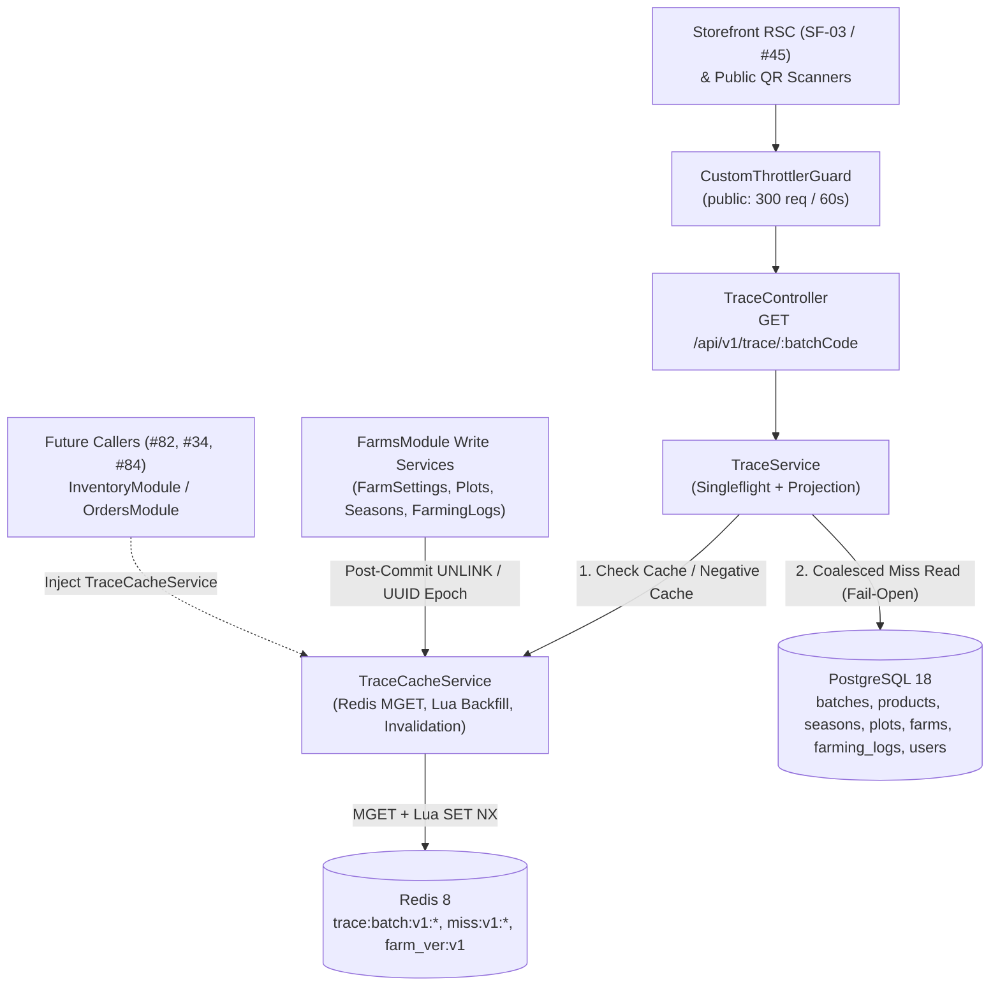
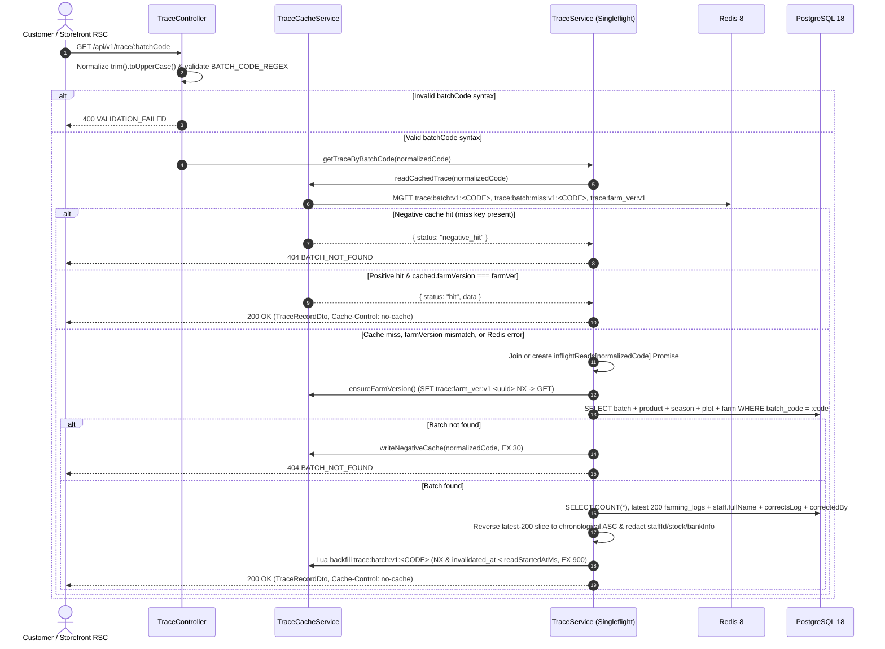
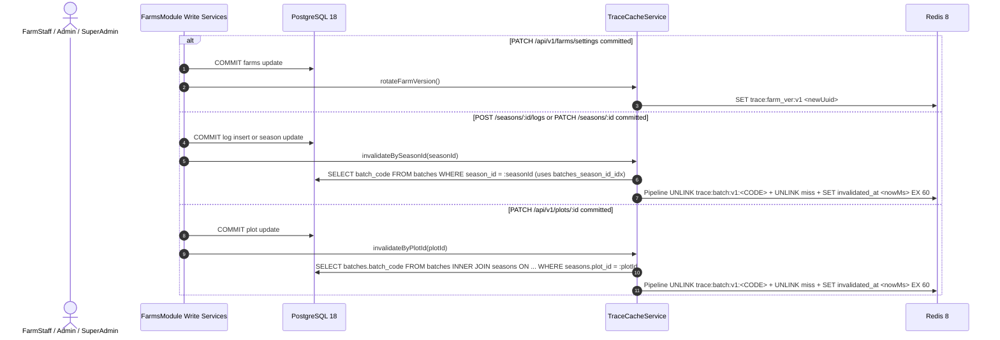

# Public QR Traceability Formal Specification

## Overview & Context

This specification defines the public, unauthenticated QR traceability endpoint `GET /api/v1/trace/:batchCode` (`UC-14..16`) introduced by #21 (parent epic #8; Storefront consumer #45 `SF-03`; QR label producer #83) in `apps/api/src/modules/farms`. Architectural commitments are recorded in ADR-0024; farm/plot/season/farming-log foundations follow ADR-0021, ADR-0022, and ADR-0023; DTO co-location, response envelopes, and RFC 9457 error contracts follow ADR-0011, ADR-0012, and ADR-0013; rate-limit fail-open and cache degradation follow `docs/standards/concurrency-and-locking.md`.

`apps/api/src/database/schemas/catalog.schema.ts` already defines `batches` (`batchCode`, `seasonId`, `productId`, `harvestDate`, `expirationDate`, `status`) and `products` (`name`, `slug`, `unit`, `imageUrls`), and `tier2-catalog.seeder.ts` already seeds sample traceable batches (`BATCH-2026-TOM-01`, `BATCH-2026-SPN-01`, `BATCH-2026-LET-01`). However, `apps/api/src/modules/farms` currently exposes no public trace route, `batches.seasonId` lacks a foreign-key index for invalidation lookups, `BATCH_NOT_FOUND` is absent from `@greenroots/shared`, and `apps/storefront` currently relies on a mismatched flat mock (`BatchTraceRecord`).

### Goals

- Expose public `GET /api/v1/trace/:batchCode` (`@Public()`, no JWT required) returning `200 ApiResponseDto<TraceRecordDto>` in `< 1.5s` with `Cache-Control: no-cache` and normalized `:batchCode` (`trim().toUpperCase()`).
- Implement hybrid Redis Cache-Aside (`TraceCacheService`) using `trace:batch:v1:<BATCH_CODE>` (900s TTL), `trace:batch:miss:v1:<BATCH_CODE>` (30s negative cache), `trace:farm_ver:v1` (UUID nonce epoch for `O(1)` farm-level invalidation), atomic Lua backfill (`NX` + `invalidated_at` guard), in-process singleflight coalescing on cache misses, and fail-open PostgreSQL fallback.
- Add `index("batches_season_id_idx").on(table.seasonId)` to `batches` via one forward-only migration and hook `TraceCacheService` invalidation into `FarmSettingsService`, `PlotsService`, `SeasonsService`, and `FarmingLogsService` while exporting `TraceCacheService` from `FarmsModule` for future `#82`, `#34`, and `#84` callers.
- Project a closed, redacted provenance record faithfully reflecting nullable `farms.certificationUrl`, `plots.soilTestResult`, `plots.waterTestResult`, `YYYY-MM-DD` batch/season dates, soft-deleted `plot`/`product` historical visibility, and the latest-200 chronological `farmingLogs` timeline with bidirectional `correctsLog` / `correctedBy` DAG linkage.
- Register `BATCH_NOT_FOUND` in `@greenroots/shared` and `apps/api` constants, add `public`-tier rate limiting (`300 req / 60s`), and propagate OpenAPI/TypeScript contracts via `bun run types:sync`.

### Non-Goals

- Batch intake (`#82`), QR label generation (`#83`), FEFO stock deduction (`#84`), or expiry cron transitions (`#34`).
- Modifying `batches.harvestDate` or `batches.expirationDate` column types from `date` to `timestamptz`.
- Refactoring `apps/storefront` `TraceView` (`#45` consumes the OpenAPI schema synced by `bun run types:sync`).
- Paginating `farmingLogs` on the public trace route (single-shot capped at 200 latest entries).
- Returning internal stock quantities, `waste_logs`, `farms.bankInfo`/contacts, or staff `users.id` UUIDs.

## Architecture

Symbols and module layout:

- `FARMS_ROUTES` in `apps/api/src/modules/farms/farms.routes.ts` adds frozen constants `TRACE_BASE: "trace"` and `TRACE_BY_BATCH_CODE: ":batchCode"`.
- `TraceController` in `apps/api/src/modules/farms/trace.controller.ts` exposes `GET /api/v1/trace/:batchCode` with `@Public()`, `@SkipThrottle({ default: true, auth: true })`, `@Throttle({ public: { limit: 300, ttl: 60000 } })`, `@Header("Cache-Control", "no-cache")`, and class-level `@ApiBadRequestResponseRfc9457()` / `@ApiInternalServerErrorResponseRfc9457()`.
- `TraceService` in `apps/api/src/modules/farms/trace.service.ts` owns closed Drizzle column selections (`TRACE_BATCH_COLUMNS`, `TRACE_PRODUCT_COLUMNS`, `TRACE_FARM_COLUMNS`, `TRACE_PLOT_COLUMNS`, `TRACE_SEASON_COLUMNS`, `TRACE_LOG_COLUMNS`), in-process singleflight `inflightReads` `Map<string, Promise<TraceRecordProjection>>`, latest-200 `farming_logs` hydration (`correctsLog` + `correctedBy`), and structured latency/cache-outcome logging.
- `TraceCacheService` in `apps/api/src/modules/farms/trace-cache.service.ts` owns Redis `MGET` read verification (`farmVersion` match), atomic Lua backfill (`NX` + `invalidated_at` guard), 30s negative-cache read/write, `rotateFarmVersion()` (`SET trace:farm_ver:v1 <uuid>`), `invalidateBySeasonId(seasonId)`, `invalidateByPlotId(plotId)`, and exported `invalidateByBatchCodes(batchCodes)` — all failing open with warning/error logs when Redis errors.
- `FarmSettingsService`, `PlotsService`, `SeasonsService`, and `FarmingLogsService` call `TraceCacheService` invalidation strictly **after** PostgreSQL transaction commit.
- `FarmsModule` in `apps/api/src/modules/farms/farms.module.ts` registers `TraceController`, `TraceService`, and `TraceCacheService` and exports `TraceCacheService`.
- `farms.interface.ts` defines compile-time constants (`TRACE_CACHE_PREFIX`, `TRACE_MISS_CACHE_PREFIX`, `TRACE_INVALIDATED_AT_PREFIX`, `TRACE_FARM_VERSION_KEY`, `TRACE_CACHE_TTL_SECONDS = 900`, `TRACE_MISS_TTL_SECONDS = 30`, `TRACE_INVALIDATION_MARKER_TTL_SECONDS = 60`, `TRACE_MAX_FARMING_LOGS = 200`, `BATCH_CODE_REGEX`).
- `apps/api/src/modules/farms/dto/trace-record.dto.ts` holds co-located Zod schemas and `TraceRecordDto` (`createZodDto`), plus `batchCodeParamSchema` for route param normalization and validation.
- `apps/api/src/database/schemas/catalog.schema.ts` adds `index("batches_season_id_idx").on(table.seasonId)` on `batches`.
- `@greenroots/shared` (`packages/shared/src/error-dictionary.ts` and `packages/shared/GLOSSARY.md`) registers `BATCH_NOT_FOUND` (`404`) and defines `Batch Traceability Record`.

## Operational Flow

### 1. Public Trace Read (`GET /api/v1/trace/:batchCode`)

### 2. Write-Path Cache Invalidation Matrix

## API Contract

### Endpoints

| Method & Path                  | Access    | Rate Limit Tier            | Success                                | RFC 9457 Errors                                                                     | Headers                   |
| :----------------------------- | :-------- | :------------------------- | :------------------------------------- | :---------------------------------------------------------------------------------- | :------------------------ |
| `GET /api/v1/trace/:batchCode` | `@Public` | `public` (`300 req / 60s`) | `200` `ApiResponseDto<TraceRecordDto>` | `400` (`VALIDATION_FAILED`), `404` (`BATCH_NOT_FOUND`), `429` (`TOO_MANY_REQUESTS`) | `Cache-Control: no-cache` |

### DTOs, Projections & Validation Rules

1. **Path Parameter (`batchCodeParamSchema`)**:
   - Pre-processes string input with `.trim().toUpperCase()`.
   - Validates against `BATCH_CODE_REGEX = /^[A-Z0-9][A-Z0-9_-]{2,99}$/` (`3..100` chars; alphanumeric start; allows hyphens and underscores without hardcoding a `BATCH-YYYY-` prefix so future `#82` code generation stays compatible).
   - Malformed path parameters reject with `400 VALIDATION_FAILED`.
2. **`TraceRecordDto`** (closed projection; internal wrapper stores `farmVersion` separately in Redis and strips it before HTTP serialization):
   - `batch`: `{ id (UUID), batchCode, harvestDate (ISO datetime per ADR-0026; originally YYYY-MM-DD under ADR-0024), expirationDate (ISO datetime per ADR-0026; originally YYYY-MM-DD under ADR-0024), status (BatchStatus) }` — excludes `initialQuantity`, `availableQuantity`, `qrCodeUrl`.
   - `product`: `{ id (UUID), name, slug, unit, imageUrls (string[], normalized from null to []) }` — excludes `basePrice`, `isActive`, `deletedAt`.
   - `farm`: `{ name, legalName, tagline (string | null), address, certificationUrl (string | null) }` — excludes `id`, `taxId`, `latitude`, `longitude`, `hotlines`, `emails`, `workingHours`, `bankInfo`, `shippingConfig`, `flashSaleConfig`, `isPayosEnabled`, `isCodEnabled`.
   - `plot`: `{ plotCode, name, areaSqm (number), soilTestResult (SoilTestResult | null), waterTestResult (WaterTestResult | null) }` — excludes `id`, `farmId`, `deletedAt`.
   - `season`: `{ id (UUID), seasonName, startDate (YYYY-MM-DD), expectedHarvestDate (YYYY-MM-DD), status (SeasonStatus) }`.
   - `farmingLogs`: array of up to 200 chronological entries (`loggedAt:asc`, `id:asc`) containing `{ id (UUID), actionType (FarmingActionType), description, mediaUrls (string[], normalized from null to []), recordedByName (string), correctsLogId (UUID | null), correctsLog (TraceLogTargetSummary | null), correctedBy (TraceLogCorrectionRef[]), loggedAt (ISO datetime) }`.
     - `TraceLogTargetSummary`: `{ id (UUID), actionType (FarmingActionType), description, loggedAt (ISO datetime) }`.
     - `TraceLogCorrectionRef`: `{ id (UUID), loggedAt (ISO datetime), recordedByName (string) }`.
     - Excludes `staffId` and `users.id` UUIDs across both `farmingLogs` and `correctedBy`.
   - `totalLogCount`: integer `>= 0` total count of `farming_logs` rows for `season.id`.
   - `logsTruncated`: boolean (`true` when `totalLogCount > 200`; `farmingLogs` retains the latest 200 entries re-sorted ascending).

### Shared Contracts, Error Codes & Migration

- `@greenroots/shared` (`packages/shared/src/error-dictionary.ts`):
  - Add `BATCH_NOT_FOUND: "BATCH_NOT_FOUND"` to `API_ERROR_CODES` with Vietnamese copy in `API_ERROR_DICTIONARY`.
- `apps/api/src/common/constants/messages.constant.ts`:
  - Add `MESSAGES.BATCHES.NOT_FOUND = "Batch not found."` and `MESSAGES.VALIDATION.INVALID_BATCH_CODE` (`GlobalExceptionFilter` resolves `/errors/not-found` from `STATUS_SLUGS[404]`).
- Database schema & migration (`apps/api/src/database/schemas/catalog.schema.ts`):
  - Add `index("batches_season_id_idx").on(table.seasonId)` to `batches`.
  - Generate one forward-only index migration via Drizzle per `docs/standards/database-and-migrations.md`.

## Security & Reliability

### Access & Exposure Matrix

| Field / Resource                                                            | Public `GET /api/v1/trace/:batchCode` |  Internal Staff Endpoints  |
| :-------------------------------------------------------------------------- | :-----------------------------------: | :------------------------: |
| `batches.batchCode`, `harvestDate`, `expirationDate`, `status`              |                  Yes                  |            Yes             |
| `batches.initialQuantity`, `availableQuantity`, `waste_logs`                |               Redacted                |     Yes (`#82`, `#48`)     |
| `farms.bankInfo`, `emails`, `hotlines`, `shippingConfig`, `flashSaleConfig` |               Redacted                |       Yes (ADR-0021)       |
| `farmingLogs` `recordedByName` (`users.fullName`)                           |                  Yes                  |            Yes             |
| `farmingLogs.staffId` / `users.id` / `users.email` / `users.phone`          |               Redacted                |  `staff.id` internal only  |
| Soft-deleted `plot` / `product` linked to existing `batch`                  |      Yes (historical provenance)      | Filtered on active pickers |

### Controls

- **Public Rate Limiting**: Route carries `@Public()`, `@SkipThrottle({ default: true, auth: true })`, and `@Throttle({ public: { limit: 300, ttl: 60000 } })`. Per `CustomThrottlerGuard` (`apps/api/src/common/guards/throttler.guard.ts`), rate limiting fails open after 2 seconds if Redis stalls and emits RFC 9457 `429 TOO_MANY_REQUESTS` in production when exceeded.
- **Lua Stale-Write Guard & Epoch Integrity**:
  - `TraceCacheService` uses the same `NX` + `invalidated_at >= readStartedAtMs` Lua backfill script structure as ADR-0021 so a concurrent write invalidation (`UNLINK` + `SET trace:batch:invalidated_at:<CODE> <nowMs> EX 60`) never lets an older in-flight `GET` pin stale data in Redis.
  - `trace:farm_ver:v1` uses opaque UUID nonces (`SET ... NX` on read miss; unconditional `SET` on `PATCH /api/v1/farms/settings`) instead of `INCR` from a missing key, preventing post-eviction `"1" === "1"` collisions.
- **Fail-Open Degradation & Stampede Protection**:
  - Any Redis read/eval/pipeline failure logs a warning/error (`TraceCacheService` logger) and falls back cleanly to PostgreSQL without returning `503` on reads or failing committed writes.
  - Concurrent misses for the same normalized `:batchCode` on an API instance share one Promise in `TraceService.inflightReads` (`finally` cleanup) to collapse thundering-herd DB queries into one execution.
- **Negative Cache & Enumeration Defense**:
  - Syntactically valid missing codes write a 30-second negative cache marker (`trace:batch:miss:v1:<CODE>`) so scanner bursts do not hit PostgreSQL repeatedly. `invalidateByBatchCodes()` unlinks both positive and negative keys so newly created batches (`#82`) become visible immediately.
- **Observability**:
  - `TraceService` emits structured debug/log telemetry per request recording `batchCode`, `cacheOutcome` (`hit` | `negative_hit` | `miss` | `coalesced_miss` | `redis_fallback`), and `durationMs` for empirical verification of the `< 1.5s` SLA.

## Domain Invariant Taxonomy

| Invariant     | Name                                         | Formal Statement                                                                                                                                                                                                          | Enforcement Seam                                                                                     | Verification Test                                                                                                                              |
| :------------ | :------------------------------------------- | :------------------------------------------------------------------------------------------------------------------------------------------------------------------------------------------------------------------------ | :--------------------------------------------------------------------------------------------------- | :--------------------------------------------------------------------------------------------------------------------------------------------- |
| `INV-TRACE-1` | Redacted Public Provenance Boundary          | Public trace responses MUST omit `initialQuantity`, `availableQuantity`, `waste_logs`, `farms.bankInfo`/contacts/pricing configs, and internal staff `users.id` UUIDs                                                     | `TraceService` closed column maps + `TraceRecordDto` schema                                          | Assert omitted keys are `undefined` in serialized `GET /api/v1/trace/:batchCode` JSON                                                          |
| `INV-TRACE-2` | Schema-Faithful Nullable Telemetry           | Nullable `farms.certificationUrl`, `plots.soilTestResult`, and `plots.waterTestResult` remain `null` when unset rather than coerced to synthetic defaults                                                                 | `TraceService` row mapper + `TraceRecordDto`                                                         | Batch on `plotB2` (`null` lab tests) returns `null` rather than `0` or `false`                                                                 |
| `INV-TRACE-3` | Historical Soft-Delete Provenance            | An existing batch remains traceable even after its `plot` or `product` has `deletedAt IS NOT NULL`                                                                                                                        | `TraceService` lookup joins `products` and `plots` without `deletedAt IS NULL` filter                | Soft-deleting a plot/product after batch creation still returns `200` on `GET /trace/:batchCode`                                               |
| `INV-TRACE-4` | Chronological Latest-200 Timeline Cap        | `farmingLogs` is ordered `loggedAt:asc, id:asc`, capped at 200 entries; if `totalLogCount > 200`, it keeps the latest 200 entries with `logsTruncated = true` and intact `correctsLog`/`correctedBy` hydration            | `TraceService` log query + reversal + batched linkage hydration                                      | Season with 205 logs returns `totalLogCount: 205`, `logsTruncated: true`, earliest 5 omitted, harvest/latest logs & linkage preserved          |
| `INV-TRACE-5` | Post-Commit Epoch & Batch Cache Invalidation | `PATCH /farms/settings`, `PATCH /plots/:id`, `PATCH /seasons/:id`, and `POST /seasons/:id/logs` invalidate cached trace views strictly after PostgreSQL commit without eager DB rebuilds, guarded by Lua `invalidated_at` | `FarmSettingsService`, `PlotsService`, `SeasonsService`, `FarmingLogsService` -> `TraceCacheService` | New `correction` log on `harvested`/`completed` season or `farms.certificationUrl` update reflects immediately on next `GET /trace/:batchCode` |
| `INV-TRACE-6` | Fail-Open Cache & Negative Miss Bounds       | Redis outages never fail `GET /trace/:batchCode` (`200`/`404` served from PostgreSQL); missing valid codes cache negatively for 30s and clear on `invalidateByBatchCodes`                                                 | `TraceCacheService` try/catch fallback + negative cache + `UNLINK`                                   | Mock Redis error still returns `200` from PostgreSQL; missing code caches miss for 30s without second DB hit                                   |

### Edge Cases (`EDGE-1..12`)

| ID        | Case                                                                                      | Expected Behaviour                                                                                                                    |
| :-------- | :---------------------------------------------------------------------------------------- | :------------------------------------------------------------------------------------------------------------------------------------ |
| `EDGE-1`  | `GET /api/v1/trace/batch-2026-tom-01` (lowercase) or padded whitespace                    | Normalized to `BATCH-2026-TOM-01`; returns `200` matching seeded batch                                                                |
| `EDGE-2`  | `GET /api/v1/trace/ab` (`< 3` chars), `../etc`, or `> 100` chars                          | Rejected by route param Zod pipe with `400 VALIDATION_FAILED`                                                                         |
| `EDGE-3`  | `GET /api/v1/trace/BATCH-UNKNOWN-999` (valid syntax, missing in DB)                       | Returns `404 BATCH_NOT_FOUND` and writes 30s negative cache key                                                                       |
| `EDGE-4`  | Repeated `GET /api/v1/trace/BATCH-UNKNOWN-999` within 30s                                 | Served from Redis negative cache (`404 BATCH_NOT_FOUND`) with zero DB queries                                                         |
| `EDGE-5`  | Batch whose plot has `soilTestResult: null` and `waterTestResult: null` (e.g., `PLOT-B2`) | Returns `200` with `plot.soilTestResult: null` and `plot.waterTestResult: null`                                                       |
| `EDGE-6`  | Batch whose season has zero `farming_logs`                                                | Returns `200` with `farmingLogs: []`, `totalLogCount: 0`, `logsTruncated: false`                                                      |
| `EDGE-7`  | Season with `correction` logs referencing earlier logs (`correctsLogId`)                  | Timeline preserves both original (`correctedBy[]`) and correction (`correctsLog`) without mutating order                              |
| `EDGE-8`  | Historical batch whose `plot` or `product` was soft-deleted (`deletedAt` set)             | Returns `200` with full historical `plot` and `product` summary                                                                       |
| `EDGE-9`  | Season with 205 `farming_logs` including `correction` targeting log #1                    | Returns latest 200 logs (`#6..#205`) sorted `ASC`, `totalLogCount: 205`, `logsTruncated: true`, and `correctsLog` hydrated for log #1 |
| `EDGE-10` | `batches` record in `near_expiry`, `sold_out`, or `expired` status                        | Returns `200` with accurate `batch.status` (still traceable via QR on physical packaging)                                             |
| `EDGE-11` | `farms.certificationUrl` is `null` or `products.imageUrls` is `null`                      | `farm.certificationUrl` returns `null`; `product.imageUrls` normalizes to `[]`                                                        |
| `EDGE-12` | Unauthenticated client (no `Authorization` header) calls `GET /api/v1/trace/:batchCode`   | Allowed (`200` or `404`), never `401`                                                                                                 |

### Concurrency & Adversarial Matrix (`ADV-1..5`)

| ID      | Scenario                                                                                                                                   | Expected Behaviour                                                                                                                                        |
| :------ | :----------------------------------------------------------------------------------------------------------------------------------------- | :-------------------------------------------------------------------------------------------------------------------------------------------------------- |
| `ADV-1` | Concurrent `GET /trace/:batchCode` miss (`readStartedAtMs = T1`) overlaps `POST /seasons/:id/logs` (`UNLINK` + `invalidated_at = T2 > T1`) | Lua backfill script detects `invalidated_at >= T1` and refuses to write stale `T1` snapshot into Redis; next `GET` reads fresh DB state                   |
| `ADV-2` | 20 concurrent `GET /trace/:batchCode` misses hit one instance simultaneously on cold key or right after `PATCH /farms/settings`            | `TraceService.inflightReads` collapses all 20 requests into 1 PostgreSQL trace query                                                                      |
| `ADV-3` | Redis drops/evicts `trace:farm_ver:v1` while `trace:batch:v1:*` still exists, followed by `PATCH /farms/settings`                          | `PATCH` writes a fresh UUID nonce to `trace:farm_ver:v1`; subsequent `GET` detects `cached.farmVersion !== farmVer` and refreshes from PostgreSQL         |
| `ADV-4` | Redis server completely unreachable during both `GET /trace/:batchCode` and `POST /seasons/:id/logs`                                       | `GET` fails open to PostgreSQL (`200`); `POST` commits log (`201`) and logs Redis invalidation failure without failing the write                          |
| `ADV-5` | Production traffic burst exceeding `300 req / 60s` from one IP                                                                             | `CustomThrottlerGuard` triggers `429 TOO_MANY_REQUESTS` (`public` tier); `auth` (`5/60s`) and `default` (`100/60s`) tiers do not throttle the trace route |

## Test Matrix

- **Factories & Mothers (`apps/api/test/factories/`)**:
  - Add `createBatch(db, overrides)` and `BatchMother` presets (`inStock`, `nearExpiry`, `soldOut`, `expired`) if not yet present.
- **Unit specs (`apps/api/src/modules/farms/trace.service.spec.ts` & `trace-cache.service.spec.ts`)**:
  - `TraceCacheService`: `MGET` hit vs `farmVersion` mismatch vs negative-cache hit vs missing `trace:farm_ver:v1` UUID initialization; Lua `NX` + `invalidated_at` rejection; fail-open fallback on Redis `get`/`eval`/`pipeline` errors; `invalidateByBatchCodes` unlinking both positive and negative keys.
  - `TraceService`: singleflight coalescing on concurrent misses, latest-200 truncation + reverse-to-ASC ordering + `logsTruncated` flag, PII/inventory redaction, nullable `soilTestResult`/`waterTestResult` preservation.
- **E2E Integration suite (`apps/api/test/integration/trace.spec.ts`)**:
  - Unauthenticated `GET /api/v1/trace/:batchCode` success on seeded/factory batches (`200`), lowercase normalization (`EDGE-1`), invalid syntax (`400`, `EDGE-2`), missing code (`404 BATCH_NOT_FOUND`, `EDGE-3`), negative cache hit (`EDGE-4`).
  - Nullable `soilTestResult`/`waterTestResult` (`EDGE-5`), empty logs (`EDGE-6`), `correction` DAG hydration (`EDGE-7`), soft-deleted `plot`/`product` provenance (`EDGE-8`), >200 logs latest-200 truncation (`EDGE-9`).
  - Cross-endpoint invalidation: `GET` warms Redis cache → `POST /seasons/:id/logs` (including `correction` on `harvested`/`completed`), `PATCH /seasons/:id`, `PATCH /plots/:id`, and `PATCH /farms/settings` (`farm_ver` rotation) → immediate subsequent `GET` returns updated projection (`INV-TRACE-5`).
  - Concurrency (`Promise.all`) verifying singleflight coalescing and Redis fail-open behavior (`ADV-2`, `ADV-4`), plus HTTP `Cache-Control: no-cache` header assertion.
- **Contract propagation**: run `bun run types:sync`, `bun run check`, `bun run test`, and `bun run test:e2e`, committing updated OpenAPI and generated client TypeScript contracts.

## Risks & Rollback

- **Unwired future batch mutators (`#82`, `#34`, `#84`)**: Until those issues are implemented and inject `TraceCacheService`, direct SQL or future service mutations on `batches` rely on the 15-minute positive TTL / 30-second negative TTL as a bounded fallback.
- **Storefront contract update (`#45`)**: Updating `apps/storefront` `BatchTraceRecord` and `TraceView` is explicitly scoped to `#45` after `bun run types:sync` emits the OpenAPI `TraceRecordDto` schema.
- **Rollback**: Revert `TraceController`, `TraceService`, `TraceCacheService`, and `FarmsModule` invalidation hooks, then re-run `bun run types:sync`. `batches_season_id_idx` is a purely additive non-blocking foreign-key index that can remain safely or be dropped via a forward compensating migration.
