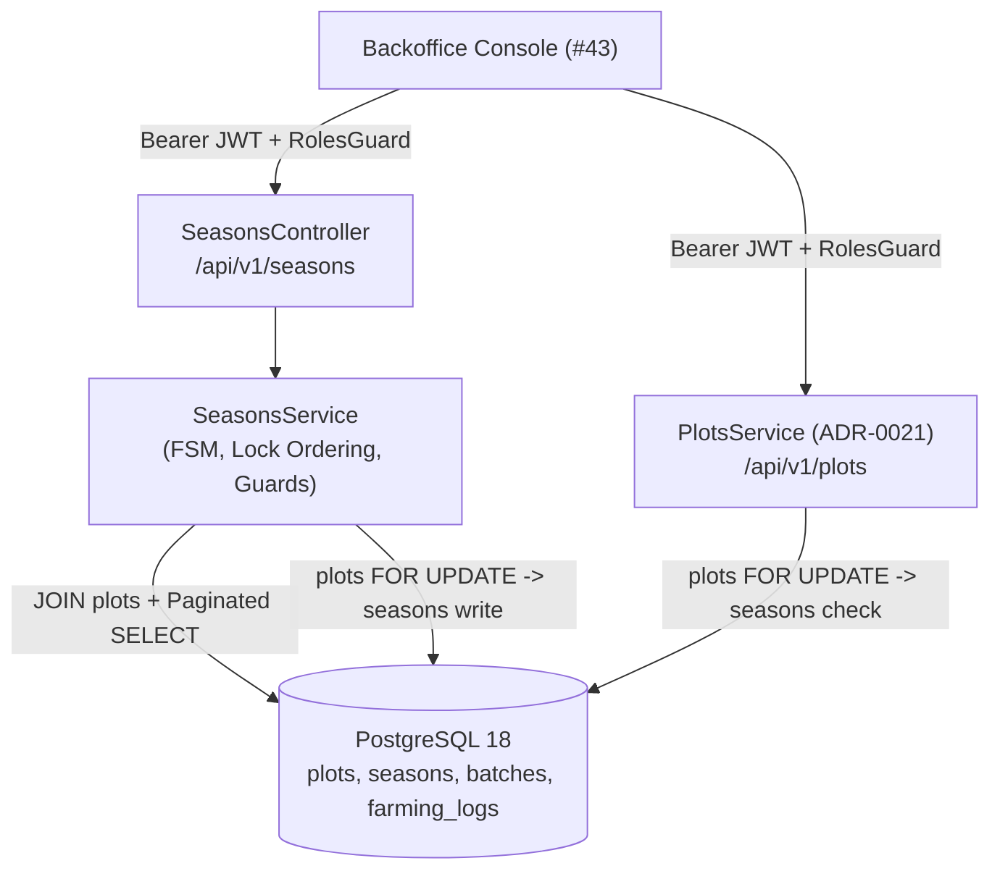
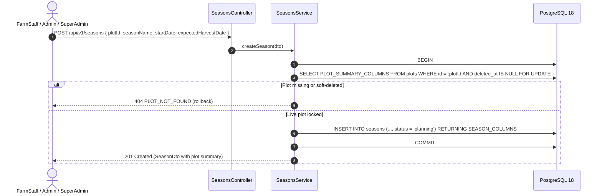
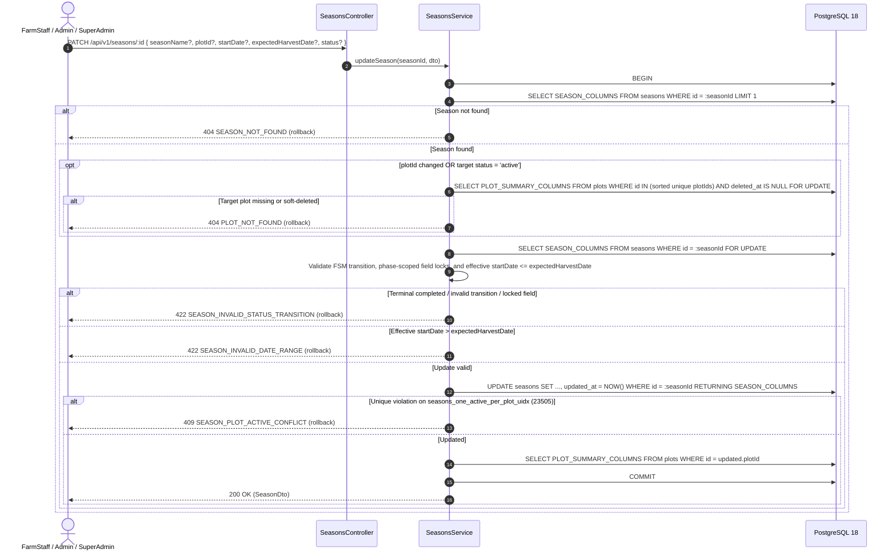
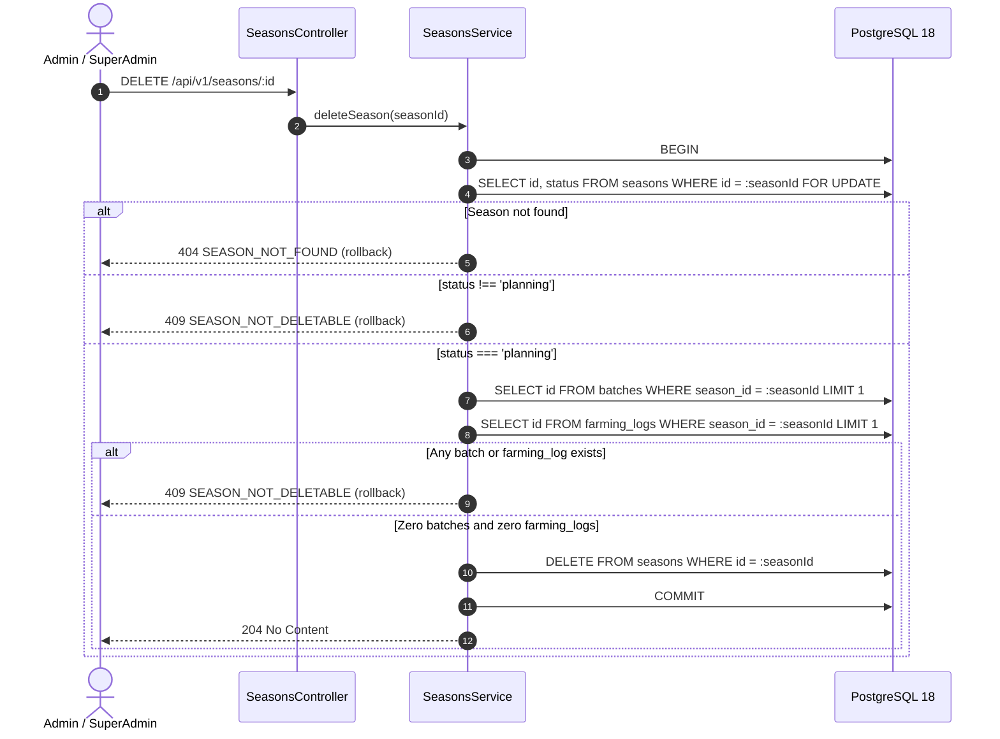

# Season Lifecycle Formal Specification

## Overview & Context

This specification defines the cultivation season lifecycle endpoints introduced by #79 (split from #19; parent epic #8; Backoffice consumer #43; downstream consumers #20 and #82) in `apps/api/src/modules/farms`. Architectural decisions are recorded in ADR-0022; schema invariants follow ADR-0005; soft-delete visibility follows ADR-0003; DTO co-location, envelopes, and RFC 9457 error contracts follow ADR-0011, ADR-0012, and ADR-0013; lock ordering against `plots` follows ADR-0021.

`apps/api/src/database/schemas/farm.schema.ts` already defines `seasons` (`id`, `plotId`, `seasonName`, `startDate`, `expectedHarvestDate`, `status`, `createdAt`, `updatedAt`) and `SeasonStatus` in `@greenroots/shared` (`planning`, `active`, `harvested`, `completed`). However, `apps/api/src/modules/farms` exposes no season endpoints, `seasons` lacks a database `CHECK (start_date <= expected_harvest_date)` constraint and a single-active-season-per-plot partial unique index, and `farming_logs` carries `ON DELETE CASCADE` with an immutable delete trigger that must be guarded before `DELETE /api/v1/seasons/:id`.

### Goals

- Expose `GET /api/v1/seasons` (paginated, filtered by `status`, `plotId`, and `q`, sorted via whitelist) and `GET /api/v1/seasons/:id` for `farm_staff`, `admin`, and `super_admin`, always including a closed `plot` summary projection (even when the historical plot was later soft-deleted).
- Expose `POST /api/v1/seasons` (`farm_staff`, `admin`, `super_admin`) creating a season in initial `planning` status linked to a live (`deleted_at IS NULL`) plot with `startDate <= expectedHarvestDate` (`YYYY-MM-DD`).
- Expose `PATCH /api/v1/seasons/:id` (`farm_staff`, `admin`, `super_admin`) enforcing the linear transition matrix (`planning -> active -> harvested -> completed`), phase-scoped field mutability, terminal immutability on `completed`, and the single-active-season-per-plot invariant.
- Expose `DELETE /api/v1/seasons/:id` (`admin`, `super_admin`) deleting only `planning` seasons with zero linked `batches` and zero linked `farming_logs`, returning `204 No Content` on success, `404` when missing, and `409` on any non-deletable state or dependency.
- Add DB-level `CHECK (start_date <= expected_harvest_date)` and partial unique index `seasons_one_active_per_plot_uidx` via one forward-only migration, and propagate contracts via `bun run types:sync`.

### Non-Goals

- Farming action logs (`#20`), batch intake (`#82`), or harvest yield calculations.
- Season analytics, revenue attribution, or separating `cropName` from `seasonName`.
- Soft delete or archiving mechanism for seasons (`seasons` is excluded from ADR-0003 soft-delete tables).
- `sales` role read access to seasons (deferred unless a future sales/pre-order screen requires it).

## Architecture

Symbols and module layout:

- `FARMS_ROUTES` in `apps/api/src/modules/farms/farms.routes.ts` adds frozen route constants (`SEASONS_BASE`: `"seasons"`, `SEASON_BY_ID`: `":id"`).
- `SeasonsController` in `apps/api/src/modules/farms/seasons.controller.ts` exposes `GET`, `POST`, `GET :id`, `PATCH :id`, and `DELETE :id` under `/api/v1/seasons`, declaring class-level `@ApiBadRequestResponseRfc9457()` and `@ApiInternalServerErrorResponseRfc9457()`.
- `SeasonsService` in `apps/api/src/modules/farms/seasons.service.ts` owns `SEASON_COLUMNS` and `SEASON_PLOT_SUMMARY_COLUMNS` closed projections, `plots -> seasons` `FOR UPDATE` lock ordering, transition and field-mutability validation, `23505` / `23514` constraint mapping, and transactional delete guards.
- `FarmsModule` in `apps/api/src/modules/farms/farms.module.ts` registers `SeasonsController` and `SeasonsService` (and exports `SeasonsService`).
- `farms.interface.ts` in `apps/api/src/modules/farms/farms.interface.ts` defines compile-time constants (`SEASON_SORT_OPTIONS`, `SeasonSortOption`, `SEASON_ALLOWED_TRANSITIONS`) without runtime Zod schemas (per ADR-0011).
- `apps/api/src/modules/farms/dto/` holds co-located Zod schemas and `createZodDto()` classes (`season.dto.ts`, `create-season.dto.ts`, `update-season.dto.ts`, `list-seasons-query.dto.ts`).
- `apps/api/src/common/schemas/zod-primitives.ts` provides `zIsoDate()` for strict calendar `YYYY-MM-DD` validation.
- `@greenroots/shared` (`packages/shared/src/error-dictionary.ts` and `packages/shared/GLOSSARY.md`) registers the five `SEASON_*` RFC 9457 error codes and updates the `Season` glossary definition.

## Operational Flow

### 1. Create Season (`planning`) with Live Plot Lock

### 2. Update Season & Linear State Machine (`PATCH /api/v1/seasons/:id`)

Note on lock ordering in step 4–7: `SeasonsService` acquires `plots ... FOR UPDATE` **before** `seasons ... FOR UPDATE` so every transaction touching both tables respects the `plots -> seasons` lock order defined in ADR-0021. If `plotId` is modified on a `planning` season, both the current `plotId` and the new `plotId` are locked in a single `WHERE id IN (...) ORDER BY id ASC FOR UPDATE` statement. After locking `seasons ... FOR UPDATE`, `SeasonsService` re-validates the transition against the locked row's latest persisted `status` and dates so concurrent `PATCH` calls cannot race past stale pre-lock state.

### 3. Delete Season Guard (`DELETE /api/v1/seasons/:id`)

### State Transition & Mutability Matrix

| Current Status | Allowed Target Status         | Mutable Fields on `PATCH`                                  | Rejected Mutations (`422`)                                                                                        |
| :------------- | :---------------------------- | :--------------------------------------------------------- | :---------------------------------------------------------------------------------------------------------------- |
| `planning`     | `planning` (no-op), `active`  | `seasonName`, `plotId`, `startDate`, `expectedHarvestDate` | `harvested`, `completed`                                                                                          |
| `active`       | `active` (no-op), `harvested` | `seasonName`, `expectedHarvestDate`                        | `planning`, `completed`, `plotId`, `startDate`                                                                    |
| `harvested`    | `completed`                   | None (`status` only)                                       | `planning`, `active`, `harvested` (no mutable fields), `seasonName`, `plotId`, `startDate`, `expectedHarvestDate` |
| `completed`    | None (terminal)               | None                                                       | All `PATCH` payloads                                                                                              |

## API Contract

### Endpoints

| Method & Path                | Allowed Roles                        | Success                                    | Additional RFC 9457 Errors                                                                                                                                                 | Notes                                                            |
| :--------------------------- | :----------------------------------- | :----------------------------------------- | :------------------------------------------------------------------------------------------------------------------------------------------------------------------------- | :--------------------------------------------------------------- |
| `GET /api/v1/seasons`        | `farm_staff`, `admin`, `super_admin` | `200` `PaginatedApiResponseDto<SeasonDto>` | `401`, `403`                                                                                                                                                               | Filters: `status`, `plotId`, `q`; always includes `plot`         |
| `GET /api/v1/seasons/:id`    | `farm_staff`, `admin`, `super_admin` | `200` `ApiResponseDto<SeasonDto>`          | `401`, `403`, `404` (`SEASON_NOT_FOUND`)                                                                                                                                   | UUIDv7 `:id`; includes `plot` even if plot was soft-deleted      |
| `POST /api/v1/seasons`       | `farm_staff`, `admin`, `super_admin` | `201` `ApiResponseDto<SeasonDto>`          | `401`, `403`, `404` (`PLOT_NOT_FOUND`)                                                                                                                                     | Always initializes `status = "planning"` server-side             |
| `PATCH /api/v1/seasons/:id`  | `farm_staff`, `admin`, `super_admin` | `200` `ApiResponseDto<SeasonDto>`          | `401`, `403`, `404` (`SEASON_NOT_FOUND`, `PLOT_NOT_FOUND`), `409` (`SEASON_PLOT_ACTIVE_CONFLICT`), `422` (`SEASON_INVALID_STATUS_TRANSITION`, `SEASON_INVALID_DATE_RANGE`) | Validates FSM, field locks, and effective date range             |
| `DELETE /api/v1/seasons/:id` | `admin`, `super_admin`               | `204` No Content                           | `401`, `403`, `404` (`SEASON_NOT_FOUND`), `409` (`SEASON_NOT_DELETABLE`)                                                                                                   | Hard delete only for `planning` without `batches`/`farming_logs` |

### DTOs, Projections & Validation Rules

All request DTOs use `.strict()` so unknown keys fail with `400 VALIDATION_FAILED` (`UNRECOGNIZED_KEYS`). Path parameter `:id` uses `ZodValidationPipe(zUuidV7())`.

1. **`SeasonPlotSummaryDto`** (nested closed projection on `SeasonDto`):
   - `id` (`zUuidV7()`), `plotCode` (`string`), `name` (`string`), `areaSqm` (`number` parsed from `numeric(10, 2)`), `deletedAt` (`z.iso.datetime().nullable()`).
   - Excludes heavy lab JSONB (`soilTestResult`, `waterTestResult`) to keep season listings lightweight.
2. **`SeasonDto`** (`SEASON_COLUMNS` closed projection + `plot` summary):
   - `id`, `plotId`, `seasonName`, `startDate` (`YYYY-MM-DD`), `expectedHarvestDate` (`YYYY-MM-DD`), `status` (`SeasonStatus`), `plot` (`SeasonPlotSummaryDto`), `createdAt`, `updatedAt`.
3. **`ListSeasonsQueryDto`** (`.strict()`):
   - `status`: optional `z.enum(SeasonStatus)`.
   - `plotId`: optional `zUuidV7()`.
   - `q`: optional `zSanitizedString({ min: 1, max: 100 })` matching `seasonName` (`ILIKE` with `%`, `_`, `\` escaped).
   - `page`: `zNumericString({ integer: true, min: 1 }).default(1)`.
   - `limit`: `zNumericString({ integer: true, min: 1, max: 100 }).default(20)`.
   - `sort`: whitelist enum `createdAt:desc` (default), `createdAt:asc`, `startDate:desc`, `startDate:asc`, `expectedHarvestDate:asc`, `expectedHarvestDate:desc`, with deterministic tie-breaker `seasons.id DESC`.
4. **`CreateSeasonDto`** (`.strict()`):
   - `plotId`: `zUuidV7()`.
   - `seasonName`: `zSanitizedString({ min: 1, max: 255 })`.
   - `startDate`: `zIsoDate()` (strict `YYYY-MM-DD` real calendar date).
   - `expectedHarvestDate`: `zIsoDate()`.
   - `.refine((d) => d.startDate <= d.expectedHarvestDate)` targeting path `["expectedHarvestDate"]` (`400 VALIDATION_FAILED`).
   - Does not accept `status` (server initializes `SeasonStatus.PLANNING`; extra keys rejected by `.strict()`).
5. **`UpdateSeasonDto`** (`.strict()`, requires at least one defined key -> `400` `MESSAGES.VALIDATION.AT_LEAST_ONE_SEASON_FIELD`):
   - `plotId`: optional `zUuidV7()`.
   - `seasonName`: optional `zSanitizedString({ min: 1, max: 255 })`.
   - `startDate`: optional `zIsoDate()`.
   - `expectedHarvestDate`: optional `zIsoDate()`.
   - `status`: optional `z.enum(SeasonStatus)`.
   - If both `startDate` and `expectedHarvestDate` are supplied and `startDate > expectedHarvestDate`, DTO refinement rejects with `400 VALIDATION_FAILED`; if only one date is supplied and violates the persisted counterpart, `SeasonsService` rejects with `422 SEASON_INVALID_DATE_RANGE`.

### Shared Contracts, Error Codes & Migration

- `@greenroots/shared` (`packages/shared/src/error-dictionary.ts`):
  - Add `SEASON_NOT_FOUND` (`404`), `SEASON_INVALID_STATUS_TRANSITION` (`422`), `SEASON_INVALID_DATE_RANGE` (`422`), `SEASON_PLOT_ACTIVE_CONFLICT` (`409`), and `SEASON_NOT_DELETABLE` (`409`) with Vietnamese copy in `API_ERROR_DICTIONARY`.
- `apps/api/src/common/constants/messages.constant.ts`:
  - Add `MESSAGES.SEASONS` developer English messages (`NOT_FOUND`, `INVALID_STATUS_TRANSITION`, `COMPLETED_IMMUTABLE`, `FIELD_LOCKED`, `INVALID_DATE_RANGE`, `PLOT_ACTIVE_CONFLICT`, `NOT_DELETABLE_STATUS`, `NOT_DELETABLE_BATCHES`, `NOT_DELETABLE_LOGS`) and `MESSAGES.VALIDATION.AT_LEAST_ONE_SEASON_FIELD` / `INVALID_CALENDAR_DATE`.
- Database schema & migration (`apps/api/src/database/schemas/farm.schema.ts`):
  - Add `uniqueIndex("seasons_one_active_per_plot_uidx").on(table.plotId).where(sql\`${table.status} = 'active'\`)`.
  - Add `check("seasons_date_range_valid_chk", sql\`${table.startDate} <= ${table.expectedHarvestDate}\`)`.
  - Generate one forward-only migration per `docs/standards/database-and-migrations.md` §5.

## Security & Reliability

### Role Matrix

| Action                                               | `guest` / `customer` | `sales` | `farm_staff` | `admin` | `super_admin` |
| :--------------------------------------------------- | :------------------: | :-----: | :----------: | :-----: | :-----------: |
| `GET /api/v1/seasons` & `GET /api/v1/seasons/:id`    |          —           |    —    |     Yes      |   Yes   |      Yes      |
| `POST /api/v1/seasons` & `PATCH /api/v1/seasons/:id` |          —           |    —    |     Yes      |   Yes   |      Yes      |
| `DELETE /api/v1/seasons/:id`                         |          —           |    —    |      —       |   Yes   |      Yes      |

### Controls

- **Authorization**: Every route carries `@ApiAuth(...)` (`JwtAuthGuard` + `RolesGuard`). Unauthenticated callers receive `401`; unauthorized roles (including `sales`) receive `403`.
- **Deadlock-free locking & concurrency**:
  - `POST /api/v1/seasons` and `PATCH /api/v1/seasons/:id` always lock `plots` before `seasons` (`plots -> seasons`), matching `PlotsService.deletePlot` (ADR-0021) so `DELETE /plots/:id` and season creation/activation serialize cleanly without deadlocks.
  - When changing `plotId` on a `planning` season, `SeasonsService` locks all involved `plots` rows ordered ascending by `id` (`ORDER BY id ASC FOR UPDATE`) in a single query (`concurrency-and-locking.md` §2).
  - Re-reading `seasons ... FOR UPDATE` inside the transaction prevents TOCTOU races on simultaneous `PATCH` transitions (`planning -> active` vs `DELETE`, or dual `active -> harvested`).
- **Database authority**: Even if concurrent transactions race or an out-of-band script writes directly, `seasons_one_active_per_plot_uidx` (`23505`) and `seasons_date_range_valid_chk` (`23514`) remain authoritative. `SeasonsService` maps `23505` on `seasons_one_active_per_plot_uidx` to `409 SEASON_PLOT_ACTIVE_CONFLICT` and `23514` on `seasons_date_range_valid_chk` to `422 SEASON_INVALID_DATE_RANGE`.
- **Safe projections & query hygiene**: All queries use explicit `SEASON_COLUMNS` / `SEASON_PLOT_SUMMARY_COLUMNS`, escape SQL `LIKE` wildcards (`%`, `_`, `\`), and bind parameters through Drizzle.
- **Rate limiting**: Standard `CustomThrottlerGuard` `default` tier (`100 req / 60s`).

## Domain Invariant Taxonomy

| Invariant      | Name                           | Formal Statement                                                                                                                 | Enforcement Seam                                                                  | Verification Test                                                                                 |
| :------------- | :----------------------------- | :------------------------------------------------------------------------------------------------------------------------------- | :-------------------------------------------------------------------------------- | :------------------------------------------------------------------------------------------------ |
| `INV-SEASON-1` | Linear Lifecycle State Machine | A season may only transition forward along `planning -> active -> harvested -> completed`; `completed` is terminal and immutable | `SeasonsService.updateSeason` under `seasons ... FOR UPDATE`                      | Skipped, reversed, or post-`completed` `PATCH` -> `422 SEASON_INVALID_STATUS_TRANSITION`          |
| `INV-SEASON-2` | Phase-Scoped Field Mutability  | `plotId` and `startDate` are immutable once `status` leaves `planning`; `harvested` locks all metadata fields                    | `SeasonsService.updateSeason` mutability guard                                    | Editing `plotId` or `startDate` in `active`/`harvested` -> `422`                                  |
| `INV-SEASON-3` | Single Active Season Per Plot  | At most one season with `status = 'active'` may reference a given `plot_id` at any instant                                       | `seasons_one_active_per_plot_uidx` + `23505` mapping under `plots` lock           | Activating a second season on same plot -> `409 SEASON_PLOT_ACTIVE_CONFLICT`                      |
| `INV-SEASON-4` | Valid Calendar Date Range      | `start_date <= expected_harvest_date` holds for every persisted season row using strict `YYYY-MM-DD` calendar dates              | `CreateSeasonDto`/`UpdateSeasonDto` (`zIsoDate`) + `seasons_date_range_valid_chk` | `POST` inverted dates -> `400`; partial `PATCH` inverted dates -> `422 SEASON_INVALID_DATE_RANGE` |
| `INV-SEASON-5` | Live Plot Linkage              | Creating a season or changing its `plotId` requires an existing plot with `deleted_at IS NULL`, locked `plots -> seasons`        | `SeasonsService` (`plots WHERE deleted_at IS NULL FOR UPDATE`)                    | Soft-deleted or unknown `plotId` -> `404 PLOT_NOT_FOUND`                                          |
| `INV-SEASON-6` | Planning-Only Delete Guard     | `DELETE /seasons/:id` succeeds only if `status === 'planning'`, `batches` count is `0`, and `farming_logs` count is `0`          | `SeasonsService.deleteSeason` (`FOR UPDATE` + `batches` & `farming_logs`)         | Non-`planning`, has batch, or has farming log -> `409 SEASON_NOT_DELETABLE`                       |

### Edge Cases (`EDGE-1..14`)

| ID        | Case                                                                                                          | Expected Behaviour                                                              |
| :-------- | :------------------------------------------------------------------------------------------------------------ | :------------------------------------------------------------------------------ |
| `EDGE-1`  | `GET` / `POST` / `PATCH /api/v1/seasons*` called by `sales`, `customer`, or `guest`                           | `403 FORBIDDEN` (`sales`/`customer`) or `401 UNAUTHORIZED` (`guest`)            |
| `EDGE-2`  | `DELETE /api/v1/seasons/:id` called by `farm_staff`                                                           | `403 FORBIDDEN` (`admin` / `super_admin` only)                                  |
| `EDGE-3`  | `POST /api/v1/seasons` includes `status: "active"` or unknown extra field                                     | `400 VALIDATION_FAILED` (`UNRECOGNIZED_KEYS`)                                   |
| `EDGE-4`  | `POST /api/v1/seasons` with invalid calendar date `"2026-02-30"` or ISO datetime `"2026-09-01T00:00:00Z"`     | `400 VALIDATION_FAILED` (`INVALID_FORMAT`)                                      |
| `EDGE-5`  | `POST /api/v1/seasons` with `startDate === expectedHarvestDate` (single-day crop cycle boundary)              | `201 Created` (`startDate <= expectedHarvestDate` satisfied)                    |
| `EDGE-6`  | `POST /api/v1/seasons` with `startDate > expectedHarvestDate`                                                 | `400 VALIDATION_FAILED` (`invalidParams[0].name = "expectedHarvestDate"`)       |
| `EDGE-7`  | `POST /api/v1/seasons` linking a soft-deleted `plotId`                                                        | `404 PLOT_NOT_FOUND`                                                            |
| `EDGE-8`  | `GET /api/v1/seasons` / `GET /seasons/:id` for a `completed` season whose plot was later soft-deleted         | `200 OK`; returns season with `plot.deletedAt !== null`                         |
| `EDGE-9`  | `GET /api/v1/seasons?q=100%` (SQL wildcard characters in `q`)                                                 | `%`, `_`, `\` escaped; matches literal substring safely                         |
| `EDGE-10` | `PATCH /api/v1/seasons/:id` with `{}` (empty body) or unknown `:id` non-UUIDv7                                | `400 VALIDATION_FAILED`                                                         |
| `EDGE-11` | `PATCH /api/v1/seasons/:id` sending `startDate` later than persisted `expectedHarvestDate`                    | `422 SEASON_INVALID_DATE_RANGE`                                                 |
| `EDGE-12` | `PATCH /api/v1/seasons/:id` sending `{ status: "active", expectedHarvestDate: "..." }` while already `active` | `200 OK` (no-op same-status allowed in `active`, updates `expectedHarvestDate`) |
| `EDGE-13` | `PATCH /api/v1/seasons/:id` sending `{ status: "completed" }` when already `completed`                        | `422 SEASON_INVALID_STATUS_TRANSITION` (`completed` is terminal immutable)      |
| `EDGE-14` | `DELETE /api/v1/seasons/:id` when `:id` does not exist                                                        | `404 SEASON_NOT_FOUND`                                                          |

### Concurrency & Adversarial Matrix (`ADV-1..5`)

| ID      | Scenario                                                                                                                      | Expected Behaviour                                                                                                                                                                                         |
| :------ | :---------------------------------------------------------------------------------------------------------------------------- | :--------------------------------------------------------------------------------------------------------------------------------------------------------------------------------------------------------- |
| `ADV-1` | Two concurrent `PATCH /seasons/:id` activating two different `planning` seasons on the same plot (`Promise.all`)              | Serialized by `plots` `FOR UPDATE` + `seasons_one_active_per_plot_uidx`; one returns `200`, the other returns `409 SEASON_PLOT_ACTIVE_CONFLICT`                                                            |
| `ADV-2` | Concurrent `POST /seasons` (or `PATCH` `plotId`) and `DELETE /plots/:id` on the same `planning`-only plot                     | Both lock `plots` (`FOR UPDATE`) in `plots -> seasons` order; either `POST` sees soft-deleted plot (`404`) or `DELETE` sees new season (`409 PLOT_HAS_ACTIVE_SEASONS`), zero deadlocks or orphaned seasons |
| `ADV-3` | Concurrent `DELETE /seasons/:id` and `PATCH /seasons/:id` (`planning -> active`) on the same season                           | Both acquire `seasons ... FOR UPDATE`; either `DELETE` commits (`204`) and `PATCH` returns `404`, or `PATCH` activates (`200`) and `DELETE` returns `409 SEASON_NOT_DELETABLE`                             |
| `ADV-4` | Two concurrent `PATCH /seasons/:id` swapping `plotId` of two `planning` seasons in opposite directions (`A -> B` vs `B -> A`) | Each locks both plots sorted ascending by UUID in one query, preventing cross-transaction deadlocks (`40P01`)                                                                                              |
| `ADV-5` | `DELETE /seasons/:id` on a `planning` season that already has a `farming_logs` row (triggering `ON DELETE CASCADE` hazard)    | Pre-delete guard detects the `farming_logs` row under `seasons ... FOR UPDATE` and returns `409 SEASON_NOT_DELETABLE` before touching `DELETE FROM seasons` (never `403 FARMING_LOG_IMMUTABLE`)            |

## Test Matrix

- **Factories & Mothers (`apps/api/test/factories/`)**:
  - `createSeason(db, overrides)` / `SeasonMother.planning()` / `SeasonMother.active()` / `SeasonMother.harvested()` / `SeasonMother.completed()`.
  - Test helpers for inserting minimal `batches` and `farmingLogs` linked to a season to exercise `INV-SEASON-6` and `ADV-5` without waiting for `#20` / `#82` HTTP endpoints.
- **Unit specs**:
  - `SeasonsService` (`seasons.service.spec.ts`): transition matrix (`planning -> active -> harvested -> completed` + all skipped/reversed rejections), phase-scoped field locks, `LIKE` wildcard escaping, and DB error code mapping (`23505`, `23514`).
  - `zIsoDate` (`zod-primitives.spec.ts`): valid leap years (`2024-02-29`), invalid calendar dates (`2026-02-30`, `2025-02-29`, `2026-13-01`), and rejection of ISO datetime timestamps.
- **E2E Integration suite (`apps/api/test/integration/seasons.spec.ts`)**:
  - Full RBAC matrix (`guest`, `customer`, `sales`, `farm_staff`, `admin`, `super_admin`) across `GET`, `POST`, `PATCH`, `DELETE`.
  - `GET /seasons` & `GET /seasons/:id`: pagination, `status` filter, `plotId` filter, `q` wildcard escaping, whitelisted `sort`, and plot inclusion for both live and post-harvest soft-deleted plots (`EDGE-8`).
  - `POST /seasons`: `planning` initialization, inverted dates (`400`), invalid calendar date (`400`), soft-deleted plot (`404`), and `seasons_date_range_valid_chk` DB-level `23514` check (`422`).
  - `PATCH /seasons/:id`: complete 4x4 transition matrix (`422` for skipped/reversed/`completed`), phase-locked `plotId`/`startDate` in `active`/`harvested` (`422`), partial date-range inversion (`422`), same-status no-op in `planning`/`active` (`200`), and `409 SEASON_PLOT_ACTIVE_CONFLICT`.
  - `DELETE /seasons/:id`: `204` for clean `planning` season, `404` for unknown ID, `409 SEASON_NOT_DELETABLE` for `active`/`harvested`/`completed`, `planning` with a `batch`, and `planning` with a `farming_log` (`ADV-5`).
  - `Promise.all` concurrency tests covering `ADV-1`, `ADV-2`, `ADV-3`, and `ADV-4`.
- **Contract propagation**: run `bun run types:sync`, `bun run check`, `bun run test`, and `bun run test:e2e` after implementation and commit generated OpenAPI/type artifacts.

## Risks & Rollback

- **Existing seeded or dirty rows violating new DB constraints**: If any environment holds a `seasons` row with `start_date > expected_harvest_date` or two `active` seasons on the same `plot_id`, migration fails on index/check creation. Mitigation: verify `tier2-catalog.seeder.ts` (already 1 `active` per plot with valid dates) and run pre-migration audit query in staging/production before applying.
- **Downstream coupling with `#20` and `#82`**: Once `#20` implements `POST /api/v1/seasons/:id/logs`, `#20` must decide whether `soil_testing` logs are allowed during `planning`; regardless of that choice, `INV-SEASON-6` guarantees `DELETE /seasons/:id` never leaks `403 FARMING_LOG_IMMUTABLE`.
- **Rollback**: Revert application changes and re-run `bun run types:sync`; to roll back database constraints in non-production environments, issue a forward compensating migration dropping `seasons_one_active_per_plot_uidx` and `seasons_date_range_valid_chk`.
