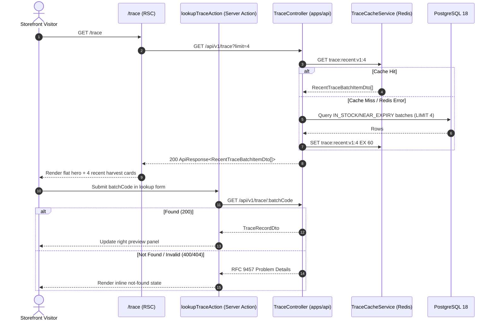

# SF-03 Storefront QR Traceability Lookup & Detail Formal Specification

## Overview & Context

This specification defines the end-to-end live integration and layout alignment for the Storefront QR traceability pages (`/trace` and `/trace/[batchCode]`), replacing hardcoded `SHOWCASE_TRACE_RECORDS` and the legacy flat `BatchTraceRecord` mock contract in `apps/storefront` with real PostgreSQL/Redis-backed data from `apps/api`.

Architectural foundations follow ADR-0024 (`docs/adr/0024-public-qr-traceability-cache-and-projection-boundary.md`), `docs/design/qr-traceability-formal-spec.md`, `docs/standards/api-design-and-error-handling.md`, and `docs/standards/ui-and-frontend.md`.

### Current Gaps

1. **Missing public recent-batches endpoint**: `TraceController` (`apps/api/src/modules/farms/trace.controller.ts`) only exposes `GET /api/v1/trace/:batchCode`. `GET /api/v1/batches` (`BatchesController`) is staff-authenticated and exposes internal stock counts (`initialQuantity`, `availableQuantity`).
2. **Mock data in Storefront**: `apps/storefront/app/(main)/trace/page.tsx` and `apps/storefront/app/(main)/trace/[batchCode]/page.tsx` call `getShowcaseTraceList()` and `getShowcaseTraceByCode()` from `apps/storefront/src/services/trace.service.ts` (`SHOWCASE_TRACE_RECORDS`).
3. **Contract mismatch**: `apps/storefront/src/types/trace.types.ts` (`BatchTraceRecord`) and `TraceView` still expect a flat mock shape (`unitLabel`, `soilPh`, `waterPh`, `heavyMetalsPass`, `engineerName`) instead of the nested `TraceRecordDto` (`batch`, `product`, `farm`, `plot`, `season`, `farmingLogs`) mandated by ADR-0024.
4. **Layout divergence on `/trace`**: `TraceLookupContent` wraps the hero in a `<Card>` with extra badges (`"Nhật ký canh tác bất biến"`, `"Hợp lệ"`), sample chips (`"Mã lô mẫu:"`), and `<Sprout />` icon placeholders instead of the flat, divider-driven layout and real product thumbnails specified in `/home/ngxc/Downloads/tra_c_u_ngu_n_g_c_qr.html`.

### Goals

- Add a public, redacted recent-batches listing endpoint `GET /api/v1/trace` (`limit` default `4`, max `12`) to `TraceController` with 60s Redis caching (`trace:recent:v1:<limit>`), singleflight miss coalescing, and fail-open PostgreSQL fallback.
- Sync OpenAPI TypeScript contracts to `apps/storefront/src/types/api-schema.d.ts` via `bun run types:sync`.
- Remove all mock data (`SHOWCASE_TRACE_RECORDS`) and flat `BatchTraceRecord` types from `apps/storefront`.
- Align `/trace` (`TraceLookupContent` + `TraceLookupView`) with the flat, divider-driven mockup layout, real product thumbnails (`filterApprovedProductImages` + `<Sprout />` fallback), and inline Server Action lookup (`#trace-not-found` on miss, preview card on hit).
- Update `/trace/[batchCode]` (`TraceView`) to consume `TraceRecordDto` directly, including nullable `soilTestResult`, `waterTestResult`, `certificationUrl`, and `correctsLog`/`correctedBy` timeline linkage.

### Non-Goals

- Changing `GET /api/v1/trace/:batchCode` projection shape or ADR-0024 invalidation semantics.
- Adding pagination or infinite scroll to the `/trace` recent harvests grid (capped at 4 items on `/trace`, API max 12).
- Exposing `initialQuantity`, `availableQuantity`, `waste_logs`, `farms.bankInfo`, or staff `users.id` UUIDs on any public endpoint.

---

## Architecture & Data Flow

---

## API Contract (`apps/api`)

### `GET /api/v1/trace`

- **Auth & Rate Limit**: `@Public()`, `@SkipThrottle({ default: true, auth: true })`, `@Throttle({ public: { limit: 300, ttl: 60000 } })`, `@Header("Cache-Control", "no-cache")`.
- **Query DTO (`ListRecentTraceQueryDto`)**:
  - `limit`: optional integer coerced from string, default `4`, min `1`, max `12`.
- **Filtering & Ordering**:
  - `batches.status IN (BatchStatus.IN_STOCK, BatchStatus.NEAR_EXPIRY)`
  - `products.deletedAt IS NULL` AND `plots.deletedAt IS NULL`
  - `ORDER BY batches.harvestDate DESC, batches.createdAt DESC LIMIT :limit`
  - Note: `GET /api/v1/trace/:batchCode` continues to resolve all historical batches including `sold_out`, `expired`, and soft-deleted `product`/`plot` per ADR-0024.
- **Response Projection (`RecentTraceBatchItemDto`)**:
  - `batchCode: string`
  - `harvestDate: string` (ISO-8601 datetime)
  - `status: BatchStatus`
  - `product`: `{ name: string, unit: string, imageUrls: string[] }`
  - `plot`: `{ plotCode: string, name: string }`
- **Caching (`TraceCacheService`)**:
  - Key: `trace:recent:v1:<limit>`, TTL: `60` seconds.
  - In-process singleflight `Map<number, Promise<RecentTraceBatchItemProjection[]>>` in `TraceService`.
  - Fail-open to PostgreSQL if Redis is unavailable.

---

## Storefront Behavior & UI Parity (`apps/storefront`)

1. **Hero Section (`/trace`)**:
   - Flat 12-column grid (`border-b border-border-subtle pb-8 lg:grid-cols-12 lg:gap-8`) without outer `<Card>` wrapper.
   - Left (`lg:col-span-7`): `<h1>` `"Tra cứu nguồn gốc từ nông trại"`, subtitle, and lookup form.
   - Accessibility invariant: `<Label htmlFor={batchCodeInputId}>` MUST remain placed outside `<InputGroup data-slot="input-group">` to satisfy `ui-primitives-semantics.spec.ts`.
   - Right (`lg:col-span-5 lg:border-l lg:border-border-subtle lg:pl-8`):
     - When a record is active: flat preview (no box border) showing product thumbnail (`size-14 rounded-md object-cover`, fallback `<Sprout />` on `bg-light-primary-container`), `batchCode` (`font-mono`), `product.name (product.unit)`, 2-column `divide-x border-y` grid (`Thu hoạch` formatted in `Asia/Ho_Chi_Minh`, `Khu vực` = `plot.name`), and `<Link href="/trace/[batchCode]">` button `"Xem nhật ký chi tiết"`.
     - When lookup fails (`400`/`404`): inline error container (`bg-light-error-container text-light-on-error-container rounded-lg p-6`) matching `#trace-not-found` in mockup.
     - When `records.length === 0` and no search performed yet: clean instructional empty state.
2. **Recent Harvested Batches Grid (`/trace`)**:
   - 4-column responsive grid (`grid-cols-1 sm:grid-cols-2 lg:grid-cols-4 gap-4`).
   - Each card uses `bg-surface-warm rounded-lg overflow-hidden flex flex-col h-full` with `h-40` cover image (or `<Sprout />` fallback), `batchCode`, `product.name (product.unit)`, `Thu hoạch <date> · <plot.plotCode>`, and `"Xem nhật ký"` `<Link>` to `/trace/[batchCode]`.
3. **Trace Detail (`/trace/[batchCode]`)**:
   - Server Component fetches `GET /api/v1/trace/{batchCode}` via `trace.service.ts`.
   - `TraceView` renders `TraceRecordDto` fields directly, gracefully handling `null` `soilTestResult`, `waterTestResult`, and `certificationUrl`, plus `correctsLog` / `correctedBy` references.

---

## Verification Plan

- **API Unit & E2E**: `TraceService` + `TraceCacheService` unit specs for `listRecentBatches`, plus E2E verification for `GET /api/v1/trace` and `GET /api/v1/trace/:batchCode`.
- **Type Sync & Checks**: `bun run types:sync`, `bun run check`, `bun run test`.
- **Storefront Tests**: `ui-primitives-semantics.spec.ts` and new `trace.service.spec.ts` covering real API mapping, `404`/`400` handling, and fail-open empty list.
