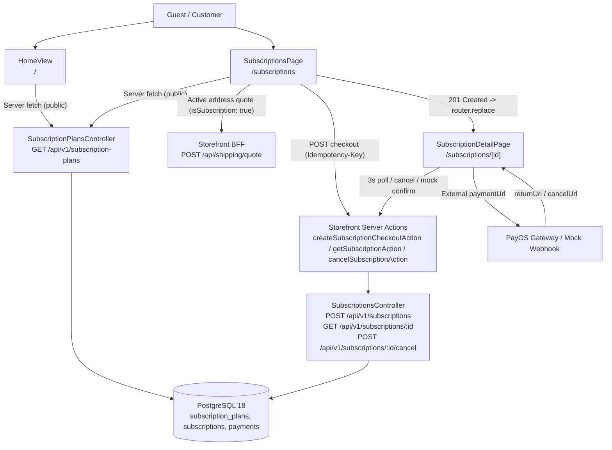
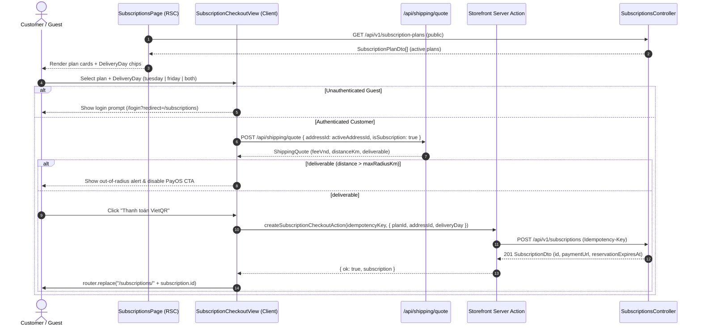

# SF-04 Subscription Plan Selection, Checkout & Pending Cancellation Formal Specification

## Overview & Context

This specification defines the end-to-end architecture, API prerequisite, UI-to-contract mapping, security boundaries, and domain invariants for Storefront `SF-04` (Subscription Plan Selection, Delivery Schedule, Prepaid Checkout, and PayOS Return Status), resolving `#54` under Epic `#12` (extending `ADR-0018`, `ADR-0030`, `ADR-0036`, `ADR-0038`, `ADR-0041`, and `docs/design/subscription-plans-and-checkout-formal-spec.md`).

### Goals

- **API Prerequisite (`POST /api/v1/subscriptions/:id/cancel`)**: Allow authenticated `UserRole.CUSTOMER` owners to cancel a `SubscriptionStatus.PENDING_PAYMENT` subscription under `subscriptions -> payments` `FOR UPDATE` locking, transitioning it to `CANCELLED`/`FAILED`, clearing `reservationExpiresAt`, and invoking `cancelPaymentLinksBestEffort` post-commit so PayOS cancellation never strands customers against the `3`-pending cap (`INV-SUB-5`).
- **Live Plan Catalog & Schedule Selector (`/subscriptions` & `HomeView`)**: Replace mock `SHOWCASE_PLANS` in `apps/storefront/src/services/subscription.service.ts` with live `GET /api/v1/subscription-plans` (`SubscriptionPlanDto` in `apps/api/src/modules/subscriptions/dto/subscription-plan.dto.ts`) across `apps/storefront/app/(main)/subscriptions/page.tsx` and `apps/storefront/src/features/home/components/home-view.tsx`, matching the flat, divider-driven Stitch UI layout (`g_i_rau_nh_k.html`).
- **Inline Subscription Checkout (`/subscriptions`)**: Support guest auth prompt (`/login?redirect=/subscriptions`), customer saved-address selection via `useDeliveryAddressStore` and `AddressDialog`, single-active-address `POST /api/shipping/quote` (`isSubscription: true`), `Idempotency-Key` UUIDv4 protection on `POST /api/v1/subscriptions`, and `router.replace('/subscriptions/' + id)` on `201 Created`.
- **PayOS Return & Status Page (`/subscriptions/[id]`)**: Implement `apps/storefront/app/(main)/subscriptions/[id]/page.tsx` and `SubscriptionPayosPanel` (analogous to `PayosPaymentPanel` in `apps/storefront/src/features/orders/components/payos-payment-panel.tsx`) to handle `SubscriptionsService` `returnUrl`/`cancelUrl` redirects (`/subscriptions/:id?payment=success|cancelled`), 15-minute `reservationExpiresAt` countdown, 3-second polling, manual/auto cancellation, and non-production mock webhook confirmation.

### Non-Goals

- Active subscription pause, resume, or post-activation cancellation and order-history management (`#31`, `#56`).
- Backoffice subscription plan catalog CRUD UI (`#55`).
- Loyalty point redemption on subscriptions (`ADR-0041` — subscriptions are PayOS-only at full `priceVnd + totalDeliveries * shippingFeePerDeliveryVnd`).
- Fabricating unbacked discount percentages (`Tiết kiệm X%`) or retail savings comparisons not present in `SubscriptionPlanDto` (`ADR-0047` truthfulness alignment).

## Architecture

## Operational Flow

### 1. Plan Selection, Schedule & Inline Checkout (`/subscriptions`)

### 2. PayOS Return, Polling & Pending Cancellation (`/subscriptions/[id]`)

1. **Success / Pending View**: `SubscriptionPayosPanel` reads `GET /api/v1/subscriptions/:id` via `getSubscriptionAction`, renders a live 15-minute countdown from `reservationExpiresAt`, displays the external `paymentUrl` button, polls every `3000ms` while `document.visibilityState === "visible"` and `status === PENDING_PAYMENT`, and transitions immediately to an active confirmation view when `status === ACTIVE`.
2. **Cancelled Return (`?payment=cancelled`) & Manual Cancel**: When PayOS redirects to `/subscriptions/:id?payment=cancelled` or the customer clicks the manual cancel button while `status === PENDING_PAYMENT`, `SubscriptionPayosPanel` invokes `cancelSubscriptionAction(id)` -> `POST /api/v1/subscriptions/:id/cancel`.
3. **API Pending Cancellation Semantics**: `SubscriptionsService.cancelPendingSubscription(customerId, subscriptionId)` locks `subscriptions -> payments` (`FOR UPDATE`), rejects non-`PENDING_PAYMENT` states with `422` (unless already `CANCELLED`, which returns idempotently), sets `subscriptions.status = CANCELLED`, `reservationExpiresAt = null`, `payments.status = CANCELLED`, commits, and runs `cancelPaymentLinksBestEffort` post-commit.

### 3. Mockup-to-Contract Alignment Rules (`g_i_rau_nh_k.html`)

- **Plan Cards**: Replace unbacked `"Tiết kiệm X%"` badges with `{totalDeliveries} chuyến · {weightPerDeliveryKg} kg/chuyến`; compute per-delivery unit price (`Math.round(priceVnd / totalDeliveries)`) and render `basketDescription`; compute week duration dynamically from `DeliveryDay` (`tuesday`/`friday` -> `totalDeliveries` weeks; `both` -> `Math.ceil(totalDeliveries / 2)` weeks).
- **Hub & Rules Copy**: Derive hub label and free-shipping radius from `FARM_METADATA` and `BUSINESS_RULES` instead of hardcoded `"Củ Chi"` text.
- **Address Quote Scoping**: Quote only `activeAddressId` (`isSubscription: true`) via `useShippingQuote` to avoid firing up to 10 concurrent quote requests when hydrating `user_addresses`.

## Security & Reliability

- **RBAC & Anti-Enumeration**: `POST /api/v1/subscriptions/:id/cancel` and `GET /api/v1/subscriptions/:id` require `UserRole.CUSTOMER` and scope queries by `customerId = sub`, returning `404 SUBSCRIPTION_NOT_FOUND` for missing or foreign subscriptions.
- **BFF Session & CSRF**: All Storefront mutations (`createSubscriptionCheckoutAction`, `cancelSubscriptionAction`) execute via Next.js Server Actions wrapped with `runWithServerActionRefresh` (`ADR-0036`), forwarding sanitized client metadata (`ADR-0037`).
- **Idempotency & Retry Safety**: `SubscriptionCheckoutView` caches `idempotencyRef` keyed by `(planId, addressId, deliveryDay)` signature so network retries reuse the same UUIDv4 `Idempotency-Key` (`ADR-0008`, `ADR-0031`).
- **Lock Ordering & External I/O**: `cancelPendingSubscription` strictly locks `subscriptions -> payments` (`FOR UPDATE`) and invokes `cancelPaymentLinksBestEffort` outside the DB transaction (`ADR-0038`, `ADR-0041`).
- **RFC 9457 Error Mapping**: Storefront maps `SUBSCRIPTION_PENDING_LIMIT_REACHED`, `SUBSCRIPTION_PAYOS_DISABLED`, `SUBSCRIPTION_PLAN_INACTIVE`, `OUT_OF_DELIVERY_RADIUS`, and `PAYMENT_GATEWAY_ERROR` through `resolveApiErrorMessage` (`ADR-0013`).

## Domain Invariant Taxonomy

| ID           | Name                             | Invariant Statement                                                                                                                                                        | Enforcement Layer                                                            | Verification Target                                                                                                    |
| :----------- | :------------------------------- | :------------------------------------------------------------------------------------------------------------------------------------------------------------------------- | :--------------------------------------------------------------------------- | :--------------------------------------------------------------------------------------------------------------------- |
| `INV-SF04-1` | Pending-Only Self-Cancellation   | Customer self-cancellation via `POST /api/v1/subscriptions/:id/cancel` succeeds only for `PENDING_PAYMENT` (or idempotently on `CANCELLED`), never `ACTIVE`.               | `SubscriptionsService.cancelPendingSubscription` (`FOR UPDATE`)              | Integration/unit spec rejects `ACTIVE` (`422`) and cancels `PENDING_PAYMENT` + PayOS link                              |
| `INV-SF04-2` | Truthful Plan Projection         | Storefront renders only `SubscriptionPlanDto` fields and derived unit-price/week math without fabricated discount percentages or retail savings.                           | `apps/storefront/src/services/subscription.service.ts`, plan card components | Unit test verifies mapper outputs real DTO fields and omits unbacked discount claims                                   |
| `INV-SF04-3` | Single-Active-Address Quote Gate | Storefront quotes shipping (`isSubscription: true`) strictly for `activeAddressId` and disables checkout submission whenever `deliverable === false`.                      | `SubscriptionCheckoutView`, `useShippingQuote`                               | Component/unit test verifies out-of-radius address disables submit CTA and shows `totalAmountVnd` breakdown when valid |
| `INV-SF04-4` | Deterministic Checkout Keying    | Changing `planId`, `addressId`, or `deliveryDay` rotates the checkout `Idempotency-Key`; retrying the identical selection reuses the same UUIDv4 key.                      | `SubscriptionCheckoutView` signature helper                                  | Unit test verifies signature stability and key rotation on selection change                                            |
| `INV-SF04-5` | PayOS Return Route Parity        | Every `201` subscription checkout navigates to `/subscriptions/[id]`, matching `SubscriptionsService` `returnUrl`/`cancelUrl` and auto-cancelling on `?payment=cancelled`. | `SubscriptionCheckoutView`, `SubscriptionPayosPanel`, `/subscriptions/[id]`  | Unit/action spec verifies `router.replace('/subscriptions/' + id)` and `cancelSubscriptionAction` on `cancelled` query |
