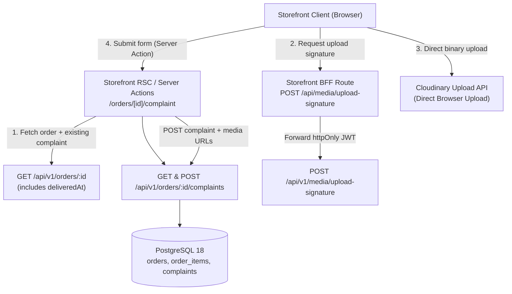

# SF-05 Storefront Complaint Form, Structured Schema & Customer Read Contract Formal Specification

## Overview & Context

This specification defines the end-to-end contract for Issue `#58` (Parent Epic `#13`, Atomic Tracking `#88`) and its UI reference [khi_u_n_i_n_h_ng.html](file:///home/ngxc/Downloads/khi_u_n_i_n_h_ng.html), building on [ADR-0009](file:///home/ngxc/workspace/20-projects/greenroots-farm/docs/adr/0009-cloudinary-signed-uploads.md), [ADR-0032](file:///home/ngxc/workspace/20-projects/greenroots-farm/docs/adr/0032-customer-order-history-projection-pagination-and-isolation.md), [ADR-0036](file:///home/ngxc/workspace/20-projects/greenroots-farm/docs/adr/0036-storefront-bff-http-only-session-and-singleflight-refresh.md), [ADR-0040](file:///home/ngxc/workspace/20-projects/greenroots-farm/docs/adr/0040-complaint-submission-window-and-media-verification.md), [ADR-0045](file:///home/ngxc/workspace/20-projects/greenroots-farm/docs/adr/0045-complaint-triage-state-and-staff-projection.md), and [ADR-0046](file:///home/ngxc/workspace/20-projects/greenroots-farm/docs/adr/0046-complaint-refund-channels-and-replacement-order.md).

Inspecting the existing codebase surfaced two blocking prerequisites that must ship alongside `#58`:

1. `OrderDto` does not expose `orders.deliveredAt`, preventing the Storefront from computing or displaying the immutable 24-hour complaint window.
2. `ComplaintsController` exposes only `POST /api/v1/orders/:id/complaints` with no customer `GET` endpoint, and `ComplaintDto` omits resolution/triage details (`triageNote`, `resolutionNote`, `refundChannel`, `refundAmountVnd`, `replacementOrderId`).

### Goals

- Add `ComplaintCategory` (`damaged_wilted`, `missing_item`, `wrong_item`, `not_fresh`, `other`) to `@greenroots/shared` and persist `category` + `affectedOrderItemIds` on `complaints` via a forward-only Drizzle migration.
- Expose `deliveredAt: string | null` on `OrderDto` (`GET /api/v1/orders/:id` and `GET /api/v1/orders/me`).
- Add `GET /api/v1/orders/:id/complaints` (`UserRole.CUSTOMER`) returning `200 { data: ComplaintDto | null }` with anti-enumeration `404 ORDER_NOT_FOUND`, and extend `ComplaintDto` with customer-safe triage/resolution fields (omitting `triagedBy` and `resolvedBy`).
- Enforce server-side `affectedOrderItemIds` ownership (every submitted UUID must belong to `orderItems` of `orderId`), in addition to existing `ADR-0040` 24h window and Cloudinary Admin API verification.
- Wire Storefront `/orders/[id]/complaint` (`apps/storefront/app/(main)/orders/[id]/complaint/page.tsx`) with direct-to-Cloudinary signed uploads via `POST /api/media/upload-signature`, live 24h countdown + server-backed expiry lock, and honest 3-step FSM status/resolution display.
- Update `apps/storefront/src/features/orders/components/order-detail-view.tsx` to align complaint entry with `DELIVERED` and `COMPLETED` statuses (`ADR-0040`).

### Non-Goals

- Backoffice complaint triage or resolution UI (`#59`).
- Customer editing/updating of submitted complaints (complaints are immutable once submitted; `#btn-edit-complaint` from the raw HTML mockup is omitted).
- Unbacked 2-hour SLA timers or customer confirmation steps (`"Chờ xác nhận"`).

## Architecture

## Operational Flow

### 1. Page Load & Eligibility Gate (`GET /orders/[id]/complaint`)

1. Server Component fetches `GET /api/v1/orders/:id` and `GET /api/v1/orders/:id/complaints` in parallel using the customer's `httpOnly` session (`ADR-0036`).
2. If `order` is missing/404, render not-found state.
3. If `complaint !== null`, render the **Status & Resolution View** (3-step FSM: `pending` → `triaged` / `rejected` → `approved` with `refund` or `replacement`, plus `triageNote` / `resolutionNote` / `refundAmountVnd` / `refundChannel` / `replacementOrderId` and submitted evidence).
4. If `complaint === null`:
   - If `order.orderStatus` is not in `[DELIVERED, COMPLETED]` or `order.deliveredAt === null`, render ineligible state.
   - If `now > deliveredAt + 24h`, render locked **Expired Window** state.
   - Otherwise, render the **Complaint Form** with a live 1-second countdown timer to `deliveredAt + 24h` that transitions to the locked expired state at `00:00:00`.

### 2. Direct-to-Cloudinary Media Upload & Submission

1. **Client Pre-Validation**:
   - Images: `1..5` files, `image/jpeg | image/png | image/webp`, `<= 5MB` each.
   - Optional Video: `0..1` file, `video/mp4 | video/quicktime | video/webm`, `<= 15MB`, `<= 15s` (checked via `<video>` `loadedmetadata` before signing; falls back to server verification if browser metadata decode fails).
2. **Signed Upload**: Client calls `POST /api/media/upload-signature` (Storefront BFF → `POST /api/v1/media/upload-signature` with `folder: "complaints"`), then `POST`s files directly to Cloudinary.
3. **Authoritative Server Submission**: Storefront Server Action calls `POST /api/v1/orders/:id/complaints` with `{ category, affectedOrderItemIds, reason, proofImageUrls, proofVideoUrl }`.
   - Backend validates `now - deliveredAt <= 24h` (`422 ORDER_COMPLAINT_WINDOW_EXPIRED`), item ownership, Cloudinary Admin API metadata (`ADR-0040`), and `complaints_order_id_uidx` (`409 ORDER_COMPLAINT_ALREADY_EXISTS`).
   - Client maps `422 ORDER_COMPLAINT_WINDOW_EXPIRED` to the locked expired state and `409` to a refresh into the status view.

## Domain Invariants

- **`INV-CMP-1` (Anti-Enumeration Ownership)**: Both `GET` and `POST /api/v1/orders/:id/complaints` MUST return `404 ORDER_NOT_FOUND` when the order does not exist or belongs to another customer (`ADR-0032`).
- **`INV-CMP-2` (Authoritative Server 24h Window)**: Client countdown is purely UX; `ComplaintsService.submitComplaint` MUST enforce `orderStatus` ∈ `{delivered, completed}`, non-null `orders.deliveredAt`, and `now - deliveredAt <= 24h` on every request (`422 ORDER_COMPLAINT_WINDOW_EXPIRED`).
- **`INV-CMP-5` (Order-Scoped Item Ownership)**: Every UUID in `affectedOrderItemIds` (`min(1)`, deduplicated) MUST exist in `order_items` for the target `orderId`; foreign or non-existent item IDs MUST be rejected with `422`.
- **`INV-CMP-6` (Customer Projection Privacy)**: `ComplaintDto` returned by `GET` and `POST` MUST NOT expose internal staff user IDs (`triagedBy`, `resolvedBy`), while safely exposing `triageNote`, `resolutionNote`, `refundChannel`, `refundAmountVnd`, and `replacementOrderId`.

## Edge Cases & Error Matrix

| Case       | Trigger                                            | Expected Server / UI Behavior                                                                                                                           |
| :--------- | :------------------------------------------------- | :------------------------------------------------------------------------------------------------------------------------------------------------------ |
| **EDGE-1** | Window expires while customer is filling form      | Live timer locks form at `00:00:00`; if submit still fires, API returns `422 ORDER_COMPLAINT_WINDOW_EXPIRED` and UI transitions to locked expired state |
| **EDGE-2** | Duplicate submit (two tabs or double-click)        | DB `complaints_order_id_uidx` rejects second insert with `409 ORDER_COMPLAINT_ALREADY_EXISTS`; UI refreshes to show existing complaint                  |
| **EDGE-3** | Foreign `affectedOrderItemIds` injected in payload | Backend verifies against `order_items WHERE order_id = :orderId`; rejects with `422`                                                                    |
| **EDGE-4** | Video `> 15s` or `> 15MB`                          | Client `<video>` `loadedmetadata` + size check blocks upload early; backend Cloudinary Admin API check enforces `422 COMPLAINT_MEDIA_INVALID`           |

## Phased Implementation Plan (Atomic Slices)

1. **Slice 1 — Shared Contracts & Migration (`packages/shared`, `apps/api/src/database`)**:
   - Add `ComplaintCategory` enum (`damaged_wilted`, `missing_item`, `wrong_item`, `not_fresh`, `other`) in `@greenroots/shared`.
   - Add `category` (`complaint_category`, default `'other'`) and `affectedOrderItemIds` (`jsonb`, default `'[]'`) to `complaints` + forward-only Drizzle migration + update `tier3-operational.seeder.ts`.
2. **Slice 2 — Backend API (`apps/api/src/modules/orders`, `complaints`)**:
   - Expose `deliveredAt` in `OrderDto` & `OrdersService`.
   - Update `CreateComplaintDto`, `ComplaintDto`, `StaffComplaintDto`, and `ComplaintsService` (add `getOrderComplaint`, item ownership validation, `category` & `affectedOrderItemIds` persistence).
   - Add `GET /api/v1/orders/:id/complaints` to `ComplaintsController`.
   - Update unit/integration specs and run `bun run types:sync`.
3. **Slice 3 — Storefront BFF & UI (`apps/storefront`)**:
   - Add `POST /api/media/upload-signature` BFF route handler.
   - Wire `apps/storefront/app/(main)/orders/[id]/complaint/page.tsx` and feature components/actions/tests.
   - Update `apps/storefront/src/features/orders/components/order-detail-view.tsx` for `DELIVERED` / `COMPLETED` + existing complaint / expired states.
   - Run `bun run check`, `bun run test`, and `bun run test:storefront`.
