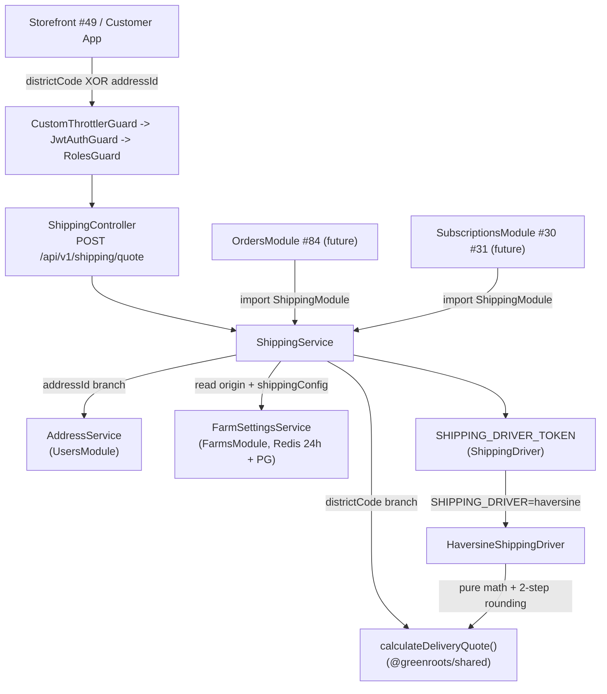
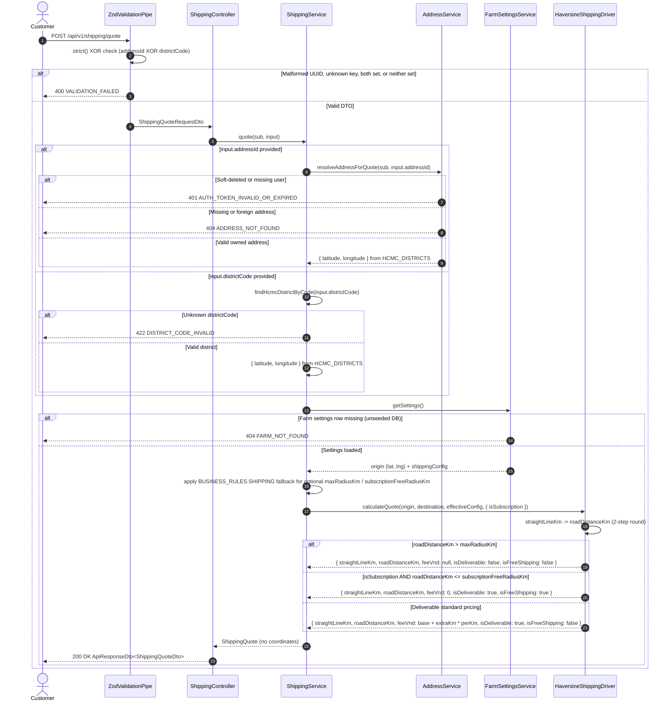

# Shipping Driver Seam and Quote API Formal Specification

## Overview & Context

This specification defines the `ShippingDriver` abstraction, `HaversineShippingDriver` adapter, standalone `ShippingModule`, shared Haversine quote refactoring in `@greenroots/shared`, and `POST /api/v1/shipping/quote` endpoint introduced for #25 (parent epic #10; storefront consumer #49; downstream transactional consumers #84, #30, #31).

Architectural commitments are recorded in ADR-0030 (subsequently amended by ADR-0034 to require `maxRadiusKm` and `subscriptionFreeRadiusKm` on `FarmShippingConfig` and remove optional-radius fallbacks in `ShippingService`); coordinate provenance and `HCMC_DISTRICTS` SSOT follow ADR-0018; dynamic `FarmSettingsService` authority follows ADR-0021; driver DI toggling follows ADR-0010; DTO co-location, response envelopes, OpenAPI sync, and RFC 9457 error handling follow ADR-0004, ADR-0007, ADR-0011, ADR-0012, and ADR-0013.

Currently, `apps/api/src/modules/orders/` does not exist, `estimateDeliveryQuote()` in `packages/shared/src/haversine.ts` hardcodes `BUSINESS_RULES.FULFILLMENT_HUB` (originally `FARM_COORDINATES`) and `BUSINESS_RULES.SHIPPING` while blocking subscription deliveries beyond `20 km`, and `API_ERROR_DICTIONARY.OUT_OF_DELIVERY_RADIUS` in `packages/shared/src/error-dictionary.ts` interpolates a static `25 km` literal.

### Goals

- Replace `estimateDeliveryQuote()` in `packages/shared/src/haversine.ts` with pure `calculateDeliveryQuote(origin, destination, config, options?)` (no backward-compatible wrapper) using explicit farm coordinates and `FarmShippingConfig` thresholds, with `maxRadiusKm` as the hard deliverability ceiling, `0 VND` subscription fee when `roadDistanceKm <= subscriptionFreeRadiusKm`, standard fee computation for `(subscriptionFreeRadiusKm, maxRadiusKm]`, and `feeVnd: null` when `isDeliverable === false`.
- Update the two existing `apps/storefront` call sites (`apps/storefront/src/components/common/header.tsx` and `address-dialog.tsx`) to call `calculateDeliveryQuote()` directly with `BUSINESS_RULES` defaults until `#49` migrates them to `POST /api/v1/shipping/quote`, and update `packages/shared/src/haversine.spec.ts` to test `calculateDeliveryQuote()` directly.
- Remove the hardcoded `25 km` literal from `API_ERROR_DICTIONARY.OUT_OF_DELIVERY_RADIUS` in `packages/shared/src/error-dictionary.ts` (updating `error-dictionary.spec.ts` as needed).
- Implement `ShippingModule` under `apps/api/src/modules/orders/shipping/*` exporting `ShippingService` and `SHIPPING_DRIVER_TOKEN`, wired into `AppModule`, with `ShippingDriver` (`calculateQuote` returning a `Promise`) and `HaversineShippingDriver` selected via `SHIPPING_DRIVER` (`ShippingDriverKind` in `apps/api/src/common/constants/environment.constant.ts` and `env.config.ts`).
- Expose `POST /api/v1/shipping/quote` (`@ApiAuth(UserRole.CUSTOMER)`, `@HttpCode(HttpStatus.OK)`) accepting a strict XOR of `addressId` (UUIDv7) or `districtCode`, plus optional `isSubscription` (`false` default), returning `200 OK` with `ApiResponseDto<ShippingQuoteDto>` and omitting all geographic coordinates.
- Run `bun run types:sync` and commit generated OpenAPI and TypeScript client contracts.

### Non-Goals

- Implementing retail checkout (`POST /api/v1/orders/checkout`, #84), subscription checkout (#30), or 04:00 child-order cron generation (#31).
- Integrating an external routing/dispatch provider (Goong Maps, GrabExpress, AhaMove); only the `ShippingDriver` async seam and `HaversineShippingDriver` are built here.
- Wiring `apps/storefront` dialogs or `SF-05` checkout to `POST /api/v1/shipping/quote` (#49).
- Adding `PATCH /api/v1/farms/settings` cross-field validation (`subscriptionFreeRadiusKm <= maxRadiusKm`), though `calculateDeliveryQuote()` safely enforces `maxRadiusKm` precedence regardless.

## Architecture

Symbols and module layout:

- `SHIPPING_DRIVERS` and `ShippingDriverKind` (`"haversine"`) in `apps/api/src/common/constants/environment.constant.ts`, validated via `SHIPPING_DRIVER` in `apps/api/src/common/config/env.config.ts` (default `"haversine"`).
- `calculateDeliveryQuote` and `DeliveryQuote` (replacing `estimateDeliveryQuote`) in `packages/shared/src/haversine.ts`, exported from `packages/shared/src/index.ts`.
- `API_ERROR_DICTIONARY.OUT_OF_DELIVERY_RADIUS` in `packages/shared/src/error-dictionary.ts` updated to remove the static `25 km` interpolation.
- `SHIPPING_ROUTES` in `apps/api/src/modules/orders/shipping/shipping.routes.ts` defining frozen `TAG`, `BASE: "shipping"`, and `QUOTE: "quote"` constants.
- `ShippingDriver`, `ShippingQuoteInput`, `ShippingDriverQuote`, and `SHIPPING_DRIVER_TOKEN` in `apps/api/src/modules/orders/shipping/shipping.interface.ts` (pure types/constants only per ADR-0011).
- `HaversineShippingDriver` in `apps/api/src/modules/orders/shipping/drivers/haversine-shipping.driver.ts` implementing `ShippingDriver` by delegating to `calculateDeliveryQuote()`.
- `ShippingQuoteRequestDto` (`shippingQuoteRequestSchema`, `ShippingQuoteRequestInput`) and `ShippingQuoteDto` (`shippingQuoteSchema`, `ShippingQuote`) in `apps/api/src/modules/orders/shipping/dto/`, re-exported from `dto/index.ts` per ADR-0011.
- `ShippingService` in `apps/api/src/modules/orders/shipping/shipping.service.ts` orchestrating destination resolution (`AddressService.resolveAddressForQuote` vs `findHcmcDistrictByCode`), farm settings loading (`FarmSettingsService.getSettings()`), optional-radius defaults (`BUSINESS_RULES.SHIPPING`), and `ShippingDriver.calculateQuote()`.
- `ShippingController` in `apps/api/src/modules/orders/shipping/shipping.controller.ts` exposing `POST /api/v1/shipping/quote`, wired into `ShippingModule` (`apps/api/src/modules/orders/shipping/shipping.module.ts`) and imported by `AppModule` (`apps/api/src/app.module.ts`).

## Operational Flow

### 1. Shipping Quote Request (`POST /api/v1/shipping/quote`)

### 2. Distance & Pricing Rules

1. **Great-circle distance**: computed between farm `(origin.latitude, origin.longitude)` and district centroid `(destination.latitude, destination.longitude)` using Earth radius `6371 km`, rounded to 2 decimal places (`straightLineKm`).
2. **Road distance**: `Number((straightLineKm * config.detourFactor).toFixed(2))` (`roadDistanceKm`). Keeping the two-step rounding from `haversine.ts` guarantees identical results between backend quotes and temporary storefront preview calls.
3. **Deliverability gate**: `isDeliverable = roadDistanceKm <= maxRadiusKm` is evaluated **before** any subscription free-tier check.
4. **Fee computation**:
   - If `!isDeliverable`: `feeVnd = null`, `isFreeShipping = false`.
   - Else if `isSubscription && roadDistanceKm <= subscriptionFreeRadiusKm`: `feeVnd = 0`, `isFreeShipping = true`.
   - Else: `extraKm = Math.max(0, Math.ceil(roadDistanceKm - config.freeKmThreshold))`, `feeVnd = config.baseFeeVnd + extraKm * config.perKmRateVnd`, `isFreeShipping = feeVnd === 0`.

## API Contract

### Endpoint

`POST /api/v1/shipping/quote`

- **Auth & RBAC**: `@ApiAuth(UserRole.CUSTOMER)` — requires valid customer JWT; `guest` and internal staff roles receive `403 FORBIDDEN`.
- **HTTP Status**: `200 OK` (`@HttpCode(HttpStatus.OK)`) — read-only calculation over POST, no `Idempotency-Key` required.
- **Error Responses**:
  - `400 VALIDATION_FAILED`: malformed `addressId`, invalid syntax, unknown fields (`latitude`, `longitude`, `city`), both `addressId` and `districtCode` provided, or neither provided.
  - `401 AUTH_TOKEN_INVALID_OR_EXPIRED`: missing/invalid/revoked JWT, or soft-deleted user on the `addressId` branch.
  - `403 FORBIDDEN`: caller role is not `UserRole.CUSTOMER`.
  - `404 ADDRESS_NOT_FOUND`: `addressId` does not exist or belongs to another customer.
  - `404 FARM_NOT_FOUND`: singleton `farms` row missing in database.
  - `422 DISTRICT_CODE_INVALID`: `districtCode` not present in `HCMC_DISTRICTS`.
  - `429 TOO_MANY_REQUESTS`: `default` rate-limit tier exceeded (`100 req / 60s`).
  - `500 INTERNAL_SERVER_ERROR`: unexpected unhandled error (sanitized by `GlobalExceptionFilter`).

### Request & Response Projections

- `ShippingQuoteRequestDto` (`.strict()` Zod object):
  - `addressId?: string` (`zUuidV7().optional()`)
  - `districtCode?: string` (`z.string().trim().min(1).max(50).optional()`)
  - `isSubscription?: boolean` (`z.boolean().default(false)`)
  - Cross-field `.superRefine()`: exactly one of `addressId` or `districtCode` MUST be defined (`CUSTOM_VALIDATION_ERROR` if both or neither are supplied).
- `ShippingQuoteDto` (closed projection, strictly omits all coordinates):
  - `straightLineKm`: non-negative number
  - `roadDistanceKm`: non-negative number
  - `feeVnd`: non-negative integer or `null` (`null` iff `isDeliverable === false`)
  - `isDeliverable`: boolean
  - `isFreeShipping`: boolean
  - `maxRadiusKm`: positive number (resolved runtime radius from `FarmSettings`, fallback `BUSINESS_RULES.SHIPPING.MAX_RADIUS_KM`)
  - `subscriptionFreeRadiusKm`: positive number (resolved runtime threshold from `FarmSettings`, fallback `BUSINESS_RULES.SHIPPING.SUBSCRIPTION_FREE_RADIUS_KM`)

## Security & Reliability

- **Coordinate provenance & anti-tampering**: Client-supplied `latitude`, `longitude`, or `city` fields fail at `ZodValidationPipe` with `400 UNRECOGNIZED_KEYS`. Origin comes exclusively from `FarmSettingsService`, and destination comes exclusively from `HCMC_DISTRICTS` (either directly via `districtCode` or via `AddressService.resolveAddressForQuote`).
- **Coordinate non-disclosure**: `ShippingQuoteDto` excludes `originLatitude`, `originLongitude`, `destLatitude`, and `destLongitude`, preventing clients from scraping farm coordinates or internal address caches.
- **Ownership & anti-enumeration**: When `addressId` is supplied, `AddressService.resolveAddressForQuote` scopes by `userId = sub` and returns `404 ADDRESS_NOT_FOUND` for both missing and cross-account UUIDv7s.
- **Live subject & cache resilience**: `addressId` quotes verify `users.deletedAt IS NULL` in PostgreSQL (`401` on soft-deleted accounts); `districtCode` quotes perform no PII/DB lookup and rely on `JwtAuthGuard` + Redis revocation (ADR-0016) to keep dropdown interactions fast. `FarmSettingsService.getSettings()` fails open from Redis to PostgreSQL on cache outages, while missing `farms` rows fail closed with `404 FARM_NOT_FOUND`.
- **Rate limiting**: Inherits `CustomThrottlerGuard` `default` tier (`100 req / 60s`) per `docs/standards/api-design-and-error-handling.md` §10.
- **Future driver resilience seam**: Because `ShippingDriver.calculateQuote()` returns a `Promise`, future external routing adapters (Goong/Grab) can apply HTTP timeouts, circuit breakers, or fallback policies inside the driver without changing `ShippingService`, `#84`, or `#30`.

## Domain Invariant Taxonomy

`ShippingDomainInvariants`:

| Invariant    | Name                      | Formal Statement                                                                                                                                                                                                                | Enforcement Seam                                                                                                                            | Verification Test                                                                                                                                                   |
| :----------- | :------------------------ | :------------------------------------------------------------------------------------------------------------------------------------------------------------------------------------------------------------------------------ | :------------------------------------------------------------------------------------------------------------------------------------------ | :------------------------------------------------------------------------------------------------------------------------------------------------------------------ |
| `INV-SHIP-1` | Coordinate Provenance     | Every quote origin equals `FarmSettings` `(latitude, longitude)` and every destination equals the `HCMC_DISTRICTS` centroid for the resolved district; client coordinates are never accepted.                                   | `ShippingQuoteRequestDto` `.strict()`, `AddressService.resolveAddressForQuote`, `findHcmcDistrictByCode`, `FarmSettingsService.getSettings` | Rejects `latitude`/`longitude`/`city` with `400`; quote reflects updated `FarmSettings` coordinates and district centroid                                           |
| `INV-SHIP-2` | Dynamic Config Authority  | Active shipping calculation uses `FarmSettings.shippingConfig` (amended by `ADR-0034` to require `maxRadiusKm` and `subscriptionFreeRadiusKm` directly without fallback), failing closed (`404`) when `farms` is unseeded.      | `ShippingService` + `FarmSettingsService.getSettings()`                                                                                     | Updating `PATCH /farms/settings` immediately alters `/shipping/quote` fee and radius; unseeded `farms` returns `404`                                                |
| `INV-SHIP-3` | Radius Hard Ceiling       | `isDeliverable === true` iff `roadDistanceKm <= maxRadiusKm`, evaluated prior to any subscription free-tier rule; `feeVnd === null` and `isFreeShipping === false` whenever `isDeliverable === false`.                          | `calculateDeliveryQuote()` in `@greenroots/shared`                                                                                          | District beyond `maxRadiusKm` returns `200` with `isDeliverable: false, feeVnd: null` even when `isSubscription: true` and `subscriptionFreeRadiusKm > maxRadiusKm` |
| `INV-SHIP-4` | Subscription Tiered Fee   | For deliverable subscription quotes (`isDeliverable === true` and `isSubscription === true`), `feeVnd === 0` (`isFreeShipping: true`) iff `roadDistanceKm <= subscriptionFreeRadiusKm`; otherwise standard fee formula applies. | `calculateDeliveryQuote()` in `@greenroots/shared`                                                                                          | Subscription quote `<= 20 km` returns `feeVnd: 0`; subscription quote in `(20 km, 25 km]` returns standard positive integer `feeVnd`                                |
| `INV-SHIP-5` | Integer VND Precision     | Every non-null `feeVnd` is a non-negative integer in VND (`Math.ceil` on extra km above `freeKmThreshold`).                                                                                                                     | `calculateDeliveryQuote()` + `ShippingQuoteDto`                                                                                             | Fractional `roadDistanceKm` beyond `freeKmThreshold` rounds up `extraKm` and produces integer `feeVnd >= 0`                                                         |
| `INV-SHIP-6` | XOR Input & Ownership     | `POST /api/v1/shipping/quote` accepts strictly one of `addressId` or `districtCode`; `addressId` belongs to authenticated `UserRole.CUSTOMER` `sub` (`404` otherwise).                                                          | `ShippingQuoteRequestDto` `.superRefine()` + `AddressService.resolveAddressForQuote`                                                        | Supplying both or neither returns `400`; foreign `addressId` returns `404`; staff/guest roles receive `403`                                                         |
| `INV-SHIP-7` | Coordinate Non-Disclosure | `ShippingQuoteDto` never exposes farm or destination `latitude`/`longitude`.                                                                                                                                                    | Closed `ShippingQuoteDto` projection in `ShippingService`                                                                                   | Response object keys strictly match `ShippingQuoteDto` schema                                                                                                       |

### Edge Cases (`EDGE-1..12`)

| ID        | Case                                                                                                          | Expected Behaviour                                                              |
| :-------- | :------------------------------------------------------------------------------------------------------------ | :------------------------------------------------------------------------------ |
| `EDGE-1`  | Body contains both `addressId` and `districtCode`                                                             | `400 VALIDATION_FAILED` (`CUSTOM_VALIDATION_ERROR`)                             |
| `EDGE-2`  | Body contains neither `addressId` nor `districtCode` (e.g. `{}`)                                              | `400 VALIDATION_FAILED` (`CUSTOM_VALIDATION_ERROR`)                             |
| `EDGE-3`  | Body contains `latitude`, `longitude`, `city`, or unknown keys                                                | `400 VALIDATION_FAILED` (`UNRECOGNIZED_KEYS`)                                   |
| `EDGE-4`  | `addressId` is malformed (non-UUIDv7 or UUIDv4)                                                               | `400 VALIDATION_FAILED` (`INVALID_UUID`)                                        |
| `EDGE-5`  | `addressId` belongs to another user or does not exist                                                         | `404 ADDRESS_NOT_FOUND`                                                         |
| `EDGE-6`  | `districtCode` is unknown (e.g. `"quan-99"` or uppercase `"QUAN-7"`)                                          | `422 DISTRICT_CODE_INVALID`                                                     |
| `EDGE-7`  | `roadDistanceKm` equals `maxRadiusKm` exactly (e.g. `25.00`)                                                  | `200 OK`, `isDeliverable: true`, `feeVnd` computed                              |
| `EDGE-8`  | `roadDistanceKm` exceeds `maxRadiusKm` (e.g. `can-gio`)                                                       | `200 OK`, `isDeliverable: false`, `feeVnd: null`, `isFreeShipping: false`       |
| `EDGE-9`  | `isSubscription: true` and `roadDistanceKm === subscriptionFreeRadiusKm` (`20.00`)                            | `200 OK`, `isDeliverable: true`, `feeVnd: 0`, `isFreeShipping: true`            |
| `EDGE-10` | `isSubscription: true` and `20.00 < roadDistanceKm <= 25.00`                                                  | `200 OK`, `isDeliverable: true`, standard `feeVnd > 0`, `isFreeShipping: false` |
| `EDGE-11` | `FarmSettings` misconfigured with `subscriptionFreeRadiusKm > maxRadiusKm` and `roadDistanceKm > maxRadiusKm` | `200 OK`, `isDeliverable: false`, `feeVnd: null` (`INV-SHIP-3`)                 |
| `EDGE-12` | `farms` table has zero rows                                                                                   | `404 FARM_NOT_FOUND` (fail closed)                                              |

### Concurrency & Adversarial Matrix (`ADV-1..4`)

| ID      | Scenario                                                                                 | Expected Behaviour                                                                                                                                                           |
| :------ | :--------------------------------------------------------------------------------------- | :--------------------------------------------------------------------------------------------------------------------------------------------------------------------------- |
| `ADV-1` | Client injects `latitude: 10.8106, longitude: 106.7091` to spoof `0 km` fee              | Rejected by `ZodValidationPipe` (`400 UNRECOGNIZED_KEYS`) before `ShippingService` runs                                                                                      |
| `ADV-2` | Customer probes another customer's address UUIDv7 via `addressId`                        | Scoped by `userId = sub`; returns `404 ADDRESS_NOT_FOUND` identically to missing UUIDs                                                                                       |
| `ADV-3` | Staff (`farm_staff`, `sales`, `admin`, `super_admin`) or `guest` calls `/shipping/quote` | Rejected by `RolesGuard` with `403 FORBIDDEN`                                                                                                                                |
| `ADV-4` | Concurrent `PATCH /api/v1/farms/settings` while `/shipping/quote` runs                   | Either reads pre-commit consistent snapshot or post-invalidation PostgreSQL row via ADR-0021 Lua stale-backfill guard; never mixes old coordinates with new `shippingConfig` |

## Test Matrix

1. **Shared Unit Tests (`packages/shared/src/haversine.spec.ts` & `error-dictionary.spec.ts`)**:
   - `calculateDeliveryQuote()` with custom origin & `FarmShippingConfig`: boundary `roadDistanceKm === maxRadiusKm`, `> maxRadiusKm` (`feeVnd: null`, `isDeliverable: false`), subscription `<= subscriptionFreeRadiusKm` (`feeVnd: 0`), subscription in `(subscriptionFreeRadiusKm, maxRadiusKm]` (standard fee), `subscriptionFreeRadiusKm > maxRadiusKm` hard-ceiling guard, `Math.ceil` extra km rounding, and `OUT_OF_DELIVERY_RADIUS` dictionary assertion.
2. **API Unit Tests (`apps/api/src/modules/orders/shipping/haversine-shipping.driver.spec.ts` & `shipping.service.spec.ts`)**:
   - `HaversineShippingDriver`: delegates to `calculateDeliveryQuote()` asynchronously and preserves integer VND + null undeliverable fees.
   - `ShippingService`: resolves `addressId` vs `districtCode`, applies `BUSINESS_RULES.SHIPPING` fallback only for optional `maxRadiusKm`/`subscriptionFreeRadiusKm`, strips coordinates from output, and throws `404 FARM_NOT_FOUND` / `422 DISTRICT_CODE_INVALID` on error paths.
3. **API Integration Tests (`apps/api/test/integration/shipping.spec.ts`)**:
   - Follows `docs/standards/testing-and-fixtures.md` naming and `api-schema.d.ts` response typing:
   - `POST /api/v1/shipping/quote`: retail quote via `districtCode`, retail quote via owned `addressId`, subscription quote `<= 20 km` (`feeVnd: 0`), subscription quote `(20 km, 25 km]` (`feeVnd > 0`), out-of-radius `can-gio` (`200`, `isDeliverable: false`, `feeVnd: null`), dynamic reflection after `PATCH /api/v1/farms/settings`, XOR validation errors (`400`), coordinate injection rejection (`400`), unknown `districtCode` (`422`), foreign/missing `addressId` (`404`), soft-deleted user on `addressId` (`401`), unauthenticated (`401`), non-customer roles (`403`), and exact `ShippingQuoteDto` key closure.
4. **Contract Sync**:
   - `bun run types:sync` executed cleanly and generated OpenAPI/schema diffs verified.

## Risks & Rollback

- **Storefront preview drift until #49**: `apps/storefront` (`header.tsx`, `address-dialog.tsx`) passes static `BUSINESS_RULES` defaults into `calculateDeliveryQuote()` until `#49` connects it to `POST /api/v1/shipping/quote`. Acceptable because no checkout transaction occurs without backend calculation (`#84`, `#30`).
- **Subscription `(20 km, 25 km]` fee downstream impact**: `#30` and `#31` must persist `quote.feeVnd ?? 0` into `subscriptions.shippingFeePerDelivery` and child `orders.shippingFee` rather than assuming `0` for all subscriptions.
- **Rollback**: Revert the implementation PR, restore `API_ERROR_DICTIONARY.OUT_OF_DELIVERY_RADIUS` if needed, and re-run `bun run types:sync`; no database schema migrations are introduced by this feature.
