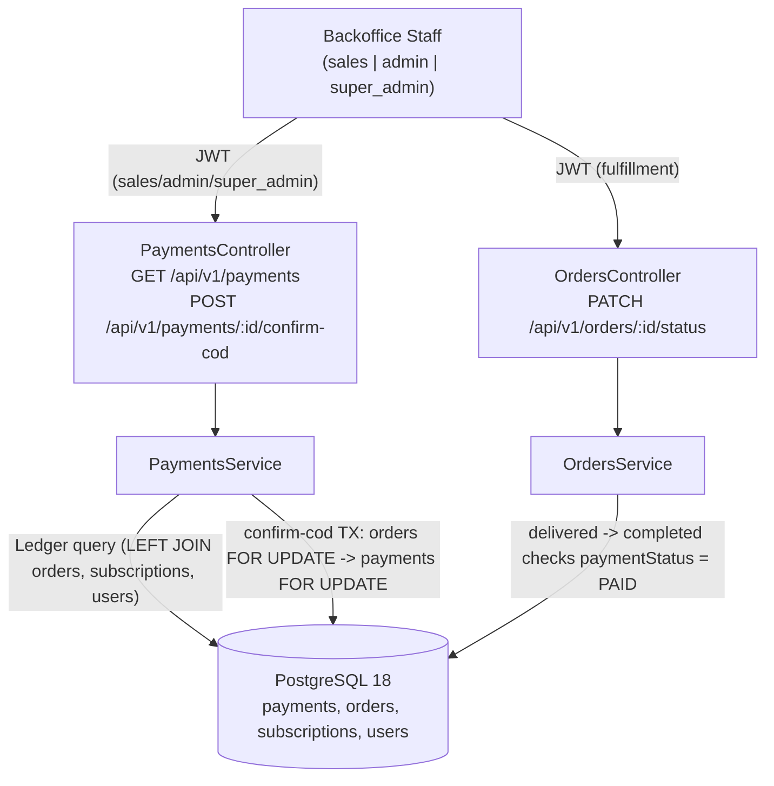

# Staff Payment Ledger and Atomic COD Confirmation Formal Specification

## Overview & Context

This specification defines the staff payment ledger (`GET /api/v1/payments`) and atomic Cash-on-Delivery (COD) confirmation (`POST /api/v1/payments/:id/confirm-cod`) for issue `#245` (parent epic `#11`, split from `#29`), plus the `delivered -> completed` paid-order gate in `OrdersService`.

Architectural conventions follow `ADR-0012` (generic response envelopes), `ADR-0013` (RFC 9457 error codes in `@greenroots/shared`), `ADR-0019` (staff RBAC), `ADR-0033` (natural DB-level idempotency and order FSM), `ADR-0042` (`orders -> payments` lock ordering), and `ADR-0043` (staff payment ledger and COD confirmation).

### Goals

- Add three RFC 9457 error codes (`PAYMENT_COD_NOT_ELIGIBLE`, `PAYMENT_INVALID_STATUS_TRANSITION`, `ORDER_PAYMENT_REQUIRED`) to `API_ERROR_CODES` / `API_ERROR_DICTIONARY` in `@greenroots/shared`, with matching English developer `MESSAGES` in `apps/api`.
- Expose `GET /api/v1/payments` (`@ApiAuth(UserRole.SALES, UserRole.ADMIN, UserRole.SUPER_ADMIN)`) returning a paginated, filtered, searchable, and hydrated `PaymentLedgerItemDto` list excluding `rawPayload` and `paymentUrl`.
- Expose `POST /api/v1/payments/:id/confirm-cod` (`@ApiAuth(UserRole.SALES, UserRole.ADMIN, UserRole.SUPER_ADMIN)`) that locks `orders -> payments` (`FOR UPDATE`), validates COD and order-status eligibility (`shipping | delivered`), atomically sets `payments.status = PAID`, `verifiedBy`, `paidAt`, and `orders.paymentStatus = PAID`, and handles `PAID` replays idempotently.
- Enforce `orderRow.paymentStatus === PaymentStatus.PAID` in `OrdersService.updateOrderStatus` before transitioning `OrderStatus.DELIVERED -> OrderStatus.COMPLETED`.
- Cover all invariants with integration/unit tests and run `bun run types:sync` to update generated OpenAPI contracts.

### Non-Goals

- PayOS driver or webhook ingestion (`#242`, `#243`).
- Backoffice `BO-09` UI (`#53`).
- Payment refund workflows (`PaymentTransactionType.REFUND`).

## Architecture

## Domain Invariants

- **`PaymentsDomainInvariants: INV-1` (RBAC Isolation)**: Both `GET /api/v1/payments` and `POST /api/v1/payments/:id/confirm-cod` require an authenticated staff session with role in `{sales, admin, super_admin}`; `farm_staff`, `customer`, and `guest` receive `403`.
- **`PaymentsDomainInvariants: INV-2` (Lock Ordering & Atomic Sync)**: `confirm-cod` must acquire `FOR UPDATE` on `orders` before `payments` and update `payments.status = PAID`, `payments.verifiedBy`, `payments.paidAt`, and `orders.paymentStatus = PAID` in the same transaction without mutating `orders.orderStatus`.
- **`PaymentsDomainInvariants: INV-3` (COD & Order Eligibility)**: `confirm-cod` only settles `paymentMethod = cod`, `transactionType = payment`, `orderId IS NOT NULL` rows whose parent order is in `shipping` or `delivered`; ineligible method/type/subscription/order-status fails with `422 PAYMENT_COD_NOT_ELIGIBLE`, and terminal non-paid payment statuses (`cancelled`, `failed`, `refunded`) fail with `422 PAYMENT_INVALID_STATUS_TRANSITION`.
- **`PaymentsDomainInvariants: INV-4` (Natural Idempotency)**: Replaying `confirm-cod` on an already-`PAID` COD `payment` transaction returns `200 OK` with the persisted projection, preserving the original `verifiedBy` and `paidAt`.
- **`PaymentsDomainInvariants: INV-5` (Ledger Sanitization & Determinism)**: `GET /api/v1/payments` never returns `rawPayload` or `paymentUrl`, hydrates `orderCode`, `subscriptionCode`, and `verifiedByName`, and orders deterministically by `createdAt DESC, id DESC`.
- **`OrdersDomainInvariants: INV-PAID-COMPLETE` (Paid-Order Completion Gate)**: `OrdersService.updateOrderStatus` rejects `delivered -> completed` when `orders.paymentStatus !== PAID` with `422 ORDER_PAYMENT_REQUIRED`.

## Operational Flow

### 1. Staff Payment Ledger (`GET /api/v1/payments`)

1. Validate query DTO (`page` default `1`, `limit` default `20` max `100`, optional `status`, `paymentMethod`, `transactionType`, `orderId`, `subscriptionId`, `from`, `to`, `search`).
2. Query `payments` with `LEFT JOIN orders`, `LEFT JOIN subscriptions`, and `LEFT JOIN users` (`verifiedBy`), applying exact filters, `createdAt` date bounds (`from <= createdAt <= to`), and case-insensitive `search` (`ILIKE %term%`) on `orders.orderCode`, `subscriptions.subscriptionCode`, and `payments.referenceCode`.
3. Return paginated envelope `{ items, meta }` ordered by `payments.createdAt DESC, payments.id DESC`, excluding `rawPayload` and `paymentUrl`.

### 2. Atomic COD Confirmation (`POST /api/v1/payments/:id/confirm-cod`)

1. Validate `:id` as UUIDv7 (`ZodValidationPipe(zUuidV7())`).
2. Unlocked lookup of `payments` by `id`:
   - If missing, throw `404 PAYMENT_NOT_FOUND`.
   - If `orderId` is `null` or `paymentMethod !== COD` or `transactionType !== PAYMENT`, throw `422 PAYMENT_COD_NOT_ELIGIBLE`.
3. Inside `db.transaction()`:
   - Lock parent order (`SELECT ... FROM orders WHERE id = :orderId FOR UPDATE`).
   - Lock payment (`SELECT ... FROM payments WHERE id = :paymentId FOR UPDATE`).
   - If `lockedPayment.status === PaymentStatus.PAID`, return hydrated `PaymentLedgerItemDto` (`200 OK`) without modifying `verifiedBy` or `paidAt`.
   - If `lockedPayment.status !== PaymentStatus.PENDING`, throw `422 PAYMENT_INVALID_STATUS_TRANSITION`.
   - If `lockedOrder.orderStatus` is not in `{OrderStatus.SHIPPING, OrderStatus.DELIVERED}`, throw `422 PAYMENT_COD_NOT_ELIGIBLE`.
   - Update `payments` (`status = PAID`, `verifiedBy = actorUserId`, `paidAt = now`, `updatedAt = now`) and `orders` (`paymentStatus = PAID`, `updatedAt = now`).
   - Emit structured log (`paymentId`, `orderId`, `actorId`, `amountVnd`) and return hydrated `PaymentLedgerItemDto` (`200 OK`).

### 3. Order Completion Gate (`PATCH /api/v1/orders/:id/status`)

1. In `OrdersService.updateOrderStatus`, after verifying `ORDER_STATUS_TRANSITIONS`:
2. If `targetStatus === OrderStatus.COMPLETED` and `orderRow.paymentStatus !== PaymentStatus.PAID`, throw `422 ORDER_PAYMENT_REQUIRED`.
