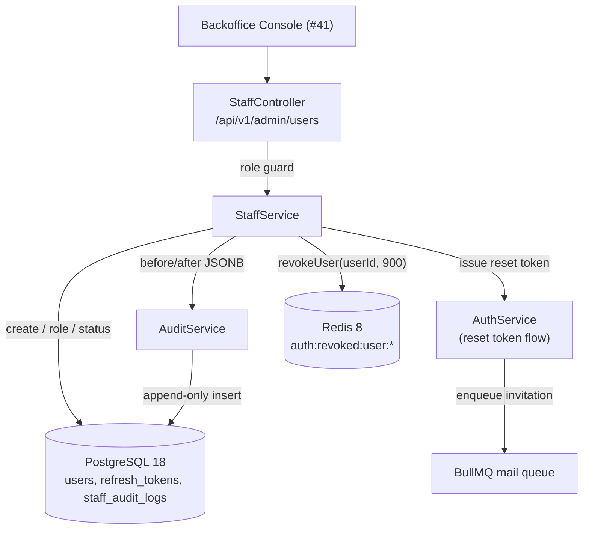

# Staff RBAC & Session Revocation Formal Specification

## Overview & Context

This document specifies the staff lifecycle defined by UC-05 and introduced by #77 (split from #18). The authorization and audit decisions are recorded in ADR-0019; session mechanics follow ADR-0015, ADR-0016, and ADR-0017.

The system already has `farm_staff`, `sales`, `admin`, `super_admin`, `customer`, and `guest` roles, but no staff management surface, no invariant preventing removal of the last active super admin, no audit trail, and no transactional session termination on suspension. Staff provisioning also risks accepting a plaintext password if it is built without a credential flow.

### Goals

- Let `admin` read the staff directory and edit profile fields.
- Let `super_admin` create accounts, change `role` and `status`, and trigger credential resets.
- Provision invited staff through the reset-password token flow, never a plaintext password.
- Guarantee at least one active super admin exists after every mutation.
- Revoke every refresh session in the same transaction that suspends or deactivates a user.
- Record every staff mutation in an append-only audit table.

### Non-Goals

- Deleting users or transferring order ownership.
- Managing customer or guest accounts through admin routes.
- SSO, OAuth, MFA, or per-permission authorization beyond roles.
- Changing the 15-minute access-token TTL.
- Audit retention policies or external log shipping.

## Architecture



- `StaffController` in `apps/api/src/modules/users` exposes `GET /api/v1/admin/users`, `POST /api/v1/admin/users`, and `PATCH /api/v1/admin/users/:id`.
- `StaffService` enforces the role matrix, the last-super-admin invariant, and self-modification rules.
- `AuditService` writes `staff_audit_logs`; a database trigger rejects UPDATE and DELETE.
- `AuthService` owns reset-token issuance and the `POST /auth/reset-password` completion path.

## Operational Flow

### 1. Invite a Staff Member

```mermaid
sequenceDiagram
    autonumber
    actor SuperAdmin
    participant API as StaffController
    participant Svc as StaffService
    participant DB as PostgreSQL
    participant Mail as BullMQ (Mail)

    SuperAdmin->>API: POST /admin/users (email, fullName, phone, role)
    API->>Svc: create(actor, dto)
    Svc->>Svc: assert actor.role = super_admin
    Svc->>Svc: reject role in {customer, guest}
    Svc->>DB: check unique active email
    alt Email exists
        Svc-->>SuperAdmin: 409 AUTH_EMAIL_ALREADY_EXISTS
    else Unique
        Svc->>Svc: unusable random password hash; 32B reset token
        Svc->>DB: BEGIN
        Svc->>DB: INSERT user (emailVerified = false, resetPasswordToken = sha256(token), expires = now + 24h)
        Svc->>DB: INSERT staff_audit_logs (action = staff.create)
        Svc->>DB: COMMIT
        Svc->>Mail: enqueue sendStaffInvitationEmail(token)
        Svc-->>SuperAdmin: 201 Created (projection, no token)
    end

    actor Invitee
    Invitee->>API: POST /auth/reset-password (token, password)
    API->>DB: validate digest and expiry, set password, emailVerified = true
    API-->>Invitee: 200 OK
```

### 2. Update Profile, Role, or Status

```mermaid
sequenceDiagram
    autonumber
    actor Actor as Admin / SuperAdmin
    participant API as StaffController
    participant Svc as StaffService
    participant DB as PostgreSQL
    participant Redis as Redis 8

    Actor->>API: PATCH /admin/users/:id
    API->>Svc: update(actor, targetId, dto)
    alt actor.role = admin and dto contains role or status
        Svc-->>Actor: 403
    else actor.id = targetId and dto contains role or status
        Svc-->>Actor: 422 SELF_MODIFICATION_FORBIDDEN
    else Allowed
        Svc->>DB: BEGIN
        Svc->>DB: SELECT target FOR UPDATE
        alt target is last active super_admin and change demotes or suspends
            Svc-->>Actor: 422 LAST_SUPER_ADMIN (rollback)
        else Safe
            Svc->>DB: UPDATE users SET ...
            Svc->>DB: INSERT staff_audit_logs (before, after)
            opt status becomes suspended or inactive
                Svc->>DB: DELETE refresh_tokens WHERE user_id = target
            end
            Svc->>DB: COMMIT
            opt status becomes suspended or inactive
                Svc->>Redis: revokeUser(target, 900)
            end
            Svc-->>Actor: 200 OK
        end
    end
```

### 3. Last-Super-Admin Guard

```mermaid
sequenceDiagram
    autonumber
    participant R1 as Request A
    participant R2 as Request B
    participant DB as PostgreSQL

    R1->>DB: BEGIN; SELECT id FROM users WHERE role = 'super_admin' AND status = 'active' FOR UPDATE
    R2->>DB: BEGIN; SELECT ... FOR UPDATE (blocks)
    R1->>DB: sees 2 active super admins -> demote one; COMMIT
    R2->>DB: unblocks, re-reads -> sees 1 active super admin -> reject with 422 LAST_SUPER_ADMIN
```

## Security & Reliability

### Role Matrix

| Action                        | `farm_staff` | `sales` | `admin` | `super_admin` |
| :---------------------------- | :----------: | :-----: | :-----: | :-----------: |
| Read staff directory          |      —       |    —    |   Yes   |      Yes      |
| Edit `fullName` / `phone`     |      —       |    —    |   Yes   |      Yes      |
| Create staff account          |      —       |    —    |    —    |      Yes      |
| Change `role`                 |      —       |    —    |    —    |      Yes      |
| Change `status`               |      —       |    —    |    —    |      Yes      |
| Trigger credential reset      |      —       |    —    |    —    |      Yes      |
| Change own `role` or `status` |      —       |    —    |    —    |      No       |

### Controls

- **Authorization**: a role guard rejects any actor outside the matrix with `403`. Customer and guest accounts cannot reach these routes at all.
- **Invitation secrecy**: the reset token is 32 random bytes, stored only as a SHA-256 digest with a 24-hour expiry. It is never returned in a response, written to an audit row, or logged. The invitee receives an unusable random password hash until they set their own.
- **Self-modification**: an actor cannot change their own `role` or `status`, preventing privilege escalation and accidental self-lockout.
- **Last super admin**: the guard locks the active super-admin rows with `SELECT ... FOR UPDATE` inside the same transaction as the mutation, so two concurrent demotions cannot both commit.
- **Session termination**: suspension or deactivation deletes all `refresh_tokens` rows for the target in the transaction. `revokeUser()` then adds the Redis deny key. Because `revokeUser()` is fail-open, the residual access-token window is bounded by the 15-minute TTL, not by the Redis call.
- **Audit integrity**: `staff_audit_logs` has actor, target, action, before/after JSONB, and timestamp. A trigger rejects UPDATE and DELETE, matching the `farming_logs` precedent. Audit inserts share the mutation transaction; a failed audit insert rolls back the mutation.
- **Failure behaviour**: a Redis outage does not block suspension, because the database deletion is authoritative. A mail outage delays the invitation but does not create an unusable account, because the token is already persisted and can be re-sent.
- **Rate limiting**: staff mutations use the authenticated bucket; invitation resends are rate-limited per email.

## Domain Invariant Taxonomy

| Invariant     | Name                   | Formal Statement                                                                                                                                        | Enforcement Seam                                              | Verification Test                                                |
| :------------ | :--------------------- | :------------------------------------------------------------------------------------------------------------------------------------------------------ | :------------------------------------------------------------ | :--------------------------------------------------------------- |
| `INV-STAFF-1` | Last Active SuperAdmin | $\forall t: \lvert\{u : u.\text{role} = \text{super\_admin} \land u.\text{status} = \text{active} \land u.\text{deletedAt} = \text{null}\}\rvert \ge 1$ | `StaffService.update` row lock + transaction                  | Demoting last super admin -> `422 LAST_SUPER_ADMIN`              |
| `INV-STAFF-2` | No Self-Modification   | $\text{Update}(a, a, \Delta) \land (\Delta.\text{role} \lor \Delta.\text{status}) \implies \bot$                                                        | `StaffService.update` actor/target comparison                 | Self role/status change -> `422 SELF_MODIFICATION_FORBIDDEN`     |
| `INV-STAFF-3` | Suspension Revocation  | $u.\text{status} \in \{\text{suspended}, \text{inactive}\} \implies \lvert\text{RefreshTokens}(u)\rvert = 0$ at commit                                  | Transaction deletes `refresh_tokens`; `revokeUser` afterwards | Suspended user refresh -> `401`; access token -> `401`           |
| `INV-STAFF-4` | Audit Completeness     | Every create, role change, status change, profile edit, or credential reset writes exactly one `staff_audit_logs` row in-transaction                    | `AuditService` inside the mutation transaction                | Mutation without audit cannot commit                             |
| `INV-STAFF-5` | Audit Immutability     | $\nexists$ successful UPDATE or DELETE on `staff_audit_logs`                                                                                            | Append-only trigger                                           | Direct UPDATE/DELETE rejected                                    |
| `INV-STAFF-6` | Invitation Secrecy     | Raw reset token $\notin$ response $\land$ $\notin$ audit row $\land$ $\notin$ log; only `sha256(token)` persisted                                       | `AuthService` invitation path                                 | Create response and audit row contain no token                   |
| `INV-STAFF-7` | Role Domain            | $\forall u \in \text{Staff}: u.\text{role} \in \{\text{farm\_staff}, \text{sales}, \text{admin}, \text{super\_admin}\}$                                 | `StaffService.create` and shared `UserRole`                   | Creating `customer` or `guest` staff -> `422 STAFF_ROLE_INVALID` |
