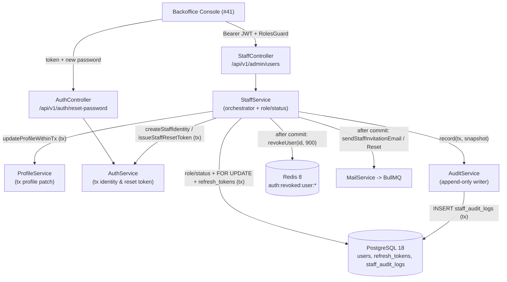
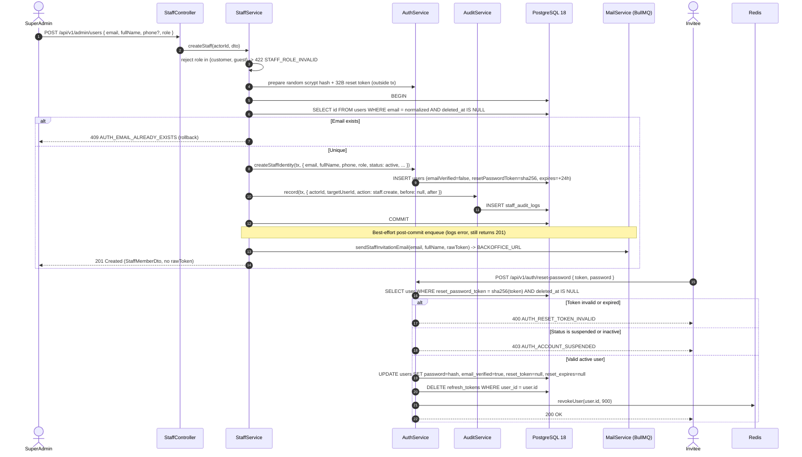
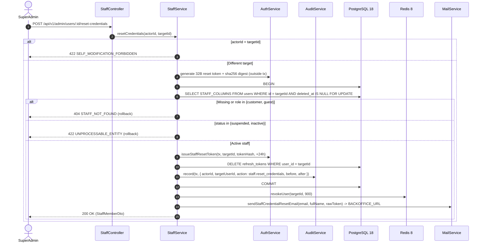

# Staff RBAC & Session Revocation Formal Specification

## Overview & Context

This document specifies the staff lifecycle defined by UC-05 and introduced by #77 (split from #18), with Backoffice consumption in #41. Authorization and audit decisions are recorded in ADR-0019; column-scoped write orchestration follows ADR-0020; session and cryptography mechanics follow ADR-0014, ADR-0015, ADR-0016, and ADR-0017.

`apps/api/src/modules/users` already hosts self-service profile (`ProfileService`, #75) and customer address book (`AddressService`, #76). However, the system still lacks a staff management surface, a last-super-admin concurrency guard, an append-only admin audit log, a credential-reset surface for staff onboarding/recovery, and session revocation when staff are suspended or demoted. Furthermore, `AuthService.resetPassword` currently neither sets `emailVerified = true` nor rejects `suspended`/`inactive` accounts, and `MailService.sendPasswordResetEmail` hardcodes `STOREFRONT_URL` with a 15-minute message instead of `BACKOFFICE_URL` with a 24-hour invitation window.

### Goals

- Let `admin` list/filter/search the staff directory and edit staff profile fields (`fullName`, `phone`).
- Let `super_admin` create/invite staff accounts, change `role` and `status`, and trigger credential resets (`POST /api/v1/admin/users/:id/reset-credentials`).
- Enforce a strict staff-only boundary (`{farm_staff, sales, admin, super_admin}`), excluding `customer` and `guest` accounts from directory reads and admin mutations.
- Provision invited staff through tx-scoped `AuthService` token issuance (`emailVerified = false`, random unusable password hash, 24h SHA-256 reset token), never accepting or returning plaintext passwords or raw tokens, and emailing links targeting `BACKOFFICE_URL`.
- Update `POST /api/v1/auth/reset-password` to set `emailVerified = true` and reject `suspended`/`inactive` accounts (`403 AUTH_ACCOUNT_SUSPENDED`).
- Guarantee at least one active `super_admin` exists after every mutation (`INV-STAFF-1`).
- Revoke all `refresh_tokens` in the same transaction and trigger Redis `revokeUser(userId, 900)` whenever a user is suspended/deactivated, changes role, or has credentials reset.
- Record every effective staff mutation in an append-only `staff_audit_logs` table protected by a PostgreSQL trigger.

### Non-Goals

- Deleting users or transferring ownership of orders or logs.
- Managing or promoting `customer` / `guest` accounts through `/api/v1/admin/users`.
- Reading `staff_audit_logs` via an HTTP endpoint (`GET /admin/audit-logs` is out of scope for #77).
- SSO, OAuth, MFA, or per-permission granularity beyond `UserRole`.
- Changing the 15-minute access-token TTL.
- Audit retention/archival policies or external log shipping.

## Architecture



Symbols and module layout:

- `USERS_ROUTES` in `apps/api/src/modules/users/users.routes.ts` defines frozen `ADMIN_TAG`, `ADMIN_BASE` (`"admin/users"`), `ADMIN_BY_ID` (`":id"`), and `ADMIN_RESET_CREDENTIALS` (`":id/reset-credentials"`).
- `StaffController` in `apps/api/src/modules/users/staff.controller.ts` exposes the four `/api/v1/admin/users` endpoints with `@ApiAuth(...)` role metadata.
- `StaffService` in `apps/api/src/modules/users/staff.service.ts` owns `STAFF_COLUMNS`, pagination/filtering/sorting, `INV-STAFF-1` (`FOR UPDATE`), `INV-STAFF-2` (self-modification guard), `INV-STAFF-7` (staff-only boundary), session revocation on role/status change, and cross-group transaction orchestration per ADR-0020.
- `AuditService` in `apps/api/src/modules/users/audit.service.ts` writes `staff_audit_logs` inside the caller's transaction (`DrizzleTx`).
- `ProfileService` in `apps/api/src/modules/users/profile.service.ts` exposes `updateProfileWithinTx(tx, targetId, patch)` so admin profile edits reuse profile sanitization/column ownership per ADR-0020.
- `AuthService` in `apps/api/src/modules/auth/auth.service.ts` exposes `createStaffIdentity(tx, input)` and `issueStaffResetToken(tx, targetId)` (24h expiry, SHA-256 digest, random unusable scrypt hash), and updates `resetPassword()` / `forgotPassword()` with `emailVerified = true` and active-status gating. `UsersModule` imports `AuthModule` (acyclic: `AuthModule` does not import `UsersModule`).
- `MailService` in `apps/api/src/modules/mail/mail.service.ts` adds `sendStaffInvitationEmail(to, fullName, token)` and `sendStaffCredentialResetEmail(to, fullName, token)` linking to `env.BACKOFFICE_URL/reset-password?token=...` with 24-hour copy.
- `STAFF_ROLES` and `StaffAuditAction` / `StaffAuditSnapshot` live in `packages/shared` (`domain.enums.ts`, `business.constants.ts`, `jsonb-contracts.type.ts`) alongside the four new `API_ERROR_CODES`.

## Operational Flow

### 1. Invite Staff & Complete Activation



### 2. Update Staff Profile, Role, or Status

```mermaid
sequenceDiagram
    autonumber
    actor Actor as Admin / SuperAdmin
    participant Ctrl as StaffController
    participant Svc as StaffService
    participant Prof as ProfileService
    participant Audit as AuditService
    participant DB as PostgreSQL 18
    participant Redis as Redis 8

    Actor->>Ctrl: PATCH /api/v1/admin/users/:id { fullName?, phone?, role?, status? }
    Ctrl->>Svc: updateStaff(actor, targetId, dto)
    alt actor.role = admin and (dto.role or dto.status present)
        Svc-->>Actor: 403 FORBIDDEN
    else dto.role in {customer, guest}
        Svc-->>Actor: 422 STAFF_ROLE_INVALID
    else actor.id = targetId and (dto.role or dto.status present)
        Svc-->>Actor: 422 SELF_MODIFICATION_FORBIDDEN
    else Authorized shape
        Svc->>DB: BEGIN
        opt dto demotes role away from super_admin or changes status to suspended/inactive
            Svc->>DB: SELECT id FROM users WHERE role='super_admin' AND status='active' AND deleted_at IS NULL ORDER BY id FOR UPDATE
        end
        Svc->>DB: SELECT STAFF_COLUMNS FROM users WHERE id = targetId AND deleted_at IS NULL FOR UPDATE
        alt Target missing or target.role in {customer, guest}
            Svc-->>Actor: 404 STAFF_NOT_FOUND (rollback)
        else Target is active super_admin, count(active super_admin) <= 1, and change removes active super_admin
            Svc-->>Actor: 422 LAST_SUPER_ADMIN (rollback)
        else Effective changes == 0 (no-op)
            Svc->>DB: COMMIT
            Svc-->>Actor: 200 OK (unchanged StaffMemberDto, no audit row)
        else Effective changes > 0
            opt fullName or phone changed
                Svc->>Prof: updateProfileWithinTx(tx, targetId, { fullName, phone })
            end
            opt role or status changed
                Svc->>DB: UPDATE users SET role/status WHERE id = targetId
            end
            Svc->>Audit: record(tx, { actorId, targetUserId, action, before, after })
            Audit->>DB: INSERT staff_audit_logs
            opt role changed OR status in {suspended, inactive}
                Svc->>DB: DELETE refresh_tokens WHERE user_id = targetId
            end
            Svc->>DB: COMMIT
            opt role changed OR status in {suspended, inactive}
                Svc->>Redis: revokeUser(targetId, 900)
            end
            Svc-->>Actor: 200 OK (updated StaffMemberDto)
        end
    end
```

### 3. Trigger Credential Reset (`super_admin`)



### 4. Last-Super-Admin Concurrency Guard

```mermaid
sequenceDiagram
    autonumber
    participant R1 as Request A (Demote SA #1)
    participant R2 as Request B (Suspend SA #2)
    participant DB as PostgreSQL 18

    Note over DB: Initial state: 2 active super_admin rows (SA #1, SA #2)
    R1->>DB: BEGIN; SELECT id FROM users WHERE role='super_admin' AND status='active' AND deleted_at IS NULL ORDER BY id FOR UPDATE
    R2->>DB: BEGIN; SELECT id ... ORDER BY id FOR UPDATE (blocks on R1 locks)
    R1->>DB: Sees 2 active super_admins -> demote SA #1 -> write audit -> COMMIT
    R2->>DB: Unblocks, re-evaluates under READ COMMITTED -> sees 1 active super_admin (SA #2)
    R2-->>R2: Count <= 1 and target is SA #2 -> ROLLBACK -> 422 LAST_SUPER_ADMIN
```

## API Contract

### Endpoints

All `/api/v1/admin/users*` endpoints live on `StaffController` (`version: "1"`), inherit class-level `@ApiBadRequestResponseRfc9457()` and `@ApiInternalServerErrorResponseRfc9457()`, and require JWT authentication via `@ApiAuth(...)`:

| Method & Path                                      | Allowed Roles          | Success                                         | Additional RFC 9457 Errors                                                                                               | Notes                                                                       |
| :------------------------------------------------- | :--------------------- | :---------------------------------------------- | :----------------------------------------------------------------------------------------------------------------------- | :-------------------------------------------------------------------------- |
| `GET /api/v1/admin/users`                          | `admin`, `super_admin` | `200` `PaginatedApiResponseDto<StaffMemberDto>` | `401`, `403`, `422` (`STAFF_ROLE_INVALID` if `role` is `customer`/`guest`)                                               | Strict staff filter (`farm_staff`, `sales`, `admin`, `super_admin`)         |
| `POST /api/v1/admin/users`                         | `super_admin`          | `201` `ApiResponseDto<StaffMemberDto>`          | `401`, `403`, `409` (`AUTH_EMAIL_ALREADY_EXISTS`), `422` (`STAFF_ROLE_INVALID`)                                          | Unusable password hash + 24h reset token + `staff.create` audit             |
| `PATCH /api/v1/admin/users/:id`                    | `admin`, `super_admin` | `200` `ApiResponseDto<StaffMemberDto>`          | `401`, `403`, `404` (`STAFF_NOT_FOUND`), `422` (`STAFF_ROLE_INVALID`, `SELF_MODIFICATION_FORBIDDEN`, `LAST_SUPER_ADMIN`) | `admin` may only send `fullName`/`phone`; `role`/`status` by `admin` -> 403 |
| `POST /api/v1/admin/users/:id/reset-credentials`   | `super_admin`          | `200` `ApiResponseDto<StaffMemberDto>`          | `401`, `403`, `404` (`STAFF_NOT_FOUND`), `422` (`SELF_MODIFICATION_FORBIDDEN`, `UNPROCESSABLE_ENTITY`)                   | Revokes sessions, issues 24h reset token, writes `staff.reset_credentials`  |
| `POST /api/v1/auth/reset-password` (existing auth) | `@Public()`            | `200` `ApiResponseDto<null>`                    | `400` (`AUTH_RESET_TOKEN_INVALID`), `403` (`AUTH_ACCOUNT_SUSPENDED`)                                                     | Now sets `emailVerified = true` and rejects `suspended`/`inactive` users    |

### DTOs & Projections

`StaffMemberDto` closed projection (`STAFF_COLUMNS` in `apps/api/src/modules/users/staff.service.ts`), omitting `password`, `verificationToken`, `verificationExpiresAt`, `resetPasswordToken`, `resetPasswordExpiresAt`, `deletedAt`, and `rewardPoints`:

| Field           | Type             | Source                | Writable                                   |
| :-------------- | :--------------- | :-------------------- | :----------------------------------------- |
| `id`            | UUIDv7 string    | `users.id`            | No                                         |
| `email`         | string           | `users.email`         | Create only (normalized lowercase trimmed) |
| `fullName`      | string, 1–100    | `users.fullName`      | Create / Update (`admin`, `super_admin`)   |
| `phone`         | string or `null` | `users.phone`         | Create / Update (`admin`, `super_admin`)   |
| `role`          | `UserRole`       | `users.role`          | Create / Update (`super_admin` only)       |
| `status`        | `UserStatus`     | `users.status`        | Update (`super_admin` only)                |
| `emailVerified` | boolean          | `users.emailVerified` | Derived by `AuthService`                   |
| `createdAt`     | ISO-8601 string  | `users.createdAt`     | No                                         |
| `updatedAt`     | ISO-8601 string  | `users.updatedAt`     | No                                         |

Input validation rules:

- `ListStaffQueryDto` (`.strict()`):
  - `role`: optional `UserRole` value; `customer` or `guest` passes schema enum and is rejected in service with `422 STAFF_ROLE_INVALID`.
  - `status`: optional `UserStatus` (`active` | `inactive` | `suspended`).
  - `q`: optional `zSanitizedString({ min: 1, max: 100 })` (or trimmed search up to 100 chars), escaped for SQL `LIKE`/`ILIKE` wildcards (`%`, `_`, `\`), matching `fullName`, `email`, or `phone`.
  - `page`: `zNumericString({ integer: true, min: 1 }).default(1)`.
  - `limit`: `zNumericString({ integer: true, min: 1, max: 100 }).default(20)`.
  - `sort`: whitelist enum `createdAt:desc` (default), `createdAt:asc`, `fullName:asc`, `fullName:desc`, `email:asc`, `email:desc`; always appends deterministic tie-breaker `id DESC`. Unknown query keys or unlisted `sort` values return `400 VALIDATION_FAILED`.
- `CreateStaffDto` (`.strict()`): `email` (`zEmail()`), `fullName` (`zFullName()`), `phone` (`zPhoneNumber().nullable().optional()`), `role` (`z.enum(UserRole)` — `customer`/`guest` mapped to `422 STAFF_ROLE_INVALID`).
- `UpdateStaffDto` (`.strict()`): optional `fullName` (`zFullName()`), `phone` (`zPhoneNumber().nullable()`), `role` (`z.enum(UserRole)`), `status` (`z.enum(UserStatus)`), with `.refine()` requiring at least one defined key (`MESSAGES.VALIDATION.AT_LEAST_ONE_FIELD` or staff-specific message). Unknown fields fail with `400 UNRECOGNIZED_KEYS`.
- `:id` route parameter: validated via `ZodValidationPipe(zUuidV7())`, rejecting malformed UUIDs with `400 INVALID_UUID`.

### Shared Contracts & Error Codes (`@greenroots/shared`)

Register in `packages/shared`:

- `STAFF_ROLES` constant in `business.constants.ts` (or `domain.enums.ts`) = `[UserRole.FARM_STAFF, UserRole.SALES, UserRole.ADMIN, UserRole.SUPER_ADMIN]`.
- `StaffAuditAction` enum (`staff.create`, `staff.update_profile`, `staff.change_role`, `staff.change_status`, `staff.update`, `staff.reset_credentials`) in `domain.enums.ts`.
- `StaffAuditSnapshot` interface (`{ email: string; fullName: string; phone: string | null; role: UserRole; status: UserStatus }`) in `jsonb-contracts.type.ts`.
- `API_ERROR_CODES` + `API_ERROR_DICTIONARY` in `error-dictionary.ts`:
  - `STAFF_NOT_FOUND` (`404`)
  - `LAST_SUPER_ADMIN` (`422`)
  - `SELF_MODIFICATION_FORBIDDEN` (`422`)
  - `STAFF_ROLE_INVALID` (`422`)
- `MESSAGES.STAFF` English developer details in `apps/api/src/common/constants/messages.constant.ts`, and `STAFF_AUDIT_LOG_IMMUTABLE` handling in `GlobalExceptionFilter` (`P0001` -> `403`, matching `FARMING_LOG_IMMUTABLE` precedent).

### Schema & Migration (`database-and-migrations.md` §5)

1. **Enums**: `staffAuditActionEnum` in `apps/api/src/database/schemas/enums.schema.ts` backed by `StaffAuditAction` from `@greenroots/shared`.
2. **Table `staff_audit_logs`**: defined in `apps/api/src/database/schemas/user.schema.ts` (and registered in `relations.ts`) with `primaryKeyUuid`, `actorId` (`uuid NOT NULL REFERENCES users(id) ON DELETE RESTRICT`), `targetUserId` (`uuid NOT NULL REFERENCES users(id) ON DELETE RESTRICT`), `action` (`staff_audit_action NOT NULL`), `before` (`jsonb.$type<StaffAuditSnapshot | null>()`), `after` (`jsonb.$type<StaffAuditSnapshot | null>()`), `createdAt` (`timestamptz NOT NULL DEFAULT now()` — no `updatedAt`), plus composite B-tree indexes `(target_user_id, created_at)` and `(actor_id, created_at)`.
3. **Immutability trigger**: forward-only Drizzle custom SQL migration installs `prevent_staff_audit_log_mutation()` and `trg_immutable_staff_audit_logs` (`BEFORE UPDATE OR DELETE ON staff_audit_logs FOR EACH ROW`, raising `STAFF_AUDIT_LOG_IMMUTABLE`), matching `20261113020004_immutable_farming_logs`. Note: PostgreSQL row triggers do not fire on `TRUNCATE`, so `truncateAllTables()` in test cleanup remains unaffected.

## Security & Reliability

### Role Matrix

| Action                                    | `guest` / `customer` | `farm_staff` | `sales` | `admin` | `super_admin` |
| :---------------------------------------- | :------------------: | :----------: | :-----: | :-----: | :-----------: |
| Read staff directory (`GET /admin/users`) |          —           |      —       |    —    |   Yes   |      Yes      |
| Edit `fullName` / `phone` (`PATCH`)       |          —           |      —       |    —    |   Yes   |      Yes      |
| Create staff account (`POST`)             |          —           |      —       |    —    |    —    |      Yes      |
| Change `role` (`PATCH`)                   |          —           |      —       |    —    |    —    |      Yes      |
| Change `status` (`PATCH`)                 |          —           |      —       |    —    |    —    |      Yes      |
| Trigger credential reset (`POST`)         |          —           |      —       |    —    |    —    |      Yes      |
| Change own `role`/`status` or self-reset  |          —           |      —       |    —    |   No    |      No       |

### Controls

- **Authorization & strict boundary**: `RolesGuard` rejects callers outside `@ApiAuth(...)` with `403 FORBIDDEN`. Inside `StaffService.updateStaff`, an `admin` supplying `role` or `status` is rejected with `403 FORBIDDEN` before reading/mutating the target. Non-staff targets (`customer`/`guest`) return `404 STAFF_NOT_FOUND` so customer existence cannot be probed via `/admin/users`.
- **Write-ownership & projection safety**: Writes follow ADR-0020's tx-scoped collaborator rule (`AuthService` owns identity/reset tokens, `ProfileService` owns `fullName`/`phone`, `StaffService` owns `role`/`status`). Every read and `RETURNING` clause uses closed `STAFF_COLUMNS`; `select *` is forbidden.
- **Invitation & reset secrecy**: Tokens are 32 random bytes (`64` hex chars), stored solely as SHA-256 digests with a 24-hour TTL (`STAFF_INVITE_TOKEN_TTL_SECONDS = 86400`). They are never returned in HTTP responses, stored in `staff_audit_logs`, or logged.
- **Self-modification**: `actorId === targetId` rejects any `role` or `status` modification and any `POST .../reset-credentials` call with `422 SELF_MODIFICATION_FORBIDDEN`, while allowing an `admin`/`super_admin` to edit their own `fullName`/`phone`.
- **Lock ordering & last super admin**: Any `PATCH` that could reduce the active `super_admin` count acquires `FOR UPDATE` on active `super_admin` rows ordered by `id ASC` before acquiring `FOR UPDATE` on `targetId` (consistent lock order on `users` rows by `id ASC` or parent-set-before-target prevents deadlocks under `READ COMMITTED`).
- **Session termination & 15-minute residual window**: Suspending, deactivating, changing `role`, or resetting credentials deletes all `refresh_tokens` for `targetId` inside the database transaction and calls `redisService.revokeUser(targetId, 900)` after commit. Because `revokeUser` is fail-open (ADR-0016), database deletion is authoritative for refresh and login/password-reset paths, while stateless JWT access tokens carry a **worst-case 15-minute residual window** during a Redis outage (`ACCESS_TOKEN_TTL_SECONDS = 900`).
- **Audit integrity**: `staff_audit_logs` inserts share the mutation transaction; any failure rolls back the mutation. Direct `UPDATE` or `DELETE` is blocked at the PostgreSQL trigger level (`INV-STAFF-5`). Only the five `StaffAuditSnapshot` fields (`email`, `fullName`, `phone`, `role`, `status`) appear in `before`/`after` JSONB; no-op `PATCH` payloads skip writing audit noise.
- **Failure behaviour**: Expensive scrypt hashing (`POST /admin/users`) and token generation run _before_ opening the DB transaction (`database-and-migrations.md` §4). A BullMQ/Redis outage after `POST /admin/users` commit logs an error and still returns `201` because the 24-hour token is persisted and resendable via `POST .../reset-credentials`. Conversely, `POST .../reset-credentials` propagates mail enqueue errors so an admin knows the reset link was not queued.
- **Rate limiting**: Admin routes use `CustomThrottlerGuard` (`default` tier: `100 req / 60s`); `POST /auth/reset-password` keeps the `auth` tier (`5 req / 60s`).

## Domain Invariant Taxonomy

| Invariant     | Name                   | Formal Statement                                                                                                                                                             | Enforcement Seam                                                    | Verification Test                                                                     |
| :------------ | :--------------------- | :--------------------------------------------------------------------------------------------------------------------------------------------------------------------------- | :------------------------------------------------------------------ | :------------------------------------------------------------------------------------ |
| `INV-STAFF-1` | Last Active SuperAdmin | $\forall t: \lvert\{u : u.\text{role} = \text{super\_admin} \land u.\text{status} = \text{active} \land u.\text{deletedAt} = \text{null}\}\rvert \ge 1$                      | `StaffService.updateStaff` `FOR UPDATE` lock + transaction          | Demoting/suspending last super admin -> `422 LAST_SUPER_ADMIN`                        |
| `INV-STAFF-2` | No Self-Modification   | $(\text{Update}(a, a, \Delta) \land (\Delta.\text{role} \lor \Delta.\text{status})) \lor \text{ResetCreds}(a, a) \implies \bot$                                              | `StaffService` actor vs target check                                | Self role/status change or self reset -> `422 SELF_MODIFICATION_FORBIDDEN`            |
| `INV-STAFF-3` | Session Revocation     | $(\Delta.\text{status} \in \{\text{suspended}, \text{inactive}\} \lor \Delta.\text{role} \lor \text{ResetCreds}) \implies \lvert\text{RefreshTokens}(u)\rvert = 0$ at commit | Transaction deletes `refresh_tokens`; `revokeUser(id, 900)` post-tx | Refresh -> `401`; access token -> `401` (with Redis up)                               |
| `INV-STAFF-4` | Audit Completeness     | Every effective create, profile edit, role change, status change, combined update, or credential reset writes 1 `staff_audit_logs` row in-tx                                 | `AuditService.record(tx)` inside mutation transaction               | Failed audit insert rolls back `users` write                                          |
| `INV-STAFF-5` | Audit Immutability     | $\nexists$ successful `UPDATE` or `DELETE` on `staff_audit_logs`                                                                                                             | `trg_immutable_staff_audit_logs` DB trigger                         | Direct SQL `UPDATE`/`DELETE` fails with `STAFF_AUDIT_LOG_IMMUTABLE`                   |
| `INV-STAFF-6` | Invitation Secrecy     | Raw reset token $\notin$ HTTP response $\land$ $\notin$ `staff_audit_logs` $\land$ $\notin$ logs; only `sha256(token)` stored                                                | `AuthService` tx helpers + closed `STAFF_COLUMNS`                   | Response & audit JSONB exclude password/token fields                                  |
| `INV-STAFF-7` | Staff-Only Boundary    | Directory reads and admin mutations only target $u.\text{role} \in \text{STAFF\_ROLES}$; assigning `customer`/`guest` is forbidden                                           | `StaffService` filter & role validation                             | Customer target -> `404 STAFF_NOT_FOUND`; `customer` role -> `422 STAFF_ROLE_INVALID` |

### Edge Cases (`EDGE-1..18`)

| ID        | Case                                                                                  | Expected Behaviour                                                            |
| :-------- | :------------------------------------------------------------------------------------ | :---------------------------------------------------------------------------- |
| `EDGE-1`  | `POST /admin/users` with `role: "customer"` or `"guest"`                              | `422 STAFF_ROLE_INVALID`                                                      |
| `EDGE-2`  | `POST /admin/users` with email already used by a `customer` or existing staff         | `409 AUTH_EMAIL_ALREADY_EXISTS`                                               |
| `EDGE-3`  | `POST /admin/users` with email of a soft-deleted user (`deleted_at IS NOT NULL`)      | Allowed (`201`), matching `users_email_uidx` partial unique index             |
| `EDGE-4`  | `POST /admin/users` with unknown fields (`password`, `emailVerified`, `rewardPoints`) | `400 VALIDATION_FAILED` (`UNRECOGNIZED_KEYS`)                                 |
| `EDGE-5`  | `POST /admin/users` when BullMQ/Redis fails after commit                              | Logs error, returns `201`; admin can resend via `reset-credentials`           |
| `EDGE-6`  | `GET /admin/users?role=customer` or `role=guest`                                      | `422 STAFF_ROLE_INVALID`                                                      |
| `EDGE-7`  | `GET /admin/users?q=50%` (SQL wildcard characters in `q`)                             | `%` and `_` escaped; matches literal substring safely                         |
| `EDGE-8`  | `GET /admin/users?sort=password:asc` or unknown query key                             | `400 VALIDATION_FAILED`                                                       |
| `EDGE-9`  | `PATCH /admin/users/:id` with `{}` (empty body)                                       | `400 VALIDATION_FAILED`                                                       |
| `EDGE-10` | `PATCH /admin/users/:id` called by `admin` with `role` or `status`                    | `403 FORBIDDEN`                                                               |
| `EDGE-11` | `PATCH /admin/users/:id` called by `admin` or `super_admin` editing own `fullName`    | `200 OK`; writes `staff.update_profile` audit row                             |
| `EDGE-12` | `PATCH /admin/users/:id` with no-op values identical to persisted row                 | `200 OK` with current projection; no `UPDATE`, no audit row, no revoke        |
| `EDGE-13` | `PATCH /admin/users/:id` targeting a `customer`, `guest`, or soft-deleted UUIDv7      | `404 STAFF_NOT_FOUND`                                                         |
| `EDGE-14` | `PATCH /admin/users/:id` or `POST .../reset-credentials` with non-UUIDv7 `:id`        | `400 VALIDATION_FAILED` (`INVALID_UUID`)                                      |
| `EDGE-15` | `POST /admin/users/:id/reset-credentials` on self (`actorId === targetId`)            | `422 SELF_MODIFICATION_FORBIDDEN`                                             |
| `EDGE-16` | `POST /admin/users/:id/reset-credentials` on `suspended` or `inactive` staff          | `422 UNPROCESSABLE_ENTITY`                                                    |
| `EDGE-17` | `POST /auth/reset-password` with valid invite token when staff was later `suspended`  | `403 AUTH_ACCOUNT_SUSPENDED`; password unchanged, `emailVerified` stays false |
| `EDGE-18` | `POST /auth/reset-password` with valid 24h invite token on active invited staff       | `200 OK`; sets `password`, sets `emailVerified = true`, staff can login       |

### Concurrency & Adversarial Matrix (`ADV-1..5`)

| ID      | Scenario                                                                       | Expected Behaviour                                                                                                     |
| :------ | :----------------------------------------------------------------------------- | :--------------------------------------------------------------------------------------------------------------------- |
| `ADV-1` | Two concurrent requests demoting/suspending the last two active `super_admin`s | Serialized by `FOR UPDATE` on active `super_admin` rows; one commits (`200`), second gets `422 LAST_SUPER_ADMIN`       |
| `ADV-2` | Two concurrent `POST /admin/users` requests with the exact same email          | One commits (`201`), second hits `users_email_uidx` (`23505`) -> mapped to `409 AUTH_EMAIL_ALREADY_EXISTS`             |
| `ADV-3` | Suspended or demoted staff sends requests with cached JWT while Redis is up    | `JwtAuthGuard` sees `auth:revoked:user:<id>` -> `401` immediately; refresh fails `401`                                 |
| `ADV-4` | Suspended or demoted staff sends requests with cached JWT while Redis is down  | `JwtAuthGuard` fails open (max 15m residual window); `POST /auth/refresh` and `POST /auth/login` reject via PostgreSQL |
| `ADV-5` | Privileged SQL or ORM attempt to `UPDATE` or `DELETE` `staff_audit_logs`       | Trigger raises `P0001` (`STAFF_AUDIT_LOG_IMMUTABLE`) -> transaction aborts, `GlobalExceptionFilter` returns `403`      |

## Test Matrix

- **Helper upgrade (`apps/api/test/helpers/auth.helper.ts`)**: Keep `createAuthenticatedAdmin(db, jwtService, overrides)` backward-compatible (default `UserRole.SUPER_ADMIN`) and support explicit role invocation (e.g., `createAuthenticatedStaff(db, jwtService, role, overrides)` or explicit `role` parameter) plus `captureMailTokens(app)` spying on `sendStaffInvitationEmail` and `sendStaffCredentialResetEmail`.
- **Unit specs**:
  - `StaffService` (`staff.service.spec.ts`): role-change/status-change revocation branching, `before`/`after` snapshot diff & no-op detection, mail failure resilience on create vs propagation on reset-credentials.
  - `AuthService` (`auth.service.spec.ts`): `resetPassword` setting `emailVerified = true` and rejecting `suspended`/`inactive` with `403`.
- **E2E Integration suite (`apps/api/test/integration/staff.spec.ts`)**:
  - Full RBAC matrix across `customer`, `farm_staff`, `sales`, `admin`, `super_admin`, and unauthenticated calls on all 4 `/api/v1/admin/users*` endpoints.
  - `GET /api/v1/admin/users`: filters (`role`, `status`, `q` including wildcard escaping), sorting, pagination envelope (`PaginatedApiResponseDto`), customer/guest exclusion, closed projection verification.
  - `POST /api/v1/admin/users`: `201` creation, unusable password cannot log in, captured raw token works on `POST /auth/reset-password` -> sets `emailVerified = true` -> staff logs in; rejects `customer`/`guest` (`422 STAFF_ROLE_INVALID`) and duplicate emails (`409`).
  - `PATCH /api/v1/admin/users/:id`: `admin` profile edit (`200`), `admin` role/status attempt (`403`), `super_admin` role/status change (`200`), self-modification (`422 SELF_MODIFICATION_FORBIDDEN`), last super admin (`422 LAST_SUPER_ADMIN`), customer target (`404 STAFF_NOT_FOUND`), no-op skip.
  - `POST /api/v1/admin/users/:id/reset-credentials`: `200`, revokes active refresh + Redis session, sends Backoffice reset email, rejects self (`422`) and `suspended`/`inactive` (`422`).
  - Session revocation (`INV-STAFF-3`): suspending, deactivating, or demoting revokes `refresh_tokens` in DB and triggers `401` on cached access token and refresh attempt.
  - Audit completeness & immutability (`INV-STAFF-4`, `INV-STAFF-5`): asserts exact `staff_audit_logs` rows + `before`/`after` JSONB and verifies raw `UPDATE`/`DELETE` throws `STAFF_AUDIT_LOG_IMMUTABLE`.
  - Concurrency (`Promise.all`): concurrent last-super-admin demotions (`ADV-1`) and duplicate staff creation (`ADV-2`).
- **Contract propagation**: run `bun run types:sync` after route/DTO changes and commit updated `apps/api/openapi.json` and generated client/test contracts.

## Risks & Rollback

- **Lock contention on `super_admin` mutations**: Locking active `super_admin` rows serializes concurrent role/status changes on super admins. Acceptable given low administrative mutation frequency; lock order (`active super_admin rows ordered by id ASC` -> `targetId`) prevents deadlocks.
- **Residual access-token window during Redis outage**: Documented 15-minute bound (`ACCESS_TOKEN_TTL_SECONDS = 900`); refresh and login remain immediately authoritative in PostgreSQL.
- **Unbounded audit table growth**: `staff_audit_logs` grows monotonically; future archival must add a deliberate retention ADR and partition/detach strategy rather than relaxing the immutability trigger.
- **Rollback**: Revert the application PR and re-run `bun run types:sync`. If rolling back the database schema in a non-production environment, run a forward compensating migration dropping `trg_immutable_staff_audit_logs`, `prevent_staff_audit_log_mutation()`, `staff_audit_logs`, and `staff_audit_action`.
