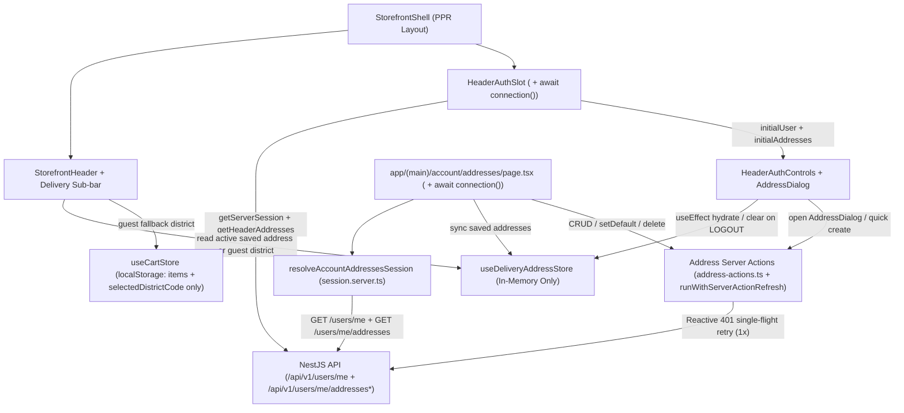
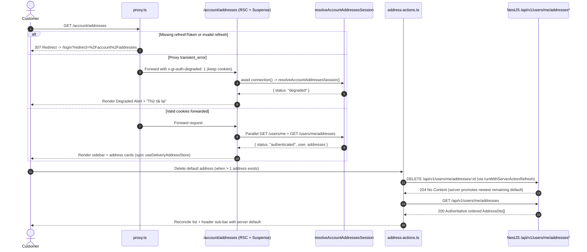
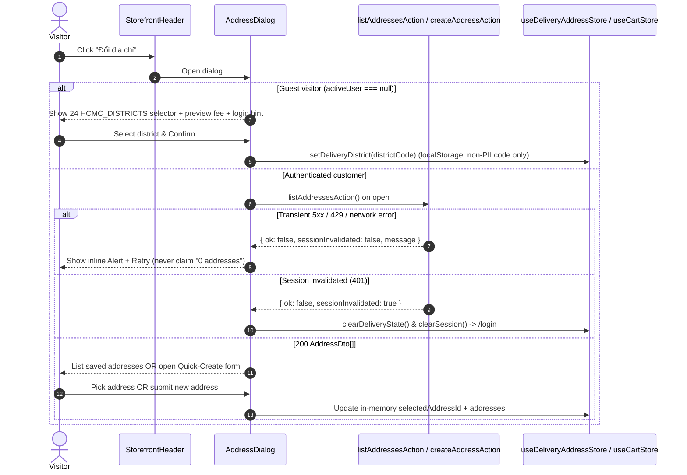

# Storefront Address Book & Quick Delivery Dialog Formal Specification

## Overview & Context

This specification defines the Storefront protected route `/account/addresses`, cookie-bridged delivery address book Server Actions (`/api/v1/users/me/addresses*`), non-persisted client delivery address synchronization, and authenticated/guest `AddressDialog` behavior for Issue `#124` (Parent Epic `#7`, building on `#76` / `ADR-0018`, `#122` / `ADR-0036`, and `#123` / `docs/design/storefront-profile-security-formal-spec.md`).

Storefront operates under Next.js 16 `cacheComponents: true`, strict BFF cookie isolation (`Q28` in `apps/storefront/src/lib/api-client.ts`), and single-use refresh token rotation (`ADR-0015`). Meanwhile, `AddressController` (`apps/api/src/modules/users/address.controller.ts`) enforces strict `.strict()` DTOs (`districtCode` only, rejecting client coordinates and rejecting `isDefault` on `PATCH /:id`), a 10-address per-user cap (`BUSINESS_RULES.MAX_USER_ADDRESSES`), and automatic newest-remaining default promotion on `DELETE /:id` (`204 No Content`). Reconciling the Stitch UI prototype (`s_a_ch_giao_h_ng.html`) and PR `#114` against these invariants avoids `localStorage` PII leakage, token-rotation races, and DTO validation failures.

### Goals

- Render `/account/addresses` inside `StorefrontShell` (`app/(main)/layout.tsx`) reusing the collapsible mobile `Sheet` + desktop card `AccountSidebar` (`UI-4` verified links only) and `@greenroots/ui` primitives.
- Keep all `/api/v1/users/me/addresses*` calls strictly on the Storefront BFF (`Q28`), executing mutations through `runWithServerActionRefresh()` (`session.server.ts`) and mapping RFC 9457 error payloads with `resolveApiErrorMessage()` (`@greenroots/shared`).
- Replace the Stitch inline bottom form and multi-button row actions with a modal `AddressFormDialog` popup (Create/Edit) and a Base UI `DropdownMenu` per address card, separated cleanly from `ConfirmActionDialog` delete confirmation (`INV-ADDR-5`).
- Isolate saved customer address PII (`receiverName`, `phoneNumber`, `streetAddress`) strictly to runtime memory (`useDeliveryAddressStore`) hydrated via `<Suspense>` SSR (`HeaderAuthSlot`) and wiped on logout / cross-tab `LOGOUT` / `SESSION_CHANGED`, keeping browser `localStorage` (`useCartStore`) restricted to cart items and non-PII `selectedDistrictCode`.
- Upgrade `AddressDialog` to let authenticated customers pick or add saved addresses cleanly while keeping a seamless guest `HCMC_DISTRICTS` selector backed by `estimateDistrictPreviewQuote()`.

### Non-Goals

- Dynamic `FarmSettingsService`-backed `POST /api/v1/shipping/quote` integration (`#49` owns dynamic Storefront shipping quote replacement).
- Order history navigation (`/orders`, `#142`) or checkout submission gating (`#141`).
- Street-level geocoding or interactive map pickers (`ADR-0018`).
- Editing `isDefault` inside `PATCH /api/v1/users/me/addresses/:id` (`EDGE-5`); default switching uses `PATCH .../default` exclusively.

## Architecture

### Target Symbols & Ownership Boundaries

- `apps/storefront/src/types/address.types.ts` — OpenAPI type aliases `CustomerAddress`, `CreateCustomerAddressInput`, `UpdateCustomerAddressInput` (`ADR-0007`).
- `apps/storefront/src/lib/auth/bff-error.ts` — shared pure RFC 9457 error extractor and refresh-failure classifier reused across `auth-actions.ts` and `address-actions.ts`.
- `apps/storefront/src/lib/address/address-validation.ts` — `normalizeAddressText`, `normalizeRequiredPhone`, `createAddressFormSchema`, `updateAddressFormSchema`, `addressIdSchema`, and `buildUpdateAddressDiff` aligned strictly with `CreateAddressDto` and `UpdateAddressDto` (reusing `VN_PHONE_REGEX` and `VN_PHONE_ERROR_MESSAGE` from `auth-validation.ts` and `HCMC_DISTRICTS` / `BUSINESS_RULES.MAX_USER_ADDRESSES` from `@greenroots/shared`).
- `apps/storefront/src/lib/address/address-actions.ts` — `"use server"` actions (`listAddressesAction`, `createAddressAction`, `updateAddressAction`, `setDefaultAddressAction`, `deleteAddressAction`) wrapped in `runWithServerActionRefresh()`, explicitly classifying terminal `401` (`sessionInvalidated: true`) vs transient errors (`sessionInvalidated: false`, cookies preserved).
- `apps/storefront/src/lib/auth/session.server.ts` — per-request memoized (`React.cache`) `getHeaderAddresses()` (fail-open for public header sub-bar) and `getAccountAddressesSession()` / `resolveAccountAddressesSession()` (fail-closed `authenticated` | `unauthenticated` | `degraded` for `/account/addresses`).
- `apps/storefront/src/stores/delivery-address.store.ts` — non-persisted `useDeliveryAddressStore` coordinating SSR default hydration, `AddressDialog` selection, CRUD reconciliation, and synchronous wipe on logout (`client-logout.ts` & cross-tab `LOGOUT`).
- `apps/storefront/src/stores/cart.store.ts` — `partialize` restricts `localStorage` persistence (`greenroots-cart-v1`) strictly to `items` and non-PII `selectedDistrictCode`.
- `apps/storefront/src/components/common/{header-auth-slot,header-auth-controls,header,address-dialog}.tsx` — `<Suspense>` hydration, header dropdown link to `/account/addresses`, sub-bar delivery target summary, and saved-address + guest-district `AddressDialog`.
- `apps/storefront/app/(main)/account/layout.tsx` & `apps/storefront/src/features/account/components/` — persistent `/account` 2-column layout keeping `AccountSidebar` (`usePathname()` + `useAuthStore` live sync) mounted across sibling navigations without sidebar skeleton flashes, generalized `AccountProfileDegradedCard`, `AddressCard` (Base UI `DropdownMenu`), `AddressFormDialog` (Create/Edit popup), `AccountAddressesView`, and `app/(main)/account/addresses/page.tsx`.

## Operational Flow

### 1. Protected Address Book SSR Resolution & CRUD

### 2. Header Sub-bar & `AddressDialog` Interaction

## Security & Reliability

- **Non-PII Browser Persistence (`INV-SF-ADDR-1`)**: `receiverName`, `phoneNumber`, and `streetAddress` never enter `localStorage` or `sessionStorage`. `useCartStore` uses Zustand `partialize` so only `items` and non-PII `selectedDistrictCode` serialize to `greenroots-cart-v1`.
- **Coordinate Integrity (`INV-SF-ADDR-2`, `ADR-0018`)**: Forms validate `districtCode` against the canonical 24 `HCMC_DISTRICTS` codes (`packages/shared`) and never send `latitude`, `longitude`, or `city`. Preview distances and fees use `estimateDistrictPreviewQuote()`.
- **Single-Flight Auth Resilience (`INV-SF-ADDR-3`, `ADR-0036`)**: Protected address actions delegate token retry to `runWithServerActionRefresh()`. Only terminal `401` responses invoke `clearServerSessionCookies()`; transient refresh errors, `429`, `5xx`, or network failures keep cookies intact and preserve user form inputs inside the modal.
- **PPR Compliance (`UI-3`)**: Both `HeaderAuthSlot` and `AccountAddressesGate` call `await connection()` outside `try/catch` before invoking `React.cache`-wrapped session/address readers, enforced statically by `scripts/ui-primitives-hygiene.test.ts`.
- **No Unhandled Error Masking**: `listAddressesAction` distinguishes empty `[]` (`200 OK`) from degraded/offline failures (`ok: false`), preventing UI false-empty states or silent logout wipes.

## Domain Invariant Taxonomy

| Invariant       | Name                          | Formal Statement                                                                                                                        | Enforcement Seam                                                                           | Verification Test                                                               |
| :-------------- | :---------------------------- | :-------------------------------------------------------------------------------------------------------------------------------------- | :----------------------------------------------------------------------------------------- | :------------------------------------------------------------------------------ |
| `INV-SF-ADDR-1` | Non-PII `localStorage`        | Browser storage never stores `receiverName`, `phoneNumber`, or saved `streetAddress`; runtime delivery state clears on logout           | `partialize` in `cart.store.ts`; in-memory `delivery-address.store.ts`; `client-logout.ts` | Persistence test verifies `localStorage` excludes PII; logout wipes `addresses` |
| `INV-SF-ADDR-2` | District-Only Input           | Address mutations submit only `HCMC_DISTRICTS` `districtCode`, contact/street strings, and optional `isDefault` (create only)           | `createAddressFormSchema`, `updateAddressFormSchema` (`address-validation.ts`)             | Rejects unknown `districtCode`, coordinates, or unknown keys                    |
| `INV-SF-ADDR-3` | Session & Cookie Preservation | Terminal `401` clears cookies (`sessionInvalidated: true`); `429`/`5xx`/`transient_error` preserve cookies and form state               | `address-actions.ts` (`runWithServerActionRefresh`, `isTransientRefreshFailure`)           | `address-actions.spec.ts` asserts cookie clear vs preserve matrix               |
| `INV-SF-ADDR-4` | Degraded SSR Isolation        | `/account/addresses` separates `unauthenticated` (`/login` redirect) from `degraded` (alert card, cookies kept)                         | `resolveAccountAddressesSession` (`session.server.ts`), `AccountAddressesGate`             | `session.server.spec.ts` covers `x-gr-auth-degraded`, `401`, and `5xx`          |
| `INV-SF-ADDR-5` | Edit/`isDefault` Separation   | Edit `Dialog` omits `isDefault` (`EDGE-5`) and submits changed fields only (`EDGE-4`); default switches use `PATCH .../default`         | `buildUpdateAddressDiff`, `AddressFormDialogView`, `AddressCard`                           | Edit payload never contains `isDefault`; unchanged edit disables submit         |
| `INV-SF-ADDR-6` | Default Promotion Sync        | Deleting a default address when other addresses exist reconciles the server-promoted default from `GET /users/me/addresses` after `204` | `executeDeleteAddressAction` (`address-actions.ts`) + `useDeliveryAddressStore`            | Delete default triggers re-fetch and updates default badge to server row        |
| `INV-SF-ADDR-7` | Address Cap Enforcement       | UI blocks new-address modal creation at `addresses.length >= 10` (`MAX_USER_ADDRESSES`) and localizes `422 ADDRESS_LIMIT_REACHED`       | `AccountAddressesView`, `AddressDialog`, `resolveApiErrorMessage`                          | Disable state at 10 items + localized RFC 9457 error assertion                  |
| `INV-SF-ADDR-8` | Cross-Surface Delivery Sync   | `/account/addresses`, `AddressDialog`, and `StorefrontHeader` reconcile edited/deleted/default selections atomically                    | `useDeliveryAddressStore` (`setAddresses`, `reconcileAfterCreate`, `clearDeliveryState`)   | Store & DOM specs assert sub-bar & active selection reconcile cleanly           |

### Edge Cases (`EDGE-1..10`)

| ID        | Case                                                                             | Expected Behaviour                                                                                                 |
| :-------- | :------------------------------------------------------------------------------- | :----------------------------------------------------------------------------------------------------------------- |
| `EDGE-1`  | User clicks `"Sửa"` with identical field values                                  | Submit disabled; `buildUpdateAddressDiff` returns `{ ok: true, patch: null }` so no `{}` `PATCH` fires             |
| `EDGE-2`  | Customer has 0 saved addresses and opens Create dialog                           | `"Đặt làm địa chỉ giao hàng mặc định"` checkbox defaults checked and disabled (`EDGE-8`)                           |
| `EDGE-3`  | Customer has 10 saved addresses                                                  | `"Thêm địa chỉ mới"` disabled with cap caption (`10 / 10 địa chỉ`); `422 ADDRESS_LIMIT_REACHED` localized if raced |
| `EDGE-4`  | Customer deletes the active default address while 2+ exist                       | `ConfirmActionDialog` warns newest remaining address becomes default; post-`204` re-fetch updates badge & header   |
| `EDGE-5`  | Customer deletes the sole remaining address                                      | List transitions to empty state; header sub-bar reverts cleanly to guest `selectedDistrictCode`                    |
| `EDGE-6`  | `AddressDialog` opens while offline or upstream returns `503`                    | Shows inline destructive `Alert` + `"Thử tải lại"` without falsely claiming 0 addresses                            |
| `EDGE-7`  | Selected address in `AddressDialog` is edited or deleted on `/account/addresses` | `useDeliveryAddressStore` updates label if edited or falls back to new server default if deleted                   |
| `EDGE-8`  | Customer opens card `DropdownMenu` on mobile or keyboard                         | Clicking `"Sửa"` or `"Xóa"` closes menu cleanly before mounting `Dialog` (zero stacked overlay focus traps)        |
| `EDGE-9`  | Multi-tab logout (`BroadcastChannel`) while browsing `/` or `/account/addresses` | Clears `useAuthStore` + `useDeliveryAddressStore` and triggers `router.refresh()`                                  |
| `EDGE-10` | Unauthenticated user opens `/account/addresses` directly                         | `proxy.ts` / RSC gate redirects to `/login?redirect=%2Faccount%2Faddresses`                                        |

## Risks & Rollback

- **PR `#114` Fork Rewrite**: Updating `VandesDang:feat/storefront-address-session` replaces unmergeable pre-`#122` commits with a clean rebase from `main` carrying `Co-authored-by: LamDang <danglam418@gmail.com>`. Rollback is a single PR revert or reverting `apps/storefront/src/lib/address/` and `/account/addresses` without any database or backend schema impact.
- **Public-Page SSR Latency**: Adding `GET /users/me/addresses` inside `HeaderAuthSlot` runs only for authenticated visitors (guests with no `accessToken` skip immediately) and fails open to `null` so public browsing never degrades.
