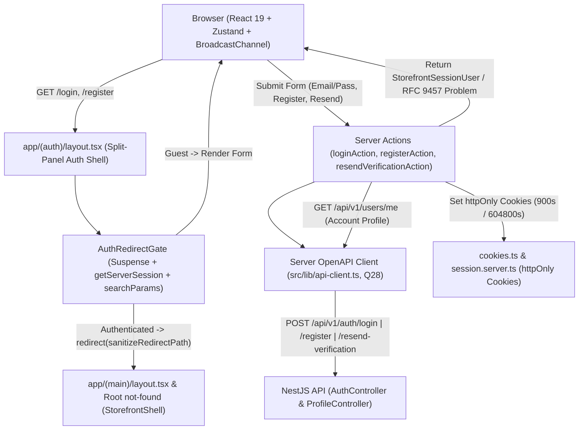
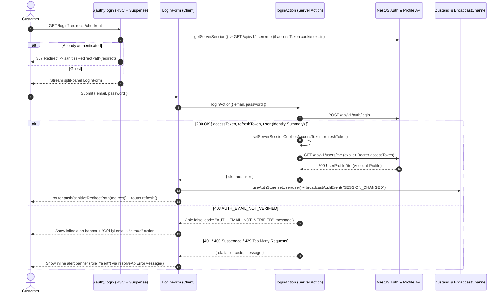

## Storefront Customer Login & Registration Screens Formal Specification

### Overview & Context

This specification defines the Storefront `/login` and `/register` UI screens, route-group layout shell separation, Server Action BFF bindings, client-side validation rules, and error/session synchronization invariants for Issue `#125` (Epic `#7`, building on `#122` / `ADR-0036` and `#17` / `docs/design/auth-and-session-management.md`).

#### Goals

- Implement `/login` and `/register` matching the Stitch split-panel design (`ng_nh_p/code.html`, `ng_k/code.html`, `greenroots_farm_design_system.md`) while stripping mock `Mã OTP` and `Google` buttons (explicit non-goals).
- Separate Storefront route shells via Next.js App Router route groups `(main)` and `(auth)` so authentication pages render full-screen without `StorefrontHeader` or `StorefrontFooter`, while keeping `StorefrontShell` active across shopping pages, `/maintenance`, and root `not-found.tsx` (requiring a `UI-2` update in `docs/standards/ui-and-frontend.md`).
- Bind form submissions strictly through Next.js Server Actions (`Q28` / `ADR-0036`) calling `api.POST("/api/v1/auth/login")`, `api.POST("/api/v1/auth/register")`, and `api.POST("/api/v1/auth/resend-verification")`, writing `httpOnly` session cookies server-side, hydrating `StorefrontSessionUser` via `GET /api/v1/users/me` (`Account Profile`), and broadcasting `SESSION_CHANGED` across tabs.
- Enforce exact parity between client validation and backend `.strict()` Zod DTOs (`LoginDto`, `RegisterDto`, `zPassword()`, `VN_PHONE_REGEX`), avoiding Stitch HTML mismatches (`email`-only login, OWASP password rules, optional whitespace-normalized `phone`, required `confirmPassword` and `agreeTerms`).
- Load local produce photography from `apps/storefront/public/images/auth/lettuce.jpg` and `apps/storefront/public/images/auth/tomato.jpg` via `next/image` instead of banned `lh3.googleusercontent.com` URLs (`UI-1`).

#### Non-Goals

- Implementing `/verify-email`, `/forgot-password`, or `/reset-password` screens (owned by sequential sibling issue `#126`; `#125` retains standard navigation links such as `/forgot-password` knowing `#126` lands immediately afterward, while providing inline verification instructions and resend action for `#125` flows).
- Social OAuth or phone OTP authentication (`docs/design/auth-and-session-management.md`).
- Phone-based login (`LoginDto` accepts `email` only) or unverified email reassignment (`AuthController` provides no email-change endpoint).
- Role-based Storefront vs Backoffice login restriction (`#145` owns surface role separation).

### Architecture



#### Route Group & Shell Boundaries

1. **Root & Route Groups**:
   - `apps/storefront/app/layout.tsx` (`RootLayout`) owns only `<html>`, `<body>`, `Be_Vietnam_Pro` font variable, and `<Toaster />`.
   - `apps/storefront/src/components/common/storefront-shell.tsx` (`StorefrontShell`) wraps `StorefrontHeader` (`<Suspense><HeaderAuthSlot /></Suspense>`), `<main className="flex-1">`, `StorefrontFooter`, and `<BackToTopButton />`.
   - `apps/storefront/app/(main)/layout.tsx` renders `<StorefrontShell>` for all storefront catalog, product, trace, subscription, checkout, order, and `/maintenance` pages (`app/(main)/maintenance/page.tsx` preserves `/maintenance`).
   - `apps/storefront/app/not-found.tsx` and `apps/storefront/app/forbidden.tsx` wrap `<NotFoundView />` and `<SystemIncidentView variant="403" />` inside `<StorefrontShell>` so `404` and `403` routes preserve storefront navigation and product search. `app/error.tsx` remains a pure `"use client"` boundary rendering `<SystemIncidentView />` (preserving `error-recovery.spec.ts`), while `app/(main)/error.tsx` wraps `(main)` route errors within `(main)/layout.tsx`.
   - `apps/storefront/app/(auth)/layout.tsx` renders the shared Stitch split-panel shell (`min-h-screen grid-cols-1 lg:grid-cols-12`): left green showcase panel (`bg-brand-forest`) with `<BrandLogo />`, badge, display heading, local `next/image` cards (`/images/auth/lettuce.jpg`, `/images/auth/tomato.jpg`), and three produce perks; right white form slot (`bg-surface-card`).

2. **Target Files & Symbols**:
   - `apps/storefront/src/lib/auth/auth-validation.ts` — pure client/server validation schemas and helpers (`normalizeOptionalPhone`, `evaluatePasswordRules`, `loginFormSchema`, `registerFormSchema`) aligned with `apps/api/src/common/schemas/zod-primitives.ts` (`zPassword`, `VN_PHONE_REGEX`, `zFullName`, `zEmail`).
   - `apps/storefront/src/lib/auth/auth-actions.ts` — `"use server"` actions (`loginAction`, `registerAction`, `resendVerificationAction`) calling `api.POST` via `api-client.ts`, persisting `httpOnly` cookies via `setServerSessionCookies()`, and mapping errors via `resolveApiErrorMessage()`.
   - `apps/storefront/src/features/auth/components/auth-redirect-gate.tsx` — `<Suspense>`-wrapped async Server Component reading `getServerSession()` and `searchParams` (`cacheComponents: true` compliant per `UI-3`), redirecting authenticated users to `sanitizeRedirectPath(redirect)`.
   - `apps/storefront/src/features/auth/components/login-form.tsx` & `register-form.tsx` — Client Components composed with `@greenroots/ui` primitives (`Button`, `Input`) and `lucide-react` icons.
   - `apps/storefront/app/(auth)/login/page.tsx` & `apps/storefront/app/(auth)/register/page.tsx`.
   - `docs/standards/ui-and-frontend.md` — amend `UI-2` ("Layout Shell Parity") to permit the `(auth)` route group split-panel exception alongside `global-error.tsx`.

### Operational Flow

#### 1. Customer Login, Session Hydration & Unverified Email Recovery



#### 2. Customer Registration & Inline Verification Guidance

```mermaid
sequenceDiagram
    autonumber
    actor Guest
    participant Form as RegisterForm (Client)
    participant Action as registerAction / resendVerificationAction
    participant API as NestJS AuthController

    Guest->>Form: Enter fullName, optional phone, email, password, confirmPassword, agreeTerms
    Form->>Form: Strip whitespace from optional phone; omit if empty; validate OWASP password rules
    Form->>Action: registerAction(payload)
    Action->>API: POST /api/v1/auth/register
    alt 201 Created
        Action-->>Form: { ok: true, email }
        Form-->>Guest: Transition to inline verification instructions panel + 60s resend button
        opt Click "Gửi lại email xác thực"
            Guest->>Form: Click Resend
            Form->>Action: resendVerificationAction({ email })
            Action->>API: POST /api/v1/auth/resend-verification
            API-->>Action: 200 OK
            Action-->>Form: Start 60s cooldown timer + inline confirmation
        end
    else 409 AUTH_EMAIL_ALREADY_EXISTS / 400 / 429
        Action-->>Form: { ok: false, code, message }
        Form-->>Guest: Show inline alert banner (role="alert")
    end
```

### Validation & UI Contract

1. **Login Form (`/login`)**:
   - `email`: `type="email"`, `autoComplete="email"`, required; validated with email syntax check before calling `loginAction`. No phone-number input.
   - `password`: `type="password"` with accessible show/hide toggle (`lucide-react` `Eye` / `EyeOff`, `aria-label` `"Hiện mật khẩu"` / `"Ẩn mật khẩu"`).
   - Links: `"Quên mật khẩu?"` -> `/forgot-password` (fulfilled sequentially by `#126`), `"Đăng ký ngay"` -> `/register` (preserving `?redirect=` when valid), logo & `"Quay lại trang chủ GreenRoots Farm"` -> `/`.
2. **Registration Form (`/register`)**:
   - `fullName`: trimmed, `1..100` characters (`zFullName`).
   - `phone`: **optional** on UI (`placeholder="0908 412 679"`). Whitespace is stripped prior to validation; when empty after trimming, `phone` MUST be **omitted** from the JSON payload sent to `POST /api/v1/auth/register` so `zPhoneNumber().optional()` does not reject `""`. When non-empty, must match `VN_PHONE_REGEX` (`/^(0[35789])\d{8}$/`).
   - `email`: `type="email"`, trimmed and lowercased.
   - `password`: must satisfy all 4 `zPassword()` rules (`8..128` chars, `>= 1` uppercase `[A-Z]`, `>= 1` digit `[0-9]`, `>= 1` special char `[^a-zA-Z0-9]`), rendered as a live visual checklist.
   - `confirmPassword`: must equal `password`.
   - `agreeTerms`: unchecked by default; must be checked (`true`) before submission and sent literally as `agreeTerms: true` to satisfy `registerSchema.strict()`.
3. **Resend Verification Cooldown**:
   - Client enforces a 60-second disabled countdown after each successful `resendVerificationAction` call, matching `RESEND_VERIFICATION_COOLDOWN_SECONDS` in `apps/api/src/common/constants/auth.constant.ts` and the `3/min` `@Throttle` limit on `POST /api/v1/auth/resend-verification`.

### Security & Reliability

- **Strict Server-Only API & Cookie Boundary (`INV-SF-AUTH-1`, `Q28`)**: `loginAction`, `registerAction`, and `resendVerificationAction` run exclusively inside Next.js Server Actions (`"use server"`). Tokens never enter client component props, `localStorage`, or `BroadcastChannel` payloads.
- **Explicit Bearer Hydration after Cookie Write**: Inside `loginAction`, immediately after `setServerSessionCookies()` persists `accessToken` and `refreshToken`, `GET /api/v1/users/me` MUST pass `headers: { Authorization: "Bearer " + accessToken }` explicitly (rather than relying on `cookies()` in the same action invocation) so `StorefrontSessionUser` resolves reliably without stale cookie reads; if `/users/me` fails transiently, `loginAction` still succeeds and relies on `router.refresh()` + `HeaderAuthSlot` to hydrate the header.
- **Open-Redirect Prevention (`INV-SF-AUTH-6`)**: Both `AuthRedirectGate` (already logged-in users) and post-login client navigation pass `redirect` query params exclusively through `sanitizeRedirectPath()`.
- **Rate-Limit & Anti-Double-Submit Guard**: Submit buttons enter a disabled pending state immediately on submission to prevent accidental bursts against NestJS `@Throttle` buckets (`POST /auth/login`: `5/min`; `POST /auth/resend-verification`: `3/min`). `429 TOO_MANY_REQUESTS` renders an inline alert via `resolveApiErrorMessage()`.
- **PPR / `cacheComponents: true` Compliance (`UI-3`)**: `AuthRedirectGate` reads `getServerSession()` and `searchParams` strictly inside a `<Suspense>` boundary on `/login` and `/register`, ensuring `next build` passes without uncached-data build errors.
- **Error Sanitization (`UI-3`, `UI-4`)**: Server Actions catch unexpected errors or malformed responses and return sanitized Vietnamese messages via `resolveApiErrorMessage()`, never leaking raw stack traces, upstream URLs, or internal exceptions to the DOM.

### Domain Invariant Taxonomy

| Invariant          | Name                              | Formal Statement                                                                                                                                               | Enforcement Seam                                             | Verification Test                                                                             |
| :----------------- | :-------------------------------- | :------------------------------------------------------------------------------------------------------------------------------------------------------------- | :----------------------------------------------------------- | :-------------------------------------------------------------------------------------------- |
| `INV-SF-AUTH-UI-1` | Strict Login DTO Parity           | `/login` submits strictly `{ email, password }` matching `loginSchema.strict()` and never sends raw phone identifiers                                          | `loginFormSchema` & `loginAction`                            | `auth-validation.spec.ts` -> rejects non-email login strings; `auth-actions.spec.ts`          |
| `INV-SF-AUTH-UI-2` | Strict Register DTO Parity        | `/register` submits `{ fullName, email, password, confirmPassword, agreeTerms: true }` plus `phone` iff non-empty after whitespace strip, never `phone: ""`    | `normalizeOptionalPhone` & `registerFormSchema`              | `auth-validation.spec.ts` -> blank phone omitted; spaced VN phone normalized to 10 digits     |
| `INV-SF-AUTH-UI-3` | OWASP Password Policy Alignment   | Client registration validation enforces length `8..128`, `[A-Z]`, `[0-9]`, and `[^a-zA-Z0-9]` matching `zPassword()`                                           | `evaluatePasswordRules` in `auth-validation.ts`              | `auth-validation.spec.ts` -> rejects passwords missing uppercase, digit, or special char      |
| `INV-SF-AUTH-UI-4` | Server-Only Credential Execution  | Browser code never reads `accessToken`/`refreshToken` or invokes `api-client.ts` directly; `loginAction` binds `httpOnly` cookies and broadcasts non-PII event | `"use server"` `auth-actions.ts` + `setServerSessionCookies` | `auth-actions.spec.ts` -> mocks `api.POST`, verifies cookie set + `/users/me` + error mapping |
| `INV-SF-AUTH-UI-5` | Verified Redirect Safety          | Both authenticated SSR guard and post-login client navigation sanitize `redirect` through `sanitizeRedirectPath()`                                             | `AuthRedirectGate` & `LoginForm`                             | `auth-validation.spec.ts` / `auth-redirect.spec.ts` -> external `//evil.com` falls back `/`   |
| `INV-SF-AUTH-UI-6` | Unverified Email Recovery Path    | `403 AUTH_EMAIL_NOT_VERIFIED` on `/login` and `201` on `/register` expose inline verification guidance and `resendVerificationAction` with 60s cooldown        | `loginAction` error classifier + `ResendVerificationButton`  | `auth-actions.spec.ts` -> maps `403 AUTH_EMAIL_NOT_VERIFIED` cleanly; cooldown helper spec    |
| `INV-SF-AUTH-UI-7` | Route-Group Shell & PPR Integrity | `(auth)` omits `StorefrontHeader`/`StorefrontFooter`, `(main)` + `not-found.tsx` retain `StorefrontShell`, and `next build` passes under `cacheComponents`     | `app/(auth)/layout.tsx`, `app/(main)/layout.tsx`, `Suspense` | `bun run check` (`next build` + `tsc`) and `error-recovery.spec.ts`                           |

#### Edge Cases & Adversarial Matrix

| ID       | Scenario                                                                               | Expected Behavior                                                                                                         |
| :------- | :------------------------------------------------------------------------------------- | :------------------------------------------------------------------------------------------------------------------------ |
| `EDGE-1` | Customer submits `/register` with empty `phone` (`""` or `"   "`)                      | `normalizeOptionalPhone` returns `undefined`; `phone` omitted from JSON body; API `201 Created`                           |
| `EDGE-2` | Customer enters `"0908 412 679"` with spaces in `/register`                            | Client strips spaces -> `"0908412679"`, matches `VN_PHONE_REGEX`, sends clean 10-digit string                             |
| `EDGE-3` | User clicks `/login?redirect=https://evil.example` after signing in                    | `sanitizeRedirectPath` normalizes target to `/` before `router.push`                                                      |
| `EDGE-4` | Unverified user attempts `/login` and receives `403 AUTH_EMAIL_NOT_VERIFIED`           | Inline alert banner explains email is unverified and reveals `"Gửi lại email xác thực"` for that email                    |
| `EDGE-5` | Already-authenticated user visits `/login?redirect=/orders`                            | `AuthRedirectGate` resolves `getServerSession()` inside `<Suspense>` and redirects immediately to `/orders`               |
| `ADV-1`  | User double-clicks login or resend button while request is in flight                   | Pending lock disables button immediately, preventing duplicate calls against `5/min` / `3/min` throttles                  |
| `ADV-2`  | `POST /api/v1/auth/login` succeeds (`200`) but subsequent `GET /api/v1/users/me` fails | `httpOnly` cookies remain persisted; `loginAction` returns `{ ok: true, user: null }`; `router.refresh()` hydrates header |
| `ADV-3`  | User submits malformed extra fields or modified DOM values to `registerAction`         | Zod validation inside `registerAction` rejects before hitting NestJS; unexpected API errors map safely                    |

### Test Matrix

Unit and build verification across `apps/storefront`:

- `apps/storefront/src/lib/auth/auth-validation.spec.ts`:
  - `// Invariant: INV-SF-AUTH-UI-1`: `loginFormSchema` accepts valid email + non-empty password and rejects phone numbers.
  - `// Invariant: INV-SF-AUTH-UI-2`: `normalizeOptionalPhone` omits blank inputs, normalizes spaced Vietnamese numbers, and rejects invalid formats.
  - `// Invariant: INV-SF-AUTH-UI-3`: `evaluatePasswordRules` verifies all 4 `zPassword()` rules (`>= 8`, `[A-Z]`, `[0-9]`, `[^a-zA-Z0-9]`), confirmation matching, and `agreeTerms === true`.
- `apps/storefront/src/lib/auth/auth-actions.spec.ts`:
  - `// Invariant: INV-SF-AUTH-UI-4`, `INV-SF-AUTH-UI-6`: `loginAction` persists cookies + queries `/users/me` with explicit `Bearer` header, degrades gracefully if `/users/me` fails, and surfaces `AUTH_EMAIL_NOT_VERIFIED` / `401` / `429` cleanly; `registerAction` omits empty `phone` and handles `409`; `resendVerificationAction` forwards email cleanly.
- Existing `apps/storefront/src/components/common/error-recovery.spec.ts` continues passing without modification.
- Full verification gates: `bun run check` (`next build` verifying `cacheComponents: true` + `(auth)`/`(main)` route groups) and `bun run test:storefront`.
