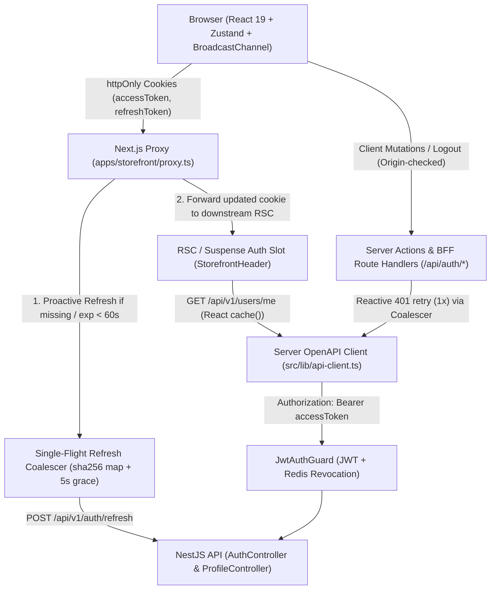
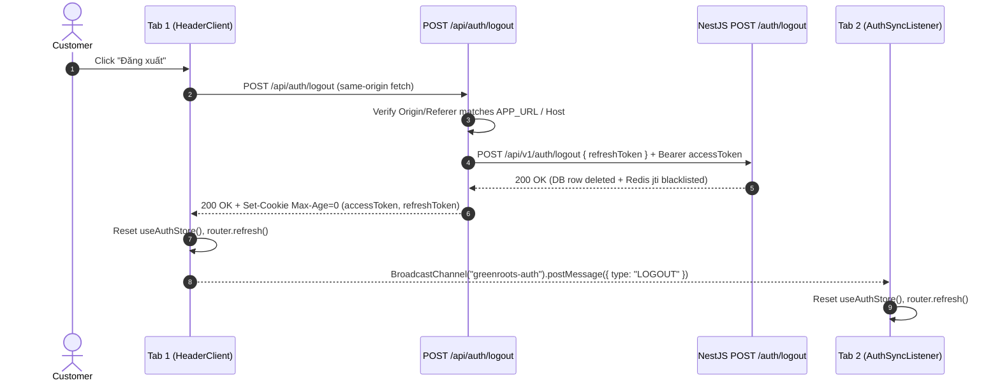

# Storefront Auth Session & BFF Token Refresh Formal Specification

## Overview & Context

This specification defines the Storefront authentication session architecture, `httpOnly` cookie bridging, single-flight token rotation, cross-tab logout synchronization, and `StorefrontHeader` identity hydration for `#122` (Epic `#7`, split from `#42`).

Storefront (`apps/storefront`) runs Next.js 16 with `cacheComponents: true` (`partialPrefetching: true`) and enforces a strict server-only API boundary (`Q28`) in `apps/storefront/src/lib/api-client.ts`. Meanwhile, `apps/api` implements stateless 15-minute JWT access tokens, 7-day opaque single-use refresh tokens (`ADR-0015`), and two-level Redis revocation (`ADR-0016`) without setting cookies (`docs/design/auth-and-session-management.md`). Because Next.js App Router Server Components (RSC) cannot mutate response cookies and `ADR-0015` atomically deletes refresh tokens on first use, naive reactive refresh inside RSCs or unsynchronized parallel calls would destroy active customer sessions.

### Goals

- Keep `accessToken` and `refreshToken` strictly inside `httpOnly` cookies managed by the Next.js BFF, preserving `Q28` (`api-client.ts` blocks browser calls).
- Prevent token loss under `ADR-0015` via proactive refresh in `apps/storefront/proxy.ts` and a per-token-hash (`sha256(refreshToken)`) single-flight coalescer with stale-cookie protection.
- Validate live session state and resolve customer display identity (`fullName`, `email`, `role`, `rewardPoints`) via per-request memoized `GET /api/v1/users/me` (`ProfileController`).
- Keep `RootLayout` PPR-compatible under `cacheComponents: true` by isolating `StorefrontHeader` session UI inside a `<Suspense>` boundary and syncing client state via Zustand + `BroadcastChannel`.
- Enforce CSRF `Origin`/`Referer` checks on state-changing BFF Route Handlers and redirect unauthorized `/account/*` and `/orders/*` requests to `/login?redirect=...` safely.

### Non-Goals

- Login, registration, email verification, and password recovery UI screens (`#125`, `#126`).
- Customer profile editing, loyalty points view, global `logout-all` UI, or address book CRUD (`#123`, `#124`).
- Guest checkout gating on `/checkout` (`#141` owns checkout auth prompts).
- Enforcing `customer`-only vs `staff`-only login separation at `/api/v1/auth/login` (deferred to a dedicated follow-up issue under Epic `#7`).
- Multi-replica distributed Redis locking inside `apps/storefront` (in-process single-flight assumes single Next.js instance or sticky routing).

## Architecture



Symbols and ownership boundaries:

- `apps/storefront/proxy.ts` (`proxy`, `config.matcher`) intercepts non-static, non-prefetch page requests, runs proactive refresh when needed, mutates forwarded request cookies for RSCs, sets/clears response `Set-Cookie` headers, and gates protected routes (`/account/*`, `/orders/*`).
- `apps/storefront/src/lib/auth/single-flight-refresh.ts` owns the in-process `inflightRefreshes` `Map` keyed by `sha256(refreshToken)` and the 5-second `recentlyRotated` marker (`Map<string, number>`) that prevents delayed requests from overwriting newly rotated cookies.
- `apps/storefront/src/lib/auth/cookies.ts` owns cookie names (`accessToken`, `refreshToken`), `httpOnly` / `SameSite=Lax` / `Secure` / `Max-Age` options (`900s` vs `604800s`), and safe `redirect` path sanitization.
- `apps/storefront/src/lib/auth/session.server.ts` exports per-request memoized (`React.cache`) `getServerSession()` calling `GET /api/v1/users/me` via `api-client.ts` and returning `null` on `401` or missing token.
- `apps/storefront/src/lib/api-client.ts` retains `serverCookieBridgeMiddleware` (`Q28`) for server-only `Authorization: Bearer` injection; Server Actions / BFF Route Handlers may use a single-retry reactive wrapper backed by `single-flight-refresh.ts`.
- `apps/storefront/app/api/auth/logout/route.ts` validates `Origin`/`Referer`, calls `POST /api/v1/auth/logout` with `{ refreshToken }` and optional `Authorization: Bearer`, and clears both cookies.
- `apps/storefront/src/stores/auth.store.ts` & `apps/storefront/src/components/common/header.tsx` hydrate client identity from the `<Suspense>` server slot, broadcast `"LOGOUT"` / `"SESSION_CHANGED"` events over `BroadcastChannel("greenroots-auth")` (with `storage` fallback), and render either customer identity + logout menu or `Đăng nhập / Đăng ký` links.

## Operational Flow

### 1. Proactive Proxy Refresh & Single-Flight Coalescing

```mermaid
sequenceDiagram
    autonumber
    actor Browser
    participant Proxy as Next.js Proxy (proxy.ts)
    participant SF as Single-Flight Coalescer
    participant API as NestJS POST /auth/refresh
    participant RSC as HeaderAuthSlot (Suspense)

    Browser->>Proxy: GET /orders (cookies: accessToken expired/absent, refreshToken=R1)
    Proxy->>Proxy: Check not static/prefetch/logout; decode JWT exp (no verify)
    alt accessToken missing OR exp - now < 60s
        Proxy->>SF: refreshSingleFlight(R1)
        alt inflightRefreshes has sha256(R1)
            SF-->>Proxy: Await shared Promise -> (A2, R2)
        else First caller for sha256(R1)
            SF->>API: POST /api/v1/auth/refresh { refreshToken: R1 }
            alt 200 OK (A2, R2)
                API-->>SF: { accessToken: A2, refreshToken: R2 }
                SF->>SF: Record sha256(R1) in recentlyRotated (TTL 5s), delete inflight
                SF-->>Proxy: { status: "rotated", accessToken: A2, refreshToken: R2 }
                Proxy->>Proxy: Forward A2 in request cookies + Set-Cookie (A2 900s, R2 604800s)
            else 401 / 429 / error
                API-->>SF: 401 AUTH_TOKEN_INVALID_OR_EXPIRED
                alt sha256(R1) present in recentlyRotated (< 5s)
                    SF-->>Proxy: { status: "stale_concurrent" } (DO NOT clear cookies)
                else Never recently rotated
                    SF-->>Proxy: { status: "invalid" }
                    Proxy->>Proxy: Clear accessToken & refreshToken cookies
                end
            end
        end
    end
    alt Protected route (/account/*, /orders/*) and unauthenticated/invalid
        Proxy-->>Browser: 307 Redirect -> /login?redirect=<safePath> (with cleared cookies)
    else Public route or valid session
        Proxy->>RSC: Forward request with fresh accessToken
        RSC->>API: GET /api/v1/users/me (Bearer A2)
        API-->>RSC: 200 UserProfileDto (fullName, email, role, rewardPoints)
        RSC-->>Browser: Stream Header + page HTML
    end
```

### 2. Single-Device Logout & Cross-Tab Synchronization



## Cookie, Route & CSRF Contract

1. **Cookie Specification (`apps/storefront/src/lib/auth/cookies.ts`)**:
   - `accessToken`: `httpOnly: true`, `sameSite: "lax"`, `path: "/"`, `secure: NODE_ENV === "production"`, `maxAge: 900` (15 minutes).
   - `refreshToken`: `httpOnly: true`, `sameSite: "lax"`, `path: "/"`, `secure: NODE_ENV === "production"`, `maxAge: 604800` (7 days).
2. **Proxy Skip & Rate-Limit Preservation**:
   - Exclude `/_next/*`, `/favicon.ico`, `/apple-icon`, `/api/auth/logout`, `/login`, `/register`, and requests carrying `Next-Router-Prefetch` or `Purpose: prefetch` from triggering `/api/v1/auth/refresh`.
3. **Protected vs Public Route Handling**:
   - **Protected prefixes** (`/account`, `/orders`): when `refreshToken` is absent (even if a stale `accessToken` exists) or `/auth/refresh` returns `"invalid"`, clear session cookies and redirect to `/login?redirect=<encodedPath>`. On `transient_error`, preserve cookies and attach `x-gr-auth-degraded: 1` so the route can surface an unavailable state.
   - **Public routes** (`/`, `/products/*`, `/trace/*`, `/subscriptions`, `/checkout`): when `/auth/refresh` returns `"invalid"`, clear session cookies and allow request to proceed as guest without redirecting.
   - **Open-redirect guard**: `sanitizeRedirectPath(raw)` accepts only paths matching `^\/(?!\/)` (no scheme, no protocol-relative `//`, fallback `/`).
4. **CSRF Enforcement**:
   - Next.js Server Actions inherit framework `Origin`/`Host` validation.
   - Custom mutating BFF Route Handlers (`POST /api/auth/logout`, future `/api/auth/*`) MUST explicitly verify `Origin` (or `Referer` origin when `Origin` is absent) matches `env.NEXT_PUBLIC_APP_URL` or the request `Host` header, returning `403` otherwise.

## Security & Reliability

- **Authorization & Role Policy (Transitional `Q8` Decision)**: During `#122`, the Storefront BFF accepts any active verified `UserRole` returned by `POST /api/v1/auth/login` (`#17` does not filter roles). Separation of `customer` vs `staff` (`farm_staff`, `sales`, `admin`, `super_admin`) authentication surfaces is tracked in a dedicated follow-up issue so staff accounts cannot authenticate on Storefront and customers cannot authenticate on Backoffice.
- **Revocation Enforcement**: `proxy.ts` inspects JWT `exp` locally solely to decide whether proactive refresh is required — it NEVER trusts decoded claims for authorization. Every authenticated SSR render validates the token against `JwtAuthGuard` + Redis two-level revocation (`ADR-0016`) via `GET /api/v1/users/me` or the target protected endpoint.
- **PII & Secret Redaction**: `accessToken`, `refreshToken`, and `Authorization` headers MUST never be logged or serialized into React Client Component props, `localStorage`, or `BroadcastChannel` payloads. `BroadcastChannel` messages carry only `{ type: "LOGOUT" | "SESSION_CHANGED" }`.
- **Single-Flight Memory Bounds**: Both `inflightRefreshes` and `recentlyRotated` store keys as `sha256(refreshToken)` hex digests (never raw tokens). Entries in `inflightRefreshes` clean up in `.finally()`, and `recentlyRotated` entries expire after 5 seconds with periodic opportunistic pruning to prevent unbounded growth.
- **Fail-Safe Behavior**:
  - When NestJS is unreachable (`ECONNREFUSED` / `5xx`) during proactive refresh, `proxy.ts` does NOT clear cookies (preserving the 7-day session against transient API restarts) and degrades gracefully on public routes or surfaces a temporary unavailable state on protected routes.
  - Only explicit `401` (`AUTH_TOKEN_INVALID_OR_EXPIRED`) from `/auth/refresh` for a token NOT in `recentlyRotated` clears cookies.
  - On `POST /api/auth/logout`, even if NestJS returns `401` (already expired/deleted) or fails transiently, the BFF ALWAYS clears local `httpOnly` cookies (`Max-Age=0`) so the user can always sign out cleanly.

## BFF Client Metadata Forwarding & Trust Boundary (`#183`, `ADR-0037`)

To ensure `refresh_tokens` records and `CustomThrottlerGuard` rate-limit buckets reflect customer devices rather than Next.js BFF egress IPs and `Bun/...` runtime defaults (including split Vercel + Render deployments):

1. **Header Extraction & Sanitization (`apps/storefront`)**:
   - Extract client IP in strict precedence: `cf-connecting-ip` -> `x-real-ip` -> rightmost valid IP in `x-forwarded-for`, validated with `node:net` `isIP()`.
   - Sanitize `User-Agent` by stripping control characters (`[\x00-\x1f\x7f]`), trimming, and clamping to 255 characters. When missing or empty after sanitization, explicitly send `User-Agent: ""` to suppress Bun/Node `fetch()` runtime defaults.
   - Always strip/overwrite incoming `x-forwarded-for`, `x-real-ip`, `x-bff-client-ip`, and `x-internal-proxy-secret` before issuing downstream requests.
   - Attach `X-BFF-Client-IP` (when a valid IP is derived) and `X-Internal-Proxy-Secret` (when `env.INTERNAL_PROXY_SECRET` is configured).
2. **Call-Site Coverage**:
   - `refreshSingleFlight(refreshToken, options)` accepts optional `clientHeaders` / `headers` and is supplied by both `apps/storefront/proxy.ts` (from `NextRequest.headers`) and `apps/storefront/src/features/auth/services/session.server.ts` (`runWithServerActionRefresh` via `await headers()`).
   - All auth Server Actions in `apps/storefront/src/features/auth/actions/auth-actions.ts` forward these sanitized headers per-request without modifying `Q28` `serverCookieBridgeMiddleware` in `apps/storefront/src/lib/api-client.ts`.
3. **API Verification & Rate-Limiter Alignment (`apps/api`)**:
   - `extractClientMetadata()` and `CustomThrottlerGuard.getTracker()` trust `X-BFF-Client-IP` (validated with `isIP()`) **only** when `INTERNAL_PROXY_SECRET` is set and `X-Internal-Proxy-Secret` passes `crypto.timingSafeEqual` (with length guard).
   - Otherwise, `apps/api` falls back to Express `req.ip ?? req.socket?.remoteAddress` (under `app.set("trust proxy", 1)`), never blindly trusting unauthenticated `X-Forwarded-For[0]` or `X-Real-IP`.
   - `extractClientMetadata()` normalizes empty/whitespace `User-Agent` to `undefined` (persisted as `null`).

## Domain Invariant Taxonomy

| Invariant        | Name                              | Formal Statement                                                                                                                                                   | Enforcement Seam                                                                 | Verification Test                                                                                      |
| :--------------- | :-------------------------------- | :----------------------------------------------------------------------------------------------------------------------------------------------------------------- | :------------------------------------------------------------------------------- | :----------------------------------------------------------------------------------------------------- |
| `INV-SF-AUTH-1`  | Server-Only Token Isolation       | Neither `accessToken` nor `refreshToken` is readable from `document.cookie`, `localStorage`, client props, or browser `fetch`                                      | `httpOnly` cookie flags in `cookies.ts` + `Q28` browser guard in `api-client.ts` | Browser guard throws `500`; cookie builder enforces `httpOnly: true`                                   |
| `INV-SF-AUTH-2`  | Single-Flight Refresh Coalescing  | $N$ concurrent requests sharing `sha256(R1)` invoke `POST /api/v1/auth/refresh` at most once                                                                       | `inflightRefreshes` `Map` in `single-flight-refresh.ts`                          | `Promise.all` of 5 concurrent refreshes triggers 1 API call                                            |
| `INV-SF-AUTH-3`  | Stale-Cookie Overwrite Guard      | A delayed request carrying `R1` within 5s of `R1` succeeding MUST NOT emit cookie-clearing `Set-Cookie` headers                                                    | `recentlyRotated` marker in `single-flight-refresh.ts`                           | Late request with rotated `R1` returns `stale_concurrent` without `Max-Age=0`                          |
| `INV-SF-AUTH-4`  | No Infinite Refresh Loop          | Any request chain performs at most 1 refresh attempt; `401`/`429` from `/auth/refresh` never re-triggers refresh (`429` preserves cookies as `transient_error`)    | `proxy.ts` skip matcher + single-retry flag in Server Action wrapper             | Invalid refresh returns `invalid` after 1 call; `429`/`5xx` preserve cookies; `/login` never refreshes |
| `INV-SF-AUTH-5`  | Cookie Hygiene & Expiry Alignment | `accessToken` cookie `maxAge` equals `900s` and `refreshToken` equals `604800s`; missing `accessToken` + present `refreshToken` triggers refresh                   | `cookies.ts` + `proxy.ts` trigger predicate                                      | Missing `accessToken` with valid `refreshToken` refreshes cleanly                                      |
| `INV-SF-AUTH-6`  | Open-Redirect Prevention          | Redirect query param after auth failure MUST satisfy `^\/(?!\/)`                                                                                                   | `sanitizeRedirectPath()` in `cookies.ts`                                         | `//evil.com` and `https://evil.com` normalize to `/`                                                   |
| `INV-SF-AUTH-7`  | CSRF Origin Guard                 | State-changing BFF Route Handlers reject cross-origin requests without matching `Origin`/`Referer`                                                                 | Origin verifier in `app/api/auth/logout/route.ts`                                | Cross-origin `POST /api/auth/logout` returns `403`                                                     |
| `INV-SF-AUTH-8`  | PPR Static Shell Preservation     | `RootLayout` renders `StorefrontHeader` with customer identity inside `<Suspense>` so `cacheComponents: true` static shell builds cleanly                          | `HeaderAuthSlot` `<Suspense>` boundary in `header.tsx`                           | `next build` / `bun run check` passes without uncached-data build errors                               |
| `INV-SF-AUTH-9`  | Shared-Secret BFF IP Trust        | `apps/api` trusts `X-BFF-Client-IP` (validated via `isIP()`) only when `X-Internal-Proxy-Secret` matches `INTERNAL_PROXY_SECRET` via `crypto.timingSafeEqual`      | `extractClientMetadata` + `CustomThrottlerGuard.getTracker()` in `apps/api`      | Spoofed `X-BFF-Client-IP` / `X-Forwarded-For` without valid secret falls back to `req.ip`              |
| `INV-SF-AUTH-10` | Sanitized BFF Header Forwarding   | Storefront BFF strips untrusted proxy headers, clamps `User-Agent` to 255 chars (sending `""` when missing), and forwards validated IP across auth actions/refresh | `proxy.ts`, `session.server.ts`, `single-flight-refresh.ts`, `auth-actions.ts`   | Missing `User-Agent` persists `null` (never `Bun/...`); control chars stripped                         |

### Edge Cases & Adversarial Matrix

| ID       | Scenario                                                                                  | Expected Behavior                                                                                                                     |
| :------- | :---------------------------------------------------------------------------------------- | :------------------------------------------------------------------------------------------------------------------------------------ |
| `EDGE-1` | `accessToken` cookie expired and purged by browser after 15m, `refreshToken` still valid  | `proxy.ts` detects `refreshToken && !accessToken`, calls single-flight refresh, sets new pair, forwards fresh `accessToken` to RSC    |
| `EDGE-2` | Guest with zero cookies visits `/` or `/products`                                         | `proxy.ts` skips refresh; `HeaderAuthSlot` skips `/users/me` call and renders `Đăng nhập / Đăng ký`                                   |
| `EDGE-3` | Guest visits `/account/profile` or `/orders/123`                                          | `proxy.ts` redirects `307` to `/login?redirect=%2Faccount%2Fprofile`                                                                  |
| `EDGE-4` | Malicious `redirect=https://phish.example` or `//phish.example`                           | `sanitizeRedirectPath` drops external target and falls back to `/`                                                                    |
| `EDGE-5` | User clicks Logout while NestJS is unreachable or `refreshToken` already deleted          | `POST /api/auth/logout` clears both cookies (`Max-Age=0`), resets Zustand, broadcasts `"LOGOUT"`                                      |
| `ADV-1`  | 5 `<Link prefetch>` requests + 1 page load hit `proxy.ts` at once near `exp`              | `Next-Router-Prefetch` requests bypass proactive refresh; concurrent page/action calls share 1 in-flight Promise                      |
| `ADV-2`  | Tab 2 sends `R1` 50ms after Tab 1 rotated `R1 -> R2`                                      | `recentlyRotated` identifies `R1` as recently rotated; Tab 2 does NOT emit `Max-Age=0`, preventing deletion of `R2`                   |
| `ADV-3`  | Attacker replays stolen `R1` > 5s after rotation                                          | `R1` is absent from DB and `recentlyRotated`; NestJS returns `401`, BFF clears cookies                                                |
| `ADV-4`  | Cross-site `<form method="POST" action="/api/auth/logout">` attack                        | `Origin` mismatch returns `403` before touching cookies or calling NestJS                                                             |
| `ADV-5`  | Account suspended or `logout-all` triggered from another device while `accessToken` < 15m | `GET /api/v1/users/me` hits `JwtAuthGuard` Redis `auth:revoked:user:<userId>` -> `401`; BFF attempts refresh -> `401`, clears session |

## Test Matrix

Unit and component tests in `apps/storefront/src/**/*.spec.ts`:

- `single-flight-refresh.spec.ts`:
  - `// Invariant: INV-SF-AUTH-2`: 5 concurrent calls with identical `R1` invoke `/auth/refresh` exactly once and resolve identically; distinct `R1`/`R2` do not block each other.
  - `// Invariant: INV-SF-AUTH-3`: delayed call with `R1` within 5s of successful rotation returns `stale_concurrent` without flagging cookie clear; replay after TTL returns `invalid`.
  - `// Invariant: INV-SF-AUTH-4`: `401` from `/auth/refresh` returns `invalid` without retries; `429`, `503`, and network failures return `transient_error` preserving cookies.
- `cookies.spec.ts`:
  - `// Invariant: INV-SF-AUTH-1`, `INV-SF-AUTH-5`: verifies `httpOnly: true`, `SameSite=Lax`, `maxAge: 900` vs `604800`, and `secure` toggling by `NODE_ENV`.
  - `// Invariant: INV-SF-AUTH-6`: `sanitizeRedirectPath` rejects `//evil.com`, `https://evil.com`, `javascript:alert(1)`, and preserves valid relative paths with query strings.
- `proxy.spec.ts`:
  - `// Invariant: INV-SF-AUTH-5`: refreshes when `accessToken` is missing or `exp < 60s`; skips `Next-Router-Prefetch` and `/login`; redirects `/account/*` & `/orders/*` on `invalid` while allowing `/` as guest.
- `logout-route.spec.ts`:
  - `// Invariant: INV-SF-AUTH-7`: rejects cross-origin `POST /api/auth/logout` with `403`; forwards `refreshToken` + `Bearer` to NestJS and clears cookies even if backend returns `401`.
- `header-auth.spec.ts` & `auth-store.spec.ts`:
  - Renders `Đăng nhập / Đăng ký` for guest state and customer `fullName` + logout trigger for authenticated state; `BroadcastChannel` `"LOGOUT"` resets store cleanly.
- Full verification gates: `bun run check` and `bun run test:storefront` pass cleanly.

## Risks & Rollback

- **Next.js 16 Cookie Forwarding Edge Case**: `proxy.ts` mutating `NextRequest.cookies` for downstream RSCs must be verified against Next.js 16.4.6 runtime in integration/dev verification (`bun run dev:storefront`); if `cookies()` inside RSC does not reflect `NextRequest.cookies.set`, pass the refreshed token via a scrubbed internal request header (`x-gr-refreshed-access-token`, stripped on incoming external requests) read by `api-client.ts`.
- **Single-Instance Assumption**: Horizontal scaling of `apps/storefront` beyond 1 Node/Bun worker without sticky sessions will cause cross-worker refresh races; mitigate later by backing `inflightRefreshes` with Redis if multi-replica deployment is introduced.
- **Role-Separation Lag**: Staff members can log into Storefront until the follow-up surface-role separation issue is implemented.
- **Rollback**: Revert `#122` changes in `apps/storefront` and `ADR-0036`; zero database migrations or backend contract changes are required.
