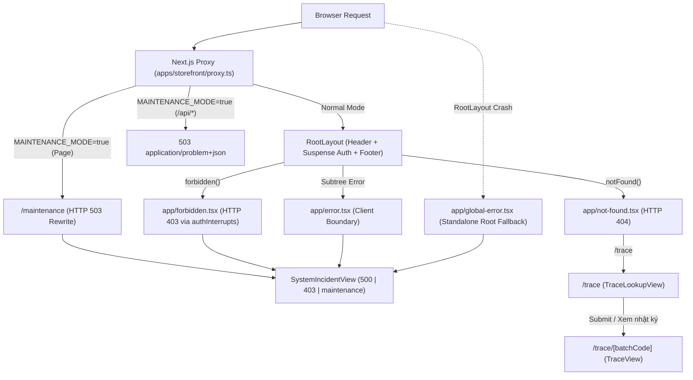
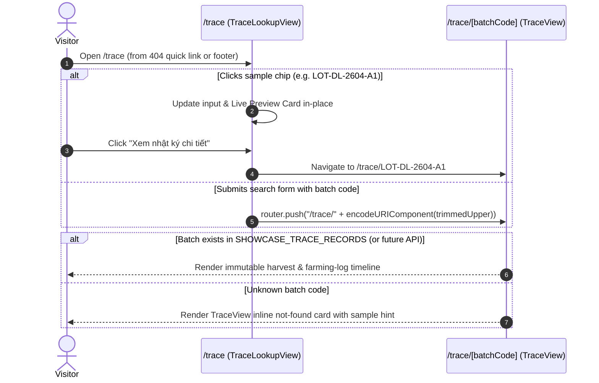

# Storefront Error Recovery, Maintenance Mode & QR Trace Lookup Design

## Overview & Context

This document specifies the architecture, routing boundaries, security sanitization, and component behavior for GreenRoots Farm Storefront error recovery, maintenance mode, and QR traceability lookup (`#127`, Epic `#7`).

`apps/storefront` runs Next.js 16 (`cacheComponents: true`, `partialPrefetching: true`) with `RootLayout` wrapping all pages in `StorefrontHeader` (including `<Suspense>`-isolated `HeaderAuthSlot`) and `StorefrontFooter`, plus a strict server-only API client (`Q28` in `apps/storefront/src/lib/api-client.ts`). Auditing the Stitch prototypes (`kh_ng_t_m_th_y_trang_404/code.html`, `s_c_h_th_ng/code.html`, `tra_c_u_ngu_n_g_c_qr.html`) against the codebase uncovered five integration hazards that this design resolves:

- The 404 Stitch prototype links to `#deal-tuoi` (instead of `#rescue` in `home-view.tsx`) and `/trace` (which currently lacks `app/trace/page.tsx`).
- Next.js strips `Error.message` and custom `ApiClientError` properties before passing RSC errors to client `app/error.tsx` in production; RSC `403` responses require `forbidden()` + `app/forbidden.tsx` (`experimental.authInterrupts`).
- `app/error.tsx` does not catch errors thrown inside `RootLayout` itself (`app/global-error.tsx` is required).
- Maintenance mode must evaluate in `apps/storefront/proxy.ts` **before** proactive token refresh (`refreshSingleFlight`) and rewrite (not redirect) to `/maintenance` with HTTP `503`.
- The Stitch QR lookup template embeds unpermitted `lh3.googleusercontent.com` image URLs, inconsistent origin strings contradicting `FARM_METADATA`, and batch codes absent from `SHOWCASE_TRACE_RECORDS`.

### Goals

- Provide branded `404` (`app/not-found.tsx`), `403` (`app/forbidden.tsx`), `500` (`app/error.tsx` + `app/global-error.tsx`), and `503` (`app/maintenance/page.tsx`) recovery views inside `@greenroots/ui` and Organic Minimalism tokens.
- Guarantee zero stack-trace, internal URL, or `error.message` leakage to the browser DOM while keeping client-side reference IDs and timestamps hydration-safe under `cacheComponents: true`.
- Implement `MAINTENANCE_MODE` gating in `apps/storefront/proxy.ts` with HTTP `503`, `Retry-After`, and `X-Robots-Tag: noindex, nofollow` without disturbing active URLs or wasting refresh tokens.
- Implement `/trace` (`apps/storefront/app/trace/page.tsx`) with live sample-batch preview, direct `/trace/[batchCode]` navigation, and synchronized showcase batch records.

### Non-Goals

- Changing NestJS API RFC 9457 error contracts (`ADR-0013`) or `apps/backoffice` error boundaries.
- Adding a `MaintenanceGuard` to `apps/api` (tracked separately; see Security & Reliability).
- Implementing `/login` or `/register` pages (`#125`), or replacing `TraceView`'s inline not-found card on `/trace/[batchCode]` (`#45`).

## Architecture



Key symbol ownership and boundaries:

- `apps/storefront/next.config.ts`: enables `experimental.authInterrupts: true` for `forbidden()` and `app/forbidden.tsx`.
- `apps/storefront/src/env.ts` & `apps/storefront/.env.example`: declares server-only `MAINTENANCE_MODE` boolean flag (`false` default).
- `apps/storefront/proxy.ts`: `handleStorefrontProxy` checks `deps?.maintenanceMode ?? isMaintenanceModeEnabled()` immediately after stripping spoofed internal headers (`x-gr-refreshed-access-token`, `x-gr-auth-degraded`).
- `apps/storefront/src/components/common/system-incident-view.tsx`: pure presentational incident recovery component supporting `"500"`, `"403"`, and `"maintenance"` variants using `@greenroots/ui`, `lucide-react`, `FARM_METADATA.hotline`, and client-only timestamp/fallback-ref hydration. QA state-switcher tabs from Stitch HTML are omitted.
- `apps/storefront/app/error.tsx` & `apps/storefront/app/global-error.tsx`: error boundaries rendering `SystemIncidentView` (minimal standalone HTML shell in `global-error.tsx` with zero dependency on `HeaderAuthSlot` or Zustand stores).
- `apps/storefront/app/forbidden.tsx` & `apps/storefront/app/maintenance/page.tsx`: route-level `403` and `503` incident pages; `/maintenance` calls `notFound()` when `MAINTENANCE_MODE` is inactive.
- `apps/storefront/app/not-found.tsx` & `apps/storefront/src/components/common/not-found-search-form.tsx`: `404` recovery view with inline search (`/products?q=...`) and verified links (`/`, `/products`, `/#rescue`, `/subscriptions`, `/trace`).
- `apps/storefront/app/trace/page.tsx`, `apps/storefront/src/features/traceability/components/trace-lookup-view.tsx`, & `apps/storefront/src/services/storefront.service.ts`: `/trace` lookup page, internal visual cards replacing Google AIDA URLs, and 4 synchronized Lâm Đồng/Đà Lạt showcase batches in `SHOWCASE_TRACE_RECORDS`.
- Typography & Styling: Reuse `Be Vietnam Pro` (`--font-sans`) with `tabular-nums` and semantic `@greenroots/ui` tokens across badges, reference IDs, and batch codes rather than loading a separate monospace font.

## Operational Flow

### 1. Maintenance Mode Gate & Error Boundary Routing

```mermaid
sequenceDiagram
    autonumber
    actor Visitor
    participant Proxy as proxy.ts (handleStorefrontProxy)
    participant Page as Storefront Page / RSC
    participant Err as error.tsx / forbidden.tsx
    participant UI as SystemIncidentView

    Visitor->>Proxy: GET /products?q=rau
    Proxy->>Proxy: Strip spoofed x-gr-* headers
    alt MAINTENANCE_MODE === true
        alt Path starts with /api/
            Proxy-->>Visitor: 503 application/problem+json (SERVICE_UNAVAILABLE, Retry-After: 900)
        else Page request
            Proxy->>Page: Rewrite to /maintenance (status: 503, Retry-After: 900, X-Robots-Tag: noindex)
            Page-->>Visitor: Render SystemIncidentView("maintenance") keeping original URL
        end
    else MAINTENANCE_MODE === false
        Proxy->>Page: Run proactive refresh / protected gate -> forward RSC
        alt Missing route or notFound()
            Page-->>Visitor: 404 app/not-found.tsx (links to /, /products, /#rescue, /subscriptions, /trace)
        else RSC calls forbidden()
            Page-->>Visitor: 403 app/forbidden.tsx -> SystemIncidentView("403") -> CTA /login
        else Runtime throw inside page subtree
            Page->>Err: Catch error (digest only in RSC prod; ApiClientError in client)
            Err->>Err: Log structured ref via console.error; resolve digest or CLI-* fallback
            Err-->>Visitor: Render SystemIncidentView("500" | client status) without error.message
        end
    end
```

### 2. QR Trace Lookup (`/trace` -> `/trace/[batchCode]`)



## Security & Reliability

- **Zero Error Detail Leakage**: `SystemIncidentView` accepts only `variant`, `referenceId`, and `onRetry` — never `error.message` or `error.stack`. When `error.digest` is absent (client-thrown errors or dev mode), a client-only fallback reference (`CLI-YYYYMMDD-XXXX`) is generated inside `useEffect` so internal `API_BASE_URL` hosts, SQL details, and stack frames never enter the DOM or SSR payload.
- **Hydration & PPR Safety (`cacheComponents: true`)**:
  - `error.tsx` and `SystemIncidentView` compute local timestamps (`Thời điểm ghi nhận`) inside `useEffect` using `Intl.DateTimeFormat("vi-VN")`, preventing SSR/CSR hydration mismatches and prerender errors.
  - `/maintenance` awaits `connection()` before reading runtime `MAINTENANCE_MODE` so build-time static analysis does not freeze the flag to `false`.
- **Auth & Loop Prevention**:
  - `MAINTENANCE_MODE` executes before `shouldProactivelyRefresh()` in `proxy.ts`, preventing visitor traffic from burning `POST /api/v1/auth/refresh` tokens or hitting rate limits during API outages.
  - The `403` `"Đăng nhập lại"` action links directly to `/login` without `?redirect=<currentPath>` to prevent infinite redirect loops when an authenticated non-customer role (`#145`) hits a forbidden customer path.
  - `global-error.tsx` avoids importing `StorefrontHeader`, `HeaderAuthSlot`, or Zustand stores so a crash in root providers cannot recursively break the global fallback.
- **Maintenance Boundary Scope (Cross-Surface Note)**:
  - `MAINTENANCE_MODE` in `apps/storefront/proxy.ts` gates Storefront web and BFF routes only. It does **not** block direct HTTP calls to `apps/api` or `apps/backoffice`. Full-stack maintenance enforcement requires either an edge reverse-proxy rule (Nginx/Cloudflare returning `503`) or a dedicated follow-up `area:api` `MaintenanceGuard` (allowing `GET /api/v1/health` and payment webhooks while returning `503 SERVICE_UNAVAILABLE` elsewhere).
- **External Media Safety**:
  - Replacing `lh3.googleusercontent.com` URLs from the Stitch HTML with local `bg-green-50` + `lucide-react` visual slots eliminates unapproved `next/image` hosts (`next.config.ts` `remotePatterns`) and third-party availability failures.

## Domain Invariant Taxonomy

| Invariant      | Name                                         | Formal Statement                                                                                                                                                                                                                                          | Enforcement Seam                                                                    | Verification Test                                                                                           |
| :------------- | :------------------------------------------- | :-------------------------------------------------------------------------------------------------------------------------------------------------------------------------------------------------------------------------------------------------------- | :---------------------------------------------------------------------------------- | :---------------------------------------------------------------------------------------------------------- |
| `INV-SF-ERR-1` | Zero Stack & Message Leakage                 | No error boundary (`error.tsx`, `global-error.tsx`, `SystemIncidentView`) renders `error.message` or `error.stack` into HTML                                                                                                                              | `SystemIncidentView` prop contract (no raw `Error` text rendering)                  | `error-recovery.spec.ts` passes sensitive `Error` text/stack into `StorefrontErrorPage` and asserts absence |
| `INV-SF-ERR-2` | Verified Recovery Navigation                 | Every navigation link and anchor on `app/not-found.tsx` and `/trace` points to an implemented route or DOM section ID (`/`, `/products`, `/#rescue`, `/subscriptions`, `/trace`, `/trace/[batchCode]`)                                                    | `not-found.tsx`, `trace-lookup-view.tsx`, `navigation.ts`, `SHOWCASE_TRACE_RECORDS` | `navigation.spec.ts` verifies `buildProductSearchHref`, `buildTraceDetailHref`, and showcase resolution     |
| `INV-SF-ERR-3` | Maintenance Short-Circuit & `503` Rewrite    | When `MAINTENANCE_MODE=true`, `handleStorefrontProxy` short-circuits before proactive refresh, rewrites page routes to `/maintenance` with HTTP `503`, `Retry-After`, and `X-Robots-Tag: noindex, nofollow`, and returns `503` RFC 9457 JSON for `/api/*` | `handleStorefrontProxy()` in `apps/storefront/proxy.ts`                             | `proxy.spec.ts` asserts 0 refresh calls, `503` status, rewrite header, and `/api/*` JSON                    |
| `INV-SF-ERR-4` | Normal-Mode Maintenance Guard                | When `MAINTENANCE_MODE=false`, direct requests to `/maintenance` invoke `notFound()` rather than displaying a false maintenance notice                                                                                                                    | `apps/storefront/app/maintenance/page.tsx`                                          | `error-recovery.spec.ts` verifies `renderMaintenanceRoute` invokes `onNotFound` when disabled               |
| `INV-SF-ERR-5` | Production QA Switcher Strip & Design Parity | Production UI never renders Stitch QA state-switcher controls, Google `Material Symbols`, or unapproved `lh3.googleusercontent.com` image URLs                                                                                                            | `SystemIncidentView`, `not-found.tsx`, `trace-lookup-view.tsx`                      | Enforced via `ui-and-frontend.md` review + `next build`                                                     |

### Edge Cases & Adversarial Matrix

| ID       | Scenario                                                                     | Expected Behavior                                                                                                       |
| :------- | :--------------------------------------------------------------------------- | :---------------------------------------------------------------------------------------------------------------------- |
| `EDGE-1` | Visitor submits empty search on `404` page                                   | Navigates cleanly to `/products` (no trailing `?q=` clutter)                                                            |
| `EDGE-2` | Client error thrown without `error.digest`                                   | `SystemIncidentView` renders fallback reference ID after client mount without hydration mismatch                        |
| `EDGE-3` | `RootLayout` or `HeaderAuthSlot` throws unhandled exception                  | `app/global-error.tsx` renders standalone GreenRoots header, `500` card, retry action, and `1900 6868` hotline          |
| `EDGE-4` | Visitor navigates directly to `/maintenance` while `MAINTENANCE_MODE=false`  | Route invokes `notFound()`, returning `404`                                                                             |
| `EDGE-5` | Visitor enters unknown batch code on `/trace` and submits                    | Navigates to `/trace/<CODE>`, where `TraceView` displays inline not-found card with sample `BATCH-2026-TOM-01` guidance |
| `ADV-1`  | Client error carries internal DB/API secret in `error.message`               | `error.tsx` logs sanitized structured telemetry and never interpolates `error.message` into DOM                         |
| `ADV-2`  | 10 requests with expired `accessToken` arrive during `MAINTENANCE_MODE=true` | `proxy.ts` rewrites to `/maintenance` (`503`) immediately; `refreshSingleFlight` invocation count equals `0`            |
| `ADV-3`  | Non-customer session hits a `forbidden()` RSC and clicks `"Đăng nhập lại"`   | Links to `/login` without `?redirect=` query param, avoiding a `403` -> `/login` -> `403` loop                          |

## Test Matrix

Unit and boundary tests under `apps/storefront/src/**/*.spec.ts`:

- `apps/storefront/src/components/common/error-recovery.spec.ts`:
  - `// Invariant: INV-SF-ERR-1`: `StorefrontErrorPage` suppresses sensitive `error.message`/`error.stack` strings while preserving server `digest`; `classifyClientIncident` maps `403`/`503`/`500`.
  - `// Invariant: INV-SF-ERR-4`: `renderMaintenanceRoute` invokes `notFound` when `MAINTENANCE_MODE=false` and returns the maintenance element when `true`.
- `apps/storefront/src/lib/navigation.spec.ts`:
  - `// Invariant: INV-SF-ERR-2`: `buildProductSearchHref` and `buildTraceDetailHref` normalize/encode query and batch parameters cleanly, and every record in `getShowcaseTraceList()` resolves via `getShowcaseTraceByCode()`.
- `apps/storefront/src/lib/auth/proxy.spec.ts`:
  - `// Invariant: INV-SF-ERR-3`: `handleStorefrontProxy` with `maintenanceMode: true` skips `refresh`, rewrites page paths (including `/orders` and `/`) to `/maintenance` with status `503`, `Retry-After`, and `X-Robots-Tag`, and returns `503` RFC 9457 JSON for `/api/*`.
- Verification gates after implementation: `bun run check`, `bun run test`, and `apps/storefront` `next build` pass cleanly.

## Risks & Rollback

- **Next.js 16 `authInterrupts` Maturity**: `experimental.authInterrupts` is experimental in Next.js 16.4.6; verified present in `next/dist/server/config-shared.d.ts`, and must be confirmed with `bun run check` and `apps/storefront` production `next build` during implementation.
- **Unimplemented `/login` Route (`#125`)**: Clicking `"Đăng nhập lại"` on `403` targets `/login`, which lands in `#125`. Until `#125` merges, `/login` resolves to the new branded `404` page rather than a dead browser error.
- **Runtime `MAINTENANCE_MODE` Evaluation**: With `cacheComponents: true`, reading `MAINTENANCE_MODE` inside `/maintenance` must follow `await connection()`, and `env.ts` must not freeze `MAINTENANCE_MODE` at build time if runtime toggling without rebuild is expected.
- **Rollback**: Revert the `#127` commit(s) in `apps/storefront` and `packages/ui`; zero database migrations or API contract changes are affected.
