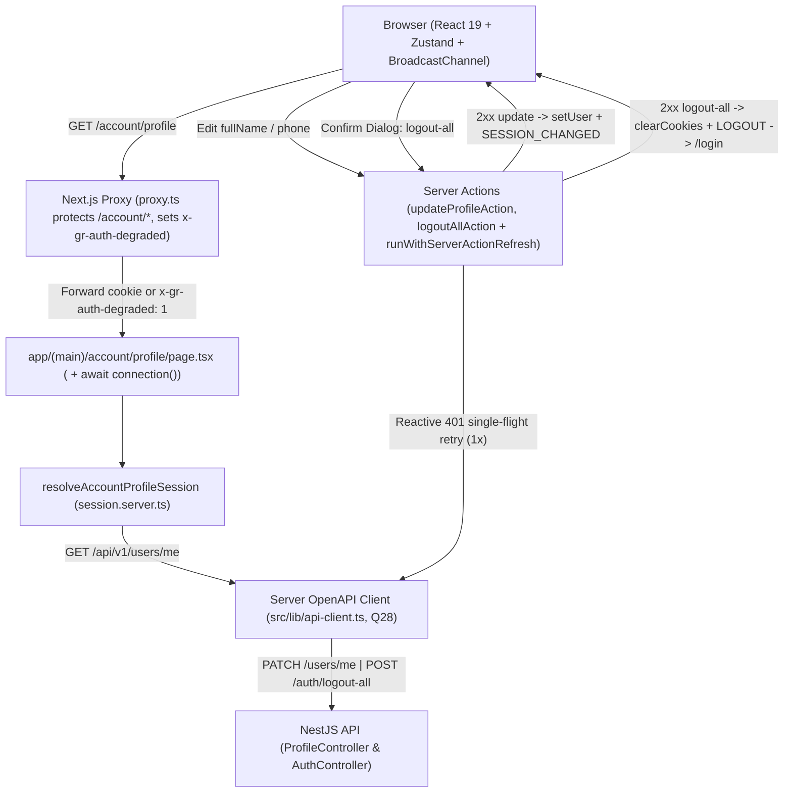
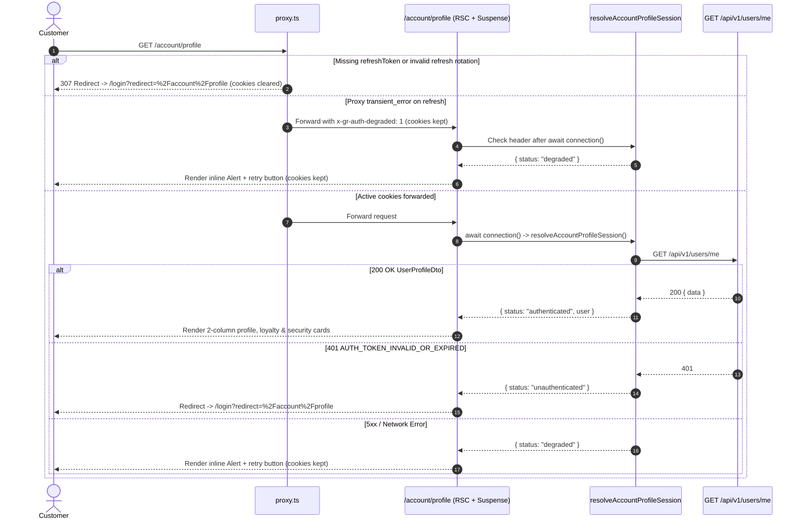
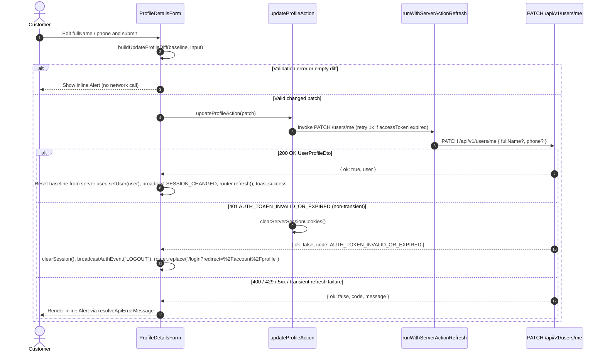
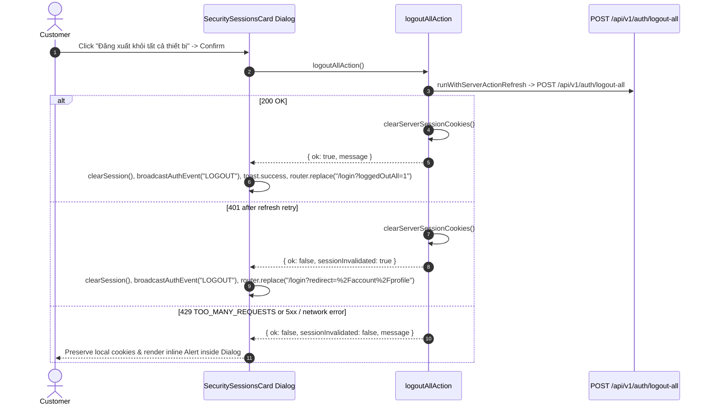

# Storefront Customer Profile, Loyalty Balance & Global Logout Formal Specification

## Overview & Context

This specification defines the Storefront `/account/profile` protected route, BFF Server Actions (`PATCH /api/v1/users/me`, `POST /api/v1/auth/logout-all`), degraded-mode SSR resolution, form normalization and synchronization rules, and UI composition for Issue `#123` (Parent Epic `#7`, building on `#75`, `#17`, `#122` / `ADR-0036`, `ADR-0020`, `ADR-0031`, and `docs/design/self-service-profile-formal-spec.md`).

### Goals

- Render `/account/profile` inside `StorefrontShell` (`app/(main)/layout.tsx`) using `@greenroots/ui` primitives and semantic tokens, adapting the 2-column layout of `h_s_b_o_m_t.html` to live API contracts.
- Separate unauthenticated/revoked `401` redirects from transient `x-gr-auth-degraded: 1` / `5xx` failures during SSR rendering under Next.js 16 `cacheComponents: true` (`await connection()` before uncached session reads).
- Display the live `UserProfileDto.rewardPoints` balance with canonical `1 điểm = 1đ` VND equivalence (`ADR-0031`) without unbacked tiers or mock earning entries.
- Wire `PATCH /api/v1/users/me` via a Server Action wrapped in `runWithServerActionRefresh()` using client/server dirty-diff validation, explicit `phone: null` clearing semantics (`INV-PROFILE-6`), and `useAuthStore` + `BroadcastChannel` synchronization.
- Wire a confirmed `"Đăng xuất khỏi tất cả thiết bị"` `Dialog` calling `POST /api/v1/auth/logout-all` via `runWithServerActionRefresh()`, explicitly warning users that the current session is revoked alongside all other devices (`AuthService.logoutAll`), preserving local cookies on `429`/`5xx`, and clearing local/cross-tab state on `2xx` or terminal `401`.

### Non-Goals

- Exposing `GET /api/v1/auth/sessions` (`#182`), forwarding browser `User-Agent`/IP metadata through Storefront BFF (`#183`), or rendering a live multi-device session table (`#184`).
- Customer address book CRUD (`/account/addresses`, `#124`) or order history (`/account/orders`, `#142`); links to unimplemented routes are omitted to preserve `UI-4`.
- Membership tiers or loyalty point transaction history (no backend endpoints exist).
- Email change, password change, or selective single-session revocation.

## Architecture

### Target Symbols & Ownership Boundaries

- `apps/storefront/src/lib/auth/cookies.ts` & `apps/storefront/proxy.ts` — shared `AUTH_DEGRADED_HEADER` (`x-gr-auth-degraded`) constant used by proxy and SSR route resolution.
- `apps/storefront/src/lib/auth/session.server.ts` — per-request memoized (`React.cache`) `getAccountProfileSession` (`resolveAccountProfileSession`) classifying `/account/profile` SSR outcomes into `authenticated`, `unauthenticated`, or `degraded`, plus `refreshOutcome` metadata on `runWithServerActionRefresh()`.
- `apps/storefront/src/lib/auth/auth-validation.ts` — `normalizeProfileFullName`, `normalizeProfilePhoneInput`, `profileFormSchema`, `updateProfilePatchSchema`, and `buildUpdateProfileDiff` matching `UpdateProfileDto.strict()`.
- `apps/storefront/src/lib/auth/auth-actions.ts` — `executeUpdateProfileAction` (`updateProfileAction`) and `executeLogoutAllAction` (`logoutAllAction`) backed by `runWithServerActionRefresh()`.
- `apps/storefront/src/lib/format.ts` — `formatVnd`, `formatViDate`, and `getUserInitials` for shared loyalty currency formatting and mobile header/sidebar avatars.
- `apps/storefront/src/lib/auth/client-logout.ts` — `performStorefrontLogout` shared single-device logout helper reused by `HeaderAuthControls` and `AccountSidebar`.
- `apps/storefront/src/components/common/confirm-action-dialog.tsx` — `ConfirmActionDialog` reusable confirmation modal shared across `AccountSidebar` and `SecuritySessionsCard`.
- `apps/storefront/src/features/account/components/` — `AccountSidebar` (mobile `Sheet` drawer + desktop card + logout confirmation), `LoyaltyBalanceCard`, `ProfileDetailsForm`, `SecuritySessionsCard`, `AccountProfileView`, and `AccountProfileDegradedView`.
- `apps/storefront/app/(main)/account/profile/page.tsx` — `<Suspense>`-bounded protected RSC invoking `await connection()` before `getAccountProfileSession()`.
- `apps/storefront/src/features/auth/components/login-form.tsx` & `apps/storefront/app/(auth)/login/page.tsx` — displays non-PII status banner when redirected with `?loggedOutAll=1`.

## Operational Flow

### 1. Protected Page Resolution & Degraded Mode

### 2. Profile Update (`PATCH /api/v1/users/me`)

### 3. Confirmed Global Logout (`POST /api/v1/auth/logout-all`)

## Security & Reliability

- **Strict BFF Boundary (`Q28`)**: All `/users/me` and `/auth/logout-all` calls stay in Server Components and `"use server"` actions using `src/lib/api-client.ts`; cookies stay `httpOnly`, `SameSite=Lax`.
- **Fail-Safe Global Revocation**: Clearing local cookies when `POST /api/v1/auth/logout-all` returns `429 TOO_MANY_REQUESTS` (`2 req/min`) or `5xx` would create a false sense of security while remote devices remain active. Local cookies are cleared **only** on `2xx` or confirmed `401`.
- **Degraded Availability Protection**: Server/network outages (`x-gr-auth-degraded: 1` or `GET /users/me` `5xx`) never wipe the 7-day refresh cookie or redirect customers off `/account/profile`.
- **PII & Stack Redaction**: `error.message`, `error.stack`, raw tokens, and user IDs are never surfaced in DOM errors or `BroadcastChannel` payloads (`AUTH_BROADCAST_CHANNEL` emits `{ type: "LOGOUT" | "SESSION_CHANGED" }` only).
- **No Unimplemented Links (`UI-4`)**: Account sidebar links target only live routes (`/account/profile`, `/subscriptions`); `/account/addresses` and `/account/orders` remain deferred to `#124` and `#142`.

## Domain Invariant Taxonomy

| Invariant          | Name                               | Formal Statement                                                                                                                                                                     | Enforcement Seam                                                          | Verification Test                                          |
| :----------------- | :--------------------------------- | :----------------------------------------------------------------------------------------------------------------------------------------------------------------------------------- | :------------------------------------------------------------------------ | :--------------------------------------------------------- |
| `INV-SF-PROFILE-1` | Degraded-safe SSR resolution       | `/account/profile` calls `await connection()` before uncached reads and distinguishes `401` (redirect `/login`) from `x-gr-auth-degraded: 1` or `5xx` (inline retry keeping cookies) | `resolveAccountProfileSession`, `AccountProfileGate`                      | `session.server.spec.ts` + `ui-primitives-hygiene.test.ts` |
| `INV-SF-PROFILE-2` | Dirty-diff & phone nullability     | Client/server validation normalizes whitespace, maps cleared `phone` to `null`, rejects malformed strings, and blocks empty no-op `{}` writes                                        | `profileFormSchema`, `updateProfilePatchSchema`, `buildUpdateProfileDiff` | `auth-validation.spec.ts` + `auth-actions.spec.ts`         |
| `INV-SF-PROFILE-3` | Profile state & tab sync           | Successful `PATCH /users/me` resets baseline fields from server `UserProfileDto`, updates `useAuthStore`, and broadcasts `SESSION_CHANGED`                                           | `ProfileDetailsForm`, `AccountSidebar`, `useAuthStore`                    | `auth-actions.spec.ts` + `account-profile.spec.ts`         |
| `INV-SF-PROFILE-4` | Canonical 1:1 loyalty display      | Loyalty balance formats `UserProfileDto.rewardPoints` with exact `1 điểm = 1đ` VND equivalence (`formatVnd`) and zero mock tiers/history                                             | `LoyaltyBalanceCard`                                                      | `account-profile.spec.ts`                                  |
| `INV-SF-PROFILE-5` | Reactive mutation refresh          | Profile update and global logout retry once through `runWithServerActionRefresh()` when `accessToken` has expired                                                                    | `executeUpdateProfileAction`, `executeLogoutAllAction`                    | `auth-actions.spec.ts`                                     |
| `INV-SF-PROFILE-6` | Fail-safe revocation cookie policy | `executeLogoutAllAction` clears cookies only on `2xx` or terminal `401`; `429`/`5xx`/network errors preserve cookies and set `sessionInvalidated: false`                             | `executeLogoutAllAction`                                                  | `auth-actions.spec.ts`                                     |
| `INV-SF-PROFILE-7` | Honest posture & valid links       | Security card avoids fabricated device lists, warns that the current device will sign out, and sidebar renders only implemented `<Link href>` targets                                | `SecuritySessionsCard`, `AccountSidebar`                                  | `account-profile.spec.ts`                                  |

### Edge Cases

| Case                                                                                   | Expected Behaviour                                                                           |
| :------------------------------------------------------------------------------------- | :------------------------------------------------------------------------------------------- |
| No fields changed on profile submit (including spacing-only or unchanged `null` phone) | Button remains disabled; `buildUpdateProfileDiff` returns `null`; Server Action never called |
| Customer clears existing phone to empty string `""`                                    | Diff emits `{ phone: null }`; `PATCH /api/v1/users/me` clears `users.phone` cleanly          |
| Customer has `phone: null` and edits only `fullName`                                   | `phone` is not required; diff emits `{ fullName }` only                                      |
| Backend returns sanitized `fullName` (HTML stripped)                                   | Form baseline updates to returned `UserProfileDto.fullName` cleanly                          |
| `logout-all` hits `429 TOO_MANY_REQUESTS` or backend `500`                             | Cookies stay intact; inline `Alert` renders inside confirmation `Dialog`                     |
| `accessToken` expired (>15m) with valid `refreshToken` during save or `logout-all`     | `runWithServerActionRefresh` rotates cookies and completes mutation in one action call       |
| `x-gr-auth-degraded: 1` or API unreachable on `/account/profile` SSR                   | Inline degraded `Alert` + retry CTA rendered; cookies preserved                              |
