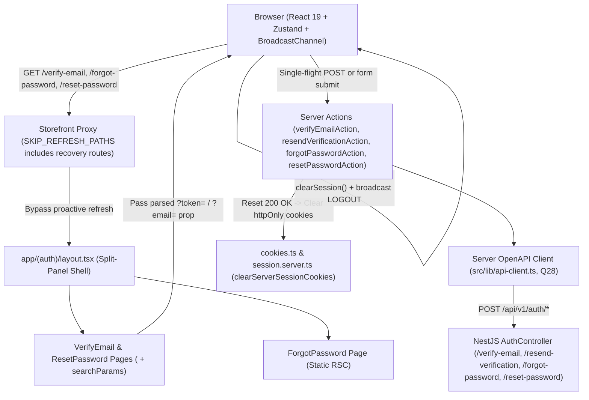
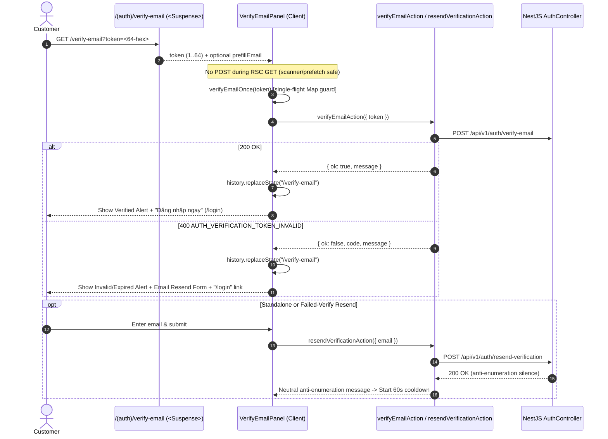
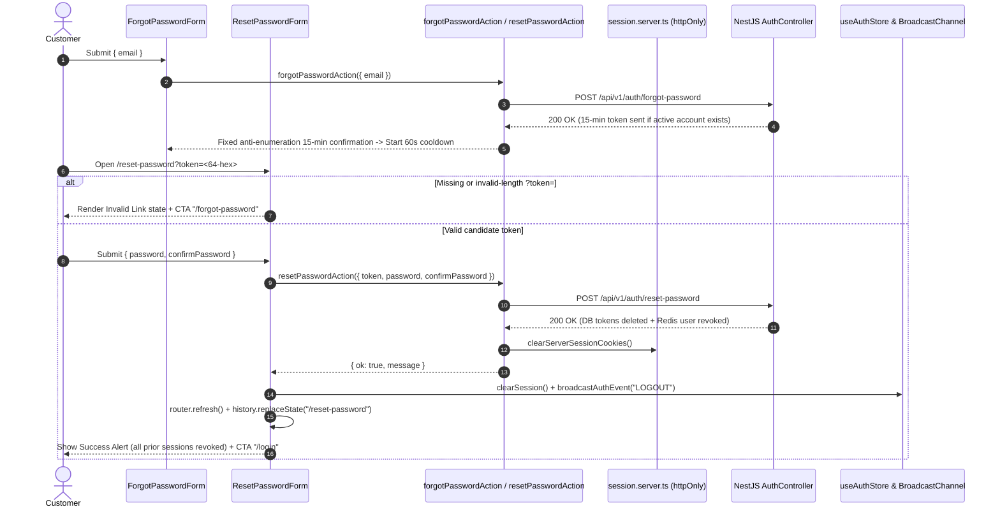

# Storefront Account Recovery & Email Verification Screens Formal Specification

## Overview & Context

This specification defines the Storefront `/verify-email`, `/forgot-password`, and `/reset-password` UI routes, Server Action BFF bindings, Next.js Proxy session exemptions, client-side validation parity, and local session revocation invariants for Issue `#126` (Parent Epic `#7`, building sequentially on `#125` / PR `#151`, `#122` / `ADR-0036`, and `#17` / `docs/design/auth-and-session-management.md`).

### Goals

- Implement `/verify-email`, `/forgot-password`, and `/reset-password` inside the shared `(auth)` split-panel route group (`apps/storefront/app/(auth)/layout.tsx`) while reconciling Stitch design screens (`x_c_th_c_email/code.html`, `qu_n_m_t_kh_u/code.html`, `t_l_i_m_t_kh_u/code.html`) with live NestJS API contracts.
- Trigger `POST /api/v1/auth/verify-email` via a client `useEffect` wrapped in an in-memory single-flight `Map<token, Promise>` deduplicator so React 19 StrictMode mounts and `GET` email-link scanners cannot double-consume single-use verification tokens.
- Keep `/verify-email` usable without `?token=` via a standalone resend form (`POST /api/v1/auth/resend-verification`) with 60-second client cooldown and neutral anti-enumeration feedback.
- Enforce `ForgotPasswordDto.strict()` (`email`-only) on `/forgot-password` with fixed 15-minute anti-enumeration confirmation banners and 60-second client cooldown aligned with backend `@Throttle({ auth: { limit: 3, ttl: 60000 } })`.
- Enforce full `zPassword()` OWASP rules (`8..128`, `[A-Z]`, `[0-9]`, `[^a-zA-Z0-9]`) on `/reset-password` via a shared `PasswordChecklist` component, reject missing/malformed `?token=` upfront before displaying inputs, clear Storefront `httpOnly` BFF cookies and client auth store on reset success, broadcast `LOGOUT` across tabs, and inform users that all prior sessions have been signed out.
- Exempt `/verify-email`, `/forgot-password`, and `/reset-password` from proactive token rotation in `apps/storefront/proxy.ts` (`SKIP_REFRESH_PATHS`) and omit `AuthRedirectGate` so already-authenticated customers can still follow recovery links cleanly.

### Non-Goals

- Unverified account email reassignment (`AuthController` provides no email-update endpoint; Stitch's `"Đổi địa chỉ email khác"` button/form is omitted).
- Phone-based password reset (`ForgotPasswordDto` rejects non-email identifiers).
- Floating Toast notifications for recovery submission errors (`UI-2` requires inline `Alert` primitives).
- Backoffice staff invitation or password recovery routes (`#126` covers Storefront customers only).

## Architecture

### Route, Proxy & Component Boundaries

1. **Proxy & Session Non-Gating**:
   - `apps/storefront/proxy.ts` extends `SKIP_REFRESH_PATHS` to `["/login", "/register", "/verify-email", "/forgot-password", "/reset-password"]`.
   - Recovery route pages intentionally do **not** wrap forms in `AuthRedirectGate` so customers holding an active or stale Storefront session can still open email verification or password reset links directly.
2. **Stitch Reconciliations**:
   - `x_c_th_c_email/code.html` -> drop `"Đổi địa chỉ email khác"` and floating `#toast`; add full `?token=` loading/success/invalid states and inline `Alert` feedback.
   - `qu_n_m_t_kh_u/code.html` -> narrow input strictly to `Email` (`type="email"`), remove prefilled sample value, replace input echo with fixed anti-enumeration copy, and add 60s resend cooldown.
   - `t_l_i_m_t_kh_u/code.html` -> upgrade rule hint from `"gồm chữ và số"` to shared 4-rule OWASP `PasswordChecklist`, add missing-token guard screen, clear Storefront cookies + cross-tab state on success, and explicitly notify users that all prior sessions were terminated.
3. **Target Files**:
   - `apps/storefront/proxy.ts`
   - `apps/storefront/src/lib/auth/auth-validation.ts` & `auth-actions.ts`
   - `apps/storefront/src/features/auth/components/password-checklist.tsx`, `auth-footer-links.tsx`, `use-cooldown.ts`, `verify-email-panel.tsx`, `forgot-password-form.tsx`, `reset-password-form.tsx`, and `register-form.tsx`
   - `apps/storefront/app/(auth)/verify-email/page.tsx`, `forgot-password/page.tsx`, and `reset-password/page.tsx`

## Operational Flow

### 1. Email Verification (`?token=` Auto-Verify & Standalone Resend)

### 2. Forgot Password & Password Reset with Global Session Sync

## Security & Reliability

- **Single-Use Token Protection (`INV-SF-REC-UI-1`)**: Because `AuthService.verifyEmail` nulls `verificationToken` immediately on first success, verification NEVER executes during RSC SSR (`GET`), and client `verifyEmailOnce(token)` shares a single in-flight Promise across React 19 StrictMode double-mounts.
- **Anti-Enumeration Enforcement (`INV-SF-REC-UI-2`)**: Neither `/forgot-password` nor `/verify-email` resend confirmation echoes user input or asserts account existence/unverified status (`AuthService.resendVerificationEmail` returns `200 OK` silently for verified, suspended, missing, and cooldown-active accounts).
- **Two-Layer Session Revocation Parity (`INV-SF-REC-UI-4`)**: When `POST /api/v1/auth/reset-password` succeeds on the backend, `resetPasswordAction` immediately clears Storefront `httpOnly` `accessToken`/`refreshToken` cookies so no stale BFF session lingers until the next `401`, and the client clears `useAuthStore`, emits `LOGOUT` over `BroadcastChannel`, and refreshes router state.
- **Token Hygiene & Rate Limiting (`INV-SF-REC-UI-7`)**: Raw tokens exist only in server-resolved prop -> client memory -> `POST` Server Action body (never in browser storage). Successful or settled `/verify-email` and successful `/reset-password` clean the URL query string via `window.history.replaceState`. Pending button locks + 60-second client cooldowns prevent accidental bursts against `@Throttle` `auth` limits (`3/min` resend & forgot-password, `5/min` reset-password).

## Domain Invariant Taxonomy

| Invariant         | Name                                  | Formal Statement                                                                                                                                           | Enforcement Seam                                                           | Verification Test                                                                                |
| :---------------- | :------------------------------------ | :--------------------------------------------------------------------------------------------------------------------------------------------------------- | :------------------------------------------------------------------------- | :----------------------------------------------------------------------------------------------- |
| `INV-SF-REC-UI-1` | Client Single-Flight Verification     | `/verify-email?token=` executes strictly in a client effect wrapped in a token-keyed single-flight Promise map, never as an SSR `GET` side effect          | `verifyEmailOnce` & `VerifyEmailPanel`                                     | `verify-email-single-flight.spec.ts` -> concurrent calls share one execution per token           |
| `INV-SF-REC-UI-2` | Anti-Enumeration Recovery Feedback    | `forgotPasswordAction` and `resendVerificationAction` always surface fixed neutral messages regardless of account existence or verification status         | `executeForgotPasswordAction`, `executeResendVerificationAction`           | `auth-actions.spec.ts` -> neutral 15m/verification copy on `200 OK`, maps `429` safely           |
| `INV-SF-REC-UI-3` | Strict Recovery DTO & Password Parity | Recovery schemas mirror backend `.strict()` DTOs (`token` `1..64`, `zEmail`, `zPassword` 4 OWASP rules + confirmation match, no phone recovery input)      | `verifyEmailSchema`, `forgotPasswordFormSchema`, `resetPasswordFormSchema` | `auth-validation.spec.ts` -> rejects phone numbers, weak passwords, mismatched confirmation      |
| `INV-SF-REC-UI-4` | Reset Session Cleanup Parity          | Successful `resetPasswordAction` clears Storefront `httpOnly` cookies server-side before client store reset and cross-tab `LOGOUT` broadcast               | `executeResetPasswordAction` & `ResetPasswordForm`                         | `auth-actions.spec.ts` -> verifies `clearCookies` invoked on success and skipped on error        |
| `INV-SF-REC-UI-5` | Non-Gated Recovery & Proxy Skip       | Recovery routes remain accessible to logged-in sessions and `proxy.ts` skips proactive token refresh for all three recovery paths                          | `SKIP_REFRESH_PATHS` in `apps/storefront/proxy.ts`                         | `proxy.spec.ts` -> zero refresh calls for `/verify-email`, `/forgot-password`, `/reset-password` |
| `INV-SF-REC-UI-6` | Missing/Oversized Reset Token Guard   | `/reset-password` rejects absent, whitespace-only, or `> 64`-char `?token=` upfront with a recovery CTA instead of rendering an unusable password form     | `parseRecoveryTokenParam` & `ResetPasswordForm`                            | `auth-validation.spec.ts` -> rejects empty, overlong, and array query token values               |
| `INV-SF-REC-UI-7` | URL Token Hygiene & `Suspense` Safety | `verify-email` and `reset-password` wrap dynamic `searchParams` readers in `<Suspense>` (`cacheComponents: true`) and strip settled tokens via History API | Route pages + client panels                                                | `bun run check` + `next build`                                                                   |

### Edge Cases & Adversarial Matrix

| ID       | Scenario                                                                                    | Expected Behavior                                                                                                                 |
| :------- | :------------------------------------------------------------------------------------------ | :-------------------------------------------------------------------------------------------------------------------------------- |
| `EDGE-1` | Customer enters `/verify-email` directly with no `?token=` and submits an unverified email  | Form validates email client/server-side, sends resend request, shows neutral anti-enumeration notice + 60s countdown              |
| `EDGE-2` | Customer enters an **already-verified** or unregistered email on `/verify-email`            | Backend exits `200 OK` silently (`AuthService.resendVerificationEmail`); UI displays neutral notice + `"Quay lại đăng nhập"` hint |
| `EDGE-3` | Customer clicks `/verify-email?token=<used-or-expired>`                                     | `verifyEmailAction` maps `400 AUTH_VERIFICATION_TOKEN_INVALID`; UI reveals resend email form + login link                         |
| `EDGE-4` | Customer submits phone number `"0908412679"` on `/forgot-password`                          | `forgotPasswordFormSchema` rejects client-side cleanly before touching API (`email`-only parity)                                  |
| `EDGE-5` | Customer opens `/reset-password` without `?token=` or with `?token=` exceeding 64 chars     | `parseRecoveryTokenParam` returns `null`; page renders missing/invalid token banner + `/forgot-password` CTA                      |
| `EDGE-6` | Already-signed-in customer opens `/reset-password?token=...` and completes reset            | Backend revokes global sessions; `resetPasswordAction` clears `accessToken`/`refreshToken`; client broadcasts `"LOGOUT"`          |
| `ADV-1`  | React 19 StrictMode double-invokes `useEffect` on `/verify-email?token=<valid>`             | `verifyEmailOnce(token)` returns the exact in-flight Promise on the 2nd call; backend receives one `POST` only                    |
| `ADV-2`  | Attacker spams `/forgot-password` or `/verify-email` resend hitting NestJS `3/min` throttle | Pending disable + 60s client cooldown prevent accidental bursts; API `429` maps to `API_ERROR_DICTIONARY.TOO_MANY_REQUESTS`       |
| `ADV-3`  | User injects extra keys (`role`, `userId`) or repeated `?token=a&token=b` query arrays      | `.strict()` schemas reject extra keys; `extractFirstQueryValue` handles array params deterministically                            |

## Test Matrix

Verification suites in `apps/storefront`:

- `apps/storefront/src/lib/auth/auth-validation.spec.ts`: `parseRecoveryTokenParam`, `parsePrefillEmailParam`, `verifyEmailSchema`, `forgotPasswordFormSchema`, `resetPasswordFormSchema`, and cooldown formatters.
- `apps/storefront/src/lib/auth/auth-actions.spec.ts`: `executeVerifyEmailAction`, `executeForgotPasswordAction`, updated `executeResendVerificationAction`, and `executeResetPasswordAction` cookie cleanup behavior.
- `apps/storefront/src/lib/auth/proxy.spec.ts`: `SKIP_REFRESH_PATHS` coverage for `/verify-email`, `/forgot-password`, and `/reset-password`.
- `apps/storefront/src/features/auth/components/verify-email-single-flight.spec.ts`: concurrent single-flight deduplication per verification token.
