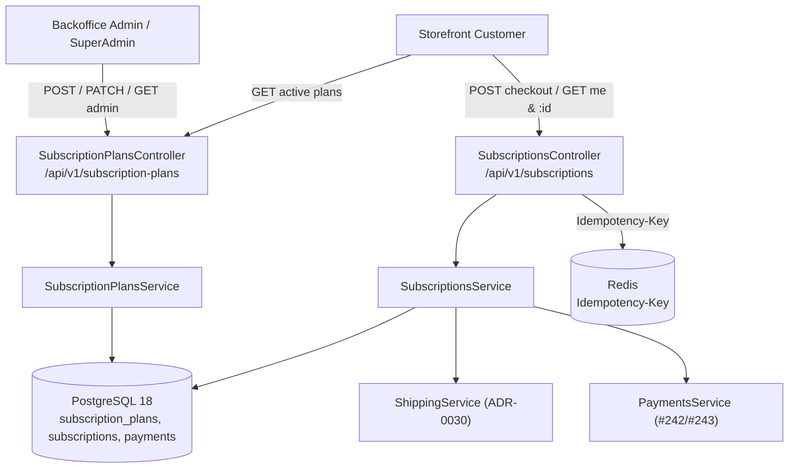
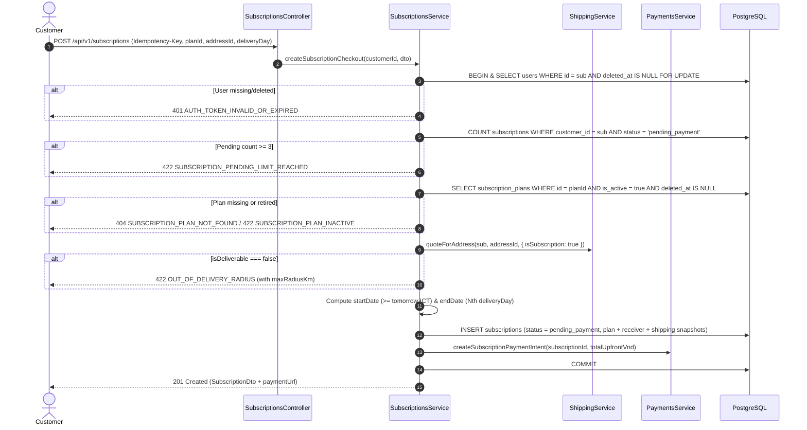

# Subscription Plans CRUD & Prepaid Snapshot Checkout Formal Specification

## Overview & Context

This specification defines the domain contracts, RBAC boundaries, database invariants, and operational workflows for the split children of `#30` (Epic `#12`), recorded in `ADR-0041` (extending `ADR-0005`, `ADR-0008`, `ADR-0018`, `ADR-0030`, `ADR-0034`, and `ADR-0038`).

### Goals

- **Child A — Subscription Plans CRUD**: Provide public active-plan listing (`GET /api/v1/subscription-plans`), admin full listing (`GET /api/v1/subscription-plans/admin`), and admin plan creation/update/soft-retirement (`POST /api/v1/subscription-plans`, `PATCH /api/v1/subscription-plans/:id`) with `isActive = false` retirement and unique active `slug` enforcement.
- **Child B — Prepaid Subscription Checkout & Customer Reads**: Extend `SubscriptionStatus` with `PENDING_PAYMENT`, snapshot `receiverName` and `receiverPhone` alongside plan and shipping-quote snapshots in `subscriptions`, collect `plan.price + totalDeliveries * shippingFeePerDelivery` atomically via `payments` (`PaymentsModule`), and expose customer-owned read endpoints (`GET /api/v1/subscriptions/me`, `GET /api/v1/subscriptions/:id`).
- Sync generated OpenAPI contracts via `bun run types:sync` after each child's API surface lands.

### Non-Goals

- 04:00 Tuesday/Friday cron child-order generation, shortage alerts, and customer pause/resume/cancel endpoints (`#31`).
- PayOS driver adapter and HMAC webhook handler implementation (`#242`, `#243`).
- Storefront `SF-04` and Backoffice `BO-08` subscription UIs (`#54`, `#55`).

## Architecture

## Operational Flow

### 1. Subscription Plans CRUD (Child A)

1. `GET /api/v1/subscription-plans`: Public endpoint returning `subscription_plans` where `isActive = true` and `deletedAt IS NULL`, ordered deterministically.
2. `GET /api/v1/subscription-plans/admin`: `@ApiAuth(UserRole.ADMIN, UserRole.SUPER_ADMIN)` returning all non-deleted plans including `isActive = false`.
3. `POST /api/v1/subscription-plans`: `@ApiAuth(UserRole.ADMIN, UserRole.SUPER_ADMIN)` validates positive `priceVnd`, `totalDeliveries`, and `weightPerDeliveryKg`, auto-generates kebab-case `slug` from `name` when omitted, and maps PostgreSQL `23505` on `subscription_plans_slug_uidx` to `409 SUBSCRIPTION_PLAN_SLUG_CONFLICT`.
4. `PATCH /api/v1/subscription-plans/:id`: `@ApiAuth(UserRole.ADMIN, UserRole.SUPER_ADMIN)` updates mutable plan fields or soft-retires via `isActive = false` without affecting existing `subscriptions` snapshots. Missing or soft-deleted plan returns `404 SUBSCRIPTION_PLAN_NOT_FOUND`.

### 2. Prepaid Subscription Checkout (Child B)

### 3. Customer Read Projection (Child B)

1. `GET /api/v1/subscriptions/me` (`@Get("me")` registered before `@Get(":id")`): Paginated (`page`, `limit`) list of `customerId = sub` subscriptions ordered by `createdAt DESC, id DESC`.
2. `GET /api/v1/subscriptions/:id`: Validates UUIDv7 (`400 INVALID_UUID`) and queries `id = :id AND customerId = sub`; returns `404 SUBSCRIPTION_NOT_FOUND` for both missing and foreign rows. Projects snapshots, `remainingDeliveries`, `status`, `startDate`, `endDate`, and omits `payments.rawPayload`, `payments.referenceCode`, and `payments.verifiedBy`.

## Security & Reliability

- **RBAC Isolation**: Plan mutations (`POST`/`PATCH`) and `/admin` listing require `UserRole.ADMIN` or `UserRole.SUPER_ADMIN` (`UserRole.STAFF` receives `403`). Subscription checkout and `/me` / `:id` reads require `UserRole.CUSTOMER`.
- **Anti-Enumeration**: `GET /api/v1/subscriptions/:id` and `addressId` resolution return `404` regardless of whether the resource is absent or owned by another customer.
- **Idempotency & Concurrency**: `POST /api/v1/subscriptions` enforces a user/route-scoped `Idempotency-Key` (`ADR-0008`, `ADR-0031`). Serializing checkout on `users ... FOR UPDATE` prevents concurrent requests from bypassing the `3` `PENDING_PAYMENT` cap.
- **Fail-Closed Payment Activation**: `subscriptions` never enter `ACTIVE` until `PaymentsService` verifies payment settlement (`#243`). Unpaid `PENDING_PAYMENT` rows expire after `BUSINESS_RULES.ORDER_PAYMENT_TIMEOUT_MINUTES` (`15` minutes).

## Domain Invariant Taxonomy

| ID          | Name                               | Invariant Statement                                                                                                                                                                                                                                     | Enforcement Layer                                                         | Verification Target                                                                                                                      |
| :---------- | :--------------------------------- | :------------------------------------------------------------------------------------------------------------------------------------------------------------------------------------------------------------------------------------------------------ | :------------------------------------------------------------------------ | :--------------------------------------------------------------------------------------------------------------------------------------- |
| `INV-SUB-1` | Prepaid Activation Gate            | A newly created subscription starts in `SubscriptionStatus.PENDING_PAYMENT` with a companion `payments` row (`PENDING`) and transitions to `ACTIVE` only on verified payment settlement.                                                                | `SubscriptionsService`, `PaymentsService`, `subscription_status` enum     | Checkout integration test verifies `status === "pending_payment"` before webhook and `active` after settlement                           |
| `INV-SUB-2` | Immutable Plan & Receiver Snapshot | `subscriptions` persists immutable snapshots of `planName`, `price`, `totalDeliveries`, `weightPerDeliveryKg`, `basketDescription`, `receiverName`, `receiverPhone`, `shippingAddress`, `shippingDistanceKm`, and `shippingFeePerDelivery` at checkout. | `subscriptions` schema (`subscription.schema.ts`), `SubscriptionsService` | Integration test mutates plan (`PATCH`) and hard-deletes `user_addresses`, verifying existing `subscriptions` snapshot remains unchanged |
| `INV-SUB-3` | Upfront Shipping Fee Accounting    | Total payment intent amount equals `plan.price + (plan.totalDeliveries * shippingFeePerDelivery)`, where `shippingFeePerDelivery` is `0` within `subscriptionFreeRadiusKm` and standard fee in `(subscriptionFreeRadiusKm, maxRadiusKm]`.               | `SubscriptionsService` + `ShippingService` (`ADR-0030`)                   | Integration tests for `<= 20 km` (`amount === price`) and `(20 km, 25 km]` (`amount === price + totalDeliveries * fee`)                  |
| `INV-SUB-4` | Deliverability & Active Plan Gate  | Checkout rejects out-of-radius addresses (`422 OUT_OF_DELIVERY_RADIUS`) and inactive/deleted plans (`404`/`422`) before inserting any row.                                                                                                              | `SubscriptionsService`, `ShippingService`                                 | Integration tests for `can-gio` (`422`) and `isActive = false` plan (`422`)                                                              |
| `INV-SUB-5` | Pending Cap & DB Bounds            | Each customer holds at most `3` `PENDING_PAYMENT` subscriptions concurrently; DB `CHECK` constraints enforce positive plan prices/deliveries/weights, `0 <= remainingDeliveries <= totalDeliveries`, and `endDate >= startDate`.                        | `users ... FOR UPDATE`, PostgreSQL `CHECK` constraints (`ADR-0005`)       | Concurrency test firing 4th pending checkout (`422`) and DB constraint test rejecting invalid bounds                                     |
