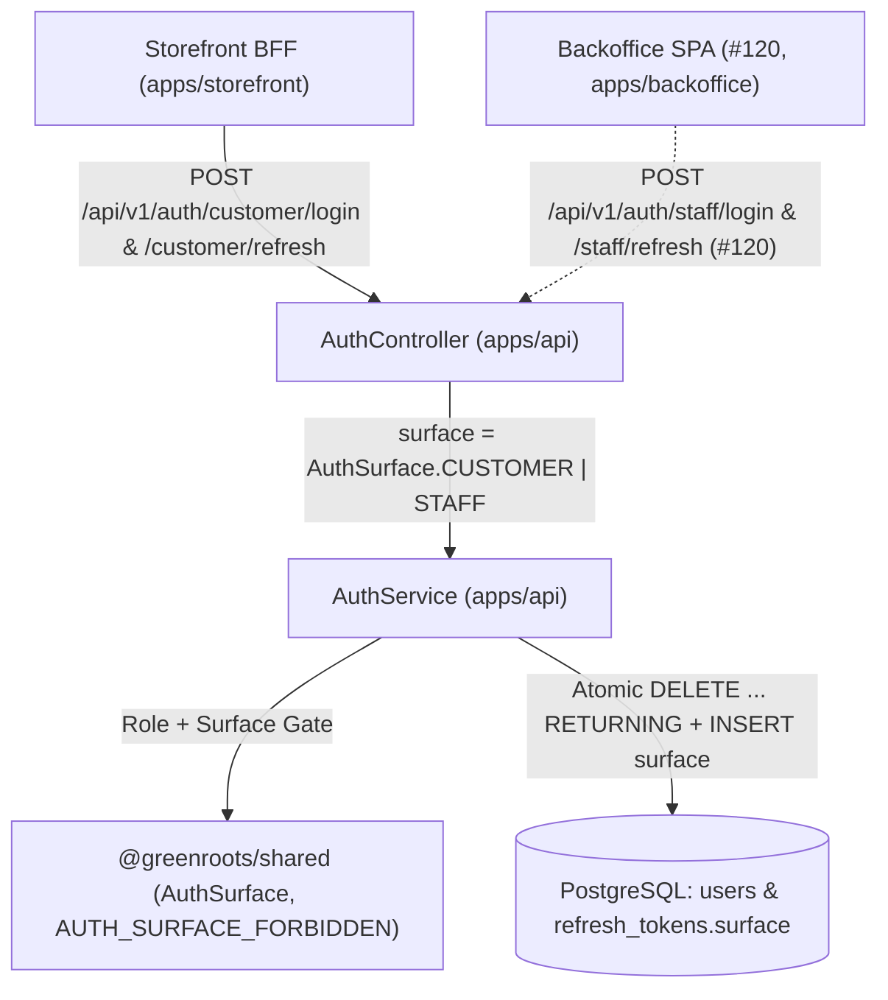
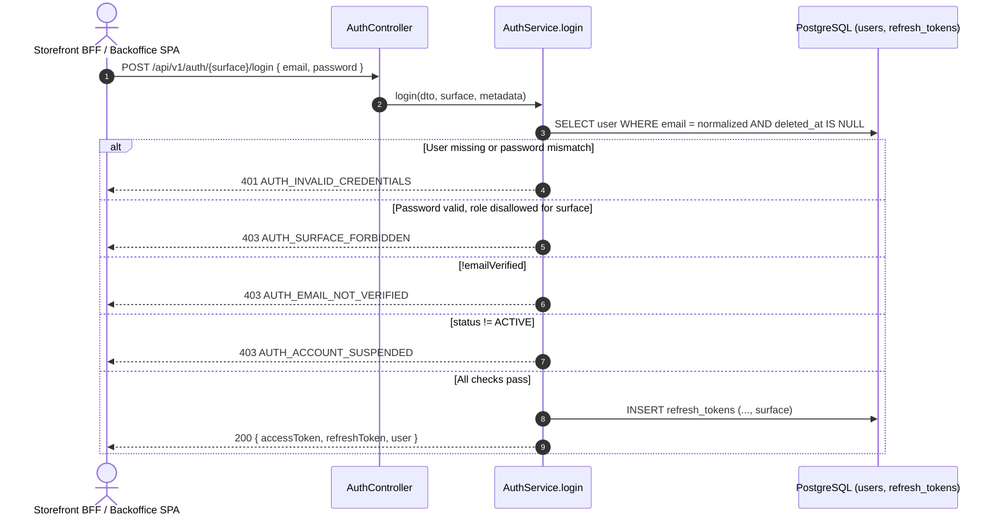
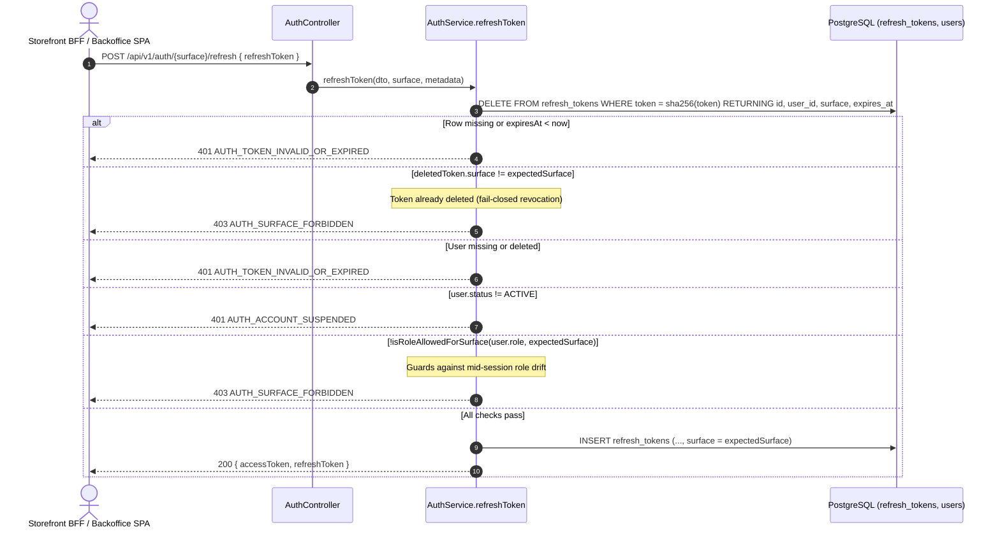

# Surface-Scoped Authentication & Refresh Token Binding Formal Specification

## Overview & Context

This specification defines the surface-scoped authentication and refresh token binding architecture for `#145` (Epic `#7`, follow-up to `#122` and `#17`, unblocking `#120`), governed by `ADR-0039` (superseding the transitional role policy in `ADR-0036`).

Currently, `POST /api/v1/auth/login` (`AuthController.login` → `AuthService.login`) and `POST /api/v1/auth/refresh` (`AuthController.refresh` → `AuthService.refreshToken`) validate credentials, `emailVerified`, and `status` without checking `UserRole` or binding refresh sessions to a client surface. Consequently, internal `STAFF_ROLES` (`farm_staff`, `sales`, `admin`, `super_admin`) can establish a Storefront session, and `UserRole.CUSTOMER` accounts could authenticate against Backoffice once `#120` is wired.

### Goals

- Separate authentication and refresh entrypoints by surface:
  - `POST /api/v1/auth/customer/login` and `POST /api/v1/auth/customer/refresh` (Customer / Storefront — `UserRole.CUSTOMER` only).
  - `POST /api/v1/auth/staff/login` and `POST /api/v1/auth/staff/refresh` (Staff / Backoffice — `STAFF_ROLES` only).
- Remove the unfiltered `POST /api/v1/auth/login` and `POST /api/v1/auth/refresh` endpoints.
- Bind persisted `refresh_tokens` rows to a PostgreSQL native `auth_surface` enum (`customer` | `staff`), enforcing fail-closed atomic `DELETE ... RETURNING` revocation and dual surface+live-role verification on refresh.
- Introduce `API_ERROR_CODES.AUTH_SURFACE_FORBIDDEN` (`403` RFC 9457) in `@greenroots/shared` and evaluate surface role immediately after password verification to prevent status/verification leakage across surfaces.
- Wire Storefront (`apps/storefront`) to `/api/v1/auth/customer/login` and `/api/v1/auth/customer/refresh`, adding BFF defense-in-depth (`user.role === UserRole.CUSTOMER`) in `resolveServerSession()` and `executeLoginAction()`.

### Non-Goals

- Wiring Backoffice SPA login, password recovery, or 401/403 interceptors (`#120` owns Backoffice wiring using the regenerated OpenAPI types).
- Splitting `logout`, `logout-all`, `forgot-password`, `reset-password`, `register`, `verify-email`, or `resend-verification` by surface.
- Restricting `GET/PATCH /api/v1/users/me` (`ProfileController`) to `UserRole.CUSTOMER`; self-service profile remains `@ApiAuth()` for all authenticated roles.
- Multi-tenant organization switching or external SSO/OAuth providers.

## Architecture

### Symbols & Ownership Boundaries

- **`packages/shared/src/domain.enums.ts`**:
  - Add `AuthSurface = { CUSTOMER: "customer", STAFF: "staff" } as const` and `export type AuthSurface`.
- **`packages/shared/src/error-dictionary.ts`**:
  - Add `AUTH_SURFACE_FORBIDDEN: "AUTH_SURFACE_FORBIDDEN"` to `API_ERROR_CODES` and a default Vietnamese message in `API_ERROR_DICTIONARY`.
- **`apps/api/src/common/constants/messages.constant.ts`**:
  - Add `MESSAGES.AUTH.SURFACE_FORBIDDEN` (English developer detail for RFC 9457 `detail`).
- **`apps/api/src/database/schemas/enums.schema.ts` & `user.schema.ts`**:
  - Add `authSurfaceEnum = pgEnum("auth_surface", enumValues(AuthSurface))` (`ADR-0002`).
  - Add `surface: authSurfaceEnum().notNull()` to `refreshTokens` (`refresh_tokens.surface`), with a Drizzle migration.
- **`apps/api/src/modules/auth/auth.routes.ts` & `auth.controller.ts`**:
  - Replace `LOGIN: "login"` and `REFRESH: "refresh"` with `CUSTOMER_LOGIN: "customer/login"`, `STAFF_LOGIN: "staff/login"`, `CUSTOMER_REFRESH: "customer/refresh"`, and `STAFF_REFRESH: "staff/refresh"`.
  - Keep `@Throttle` limits (`5/60s` on login routes, `10/60s` on refresh routes) and `@ApiForbiddenResponseRfc9457()` on all four routes.
- **`apps/api/src/modules/auth/auth.service.ts`**:
  - Parameterize `login(dto, surface, metadata)` and `refreshToken(dto, surface, metadata)` (or expose `loginForSurface` / `refreshForSurface` helpers).
  - Persist `surface` in `createTokenSession(userId, email, role, surface, metadata)`.
- **`apps/storefront/src/features/auth/`**:
  - `actions/auth-actions.ts` (`executeLoginAction`): call `POST /api/v1/auth/customer/login`; verify `profileResult.data.data.role === UserRole.CUSTOMER` before returning `{ ok: true, user }`, clearing cookies if mismatched.
  - `services/single-flight-refresh.ts` (`defaultRefreshFetcher`): call `POST /api/v1/auth/customer/refresh`.
  - `services/session.server.ts` (`resolveServerSession`): verify `data.data.role === UserRole.CUSTOMER`; return `null` on mismatch (defense-in-depth against pre-`#145` cookies).

## Operational Flow

### 1. Surface-Scoped Login (`POST /api/v1/auth/{customer|staff}/login`)

### 2. Surface-Bound Refresh Rotation (`POST /api/v1/auth/{customer|staff}/refresh`)

## Security & Reliability

### Invariants & Edge Cases

1. **`INV-AUTH-SURFACE-1` (Strict Role Partition):**
   - `AuthSurface.CUSTOMER` permits **only** `UserRole.CUSTOMER`.
   - `AuthSurface.STAFF` permits **only** `STAFF_ROLES` (`farm_staff`, `sales`, `admin`, `super_admin`).
   - `UserRole.GUEST` is rejected on both surfaces (`403 AUTH_SURFACE_FORBIDDEN`).
2. **`INV-AUTH-SURFACE-2` (Check Ordering Prevents Status Leakage):**
   - `verifyPassword` MUST run before the surface role check (wrong password always returns `401 AUTH_INVALID_CREDENTIALS` to avoid unauthenticated email/role enumeration).
   - The surface role check MUST run before `emailVerified` and `status` checks so unverified or suspended staff accounts cannot trigger Storefront email-verification flows.
3. **`INV-AUTH-SURFACE-3` (Fail-Closed Cross-Surface Refresh):**
   - `DELETE ... RETURNING` executes unconditionally on `refresh_tokens.token = sha256(refreshToken)` before validating `deletedToken.surface`. Any cross-surface refresh attempt permanently revokes that refresh token and returns `403 AUTH_SURFACE_FORBIDDEN`.
   - Live `user.role` MUST also match `expectedSurface` on refresh, preventing a customer promoted to staff (or vice versa) from continuing on the old surface's refresh chain.
4. **`INV-AUTH-SURFACE-4` (Storefront BFF Defense-in-Depth):**
   - Even if a valid pre-`#145` staff cookie exists in a user's browser, `resolveServerSession()` MUST reject `user.role !== UserRole.CUSTOMER` and return `null`.
   - In `executeLoginAction()`, if `fetchMe` succeeds and `role !== UserRole.CUSTOMER`, cookies MUST be cleared and login MUST fail with `AUTH_SURFACE_FORBIDDEN`.
5. **Migration & Pre-Launch Backfill:**
   - Because `refresh_tokens.surface` is `NOT NULL` without a default, the Drizzle migration adds `auth_surface` enum and either truncates/deletes existing pre-launch `refresh_tokens` rows (cleanest, forces re-login on new surface endpoints) or backfills from `users.role` before applying `SET NOT NULL`. Deleting pre-launch `refresh_tokens` rows is preferred to avoid carrying un-scoped sessions across the deploy boundary.

## Verification & Test Plan

1. **Shared & Schema Sync:**
   - `bun run types:sync` regenerates `apps/storefront/src/types/api-schema.d.ts` and `apps/backoffice/src/types/api-schema.d.ts` with `/api/v1/auth/customer/*` and `/api/v1/auth/staff/*` and removes `/api/v1/auth/login` and `/api/v1/auth/refresh`.
2. **API Unit & Integration Tests (`apps/api`):**
   - Customer login succeeds on `/customer/login` (`200`) and fails with `403 AUTH_SURFACE_FORBIDDEN` on `/staff/login`.
   - Staff login (`farm_staff`, `sales`, `admin`, `super_admin`) succeeds on `/staff/login` (`200`) and fails with `403 AUTH_SURFACE_FORBIDDEN` on `/customer/login`.
   - Wrong password for any role returns `401 AUTH_INVALID_CREDENTIALS` (never `403`).
   - Unverified or suspended staff account on `/customer/login` returns `403 AUTH_SURFACE_FORBIDDEN` (not `AUTH_EMAIL_NOT_VERIFIED` or `AUTH_ACCOUNT_SUSPENDED`).
   - Refresh token minted via `/customer/refresh` or `/customer/login` fails with `403 AUTH_SURFACE_FORBIDDEN` on `/staff/refresh`, and subsequent replay on `/customer/refresh` fails with `401 AUTH_TOKEN_INVALID_OR_EXPIRED` (proving fail-closed revocation).
   - Role drift: customer token refreshed after role change to `sales` fails on `/customer/refresh` with `403 AUTH_SURFACE_FORBIDDEN`.
3. **Storefront Unit Tests (`apps/storefront`):**
   - `executeLoginAction` calls `/api/v1/auth/customer/login`, maps `403 AUTH_SURFACE_FORBIDDEN` to localized error, and rejects non-customer `/users/me` responses.
   - `refreshSingleFlight` calls `/api/v1/auth/customer/refresh` and treats `403` as `"invalid"`.
   - `resolveServerSession` returns `null` when `/users/me` returns a `STAFF_ROLES` user.
4. **Full Workspace Gates:**
   - `bun run check`, `bun run test`, and `bun run test:e2e` pass cleanly.
