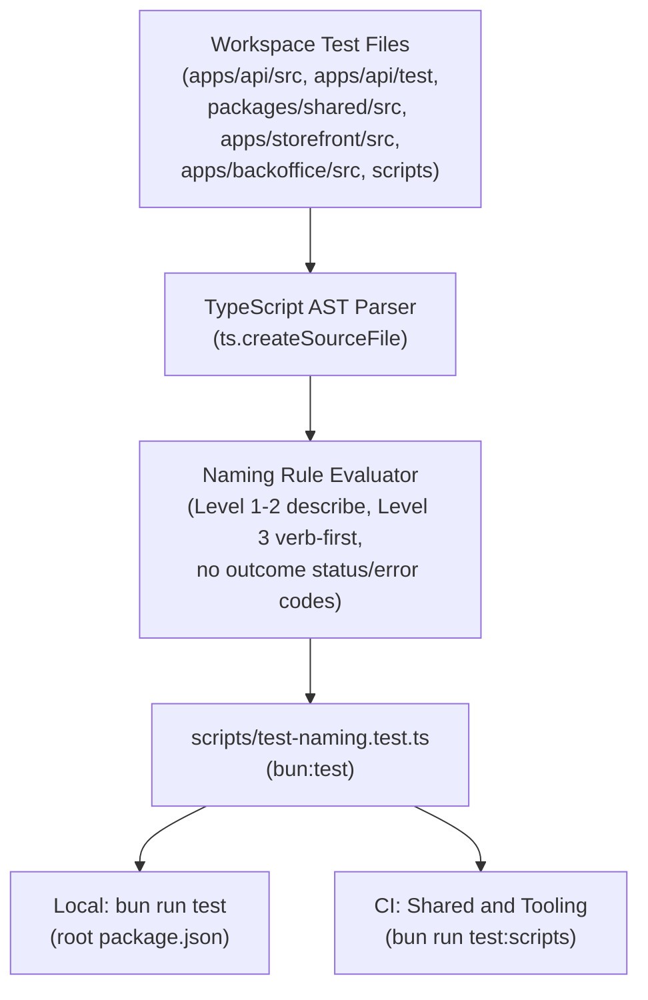
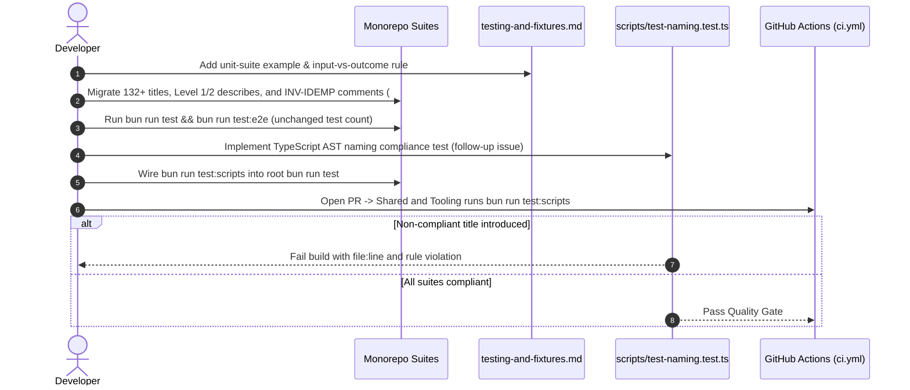

# Test Naming & Invariant Compliance Design

## Overview & Context

Commit `09c3461` established concise, behavior-focused test naming rules in `docs/standards/testing-and-fixtures.md` and migrated `apps/api/test/integration/auth.spec.ts`. Because compliance relied solely on manual review, subsequent PRs reintroduced HTTP status codes and error codes into test titles (`seasons.service.spec.ts`, `batches.spec.ts`, `orders.service.spec.ts`), while legacy suites across `apps/api`, `packages/shared`, and `apps/api/test` still retain `should` prefixes, `Module`/`E2E` suffixes, and adverb-first or subject-first test titles.

An empirical audit at commit `c3fa6b1` across 64 test files (**781** `it()`/`test()` cases in the five workspace target roots, plus `scripts/*.test.ts`) identified:

- **132** `it()`/`test()` titles starting with `should` across 14 files (`auth.service.spec.ts`, `zod-primitives.spec.ts`, `idempotency.service.spec.ts`, `cloudinary.service.spec.ts`, `media.spec.ts`, `zod-validation.pipe.spec.ts`, `api-response.util.spec.ts`, `throttler.guard.spec.ts`, `idempotency.interceptor.spec.ts`, `token-cleanup.service.spec.ts`, `mail.service.spec.ts`, `global-exception.e2e-spec.ts`, `mail.spec.ts`, `openapi.spec.ts`).
- **HTTP status codes, status phrases, and expected outcome error codes** embedded in titles across `global-exception.filter.spec.ts`, `throttler.guard.spec.ts`, `idempotency.interceptor.spec.ts`, `idempotency.service.spec.ts`, `auth.service.spec.ts`, `seasons.service.spec.ts`, `cloudinary.service.spec.ts`, `orders.service.spec.ts`, `global-exception.e2e-spec.ts`, `media.spec.ts`, and `batches.spec.ts`.
- **Non-standard `describe()` hierarchy** in `mail.service.spec.ts` (unit path in `apps/api/src/` using `"Mail Module Integration"`), `global-exception.e2e-spec.ts`, `openapi.spec.ts`, `idempotency.spec.ts`, `mail.spec.ts`, `media.spec.ts`, and `idempotency.interceptor.spec.ts` (4-level `"when ..."` nesting).
- **Non-verb openers** in `auth.spec.ts` (`silently succeeds`, `atomically deletes`, `safely handles`), `crypto.util.spec.ts` (`sha256 returns...`, `refresh tokens are...`), and `redis.service.spec.ts` (`isAccessTokenRevoked forwards...`).
- **Missing invariant comments** in `idempotency.spec.ts`, whereas `INV-IDEMP-1..5` are already specified in `docs/adr/0008-redis-idempotency-interceptor.md` and `docs/standards/api-design-and-error-handling.md`.

### Goals

1. Align all existing test suites in `apps/api/src`, `apps/api/test`, `packages/shared/src`, `apps/storefront/src`, `apps/backoffice/src`, and `scripts/` with `docs/standards/testing-and-fixtures.md` without altering test count or assertions.
2. Extend `docs/standards/testing-and-fixtures.md` with a unit-suite `describe()` example and explicit input-vs-outcome rules for error codes and SQLSTATE identifiers.
3. Introduce a zero-dependency TypeScript AST compliance test (`scripts/test-naming.test.ts`) wired into root `package.json` (`bun run test`) and CI (`bun run test:scripts` in `Shared and Tooling`) to prevent future regressions.
4. Annotate `// Invariant: INV-IDEMP-1..5` comments in idempotency suites while preserving all 235 pre-existing `// Invariant:` comments.

### Non-Goals

- Changing assertions, coverage, fixtures, or factory/mother behavior.
- Moving test files or reorganizing workspace directories (e.g., `mail.service.spec.ts` stays under `apps/api/src/modules/mail/`).
- Adding external test frameworks or custom `oxlint` JavaScript plugins.
- Creating a repository ADR (trivial reversibility and absence of architectural lock-in fail all three ADR gates).
- Inventing new `INV-*` identifiers for subsystems without formal design specs (`media`, `mail`, `openapi`, `global-exception`).

## Architecture

### 1. Hierarchy & Title Grammar

- **Integration suites** (`apps/api/test/**/*.spec.ts`, `apps/api/test/**/*.e2e-spec.ts`):
  - Level 1: `describe("<Domain> Integration")` — `Module` and `E2E` suffixes are forbidden (e.g., `GlobalExceptionFilter Integration`, `Idempotency Integration`, `Mail Integration`, `Media Integration`, `OpenAPI Integration`).
  - Level 2: `describe("<METHOD> <route>")` or `describe("<Feature Group>")` — no `when ...` clauses, no HTTP status codes, and no parenthetical modifiers such as `(authenticated)`.
- **Unit suites** (`apps/api/src/**/*.spec.ts`, `packages/shared/src/**/*.spec.ts`, `apps/storefront/src/**/*.spec.ts`, `apps/backoffice/src/**/*.spec.ts`, `scripts/*.test.ts`):
  - Level 1: `describe("<Subject>")` — class, module, function, or store under test (`Mail` with Level 2 `MailService` and `MailProcessor` for `mail.service.spec.ts`).
  - Level 2: `describe("<method>")` or `describe("<Feature Group>")` — flatten conditional `describe("when ...")` blocks (such as in `idempotency.interceptor.spec.ts`) into Level 3 `when <condition>` clauses.
- **Level 3 test titles** (`it()` / `test()`):
  - Must match `<third-person-active-verb> <behavior> [when <condition>]`.
  - Hyphenated third-person verbs (`short-circuits`, `re-evaluates`, `hard-deletes`, `soft-releases`) are valid.
  - Leading `should`, leading adverbs (`silently`, `atomically`, `safely`), and noun/subject-first openers (`sha256 returns...`, `isAccessTokenRevoked forwards...`) are invalid.

### 2. Outcome vs Input Token Boundary

`docs/standards/testing-and-fixtures.md` prohibits test IDs, HTTP status codes, and error codes from test titles. To preserve clarity in low-level parser, filter, and error-dictionary unit tests without weakening outcome cleanliness:

- **Forbidden everywhere in titles**:
  - Test IDs (`T1-*`, `[ID]`) and `INV-*` references (move to `// Invariant: INV-...` comments).
  - HTTP status codes (`200`, `201`, `204`, `400`, `401`, `403`, `404`, `409`, `413`, `415`, `422`, `429`, `500`, `502`, `503`) and HTTP status phrases (`Bad Request`, `Unauthorized`, `Forbidden`, `Not Found`, `Conflict`, `Unprocessable Entity`, `Too Many Requests`, `Service Unavailable`).
  - Expected outcome API error codes (e.g., `AUTH_EMAIL_ALREADY_EXISTS`, `ORDER_NOT_FOUND`, `FARM_NOT_FOUND`).
- **Permitted when naming the subject or input under test**:
  - PostgreSQL SQLSTATE codes (`P0001`, `23503`, `23505`, `23514`) in exception-mapping and constraint tests (`global-exception.filter.spec.ts`, `seasons.service.spec.ts`).
  - Error dictionary keys tested as inputs in `packages/shared/src/error-dictionary.spec.ts` (`TOO_SMALL`, `TOO_BIG`, `ORDER_BELOW_MINIMUM_VALUE`, `NETWORK_ERROR`).
  - Non-error domain/config constants (`STOREFRONT_URL`, `BATCH_CODE_REGEX`, `HCMC_DISTRICTS`, `AUTH_REVOCATION_TTL_SECONDS`).

### 3. Execution & Issue Split Boundary

- **Issue #74** remains strictly focused on migrating existing titles across all suites, adding `// Invariant: INV-IDEMP-1..5` to idempotency tests, and adding the unit-suite example + input-vs-outcome clarification to `docs/standards/testing-and-fixtures.md`.
- **Follow-up tooling issue** (blocked by #74) introduces `scripts/test-naming.test.ts` and updates root `package.json` `"test"` to append `&& bun run test:scripts`. Separating mechanical string edits from AST parser logic keeps PR review diffs isolated and adheres to `docs/standards/issue-tracker.md`.

## Operational Flow

## Security & Reliability

1. **AST Inspection Over Regex Matching**: Parsing via `ts.createSourceFile` from the root `typescript` package inspects only `CallExpression` nodes whose callee is `describe`, `it`, or `test` (or `.only`/`.skip`/`.todo`/`.each` property access). This eliminates false positives on assertion expressions such as `SEMVER.test("1.2.3")` in `scripts/version.test.ts` (alongside `scripts/release.test.ts` and `scripts/detect-and-tag-release.test.ts`).
2. **Fail-Closed Dynamic Title Guard**: Passing computed expressions or non-static template literals to `describe`, `it`, or `test` fails validation rather than silently skipping checks.
3. **Offline Determinism**: `scripts/test-naming.test.ts` performs read-only filesystem traversal and pure AST inspection with zero database, Redis, network, or subprocess dependencies.
4. **Zero Semantic Mutation**: Title migration must preserve exact test counts (`781` cases across the five target roots at `c3fa6b1`, plus `scripts/*.test.ts`) and keep all status/error assertions intact inside test bodies.

## Domain Invariant Taxonomy

| Invariant    | Name                           | Formal Statement                                                                                                                                                                                                                      | Enforcement Seam                                                                 | Verification Test                                                              |
| :----------- | :----------------------------- | :------------------------------------------------------------------------------------------------------------------------------------------------------------------------------------------------------------------------------------ | :------------------------------------------------------------------------------- | :----------------------------------------------------------------------------- |
| `INV-TEST-1` | Active-Verb Level 3 Titles     | Every `it()`/`test()` title starts with a third-person singular active verb (hyphenated verbs allowed), never `should`, leading adverbs, or noun-first subjects.                                                                      | `scripts/test-naming.test.ts` AST check on `it`/`test` calls                     | `scripts/test-naming.test.ts` -> rejects `should` and non-verb openers         |
| `INV-TEST-2` | Clean Outcome Titles           | No `describe()`/`it()`/`test()` title embeds test IDs, `INV-*` tags, HTTP status codes/phrases, or expected outcome API error codes.                                                                                                  | `scripts/test-naming.test.ts` token check with explicit input-constant allowlist | `scripts/test-naming.test.ts` -> rejects HTTP statuses and outcome error codes |
| `INV-TEST-3` | Suite Level 1 & 2 Grammar      | Integration suites use `<Domain> Integration` + `<METHOD> <route>` or `<Feature Group>` without `Module`/`E2E`/`when`/parenthetical suffixes; unit suites use `<Subject>` + `<method>`/`<Feature Group>` without `when ...` wrappers. | `scripts/test-naming.test.ts` `describe` tree depth and pattern validator        | `scripts/test-naming.test.ts` -> validates `describe` hierarchy per suite root |
| `INV-TEST-4` | Invariant Comment Traceability | Documented domain invariants are referenced via `// Invariant: INV-...` comments inside test bodies rather than titles, with `INV-IDEMP-1..5` present in idempotency tests.                                                           | `docs/standards/testing-and-fixtures.md` & PR review                             | `idempotency.spec.ts` -> preserves/adds `// Invariant:` traceability           |
| `INV-TEST-5` | Monorepo Gate Coverage         | `scripts/test-naming.test.ts` executes in both local `bun run test` and CI `Shared and Tooling` (`bun run test:scripts`) across all test files.                                                                                       | Root `package.json` `"test"` & `.github/workflows/ci.yml`                        | `bun run test` and `bun run test:scripts`                                      |
