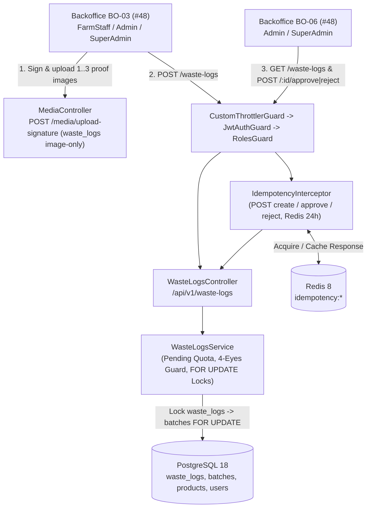

# Two-Step Waste Write-Off Proposal and Approval Formal Specification

## Overview & Context

This specification defines the two-step inventory waste write-off endpoints (`POST /api/v1/waste-logs`, `GET /api/v1/waste-logs`, `GET /api/v1/waste-logs/:id`, `POST /api/v1/waste-logs/:id/approve`, `POST /api/v1/waste-logs/:id/reject`), schema evolution on `waste_logs`, and image-only `waste_logs` media boundary introduced for #24 (`UC-27`, `UC-28`; parent epic #9; Backoffice consumer #48 `BO-03`/`BO-06`; analytics consumer #35; E2E consumer #37) in `apps/api/src/modules/inventory`.

Architectural commitments are recorded in ADR-0029; database invariants follow ADR-0005; idempotency follows ADR-0008; Cloudinary signed upload boundaries follow ADR-0009 and ADR-0025; DTO co-location, envelopes, OpenAPI sync, and RFC 9457 contracts follow ADR-0007, ADR-0011, ADR-0012, and ADR-0013; batch lifecycle and live product stock aggregation follow ADR-0026, ADR-0027, and ADR-0028.

`apps/api/src/database/schemas/catalog.schema.ts` currently defines `wasteLogs` with `approvedBy` (lacking `reviewedAt`, `rejectionReason`, and `CHECK` constraints), `apps/api/src/modules/inventory` hosts only `BatchesController` and `BatchesService`, `apps/api/src/modules/media/media.interface.ts` permits video uploads into `waste_logs`, and `apps/backoffice/src/routes/inventory/waste.tsx` (`BO-06`) has no backend endpoints to list or review waste proposals.

### Goals

- Evolve `waste_logs` in `apps/api/src/database/schemas/catalog.schema.ts` and `relations.ts` via one forward-only migration: rename `approved_by` to `reviewed_by` (`ON DELETE SET NULL`), add `rejection_reason` (`varchar(500)`) and `reviewed_at` (`timestamptz`), and enforce `waste_logs_discarded_quantity_positive` (`discarded_quantity > 0`) plus `waste_logs_review_state_consistent`.
- Expose `POST /api/v1/waste-logs` (`@Idempotent({ required: true })`, `farm_staff` | `admin` | `super_admin`) creating a `pending_approval` proposal backed by `1..3` unique Cloudinary image URLs in folder `waste_logs`, locked `FOR UPDATE` on the target batch to prevent over-proposal against `availableQuantity - SUM(pending)`.
- Expose `GET /api/v1/waste-logs` and `GET /api/v1/waste-logs/:id` (`farm_staff` | `admin` | `super_admin`) with closed `WasteLogDto` projections (`batch` + product summary, `reporter`, `reviewer`), scoping `farm_staff` reads strictly to their own `reportedBy` rows.
- Expose `POST /api/v1/waste-logs/:id/approve` and `POST /api/v1/waste-logs/:id/reject` (`@Idempotent({ required: true })`, `admin` | `super_admin`) returning `200 OK`, enforcing 4-eyes non-self-review (`403 WASTE_LOG_SELF_REVIEW_FORBIDDEN`), terminal state conflict checks (`409 WASTE_LOG_ALREADY_REVIEWED`), `waste_logs -> batches` `FOR UPDATE` lock ordering, atomic `batches.available_quantity` deduction (`409 INSUFFICIENT_STOCK` on concurrent stock depletion), and `BatchStatus.SOLD_OUT` transition when sellable batches reach `0.00` (keeping `expired` unchanged).
- Restrict `waste_logs` folder in `IMAGE_ONLY_MEDIA_FOLDERS` (`apps/api/src/modules/media/media.interface.ts`), align `tier2-catalog.seeder.ts` proof URLs, register new RFC 9457 codes in `@greenroots/shared`, and run `bun run types:sync`.

### Non-Goals

- Adding a `discarded_quantity` column to `batches` (`waste_logs` remains the SSOT for discarded quantities).
- Deleting, editing, or reopening `waste_logs` after submission or terminal review (`approved` / `rejected`).
- Operational waste ratio analytics (`GET /api/v1/analytics/operations`, #35) or FEFO order checkout allocation (#84, #86).
- Backoffice `BO-03` / `BO-06` UI wiring (#48) or Playwright E2E scripts (#37).

## Architecture



Symbols and module layout:

- `INVENTORY_ROUTES` in `apps/api/src/modules/inventory/inventory.routes.ts` adds `WASTE_LOGS_BASE: "waste-logs"`, `WASTE_LOG_BY_ID: ":id"`, `WASTE_LOG_APPROVE: ":id/approve"`, and `WASTE_LOG_REJECT: ":id/reject"`.
- `WasteLogsController` in `apps/api/src/modules/inventory/waste-logs.controller.ts` hosts `POST /api/v1/waste-logs`, `GET /api/v1/waste-logs`, `GET /api/v1/waste-logs/:id`, `POST /api/v1/waste-logs/:id/approve` (`@HttpCode(HttpStatus.OK)`), and `POST /api/v1/waste-logs/:id/reject` (`@HttpCode(HttpStatus.OK)`), wired into `InventoryModule` (`apps/api/src/modules/inventory/inventory.module.ts`).
- `WasteLogsService` in `apps/api/src/modules/inventory/waste-logs.service.ts` owns closed column projections (`WASTE_LOG_COLUMNS`, joined `batches`, `products`, and aliased `reporter` / `reviewer` `users` projections), `batches` `FOR UPDATE` pending-quota enforcement, `waste_logs -> batches` `FOR UPDATE` approval locking, 4-eyes `reportedBy !== actor.id` checks, `BatchStatus.SOLD_OUT` zero-stock transitions, and `numeric(10, 2)` serialization.
- `inventory.interface.ts` in `apps/api/src/modules/inventory/inventory.interface.ts` adds compile-time constants (`WASTE_LOG_SORT_OPTIONS`, `WASTE_LOG_MAX_MEDIA_ITEMS = 3`, `WASTE_LOG_MIN_MEDIA_ITEMS = 1`, `WASTE_LOG_REASON_MAX_LENGTH = 255`, `WASTE_LOG_REJECTION_REASON_MAX_LENGTH = 500`, `ELIGIBLE_WASTE_BATCH_STATUSES`).
- `apps/api/src/modules/inventory/dto/` adds co-located schemas and DTO classes (`waste-log.dto.ts`, `create-waste-log.dto.ts`, `reject-waste-log.dto.ts`, `list-waste-logs-query.dto.ts`, re-exported from `dto/index.ts`) per ADR-0011.
- `apps/api/src/modules/media/media.interface.ts` adds `"waste_logs"` to `IMAGE_ONLY_MEDIA_FOLDERS`.
- `apps/api/src/database/schemas/catalog.schema.ts` and `relations.ts` update `wasteLogs` (`reviewedBy`, `reviewedAt`, `rejectionReason`, `check()` constraints) with one generated forward-only migration in `apps/api/drizzle/`.
- `@greenroots/shared` (`packages/shared/src/error-dictionary.ts` and `packages/shared/GLOSSARY.md`) registers new RFC 9457 waste-log error codes and sharpens `Waste Log` vocabulary.

## Operational Flow

### 1. Waste Proposal (`POST /api/v1/waste-logs`) & Review (`approve` / `reject`)

```mermaid
sequenceDiagram
    autonumber
    actor Reporter as FarmStaff / Admin / SuperAdmin
    actor Reviewer as Admin / SuperAdmin (distinct user)
    participant Idemp as IdempotencyInterceptor
    participant Ctrl as WasteLogsController
    participant Svc as WasteLogsService
    participant DB as PostgreSQL 18

    Reporter->>Idemp: POST /api/v1/waste-logs (Idempotency-Key, { batchId, discardedQuantity, reason, mediaUrls })
    Idemp->>Ctrl: Acquire Redis key (503 if Redis down, 409 if processing, replay if completed)
    Ctrl->>Ctrl: ZodValidationPipe (.strict(), 1..3 unique waste_logs Cloudinary image URLs)
    Ctrl->>Svc: createWasteLog(dto, actor)
    Svc->>DB: BEGIN
    Svc->>DB: SELECT id, status, available_quantity FROM batches WHERE id = :batchId FOR UPDATE
    alt Batch missing
        Svc-->>Reporter: 404 BATCH_NOT_FOUND (rollback)
    else status === "sold_out" OR available_quantity <= 0
        Svc-->>Reporter: 422 WASTE_LOG_BATCH_NOT_ELIGIBLE (rollback)
    else Eligible batch (in_stock / near_expiry / expired)
        Svc->>DB: SELECT COALESCE(SUM(discarded_quantity), 0) FROM waste_logs WHERE batch_id = :batchId AND status = 'pending_approval'
        alt discardedQuantity > available_quantity - pendingSum
            Svc-->>Reporter: 422 WASTE_LOG_QUANTITY_EXCEEDS_AVAILABLE (rollback)
        else Quota sufficient
            Svc->>DB: INSERT INTO waste_logs (..., status = 'pending_approval') RETURNING *
            Svc-->>Reporter: 201 Created ApiResponseDto<WasteLogDto>
        end
    end

    Reviewer->>Idemp: POST /api/v1/waste-logs/:id/approve (Idempotency-Key, empty body)
    Idemp->>Ctrl: Acquire Redis key
    Ctrl->>Svc: approveWasteLog(id, actor)
    Svc->>DB: BEGIN
    Svc->>DB: SELECT * FROM waste_logs WHERE id = :id FOR UPDATE
    alt Missing log
        Svc-->>Reviewer: 404 WASTE_LOG_NOT_FOUND (rollback)
    else status !== "pending_approval"
        Svc-->>Reviewer: 409 WASTE_LOG_ALREADY_REVIEWED (rollback)
    else reported_by === actor.sub
        Svc-->>Reviewer: 403 WASTE_LOG_SELF_REVIEW_FORBIDDEN (rollback)
    else Pending & independent reviewer
        Svc->>DB: SELECT id, status, available_quantity FROM batches WHERE id = :batchId FOR UPDATE
        alt available_quantity < discarded_quantity
            Svc-->>Reviewer: 409 INSUFFICIENT_STOCK (rollback; log stays pending_approval)
        else Stock sufficient
            Svc->>DB: UPDATE batches SET available_quantity = available_quantity - discarded_quantity, status = (0 AND in_stock|near_expiry ? sold_out : status)
            Svc->>DB: UPDATE waste_logs SET status = 'approved', reviewed_by = :actorId, reviewed_at = NOW()
            Svc-->>Reviewer: 200 OK ApiResponseDto<WasteLogDto>
        end
    end
```

### 2. Rejection & `WasteLogStatus` State Machine

- `WasteLogStatus` permits only two single-step transitions from `pending_approval`:
  - `pending_approval -> approved` via `POST /api/v1/waste-logs/:id/approve` (sets `reviewedBy`, `reviewedAt`, leaves `rejectionReason = null`, deducts `batches.availableQuantity`).
  - `pending_approval -> rejected` via `POST /api/v1/waste-logs/:id/reject` (sets `reviewedBy`, `reviewedAt`, `rejectionReason`, leaves `batches.availableQuantity` untouched).
- Both `approved` and `rejected` are terminal. Any subsequent `approve` or `reject` call with a fresh `Idempotency-Key` returns `409 WASTE_LOG_ALREADY_REVIEWED`.

## API Contract

### Endpoints

| Method & Path                         | Access                               | Rate Limit Tier             | Idempotency       | Success                                      | RFC 9457 Errors                                                                                                                                                              |
| :------------------------------------ | :----------------------------------- | :-------------------------- | :---------------- | :------------------------------------------- | :--------------------------------------------------------------------------------------------------------------------------------------------------------------------------- |
| `POST /api/v1/waste-logs`             | `farm_staff`, `admin`, `super_admin` | `default` (`100 req / 60s`) | Required UUID key | `201` `ApiResponseDto<WasteLogDto>`          | `400`, `401`, `403`, `404` (`BATCH_NOT_FOUND`), `409` (`CONCURRENCY_CONFLICT`), `422` (`WASTE_LOG_BATCH_NOT_ELIGIBLE`, `WASTE_LOG_QUANTITY_EXCEEDS_AVAILABLE`), `429`, `503` |
| `GET /api/v1/waste-logs`              | `farm_staff`, `admin`, `super_admin` | `default` (`100 req / 60s`) | Safe `GET`        | `200` `ApiResponsePaginatedDto<WasteLogDto>` | `400`, `401`, `403`, `429`, `500`                                                                                                                                            |
| `GET /api/v1/waste-logs/:id`          | `farm_staff`, `admin`, `super_admin` | `default` (`100 req / 60s`) | Safe `GET`        | `200` `ApiResponseDto<WasteLogDto>`          | `400`, `401`, `403` (`FORBIDDEN`), `404` (`WASTE_LOG_NOT_FOUND`), `429`, `500`                                                                                               |
| `POST /api/v1/waste-logs/:id/approve` | `admin`, `super_admin`               | `default` (`100 req / 60s`) | Required UUID key | `200` `ApiResponseDto<WasteLogDto>`          | `400`, `401`, `403` (`WASTE_LOG_SELF_REVIEW_FORBIDDEN`), `404` (`WASTE_LOG_NOT_FOUND`), `409` (`WASTE_LOG_ALREADY_REVIEWED`, `INSUFFICIENT_STOCK`), `429`, `503`             |
| `POST /api/v1/waste-logs/:id/reject`  | `admin`, `super_admin`               | `default` (`100 req / 60s`) | Required UUID key | `200` `ApiResponseDto<WasteLogDto>`          | `400`, `401`, `403` (`WASTE_LOG_SELF_REVIEW_FORBIDDEN`), `404` (`WASTE_LOG_NOT_FOUND`), `409` (`WASTE_LOG_ALREADY_REVIEWED`), `429`, `503`                                   |

### DTOs, Projections & Validation Rules

1. **`CreateWasteLogDto` (`createWasteLogSchema`, `.strict()`)**:
   - `batchId`: `zUuidV7()`.
   - `discardedQuantity`: `z.number().min(0.01).max(99_999_999.99)` with at most 2 decimal places (`Math.abs(value * 100 - Math.round(value * 100)) < 1e-6`).
   - `reason`: `zSanitizedString({ min: 1, max: 255 })`.
   - `mediaUrls`: `z.array(zCloudinaryMediaUrl({ folder: "waste_logs", resourceTypes: ["image"] })).min(1).max(3)` with uniqueness refinement (`MESSAGES.VALIDATION.DUPLICATE_MEDIA_URL`).
2. **`RejectWasteLogDto` (`rejectWasteLogSchema`, `.strict()`)**:
   - `rejectionReason`: `zSanitizedString({ min: 1, max: 500 })`.
3. **`POST /api/v1/waste-logs/:id/approve`**:
   - Accepts no request body (empty payload); `@Param("id", new ZodValidationPipe(zUuidV7()))`.
4. **`ListWasteLogsQueryDto` (`listWasteLogsQuerySchema`, `.strict()`)**:
   - `status`: `z.enum(WasteLogStatus).optional()`.
   - `batchId`: `zUuidV7().optional()`.
   - `productId`: `zUuidV7().optional()`.
   - `search`: `zSanitizedString({ min: 1, max: 100 }).optional()` (case-insensitive escaped `ILIKE` match on `batches.batchCode`).
   - `page`: `zNumericString({ integer: true, min: 1 }).default(1)`.
   - `limit`: `zNumericString({ integer: true, min: 1, max: 100 }).default(20)`.
   - `sort`: `z.enum(["createdAt:desc", "createdAt:asc", "discardedQuantity:desc", "discardedQuantity:asc"]).default("createdAt:desc")`.
5. **`WasteLogDto` (`wasteLogSchema`)**:
   - `id`, `batchId`, `batch` (`{ id, batchCode, productId, productName, unit, status, availableQuantity }`), `reporter` (`{ id, fullName }`), `reviewer` (`{ id, fullName } | null`), `discardedQuantity` (`number`), `reason`, `rejectionReason` (`string | null`), `mediaUrls` (`z.array(z.string())`), `status` (`z.enum(WasteLogStatus)`), `reviewedAt` (`z.iso.datetime().nullable()`), `createdAt` (`z.iso.datetime()`), `updatedAt` (`z.iso.datetime()`).
6. **New `API_ERROR_CODES` in `@greenroots/shared` & `MESSAGES` in `apps/api`**:
   - `WASTE_LOG_NOT_FOUND` (`404`)
   - `WASTE_LOG_BATCH_NOT_ELIGIBLE` (`422`)
   - `WASTE_LOG_QUANTITY_EXCEEDS_AVAILABLE` (`422`)
   - `WASTE_LOG_ALREADY_REVIEWED` (`409`)
   - `WASTE_LOG_SELF_REVIEW_FORBIDDEN` (`403`)
   - Reuse existing `INSUFFICIENT_STOCK` (`409`) and `BATCH_NOT_FOUND` (`404`).

## Security & Reliability

### Access & Exposure Matrix

| Route / Operation                     | `customer` / `guest` / `sales` | `farm_staff`                   | `admin` / `super_admin`        |
| :------------------------------------ | :----------------------------: | :----------------------------- | :----------------------------- |
| `POST /api/v1/waste-logs`             |             `403`              | Allowed (`reportedBy = self`)  | Allowed (`reportedBy = self`)  |
| `GET /api/v1/waste-logs`              |             `403`              | Own rows (`reportedBy = self`) | All rows                       |
| `GET /api/v1/waste-logs/:id`          |             `403`              | Own row only (`403` otherwise) | Any row                        |
| `POST /api/v1/waste-logs/:id/approve` |             `403`              | `403`                          | Non-reporter only (`403` self) |
| `POST /api/v1/waste-logs/:id/reject`  |             `403`              | `403`                          | Non-reporter only (`403` self) |

### Controls Across Baseline Domains

- **Security & Trust Boundary**: `CustomThrottlerGuard -> JwtAuthGuard -> RolesGuard` plus service-layer ownership (`farm_staff` read scoping) and 4-eyes segregation (`reportedBy !== actor.sub` on `approve`/`reject`). `reason` and `rejectionReason` pass `zSanitizedString`, `mediaUrls` strictly enforce HTTPS `res.cloudinary.com/<cloudName>/image/upload/.../waste_logs/...` (rejecting path traversal, transforms, queries, and videos), and `reportedBy` / `reviewedBy` always derive from verified JWT claims (`@CurrentUser()`).
- **Reliability & Concurrency**: Every write command enforces `@Idempotent({ required: true })` (fail-closed `503` if Redis is down, `409` if in-flight, replay within 24h per ADR-0008). Transactions run at `READ COMMITTED` with deterministic row lock ordering: `batches FOR UPDATE` on create; `waste_logs FOR UPDATE` then `batches FOR UPDATE` on approve (no other code path acquires `batches` before `waste_logs`, avoiding lock inversion deadlocks). PostgreSQL `CHECK` constraints (`batches_available_quantity_non_negative`, `batches_available_lte_initial`, `waste_logs_discarded_quantity_positive`, `waste_logs_review_state_consistent`) act as final authority.
- **Performance & Scalability**: `GET /api/v1/waste-logs` uses `waste_logs_status_idx` and `waste_logs_batch_id_idx` with closed column projections and bounded pagination (`limit <= 100`). Live catalog stock (`ProductsService`, ADR-0027) requires zero extra cache invalidation because `pending_approval` never deducts `batches.available_quantity` and `approve` commits the deduction directly.
- **Maintainability & Observability**: `WasteLogsController` and `WasteLogsService` isolate waste write-off workflows cleanly inside `InventoryModule` alongside `BatchesService`. All errors surface as structured RFC 9457 responses via `GlobalExceptionFilter` without leaking SQL details or reviewer PII beyond `{ id, fullName }`.

## Domain Invariant Taxonomy

| Invariant     | Name                                   | Formal Statement                                                                                                                                                              | Enforcement Seam                                                            | Verification Test                                                                                                   |
| :------------ | :------------------------------------- | :---------------------------------------------------------------------------------------------------------------------------------------------------------------------------- | :-------------------------------------------------------------------------- | :------------------------------------------------------------------------------------------------------------------ |
| `INV-WASTE-1` | Pending Proposal Stock Neutrality      | Creating a `pending_approval` waste log NEVER decrements `batches.available_quantity` or alters `batches.status`                                                              | `WasteLogsService.createWasteLog`                                           | Integration test verifying `batches.availableQuantity` & `GET /products` stock stay unchanged on `POST /waste-logs` |
| `INV-WASTE-2` | Pending Quota & Non-Negative Stock     | At proposal, `discardedQuantity <= batch.availableQuantity - SUM(pending)` under `batches FOR UPDATE`; at approval, `batches.available_quantity` decrements atomically `>= 0` | `WasteLogsService.createWasteLog` / `approveWasteLog` + PG `CHECK`          | Concurrency & over-proposal tests confirming `422` at creation and `409 INSUFFICIENT_STOCK` on checkout race        |
| `INV-WASTE-3` | 4-Eyes Segregation of Duties           | Only `admin` / `super_admin` may `approve` or `reject`, and `actor.sub` MUST NOT equal `wasteLogs.reportedBy`                                                                 | `@ApiAuth` + `WasteLogsService.assertIndependentReviewer`                   | Integration tests asserting `403` for `farm_staff` and `403 WASTE_LOG_SELF_REVIEW_FORBIDDEN` for self-review        |
| `INV-WASTE-4` | Terminal Single-Transition Review FSM  | Only `pending_approval` logs can transition to `approved` or `rejected`; terminal logs reject re-review with `409` and persist consistent `reviewed_at` / `rejection_reason`  | `WasteLogsService.approveWasteLog` / `rejectWasteLog` + `waste_logs` CHECK  | Parallel `approve`+`approve` & `approve`+`reject` tests verifying single transition and `409` on loser              |
| `INV-WASTE-5` | Image-Only `waste_logs` Media Boundary | Upload signatures for `waste_logs` reject `video`, and `POST /waste-logs` requires `1..3` unique Cloudinary HTTPS `image` URLs inside `waste_logs`                            | `IMAGE_ONLY_MEDIA_FOLDERS` + `createWasteLogSchema` (`zCloudinaryMediaUrl`) | Unit/integration tests rejecting video signatures, `0`/`4` URLs, duplicates, and wrong folders (`400`/`422`)        |

### Edge Cases (`EDGE-1..9`)

| ID       | Case                                                                                                     | Expected Behaviour                                                                                             |
| :------- | :------------------------------------------------------------------------------------------------------- | :------------------------------------------------------------------------------------------------------------- |
| `EDGE-1` | Proposal submitted against a `sold_out` batch (`availableQuantity === 0`)                                | Rejected with `422 WASTE_LOG_BATCH_NOT_ELIGIBLE`                                                               |
| `EDGE-2` | Proposal submitted against an `expired` batch with `availableQuantity > 0`                               | Allowed (`201`); on approval `availableQuantity` decreases and `batches.status` remains `expired`              |
| `EDGE-3` | Approval deducts an `in_stock` or `near_expiry` batch's `availableQuantity` down to `0.00`               | Batch `availableQuantity` becomes `0.00` and `batches.status` transitions atomically to `sold_out`             |
| `EDGE-4` | Target batch's parent `products` row was soft-deleted (`deletedAt IS NOT NULL`) after batch intake       | Proposal and approval still succeed (`201` / `200`) for remaining physical stock                               |
| `EDGE-5` | Multiple pending logs exist on a batch (e.g., `6.00` pending on `10.00` stock) and staff proposes `5.00` | Rejected with `422 WASTE_LOG_QUANTITY_EXCEEDS_AVAILABLE` (`10.00 - 6.00 = 4.00` remaining unallocated)         |
| `EDGE-6` | Concurrent order confirmation (#86) reduces `availableQuantity` below `discardedQuantity` before approve | `approve` fails with `409 INSUFFICIENT_STOCK`; log remains `pending_approval` so Admin can explicitly `reject` |
| `EDGE-7` | `reject` payload has empty/whitespace `rejectionReason` or `approve` sends unexpected JSON keys          | Rejected at HTTP boundary with `400 VALIDATION_FAILED` / `UNRECOGNIZED_KEYS`                                   |
| `EDGE-8` | `farm_staff` requests `GET /waste-logs/:id` created by another staff member                              | Rejected with `403 FORBIDDEN`                                                                                  |
| `EDGE-9` | Reviewer user row is deleted later (`ON DELETE SET NULL` sets `reviewed_by = NULL`)                      | `WasteLogDto.reviewer` serializes as `null` while `status`, `reviewedAt`, and `rejectionReason` remain valid   |

### Concurrency & Adversarial Matrix (`ADV-1..5`)

| ID      | Scenario                                                                                               | Expected Behaviour                                                                                                              |
| :------ | :----------------------------------------------------------------------------------------------------- | :------------------------------------------------------------------------------------------------------------------------------ |
| `ADV-1` | Two `admin` sessions concurrently call `approve` and `reject` (distinct keys) on the same pending log  | `waste_logs FOR UPDATE` serializes them; winner commits `200`, loser rolls back with `409 WASTE_LOG_ALREADY_REVIEWED`           |
| `ADV-2` | `admin` double-clicks `approve` or `reject` with the exact same `Idempotency-Key`                      | First succeeds (`200`), second replays cached `200` without re-executing SQL (`INV-IDEMP-1`); mismatched key/body returns `422` |
| `ADV-3` | Two staff members concurrently propose `6.00` kg each on a `10.00` kg batch                            | `batches FOR UPDATE` serializes proposals; first creates (`201`), second sees `SUM(pending) = 6.00` and fails `422`             |
| `ADV-4` | `admin` creates a waste log via `POST /waste-logs` and attempts to `approve` or `reject` it themselves | Rejected with `403 WASTE_LOG_SELF_REVIEW_FORBIDDEN`                                                                             |
| `ADV-5` | Client submits forged video URL, `products/` URL, or Cloudinary transform URL in `mediaUrls`           | `createWasteLogSchema` (`zCloudinaryMediaUrl`) rejects at HTTP boundary with `400`                                              |

## Test Matrix

- **Unit specs**:
  - `apps/api/src/modules/media/cloudinary.service.spec.ts`: verify `waste_logs` permits `image` (`<= 5MB`) and rejects `video` (`400`) via `IMAGE_ONLY_MEDIA_FOLDERS`.
  - `apps/api/src/modules/inventory/waste-logs.service.spec.ts`: cover `createWasteLog`, `listWasteLogs`, `getWasteLogById`, `approveWasteLog`, `rejectWasteLog`, pending quota arithmetic, `BatchStatus` zero-stock transitions, 4-eyes checks, and `reviewer = null` serialization.
- **E2E Integration suite (`apps/api/test/integration/waste-logs.spec.ts`)**:
  - Full lifecycle tests against PostgreSQL 18 + Redis 8: proposal (`201` + `pending_approval`), unchanged product stock (`GET /api/v1/products`), `GET /api/v1/waste-logs` role scoping (`farm_staff` vs `admin`), `approve` (`200`, stock deducted, `sold_out` transition at `0`, `expired` kept `expired`), `reject` (`200`, `rejectionReason` + `reviewedAt` persisted, stock untouched).
  - Security & RBAC: `401` unauthenticated, `403` for `customer`/`sales`, `403` when `farm_staff` calls `approve`/`reject` or reads another staff's detail, `403 WASTE_LOG_SELF_REVIEW_FORBIDDEN` on self-review.
  - Concurrency & Idempotency: parallel `POST /waste-logs` over-proposal race (`batches FOR UPDATE`), parallel `approve` vs `approve` and `approve` vs `reject` (`409 WASTE_LOG_ALREADY_REVIEWED`), concurrent batch stock depletion (`409 INSUFFICIENT_STOCK`), `@Idempotent` replay (`200`/`201`) and payload mismatch (`422`).
- **Verification commands**:
  - `bun run types:sync`
  - `bun run check`
  - `bun run test`
  - `bun run test:e2e`

## Risks & Rollback

- **Downstream Coordination**:
  - `#48` (`BO-03`/`BO-06`) consumes `WasteLogDto` and generated `Idempotency-Key` headers from OpenAPI types (`apps/backoffice/src/types/api-schema.d.ts`).
  - `#35` (`GET /api/v1/analytics/operations`) aggregates `waste_logs WHERE status = 'approved'` against `batches.initial_quantity`.
  - `#37` exercises the full 2-step Playwright flow (`farm_staff` create -> `admin` list & approve).
- **Rollback**:
  - Revert `WasteLogsController`, `WasteLogsService`, `waste_logs` DTOs, `IMAGE_ONLY_MEDIA_FOLDERS` entry, and revert the Drizzle migration via a new compensating forward migration if already applied to a shared environment; re-run `bun run types:sync`.
