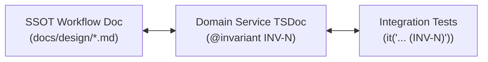

# Domain Docs

How the engineering skills should consume this repo's domain documentation when exploring the codebase.

## Before Exploring, Read These

1. **`GLOSSARY-MAP.md`** at the repo root — the entry point for every context glossary and context ADR directory.
2. **The `GLOSSARY.md` for every context you touch** — read the shared glossary plus the app glossary relevant to the task.
3. **ADRs that touch the area** — check `docs/adr/` and `<context>/docs/adr/` before changing behavior.

If any of these files do not exist, **proceed silently**. Do not flag their absence and do not suggest creating them upfront. The `/domain-modeling` skill creates them lazily when terms or decisions actually get resolved.

## File Structure

### Multi-context Layout (Current)

| Scope            | Glossary                      | ADRs                        |
| :--------------- | :---------------------------- | :-------------------------- |
| Repo-wide        | `GLOSSARY-MAP.md`             | `docs/adr/`                 |
| Shared contracts | `packages/shared/GLOSSARY.md` | `packages/shared/docs/adr/` |
| API              | `apps/api/GLOSSARY.md`        | `apps/api/docs/adr/`        |
| Storefront       | `apps/storefront/GLOSSARY.md` | `apps/storefront/docs/adr/` |
| Backoffice       | `apps/backoffice/GLOSSARY.md` | `apps/backoffice/docs/adr/` |

- ADR naming: `000X-<kebab-name>.md`.
- Planned contexts get a glossary when their first domain feature lands. Do not create empty glossary files.
- Cross-context decisions go in `docs/adr/`; context-scoped decisions go in that context's `docs/adr/`.

## Ownership Rules

1. `packages/shared/GLOSSARY.md` owns cross-app vocabulary: entities, enums, statuses, money and delivery rules.
2. `apps/api/GLOSSARY.md` is authoritative for backend domain behavior and invariants.
3. `apps/storefront/GLOSSARY.md` and `apps/backoffice/GLOSSARY.md` may add surface-specific terms but MUST NOT redefine shared terms.
4. If a term conflicts, the API glossary wins; record the resolution as an ADR.

## Use the Glossary's Vocabulary

When your output names a domain concept (in an issue title, refactor proposal, hypothesis, or test name), use the term as defined in the relevant `GLOSSARY.md`. Do not drift to synonyms the glossary explicitly avoids.

If the concept you need is not in the glossary yet, treat it as a signal: either you are inventing language the project does not use, or there is a real gap to note for `/domain-modeling`.

## Flag ADR Conflicts

If your output contradicts an existing ADR, surface it explicitly rather than silently overriding:

> _Contradicts ADR-0007 (integer VND storage) — but worth reopening because…_

## Domain Invariant Taxonomy & Traceability (`INV-N`)

### A. Module-Scoped Invariant Matrix

Domain invariants are scoped per domain module, for example `OrdersDomainInvariants: INV-1..4`, `SubscriptionsDomainInvariants: INV-1..3`, `AuthDomainInvariants: INV-1..4`. Identifiers are unique within the module and shared across all endpoints and operations in that domain.



### B. The Traceability Triangle

1. **SSOT Specification**: `docs/design/<feature>-workflow.md` explicitly enumerates all domain invariants (`INV-1`, `INV-2`, etc.).
2. **Service TSDoc**: Exported service methods MUST document enforced invariants via `@invariant INV-N (<Name>): <Enforcement Details>` in Tier 1 TSDoc.
3. **Test Assertions**: Test suites MUST tag corresponding assertions with `(INV-N)` in the `it("...")` description to guarantee continuous verification.

### Example

```ts
/**
 * Reserves stock for every line item in a checkout request.
 *
 * @invariant INV-1 (No Oversell): Locks batch rows and rejects if available stock is insufficient.
 * @invariant INV-2 (Money Precision): All totals are computed as integer VND.
 */
async checkout(command: CheckoutCommand): Promise<Order> {
  // ...
}
```
