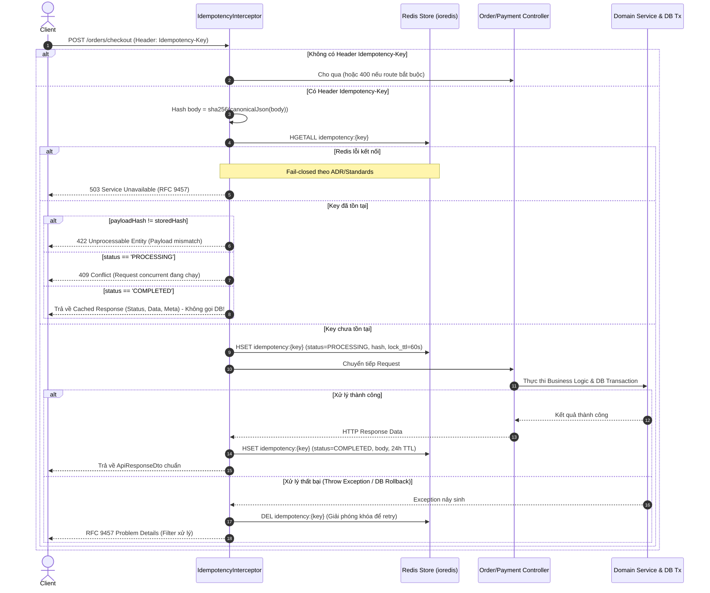
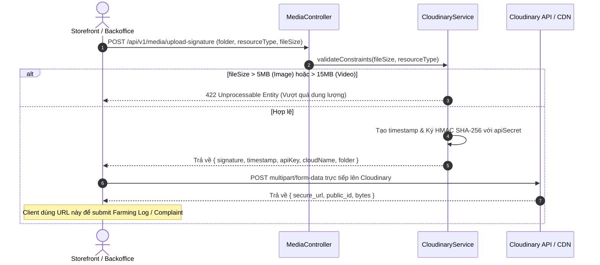
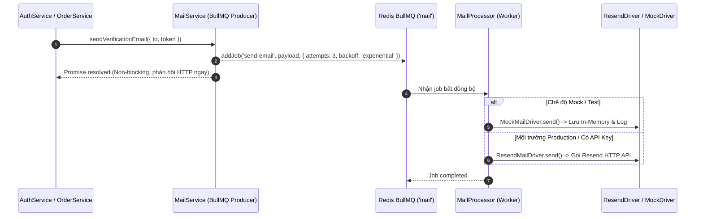

Chào bạn, dưới đây là toàn bộ bản thiết kế kiến trúc, phân tích luồng dữ liệu (Data Flow), các bất biến nghiệp vụ (Business Invariants) và lộ trình triển khai chi tiết từng lát cắt (Slice-by-Slice) cho **Issue #16** theo đúng tiêu chuẩn kỹ thuật của GreenRoots Farm.

---

### Bước 1: Khởi tạo Nhánh & Khóa Scope

#### 1. Đọc kỹ mục tiêu & Scope của Issue #16

- **Issue**: [#16: task(api): add offline OpenAPI generator, Idempotency interceptor, and Mail/Cloudinary infra](https://github.com/ngxccc/greenroots-farm/issues/16)
- **Thuộc Epic**: `#7 epic(core): Auth, Users, Shared Infra & OpenAPI Type Sync`
- **Mức độ ưu tiên**: `P0` (Core Infrastructure blocker).
- **Scope cốt lõi (Outcome)**:
  1. **Offline OpenAPI Generator (`bun run types:sync`)**: Khởi tạo NestJS application context ở chế độ offline (không cần kết nối PostgreSQL hay Redis sống), xuất `openapi.json` và đồng bộ tự động `api-schema.d.ts` cho `apps/storefront`, `apps/backoffice` và `apps/api/test/generated`.
  2. **Redis 24h `Idempotency-Key` Interceptor**: Áp dụng cho các mutating endpoints (`POST /api/v1/orders/checkout`, payments, refunds). Cache kết quả trong 24h, từ chối request trùng lặp khác payload với mã lỗi `422`, từ chối request đang xử lý song song với `409`, và áp dụng chính sách **Fail-closed (`503`)** khi Redis gặp sự cố.
  3. **`MailQueue` (BullMQ + Resend & Mock)**: Tách luồng gửi mail bất đồng bộ qua Redis BullMQ. Hỗ trợ `ResendMailDriver` khi có `RESEND_API_KEY` và `MockMailDriver` in-memory phục vụ development/testing cục bộ.
  4. **`CloudinaryService` Signed Upload**: Cung cấp chữ ký HMAC an toàn cho Client tải trực tiếp media lên Cloudinary. Thực thi chặt chẽ giới hạn kích thước: **Ảnh $\le 5\text{MB}$**, **Video $\le 15\text{MB}$** và hỗ trợ Mock chế độ dev.

#### 2. Kiểm tra phụ thuộc (Dependencies & Blockers)

- **`blocked_by`**: Trống (`[]`). Không bị phụ thuộc bởi issue nào chưa giải quyết; có thể triển khai ngay.
- **`blocking`**: Đang chặn 2 issue:
  - `#17 task(auth)`: Cần `MailQueue` để gửi email xác thực tài khoản / đặt lại mật khẩu.
  - `#32 task(api)`: Cần `CloudinaryService` để tải ảnh/video chứng minh khiếu nại (Complaints).

#### 3. Trạng thái Git & Tách nhánh

Đã kiểm tra cây làm việc `main` sạch sẽ và tạo nhánh theo chuẩn Git Flow (`docs/standards/git-flow-and-pr-matrix.md`):

```bash
git checkout main && git pull origin main
git checkout -b feat/api-infra-and-openapi
```

_(Hiện tại nhánh `feat/api-infra-and-openapi` đã được khởi tạo sẵn sàng trên repository)._

---

### Bước 2: Mổ xẻ Luồng Nghiệp vụ & Bất biến (Business Invariants)

#### 1. Luồng dữ liệu (Data Flow)

##### A. Luồng Idempotency Interceptor (Bảo vệ giao dịch tài chính & đơn hàng)



##### B. Luồng Signed Upload Cloudinary (Client tải trực tiếp, không nghẽn API)



##### C. Luồng MailQueue (BullMQ Producer & Consumer)



---

#### 2. Các bất biến nghiệp vụ (Business Invariants)

| Mã bất biến       | Tên quy tắc                 | Mô tả chi tiết & Hành vi cưỡng chế                                                                                                                                                                                                         |
| :---------------- | :-------------------------- | :----------------------------------------------------------------------------------------------------------------------------------------------------------------------------------------------------------------------------------------- |
| **INV-IDEMP-1**   | Replay Tính Toàn Vẹn 24h    | Gửi lại cùng `Idempotency-Key` với **cùng request body** trong vòng 24 giờ phải nhận lại **chính xác response code và response body** của lần gọi đầu tiên; tuyệt đối không gọi lại tầng Database/Domain Service.                          |
| **INV-IDEMP-2**   | Bất biến Payload Mismatch   | Gửi cùng `Idempotency-Key` nhưng **thay đổi bất kỳ trường nào trong body** phải lập tức bị từ chối với mã lỗi `422 Unprocessable Entity`; không ghi đè và không thực thi tiếp.                                                             |
| **INV-IDEMP-3**   | Khóa Tiến Trình Trùng Lặp   | Hai request cùng `Idempotency-Key` tới đồng thời: request thứ hai đến khi request thứ nhất còn đang ở trạng thái `PROCESSING` phải nhận mã lỗi `409 Conflict`.                                                                             |
| **INV-IDEMP-4**   | Fail-Closed Khi Mất Kết Nối | Kho lưu trữ Idempotency (Redis) là hàng rào an toàn cho tài chính/kho hàng. Khi Redis gặp sự cố, hệ thống **bắt buộc Fail-Closed** (`503 Service Unavailable`), không được phép chạy tiếp để tránh double-charge hoặc trừ âm kho.          |
| **INV-IDEMP-5**   | Tự Động Giải Phóng Khi Lỗi  | Nếu giao dịch miền hoặc DB transaction gặp lỗi và rollback, trạng thái `PROCESSING` trong Redis phải được xóa bỏ ngay lập tức để người dùng có thể gửi lại (retry).                                                                        |
| **INV-MEDIA-1**   | Giới Hạn Kích Thước Media   | Dung lượng upload tối đa: **Ảnh $\le 5\text{MB}$** ($5 \times 1024 \times 1024$ bytes), **Video $\le 15\text{MB}$** ($15 \times 1024 \times 1024$ bytes). Mọi yêu cầu xin chữ ký vượt quá giới hạn này phải bị chặn ngay tại API boundary. |
| **INV-MEDIA-2**   | Whitelist Định Dạng Media   | Chỉ cấp chữ ký cho định dạng ảnh (`image/jpeg`, `image/png`, `image/webp`) và video (`video/mp4`, `video/quicktime`, `video/webm`).                                                                                                        |
| **INV-MAIL-1**    | Độc Lập Luồng Gửi Thư       | Việc gửi email không bao giờ được phép chặn (block) hoặc làm hỏng transaction chính của người dùng (tách biệt 100% qua hàng đợi BullMQ).                                                                                                   |
| **INV-OPENAPI-1** | Offline-First Schema Sync   | Quá trình sinh OpenAPI JSON và đồng bộ TypeScript types phải chạy độc lập hoàn toàn (**offline**), không phụ thuộc vào trạng thái đang chạy của Docker, DB hay Redis.                                                                      |

---

#### 3. Bảng mã lỗi RFC 9457 Problem Details

Tất cả phản hồi lỗi đều tuân thủ `application/problem+json` theo chuẩn `docs/standards/api-design-and-error-handling.md`:

| HTTP Status         | Type Slug                      | Title                | Detail (Thông báo an toàn)                                              | Khi nào kích hoạt?                                                      |
| :------------------ | :----------------------------- | :------------------- | :---------------------------------------------------------------------- | :---------------------------------------------------------------------- |
| `400 Bad Request`   | `/errors/bad-request`          | Bad Request          | `Định dạng Idempotency-Key không hợp lệ, yêu cầu định dạng UUID`        | Header `Idempotency-Key` không đúng định dạng chuẩn UUID.               |
| `409 Conflict`      | `/errors/conflict`             | Conflict             | `Yêu cầu với khóa định danh này đang được xử lý, vui lòng thử lại sau`  | Request trùng `Idempotency-Key` đang ở trạng thái `PROCESSING`.         |
| `422 Unprocessable` | `/errors/unprocessable-entity` | Unprocessable Entity | `Khóa Idempotency-Key đã được sử dụng với nội dung yêu cầu khác`        | Replay cùng key nhưng `payloadHash` khác nhau.                          |
| `422 Unprocessable` | `/errors/unprocessable-entity` | Unprocessable Entity | `Dung lượng tệp vượt quá giới hạn cho phép (Ảnh <= 5MB, Video <= 15MB)` | Client xin chữ ký Cloudinary vượt quá giới hạn dung lượng.              |
| `503 Unavailable`   | `/errors/service-unavailable`  | Service Unavailable  | `Dịch vụ Idempotency tạm thời không khả dụng, vui lòng thử lại`         | Redis bị mất kết nối trong quá trình kiểm tra hoặc ghi Idempotency key. |

---

### Bước 3: Triển khai từng Lát cắt (Slice-by-Slice)

#### Lát cắt 1: Offline OpenAPI Generator & Type Sync (`bun run types:sync`)

1. **Vấn đề cần giải quyết**:
   - `types:sync` ở root gọi `cd apps/api && bun run openapi:generate`.
   - Trước đây NestJS thường chỉ sinh OpenAPI khi `app.listen()` chạy một HTTP server thực tế, đòi hỏi PostgreSQL và Redis phải online.
2. **Giải pháp kiến trúc**:
   - Xây dựng file thực thi `apps/api/scripts/generate-openapi.ts`.
   - Sử dụng `NestFactory.createApplicationContext` hoặc `NestFactory.create` với headless express app (không gọi `app.listen()`).
   - Gọi hàm `createOpenApiDocument(app)` đã có sẵn trong `apps/api/src/common/config/openapi.config.ts`.
   - Ghi kết quả ra `apps/api/openapi.json`.
   - Dùng `openapi-typescript` parse `openapi.json` và xuất type contracts vào 3 vị trí:
     - `apps/storefront/src/types/api-schema.d.ts`
     - `apps/backoffice/src/types/api-schema.d.ts`
     - `apps/api/test/generated/api-schema.d.ts`
   - Gọi `await app.close()` để đóng lazy connections một cách an toàn.

```ts
// apps/api/scripts/generate-openapi.ts (Cấu trúc cốt lõi)
import { NestFactory } from "@nestjs/core";
import { AppModule } from "../src/app.module";
import { createOpenApiDocument } from "../src/common/config/openapi.config";
import openapiTS, { astToString } from "openapi-typescript";
import { writeFileSync, mkdirSync } from "node:fs";
import { resolve } from "node:path";

async function generate() {
  const app = await NestFactory.create(AppModule, { logger: false });
  const document = createOpenApiDocument(app);

  // 1. Ghi openapi.json
  const openApiPath = resolve(import.meta.dir, "../openapi.json");
  writeFileSync(openApiPath, JSON.stringify(document, null, 2), "utf-8");

  // 2. Chuyển sang TypeScript types qua AST
  const ast = await openapiTS(document);
  const typesContent = astToString(ast);

  // 3. Phân phối types tới Storefront, Backoffice, API test
  const targets = [
    "../../apps/storefront/src/types/api-schema.d.ts",
    "../../apps/backoffice/src/types/api-schema.d.ts",
    "../test/generated/api-schema.d.ts",
  ];
  for (const target of targets) {
    const fullPath = resolve(import.meta.dir, target);
    writeFileSync(fullPath, typesContent, "utf-8");
  }

  await app.close();
}
```

---

#### Lát cắt 2: Redis 24h `Idempotency-Key` Interceptor

1. **Tầng Hợp đồng (Contract/DTO)**:
   - Decorator `@Idempotent(options?: { required?: boolean; ttlSeconds?: number })`.
   - Schema kiểm tra header: `z.string().uuid()` (hoặc `UUIDv7`).
   - Cấu trúc bản ghi lưu trong Redis:

     ```ts
     interface IdempotencyRecord {
       status: "PROCESSING" | "COMPLETED";
       payloadHash: string; // sha256(canonicalJson(body))
       statusCode?: number;
       headers?: Record<string, string>;
       responseBody?: string;
       createdAt: string;
     }
     ```

2. **Tầng Nghiệp vụ (IdempotencyService)**:
   - Phương thức `acquireKey(key, payloadHash)`:
     - Dùng pipeline Redis hoặc mã hóa Atomic (SET NX với lock TTL 60s cho trạng thái `PROCESSING`).
     - Nếu key đã có: Phân nhánh kiểm tra `payloadHash` (khác nhau $\rightarrow$ ném `UnprocessableEntityException`), kiểm tra trạng thái (`PROCESSING` $\rightarrow$ ném `ConflictException`, `COMPLETED` $\rightarrow$ trả về cached payload).
     - Bọc khối Redis trong `try-catch`: Khi `Redis` ném error hoặc không phản hồi $\rightarrow$ ném `ServiceUnavailableException` (Fail-Closed).
   - Phương thức `completeKey(key, responseData, ttl = 86400)`:
     - Cập nhật bản ghi thành `status: COMPLETED`, lưu `responseBody` và đặt thời gian sống (TTL) chính xác là 24 giờ (`86400` giây).
   - Phương thức `releaseKey(key)`:
     - Gọi khi luồng xử lý phía sau thất bại (Controller/Service ném lỗi), xóa key để cho phép client gửi lại.

3. **Tầng Biên (IdempotencyInterceptor)**:
   - Đọc header `Idempotency-Key` từ `ExecutionContext`.
   - Nếu có header:

     ```ts
     return from(this.idempotencyService.acquireKey(key, body)).pipe(
       switchMap((cached) => {
         if (cached) {
           response.status(cached.statusCode);
           return of(cached.body);
         }
         return next.handle().pipe(
           tap((data) =>
             this.idempotencyService.completeKey(
               key,
               data,
               response.statusCode,
             ),
           ),
           catchError((err) => {
             this.idempotencyService.releaseKey(key);
             return throwError(() => err);
           }),
         );
       }),
     );
     ```

---

#### Lát cắt 3: `MailQueue` (BullMQ + Resend Adapter & Mock Driver)

1. **Tầng Hợp đồng (Driver Interface & DTO)**:

   ```ts
   export interface SendEmailPayload {
     to: string | string[];
     subject: string;
     html: string;
     text?: string;
     template?: string;
   }

   export interface IMailDriver {
     send(payload: SendEmailPayload): Promise<{ messageId: string }>;
   }
   ```

2. **Tầng Triển khai Driver (Resend vs Mock)**:
   - `MockMailDriver`:
     - Chứa mảng bộ nhớ `public sentEmails: SendEmailPayload[] = []`.
     - Tự động sinh `mock-<uuid>` message ID.
     - Cung cấp hàm `clear()` và `getSentEmails()` phục vụ trực tiếp cho Integration Tests.
   - `ResendMailDriver`:
     - Đọc `env.RESEND_API_KEY` và `env.EMAIL_FROM`.
     - Gửi HTTP `POST https://api.resend.com/emails` (không cần thêm dependency cồng kềnh, dùng native `fetch` của Bun/Node 20+).

3. **Tầng Hàng đợi & Xử lý (Producer & Consumer)**:
   - `MailService`: Inject `@InjectQueue("mail") private mailQueue: Queue`. Cung cấp các hàm domain-level: `sendVerificationEmail()`, `sendPasswordResetEmail()`, `sendOrderConfirmation()`.
   - `MailProcessor`: `@Processor("mail")` kế thừa `WorkerHost`. Xử lý job với retry backoff cấp số nhân khi gặp sự cố mạng bên thứ ba.

---

#### Lát cắt 4: `CloudinaryService` Signed Upload (Ràng buộc $\le 5\text{MB}$ ảnh, $\le 15\text{MB}$ video)

1. **Tầng Hợp đồng (DTO & Constraints)**:

   ```ts
   export const MEDIA_CONSTRAINTS = {
     IMAGE: {
       MAX_BYTES: 5 * 1024 * 1024, // 5MB
       ALLOWED_MIME: ["image/jpeg", "image/png", "image/webp"],
       RESOURCE_TYPE: "image",
     },
     VIDEO: {
       MAX_BYTES: 15 * 1024 * 1024, // 15MB
       ALLOWED_MIME: ["video/mp4", "video/quicktime", "video/webm"],
       RESOURCE_TYPE: "video",
     },
   } as const;
   ```

   - Zod DTO `SignedUploadDto`:
     - `resourceType`: Enum `["image", "video"]`.
     - `fileSizeBytes`: Số nguyên dương, validate không vượt quá `MAX_BYTES` tương ứng.
     - `folder`: Chuỗi enum hợp lệ (`"farming_logs"`, `"complaints"`, `"products"`).

2. **Tầng Nghiệp vụ (CloudinaryService)**:
   - Xác thực kích thước tệp: Nếu vi phạm ném `UnprocessableEntityException` kèm chi tiết RFC 9457.
   - Thuật toán ký chuẩn Cloudinary:
     - Gom các tham số: `folder`, `timestamp`, `transformation` (nếu có).
     - Sắp xếp theo thứ tự alphabet các key `key1=val1&key2=val2`.
     - Ghép `api_secret` vào cuối chuỗi và tính mã băm SHA-1 (hoặc SHA-256).
   - Mock Driver Mode: Khi không có `CLOUDINARY_API_SECRET` (local dev), trả về Mock Signature hợp lệ giúp toàn bộ giao diện Storefront & Backoffice chạy trơn tru mà không cần tài khoản Cloudinary thật.

3. **Tầng Biên (MediaController)**:
   - Endpoint: `POST /api/v1/media/upload-signature`.
   - Áp dụng `JwtAuthGuard` để chỉ người dùng hợp lệ mới có thể xin chữ ký tải media.
   - Bọc trong `apiSuccess(...)` theo chuẩn `ApiResponseDto`.

---

### Bước 4: Viết Test chứng minh Nghiệp vụ (Verification)

Hạ tầng kiểm thử được chuẩn hóa tương đồng với `open-genset` (`backend/test/`):

```
apps/api/test/
├── helpers/
│   ├── app.helper.ts           # createTestApp / teardownTestApp (TestingModule, scoped Redis, pipes, filters)
│   ├── database.helper.ts      # Schema-per-worker virtualization (test_<timestamp>_<uuid>), instant clone
│   ├── auth.helper.ts          # createAuthenticatedUser / createAuthenticatedAdmin session generator
│   └── test-env.ts             # Test environment variable defaults
├── factories/
│   ├── user.factory.ts         # Drizzle ORM user factory
│   └── index.ts
├── mocks/
│   └── database.mock.ts        # Query chaining mock database fallback
├── global-exception.e2e-spec.ts # Test RFC 9457 application/problem+json (400, 404, 200 health)
├── openapi.spec.ts             # Test cấu trúc OpenAPI 3.1.0, GET /openapi.json & Scalar /api/docs
└── integration/
    ├── idempotency.spec.ts     # Real Supertest HTTP tests cho 5 invariants Idempotency
    ├── media.spec.ts           # Real Supertest HTTP tests cho Cloudinary signed upload
    └── mail.spec.ts            # Test BullMQ queue enqueueing & MockMailDriver delivery
```

Chạy E2E tests qua: `cd apps/api && bun run test:e2e` hoặc `bun run test:api`.

#### 1. Kịch bản kiểm thử Idempotency Interceptor

- **Test 1: Happy Path (Lần gọi đầu)**
  - Gửi `POST /api/v1/orders/checkout` kèm `Idempotency-Key: <UUID>`.
  - Kỳ vọng: Trả về `201 Created`, ghi bản ghi `COMPLETED` vào Redis với TTL 86400s.
- **Test 2: Cache Replay (INV-IDEMP-1)**
  - Gửi lại request thứ 2 với cùng Key và cùng Body.
  - Kỳ vọng: Trả về đúng `201 Created` và body cũ; mock controller chứng minh **không bị gọi lần thứ 2**.
- **Test 3: Payload Mismatch (INV-IDEMP-2)**
  - Gửi cùng Key nhưng thay đổi số lượng mặt hàng hoặc giá trị giỏ hàng.
  - Kỳ vọng: Nhận mã `422 Unprocessable Entity` với slug `/errors/unprocessable-entity`.
- **Test 4: Concurrent Race Condition (INV-IDEMP-3)**
  - Mô phỏng 2 request gửi song song cực nhanh với cùng key khi request đầu đang giữ trạng thái `PROCESSING`.
  - Kỳ vọng: Request thứ 2 lập tức nhận `409 Conflict`.
- **Test 5: Fail-Closed Khi Redis Down (INV-IDEMP-4)**
  - Giả lập Redis ném lỗi connection refused hoặc timeout.
  - Kỳ vọng: Hệ thống từ chối thực thi và trả về `503 Service Unavailable`.
- **Test 6: Rollback & Key Release (INV-IDEMP-5)**
  - Giả lập domain logic ném lỗi nghiệp vụ (ví dụ: hết hàng trong kho).
  - Kỳ vọng: Key trạng thái `PROCESSING` bị xóa khỏi Redis để người dùng có thể thử lại sau khi nạp tiền/chọn món khác.

#### 2. Kịch bản kiểm thử Cloudinary Signed Upload

- **Test 1: Image $\le 5\text{MB}$ & Video $\le 15\text{MB}$**
  - Gửi yêu cầu với file ảnh 4.9MB và video 14MB.
  - Kỳ vọng: Trả về chữ ký hợp lệ, timestamp và API key.
- **Test 2: Reject Image $> 5\text{MB}$ (INV-MEDIA-1)**
  - Gửi yêu cầu ảnh 5.1MB.
  - Kỳ vọng: Ném `422 Unprocessable Entity`.
- **Test 3: Reject Video $> 15\text{MB}$ (INV-MEDIA-1)**
  - Gửi yêu cầu video 15.5MB.
  - Kỳ vọng: Ném `422 Unprocessable Entity`.
- **Test 4: Chữ ký HMAC nhất quán**
  - So sánh chữ ký sinh ra với fixture SHA-1 đã tính toán mẫu.
  - Kỳ vọng: Khớp 100% từng ký tự hex.

#### 3. Kịch bản kiểm thử MailQueue

- **Test 1: Job Enqueue**
  - Gọi `mailService.sendVerificationEmail()`.
  - Kỳ vọng: Job được thêm vào BullMQ với tham số retry chuẩn (3 lần, exponential backoff).
- **Test 2: Mock Driver In-Memory Capture**
  - Worker xử lý job trong môi trường test.
  - Kỳ vọng: Email xuất hiện trong `MockMailDriver.sentEmails` với đầy đủ tiêu đề, người nhận và nội dung HTML.

---

### Bước 5: Chạy Quality Gate toàn Monorepo & Mở Pull Request

#### 1. Bộ lệnh kiểm tra cục bộ (Quality Gate)

Trước khi mở PR, toàn bộ monorepo phải vượt qua chất lượng nghiêm ngặt không có bất kỳ warning/lỗi nào:

```bash
# 1. Kiểm tra format oxfmt
bun run format:check

# 2. Type-check toàn bộ monorepo (shared, ui, api, storefront, backoffice, scripts)
bun run check-types

# 3. Linter siêu tốc oxlint
bun run lint

# 4. Chạy toàn bộ test suite
bun run test
```

#### 2. Kế hoạch chia Commit nguyên tử (Atomic Commits)

Tuân thủ Conventional Commits (`docs/standards/git-flow-and-pr-matrix.md`):

1. `chore(api): add offline OpenAPI generator and type sync script`
   - Bổ sung `scripts/generate-openapi.ts` và script `openapi:generate` trong `apps/api/package.json`.
   - Sinh lại `api-schema.d.ts` cho storefront, backoffice và api test.
2. `feat(api): implement Redis 24h Idempotency-Key interceptor with RFC 9457 errors`
   - Bổ sung `IdempotencyService`, `IdempotencyInterceptor` và decorator `@Idempotent()`.
   - Xử lý payload hash, trạng thái PROCESSING/COMPLETED, 409 conflict, 422 mismatch và 503 fail-closed.
3. `feat(api): add MailQueue with BullMQ, Resend adapter, and Mock driver`
   - Bổ sung `MailModule`, `MailService`, `MailProcessor`, `ResendMailDriver` và `MockMailDriver`.
4. `feat(api): implement CloudinaryService signed upload with media size constraints`
   - Bổ sung `MediaModule`, `CloudinaryService`, `MediaController` với giới hạn $\le 5\text{MB}$ ảnh và $\le 15\text{MB}$ video.
5. `test(api): add unit and integration test suites for infra modules`
   - Bổ sung đầy đủ các bộ test chứng minh invariant cho Idempotency, Cloudinary và MailQueue.

#### 3. Mở Pull Request

Sau khi chạy pass kiểm tra, đẩy nhánh lên origin và tạo PR với 5 phần tiêu chuẩn:

- **Title**: `feat(api): add offline OpenAPI generator, Idempotency interceptor, and Mail/Cloudinary infra`
- **Labels**: `area:api`, `area:shared`, `type:task`, `priority:p0`
- **Body**: Bao gồm Summary, Changes, Testing evidence, Risk/Rollback plan, và `Fixes #16`.

Bạn hãy xác nhận kế hoạch trên để chúng ta bắt đầu triển khai code cho từng lát cắt!
